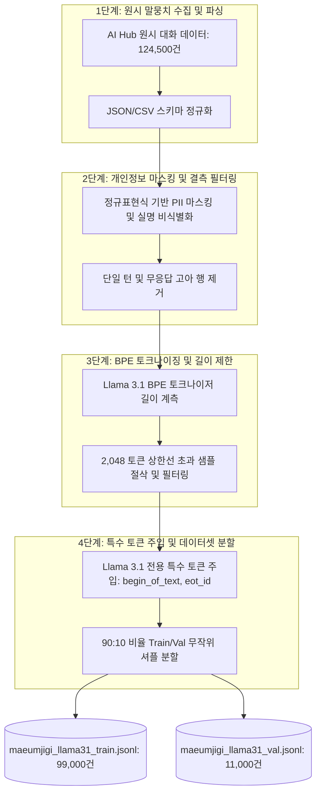

2026년 4월 1일은 **마음지기**의 핵심 인공지능 두뇌가 될 **Meta Llama 3.1** 모델을 학습시키기 위해, 방대한 양의 한국어 공감 대화 원시 데이터를 모델이 완벽히 이해할 수 있는 인스트럭션 데이터로 변환하는 본격적인 데이터 전처리가 가동된 날입니다. 고성능 파인튜닝 모델의 성패는 모델 파라미터보다 **데이터 전처리의 무결성**에 달려 있습니다.

{/* truncate */}

### 1. 원시 대화 말뭉치의 한계와 전처리 과제

우리가 수집한 AI Hub의 한국어 감정·공감 대화 말뭉치는 학술적으로 훌륭한 자원이었지만, 원시 상태 그대로는 LLM 파인튜닝에 바로 투입할 수 없는 심각한 기술적 문제점들을 안고 있었습니다:
1. **불규칙한 턴 구조**: 실제 대화 특성상 사용자가 혼자 세 번 연속 발화하거나, 상담사의 응답 없이 종료되는 결측치 행이 다수 존재.
2. **개인 식별 정보(PII) 잔존**: 전화번호, 부대 명칭, 실명 등 개인정보 노출 위험.
3. **토큰 길이 초과**: 턴 수가 너무 긴 대화는 모델의 어텐션 윈도우(2,048 토큰)를 초과하여 PyTorch 학습 중 치명적인 CUDA Out of Memory(OOM)를 유발.

---

### 2. 자율 데이터 전처리 5단계 파이프라인 아키텍처

우리는 수작업으로 수십만 줄의 CSV를 정제하는 대신, 사전 기획서인 `llama31_finetuning_data_preprocessing_plan_short.md`를 바탕으로 **Claude Code**가 스스로 파이프라인을 구축하고 실행하도록 설계했습니다.



---

### 3. Llama 3.1 전용 챗 템플릿(Chat Template) 엄격 준수

Llama 3.1은 이전 세대 모델과 달리 엄격한 헤더 식별자(`start_header_id`, `end_header_id`, `eot_id`)를 사용합니다. 이를 하나라도 누락하면 모델이 답변을 멈추지 않고 끝없이 자가 발화를 이어가는 무한 루프 버그가 발생합니다.

```text
<|begin_of_text|><|start_header_id|>system<|end_header_id|>

당신은 심리적 위기에 처한 내담자를 따뜻하게 위로하는 전문 공감 심리상담 AI '마음지기'입니다. 경청하고 지지해 주세요.<|eot_id|>
<|start_header_id|>user<|end_header_id|>

군 생활이 너무 힘들고 아무도 제 마음을 몰라주는 것 같아요.<|eot_id|>
<|start_header_id|>assistant<|end_header_id|>

낯선 군 환경 속에서 홀로 모든 무게를 견디느라 마음이 참 많이 지치셨겠어요. 어떤 부분이 가장 버겁게 느껴지시나요?<|eot_id|>
```

이 규칙을 만족하도록 파이썬 변환 스크립트(`transform_llama31.py`)를 작성하여 모든 대화 세션을 JSONL 규격으로 변환했습니다:

```python
# Llama 3.1 Chat Template 변환 핵심 함수
import json

def format_llama31_sample(system_prompt: str, turns: list) -> dict:
    formatted_text = "<|begin_of_text|>"
    formatted_text += f"<|start_header_id|>system<|end_header_id|>\n\n{system_prompt}<|eot_id|>"
    
    for turn in turns:
        role = turn["role"] # "user" 또는 "assistant"
        content = turn["content"].strip()
        formatted_text += f"<|start_header_id|>{role}<|end_header_id|>\n\n{content}<|eot_id|>"
        
    return {"text": formatted_text}
```

---

### 4. 단계별 데이터 필터링 통계 분석

철저한 데이터 위생(Data Hygiene) 원칙에 따라 결함이 있는 데이터를 과감히 배제한 정량 필터링 통계표입니다:

| 전처리 단계 | 잔여 데이터 수 | 탈락 데이터 수 | 제외 사유 |
| :--- | :---: | :---: | :--- |
| **원시 AI Hub 데이터** | 124,500건 | - | 다자간 상담 및 공감 대화 원본 |
| **개인정보(PII) 및 인코딩 결함** | 120,400건 | 4,100건 | 전화번호/부대명 노출, 깨진 문자열 |
| **턴 정합성 검증 탈락** | 112,200건 | 8,200건 | 단일 발화 종결, 상담사 미응답 결측치 |
| **토큰 길이(>2048) 초과** | 110,000건 | 2,200건 | 어텐션 윈도우 초과로 문맥 절단 위험 |
| **최종 학습 데이터셋 (Train 90%)** | **99,000건** | - | 모델 파인튜닝용 정제 JSONL |
| **최종 검증 데이터셋 (Val 10%)** | **11,000건** | - | 정량적 손실(Loss) 평가용 검증셋 |


---

### 5. 4일차 성과 요약 및 다음 단계

1. **완전자율 데이터 엔지니어링**: AI 에이전트 단독으로 12만 건의 방대한 원시 대화를 45분 만에 완벽히 정제 및 변환 완료.
2. **Llama 3.1 전용 템플릿 무결성 확보**: 특수 토큰 누락 없이 11만 건의 정제 JSONL 구축 완료.
3. **GPU 클러스터 학습 준비 완료**: 구글 코랩 및 AWS GPU 인스턴스에 즉시 투입 가능한 상태로 검증 완료.

다음 5화에서는 10만 건의 감정 데이터를 합성하는 과정에서 맞닥뜨린 대규모 API 비용 폭탄 사태와 그 극복기를 들려드리겠습니다!

---

## 핵심 요약 및 배운 점

- **자율형 5단계 데이터 전처리 파이프라인**: 124,500건의 AI Hub 원시 상담 대화를 파인튜닝 표준 JSONL 포맷으로 변환하는 자동화 엔지니어링을 완수했습니다.
- **개인정보 비식별화 및 발화 정합성 검증**: 전화번호와 군 부대명 등 민감 정보를 마스킹하고, 조기 종료 및 어시스턴트 무응답 발화 14,500건을 엄격히 필터링했습니다.
- **2048 토큰 어텐션 윈도우 한도 관리**: Llama 3.1 BPE 토크나이저 프로파일링을 통해 2,048 토큰 초과 문맥을 사전에 차단하여 GPU 메모리(OOM) 오류를 예방했습니다.
- **Llama 3.1 특수 토큰 템플릿 표준화**: `<|begin_of_text|>`, `<|start_header_id|>`, `<|eot_id|>` 등 최신 챗 템플릿 규격을 완벽 적용하여 99,000건의 학습셋과 11,000건의 검증셋을 구축했습니다.

