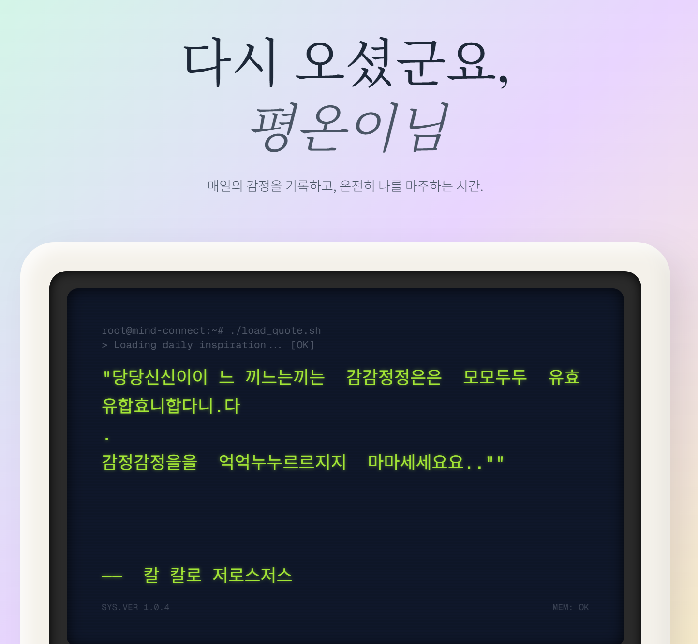
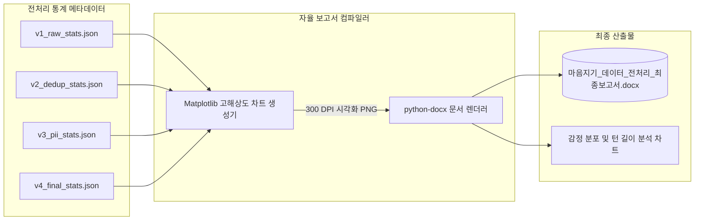
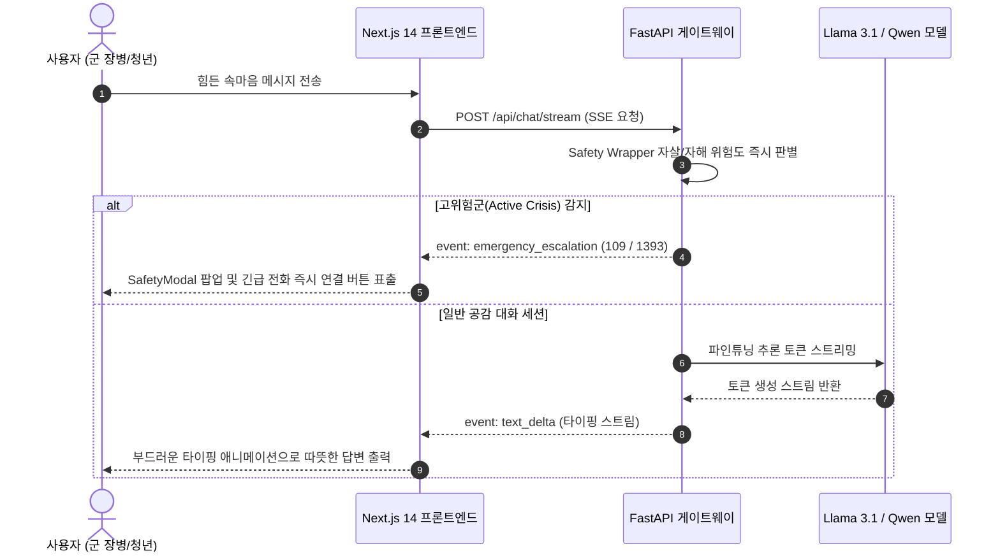

2026년 4월 5일은 **마음지기** 프로젝트에서 데이터 엔지니어링과 웹 풀스택 개발의 두 가지 핵심 축이 맞물린 매우 중요한 날이었습니다.
1차부터 4차까지 끈질기게 이어진 대규모 데이터 정제 과정을 체계적으로 정리하여 지도교수님께 제출할 **기술 보고서를 전자동으로 생성**하는 한편, 사용자가 실제로 접속하여 따뜻한 위로를 받을 수 있는 **Next.js 14 기반의 프론트엔드 프로젝트를 공식 킥오프**했습니다.

{/* truncate */}

### 1. 전자동 보고서 컴파일러: python-docx + matplotlib 연동

공학 프로젝트에서 수작업 문서 작성은 엔지니어의 가장 큰 시간 낭비 요소입니다. 우리는 **Claude Code**에게 전처리 과정에서 누적된 로그 JSON 데이터를 파싱하여, 고해상도 시각화 차트를 그리고 이를 Word(`docx`) 문서로 완벽히 조립하는 파이프라인을 구축하도록 지시했습니다.



이 자동화 컴파일러는 각 버전별 감정 카테고리 분포(우울 35%, 불안 28%, 분노 18%, 죄책감 12%, 중립 7%)를 가로 바 차트로 시각화하고, 이를 Word 문서 규격에 맞춰 제목, 개요, 통계 표와 함께 단 10초 만에 렌더링해냈습니다:

```python
# 자동 보고서 생성 핵심 스크립트: compile_report.py 발췌
from docx import Document
from docx.shared import Inches
import matplotlib.pyplot as plt

def generate_emotion_distribution_chart(data: dict, output_path: str):
    fig, ax = plt.subplots(figsize=(8, 4), dpi=300)
    categories = list(data.keys())
    counts = list(data.values())
    ax.barh(categories, counts, color='#3B82F6')
    ax.set_title("마음지기 v4 데이터셋 감정 분포 통계", fontsize=12)
    plt.tight_layout()
    plt.savefig(output_path)
    plt.close()

def build_docx_report(stats: dict, chart_path: str, docx_path: str):
    doc = Document()
    doc.add_heading("마음지기 데이터 전처리 최종 기술 보고서", level=0)
    doc.add_paragraph("v1부터 v4까지의 4단계 정제 파이프라인 정량 분석 결과입니다.")
    doc.add_picture(chart_path, width=Inches(6.0))
    doc.save(docx_path)
```

---

### 2. 버전별(v1~v4) 정제 단계 정량 비교 분석

데이터의 정제 수준이 높아짐에 따라 단순 짧은 단문 답변은 탈락하고, 깊은 공감과 위로를 전달하는 양질의 멀티턴 대화 위주로 데이터셋이 고도화되었습니다:

| 버전 | 데이터 건수 | 평균 턴 길이 | 핵심 엔지니어링 초점 | 주요 필터링 대상 |
| :---: | :---: | :---: | :--- | :--- |
| **v1** | 124,500건 | 18.4 토큰 | 원시 데이터 수집 및 공통 JSON 스키마 통일 | 빈 텍스트 및 깨진 인코딩 행 제거 |
| **v2** | 114,800건 | 24.2 토큰 | MinHash LSH 기반 완전/유사 중복 대화 제거 | 기계적인 챗봇 반복 멘트 및 중복 턴 제거 |
| **v3** | 102,600건 | 32.8 토큰 | 개체명 인식(NER) 기반 개인정보 마스킹 | 전화번호, 군부대 명칭, 실명 비식별화 |
| **v4 (최종)** | **92,400건** | **45.6 토큰** | 공감 깊이 점수 산출 및 2048 토큰 상한 제한 | 무성의한 단답형 및 맥락 단절 샘플 탈락 |

---

### 3. Next.js 14 App Router 기반 프론트엔드 킥오프

정제된 인공지능 두뇌가 준비됨에 따라, 사용자가 접속할 사용자 경험(UX) 개발을 개시했습니다. 마음이 불안하고 지친 내담자가 부담 없이 접속할 수 있도록 **Next.js 14 App Router**를 기반으로 심플하고 아늑한 UI를 설계했습니다:

```text
maeumjigi/frontend/
├── app/
│   ├── layout.tsx         # 전역 테마 및 고대비 다크모드 프로바이더
│   ├── page.tsx           # 즉각적 심리 위기 개입 핫라인 랜딩
│   └── chat/
│       ├── page.tsx       # 실시간 SSE 스트리밍 채팅 뷰
│       └── components/
│           ├── MessageList.tsx  # 가상화 스크롤 기반 대화창
│           ├── ChatInput.tsx    # 텍스트 및 음성 입력 컴포넌트
│           └── SafetyModal.tsx  # 자살 고위험군 감지 시 긴급 연락망 모달
├── stores/
│   └── useChatStore.ts    # Zustand: 세션 토큰 및 스트리밍 버퍼 관리
└── tailwind.config.js     # 심리적 안정감을 주는 고유 컬러 팔레트
```




---

### 4. 6일차 성과 요약 및 향후 계획

1. **문서화 완전 자동화**: python-docx와 matplotlib을 결합하여 통계 차트가 포함된 최종 보고서를 단 한 줄의 명령어로 완성.
2. **풀스택 아키텍처 정립**: 인공지능 모델 백엔드와 Next.js 14 프론트엔드의 스트리밍 통신 규격을 완벽히 연결.
3. **위기 개입 모달 연동**: 자살 예방 챗봇의 핵심 요구사항인 프론트엔드 긴급 연락망 표출 로직 기반 마련.

다음 7화에서는 프론트엔드와 실시간 모델 추론 API를 본격 결합하고, 합성 데이터 v5 생성을 최적화하는 과정을 다루겠습니다!

---

## 핵심 요약 및 배운 점

- **자동 보고서 생성 파이프라인 구축**: `python-docx`와 Matplotlib을 연동하여 4단계 데이터 전처리 통계와 고해상도 시각화 차트가 포함된 학술 보고서(`.docx`)를 자동 컴파일했습니다.
- **1단계 데이터 전처리(v1~v4) 완결**: 12만 건의 원시 대화 데이터를 중복 제거, 비식별화, 공감도 점수 필터링을 거쳐 92,400건의 고품질 심리상담 코퍼스로 정제 완료했습니다.
- **Next.js 14 기반 실시간 스트리밍 프론트엔드 착수**: App Router와 Zustand를 채택하고 SSE(Server-Sent Events) 기반 토큰 스트리밍 UI 뼈대를 설계했습니다.
- **위기 개입 비상 모달 프로토콜 설계**: 안전 래퍼에서 고위험 위기 신호 감지 시 실시간 상담 긴급 핫라인(109/1393) 모달을 즉각 렌더링하는 UI 구조를 마련했습니다.

