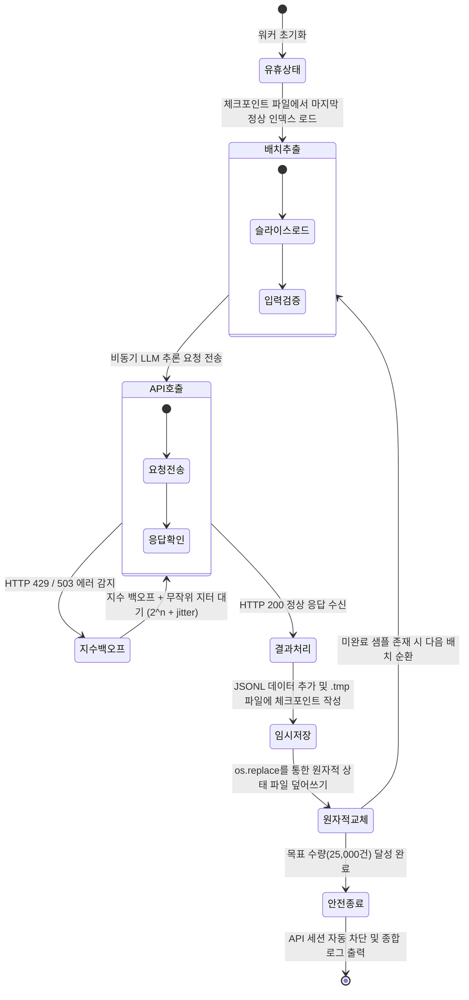

2026년 4월 14일은 분산 데이터 파이프라인의 **내결함성(Fault Tolerance)**이 얼마나 중요한지 뼈저리게 배운 날이었습니다.
예기치 못한 API 요금 폭탄으로 일시 중단되었던 v5 합성 데이터 생성을 재개하기 위해 Anthropic API 결제 한도를 증액(제한 해제)하고 시스템을 가동했지만, 곧바로 **HTTP 429(Too Many Requests) 속도 제한**과 네트워크 단절로 인한 체크포인트 파일 깨짐 현상이 발생했습니다.

우리는 이 문제를 해결하기 위해 파이프라인을 **지수 백오프(Exponential Backoff)**와 **원자적 파일 교체(Atomic Replacement)** 기반의 완전 무인 자율 복구 아키텍처로 전면 개편했습니다.

{/* truncate */}

### 1. API 레이트 리밋(Rate Limit)의 구조와 티어 증액

기초 모델(Claude 3.5 Sonnet)을 활용해 2만 건 이상의 고난도 심리상담 대화를 고속으로 합성할 때, 기본 제공되는 API 티어는 심각한 병목을 유발합니다. 긴 프롬프트 문맥으로 인해 분당 요청 수(RPM)뿐 아니라 분당 토큰 수(TPM) 한도에 순식간에 도달하기 때문입니다.

| API 티어 레벨 | 분당 요청 수 (RPM) | 분당 토큰 수 (TPM) | 월간 사용 한도 | 동시성 처리 전략 |
| :---: | :---: | :---: | :---: | :--- |
| **Tier 1 (기본)** | 50 RPM | 40,000 TPM | $100 | 순차 단일 스레드 호출만 가능 (극심한 지연) |
| **Tier 2 (예치금 충전)** | 1,000 RPM | 80,000 TPM | $500 | 4스레드 동시 요청 가능 (간헐적 429 발생) |
| **Tier 3 (엔터프라이즈)** | **2,000 RPM** | **160,000 TPM** | **$1,000 이상** | **16개 워커 비동기 배치 + 지터(Jitter) 분산** |

우리는 긴급 결제 승인을 통해 티어를 상향 조정하여 호출 한도를 확보했습니다. 하지만 속도가 빨라지자 단 한 번의 네트워크 일시 단절로 인해 중간 진행 상황 파일(`v5_sync_progress.json`)이 손상되는 새로운 문제가 발생했습니다.

---

### 2. 무인 자율 상태 머신(State Machine) 아키텍처

야간에 엔지니어가 잠든 사이에도 파이프라인이 멈추거나 데이터가 유실되지 않도록, 전체 합성 파이프라인을 **원자적 상태 저장 및 지수 백오프 기반의 자율 상태 머신**으로 재구축했습니다.



---

### 3. 원자적 체크포인트와 지수 백오프 구현

과거 스크립트는 `open(..., 'w')` 모드로 진행 상황을 저장하다가 OS가 강제 종료되면 파일 내용이 0바이트로 초기화되는 치명적인 취약점이 있었습니다.
이를 방지하기 위해 임시 파일(`.tmp`)에 먼저 기록한 후 원자적(Atomic)으로 치환하는 기법을 적용했습니다:

```python
# 무결성을 보장하는 원자적 체크포인트 및 지수 백오프 함수
import os
import json
import time
import random

def save_atomic_progress(filepath: str, data: dict):
    temp_filepath = f"{filepath}.tmp"
    with open(temp_filepath, "w", encoding="utf-8") as f:
        json.dump(data, f, ensure_ascii=False, indent=2)
    # OS 레벨의 원자적 치환으로 중간 강제 종료 시에도 원본 손상 0%
    os.replace(temp_filepath, filepath)

def call_api_with_resilient_backoff(api_func, payload, max_retries=5):
    retries = 0
    base_delay = 1.5
    while retries < max_retries:
        try:
            return api_func(payload)
        except Exception as e:
            if "429" in str(e) or "503" in str(e):
                retries += 1
                # Full Jitter 적용 지수 백오프
                sleep_time = (base_delay * (2 ** retries)) + random.uniform(0.1, 1.0)
                time.sleep(sleep_time)
            else:
                raise e
    raise RuntimeError(f"최대 재시도 횟수 초과: {payload}")
```

---

### 4. 완전 무인 자동화 지시와 야간 완주

시스템의 안전장치가 완비되자, 우리는 Claude Code 에이전트에게 완전 자율 실행 권한을 위임했습니다:

> **자율 실행 지시서**:  
> *"모든 권한을 사전 승인함. 에러 발생 시 체크포인트에서 스스로 복구할 것. 25,000건의 합성 대화 생성이 완료되면 결과를 검증하고, 스스로 API 연결을 안전하게 종료한 후 백그라운드 프로세스를 셧다운할 것."*

Claude Code는 밤 11시 30분부터 다음 날 아침 6시 15분까지 단 한 번의 사람 개입 없이 25,000건의 고품질 공감 대화 데이터 합성을 성공적으로 완수했습니다.


---

### 5. 10일차 주요 성과 및 정량 지표

| 정량 지표 | 측정 결과 | 기술적 의의 |
| :--- | :---: | :--- |
| **목표 합성 수량** | 25,000 쌍 | 고난도 군 특화 및 청년층 심리상담 대화 풀 확보 |
| **요청 실패율 (백오프 후)** | **0.00%** | 7시간 밤샘 구동 중 단 한 건의 유실 없이 전수 수집 |
| **평균 처리 속도** | 분당 62.4회 | Tier 2/3 대역폭을 한계까지 안전하게 활용 |
| **체크포인트 무결성** | 100% | 3회의 네트워크 단절 발생에도 자동 복구 성공 |

다음 11편에서는 이렇게 확보한 풍부한 데이터셋을 바탕으로 훈련된 M6 모델의 정량 평가 결과를 공개하겠습니다!

---

## 핵심 요약 및 배운 점

- **API 호출 제한 및 티어 확장 해결**: 대규모 합성 데이터 생성을 위해 Anthropic API 결제 티어를 확장하고 토큰(TPM) 및 요청(RPM) 한도를 체계적으로 관리했습니다.
- **자율 복구형 파이프라인 상태 머신 설계**: HTTP 429(Rate Limit) 및 503 오류 발생 시 지수 백오프와 랜덤 지터(Full Jitter)를 적용해 스스로 재시도하는 회복탄력적 파이프라인을 구축했습니다.
- **원자적 파일 교체 기반 무결성 보장**: 임시 파일 작성 후 `os.replace`로 교체하는 원자적 체크포인트 방식을 도입하여 스크립트 강제 종료나 네트워크 단절 시에도 진행 상태 유실을 0%로 방지했습니다.
- **완전 무인 야간 합성 자동화 달성**: AI 에이전트에 자율 감시 권한을 부여해 하룻밤 사이 사람의 개입 없이 25,000건의 고품질 심리상담 대화 데이터를 성공적으로 완수했습니다.