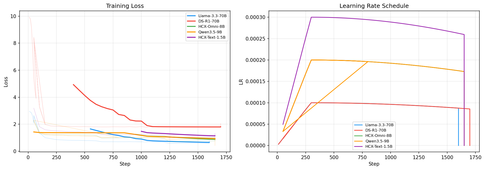
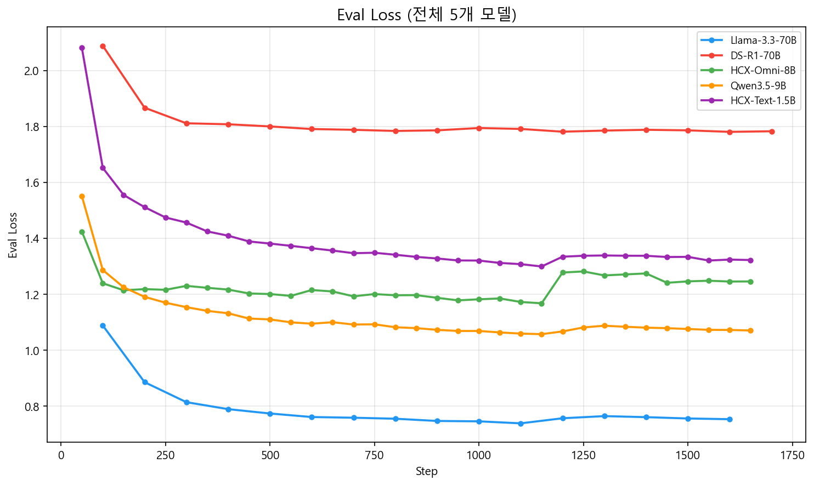

70B라는 거대한 모델의 파인튜닝 과정에서 발생한 OOM(메모리 부족) 지옥을 경험한 5월 4일, 저희는 과감한 전략 변경을 시도했습니다. 70B 모델(Llama3.3, DeepSeek-R1)은 배치 사이즈를 극단적으로 줄여 겨우 `checkpoint-1200`, `1300`까지 진행시켰지만, 학습 시간이 너무 오래 걸려 효율이 극악이었습니다.

{/* truncate */}

### 중소형 모델(1.5B ~ 9B)로 눈을 돌리다

물리적인 서버 자원과 캡스톤 프로젝트의 마감 기한을 고려했을 때, 70B에만 매달리는 것은 위험하다고 판단했습니다. 그래서 **HCX-Omni-8B, Qwen35-9B, HCX-Text-1.5B** 와 같은 상대적으로 가벼운 중소형 모델들로 파인튜닝 대상을 선회하여 실험을 시작했습니다.

> "현재 지정한 하이퍼파라미터로 HCX-Omni-8B, Qwen35-9B, HCX-Text-1p5B를 학습시키는데 시간이 오래 걸리는데, 보편적으로 모델별로 이러한 파라미터가 사용되는가?"
> "이 batch size 상향이 학습에 어떠한 영향을 미치나요?"

작은 모델이라고 해서 모든 것이 순조로운 것은 아니었습니다. 빠른 학습을 위해 배치 사이즈(Batch Size)를 상향 조정해 보고, 모델 크기에 맞는 하이퍼파라미터 최적화 값을 찾아 AI와 끝없는 토론을 이어갔습니다. 가장 작은 모델인 HCX-Text-1.5B의 학습 결과를 먼저 뽑아내어 성능 평가를 진행하며 튜닝의 방향성을 잡아나갔습니다.

### 체크포인트 저장 오류와 커널 버전 문제

HCX-Omni-8B 학습을 순조롭게 진행하던 중, 50 스텝에서 체크포인트를 저장하려다 또 다른 암초를 만났습니다.

```python
[RANK 0] Detected kernel version 5.4.0, which is below the recommended minimum of 5.5.0; this can cause the process to hang.
...


JSONDecodeError Traceback (most recent call last)
---> 60 trainer.train(resume_from_checkpoint=...)
```

운영체제의 커널 버전이 낮아 프로세스가 멈출 수 있다는 경고와 함께, 저장된 체크포인트의 JSON 파일이 깨져서(`JSONDecodeError`) 학습을 재개하지 못하는 끔찍한 에러였습니다. 

> "현재 모델들이 학습 중 중단되면 중단된 부분에서 다시 학습을 시작하나요?"

다행히 허깅페이스 `Trainer`는 체크포인트부터 이어서 학습(`resume_from_checkpoint`)하는 기능을 제공하지만, 그 체크포인트 파일 자체가 손상되면 말짱 도루묵이 됩니다. 모델 크기를 줄였음에도 여전히 프레임워크와 인프라 단에서 발생하는 수많은 에러들과 씨름하며 하루를 꼬박 보냈습니다. 과연 안정적인 학습 궤도에 오를 수 있을까요?

---

## 핵심 요약 및 배운 점

- **70B 초거대 모델 한계와 중형 모델 피벗**: 70B 모델의 극심한 학습 지연과 OOM 한계를 인정하고, HCX-Omni-8B, Qwen 3.5-9B, HCX-Text-1.5B 등 중형 모델 중심으로 과감히 전략을 전환했습니다.
- **중형 모델 배치 사이즈 및 하이퍼파라미터 최적화**: 모델 경량화에 맞춰 배치 사이즈를 상향 조정하고 학습률 스케줄을 재설계하여 GPU 연산 효율을 극대화했습니다.
- **체크포인트 직렬화 에러 규명**: 스텝 저장 도중 파일이 깨져 발생한 `JSONDecodeError`와 OS 커널 5.4.0 버전 호환 경고의 상관관계를 분석하고 복구 전략을 수립했습니다.
- **학습 인프라 복원력 확보**: 예기치 않은 서버 중단 시에도 안전하게 학습을 재개할 수 있도록 원자적(Atomic) 체크포인트 저장 및 무결성 검증 체계를 강화했습니다.