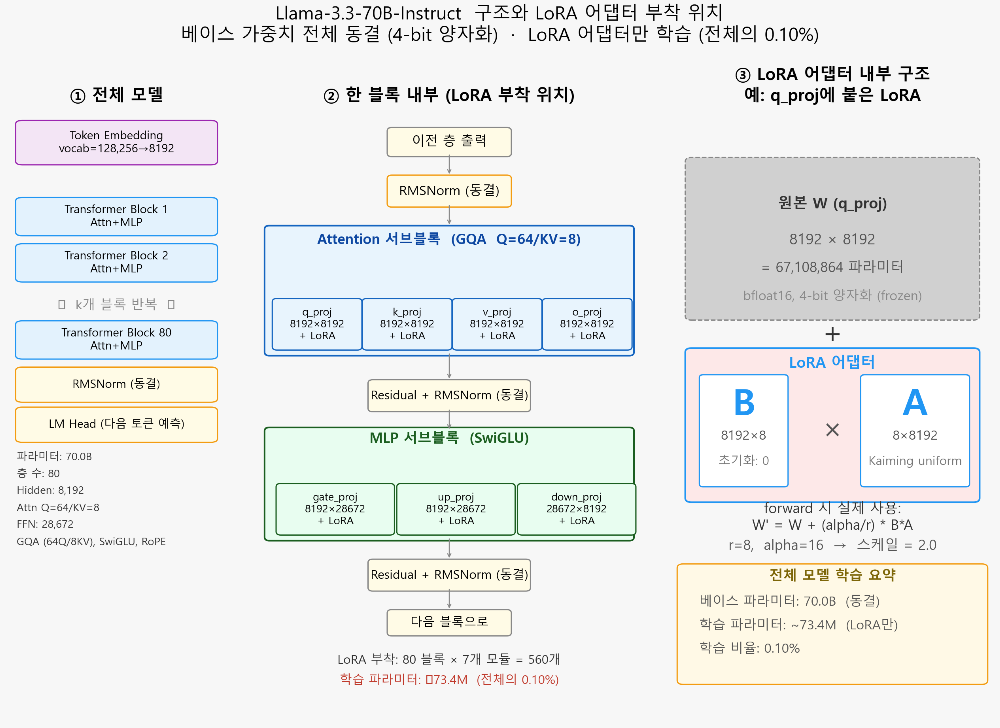

LoRA 하이퍼파라미터 실수(alpha/rank 설정 오류)를 바로잡기 위해 야심 차게 시작했던 2차 파인튜닝(`fine_tuning_2`) 병렬 학습이 5월 12일 마침내 끝이 났습니다!

{/* truncate */}

### Best Checkpoint 추출과 추론 파이프라인 구축

3개 모델에 대해 6가지 하이퍼파라미터 조합으로 돌렸던 파인튜닝이 모두 완료되었습니다. 곧바로 `eval_loss`를 비교하여 가장 성능이 좋은 최고(Best)의 체크포인트를 뽑아내 모델별 `adapter` 폴더로 옮기는 작업을 진행했습니다.

또한, 서버에서 백그라운드로 추론(Eval)과 결과 비교(Comparison)를 한 번에 끝낼 수 있도록 `run_test_20_30.sh` 스크립트를 새롭게 구성했습니다.

> "현재 HCX-Text-1p5B 모델들이 15분 동안 12개 생성했습니다. GPU Util은 각 그래픽 카드 당 1.6GB..."

그러나 추론 속도는 여전히 절망적이었습니다. 가장 가벼운 1.5B 모델조차 1분에 채 1개의 답변도 만들어내지 못하고 있었습니다. VRAM 사용량은 1.6GB밖에 안 되는데, Batch Size가 1로 잡혀 있어 병목 현상이 발생한 것입니다. 여기에 서버 용량 부족 문제까지 겹치면서, 프로젝트 기본 경로를 `~/home/`에서 `~/home/data/temporary/`로 급하게 이전하느라 모든 스크립트 경로를 수정하는 소동도 있었습니다.

### 하드코딩의 함정에 빠지다

그렇게 힘들게 평가 코드를 다 돌리고 난 후, 소름 돋는 사실을 발견했습니다.

> "왜 20_eval_ft_models.ipynb의 MODEL_ALIAS = 'Qwen35-9B_a16' 이렇게 하나의 모델로 하드코딩 되어 있나?"
> "그럼 서버에서 logs/.../20_eval_HCX-Text-1p5B_a8.ipynb에서도 MODEL_ALIAS = 'Qwen35-9B_a16'가 정의되어 있었는데, 파일명과 모델명이 다른 게 정상이라는 거지?"

그렇습니다. 평가 자동화 스크립트를 짜면서 실수로 `MODEL_ALIAS`를 하드코딩해버린 것입니다. HCX 모델을 테스트한다고 파일은 열심히 복사해서 돌렸지만, 정작 코드 내에서는 계속 `Qwen35-9B_a16` 모델만 주구장창 불러와서 똑같은 추론을 반복하고 있었던 셈입니다! 

파인튜닝은 과학이 아니라 꼼꼼함의 싸움이라는 것을 또 한 번 뼈저리게 느낀 하루였습니다. 하드코딩된 버그를 고치고 내일 다시 추론을 돌려야 할 것 같습니다.

---

## 핵심 요약 및 배운 점

- **2차 파인튜닝 체크포인트 추출**: 3개 베이스 모델과 6개 하이퍼파라미터 조합의 병렬 훈련을 완수하고, 검증 손실(eval_loss)이 가장 낮은 가중치를 `adapter`에 자동 배치했습니다.
- **추론 병목 현상 규명**: 1.5B 소형 모델에서도 분당 1건 미만의 저조한 추론 속도가 발생한 원인이 배치 사이즈 1 설정과 GPU VRAM 활용 저하(1.6GB)에 있음을 확인했습니다.
- **평가 자동화 하드코딩 버그 발견**: 노트북 스크립트 내 `MODEL_ALIAS`가 `Qwen35-9B_a16`으로 고정되어 있어 타 모델 평가 시에도 동일 모델이 중복 로드되던 치명적 결함을 적발했습니다.
- **LLM 파이프라인 무결성 교훈**: 다중 모델 벤치마크 환경에서는 파일명뿐만 아니라 런타임 변수 주입과 어설션(Assertion) 검증을 자동화해야 한다는 교훈을 얻었습니다.