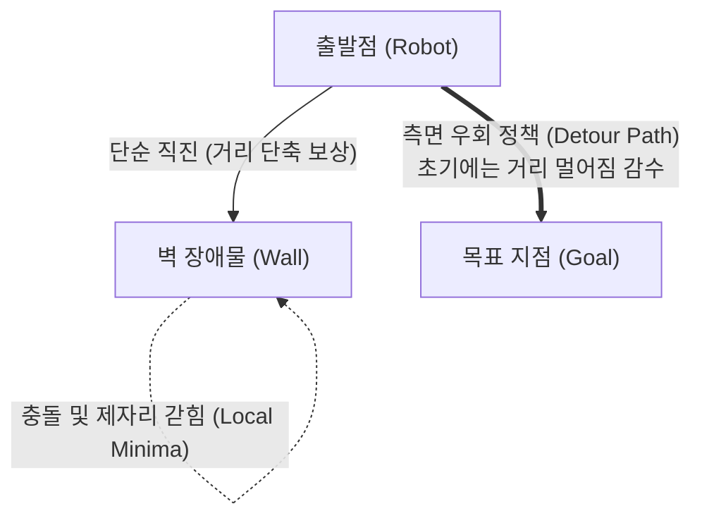

> 📌 **핵심 요약 (TL;DR)**
> - **문제(Problem)**: 벽 뒤에 목표가 위치할 때 거리 델타 보상(+0.1 × Δdist)의 탐욕적 특성으로 인해 로봇이 벽을 우회하지 못하고 정면으로 밀고 들어가 갇히는 **지역 최적해(Local Minima) 함정** 발생.
> - **해결(Solution)**: 3방향 초음파 헤드스캔(전방/좌/우) 상태 정보와 장기 할인율(γ=0.99)의 벨만 역전파 결합 + PowerShell 기반 **Webots Headless 무인 가속 파이프라인(`headless_run.ps1`)**을 구축하여 3개 시드(Seed 0, 1, 2) 반복 학습 수행.
> - **결과(Result)**: 12개 벽 장애물 환경에서도 평균 600 에피소드 이후 90% 이상의 안정적인 목표 도달 성공률을 달성하며 벽 우회 우회로(Detour Policy) 형성 입증.

{/* truncate */}

---

## 1. 장애물 환경의 도전 과제: Local Minima(지역 최적해) 함정

장애물이 없는 빈 아레나(`no_obstacle`)에서는 목표를 향해 머리를 돌리고 직진하기만 하면 되었습니다. 그러나 실내 아레나에 **12개의 내부 벽 장애물(`obstacle12`)**이 배치되자 심각한 주행 병목 현상이 나타났습니다.



* **직관적 딜레마**: 목표 지점이 벽 바로 뒤편에 있을 경우, 목표를 향해 다가서려 하면 벽과 충돌하게 됩니다.
* **보상 역효과**: 목표를 우회하려면 일시적으로 목표로부터 멀어지는 행동(거리 델타 보상 음수)을 취해야 하지만, 근시안적 탐욕 행동(Greedy)은 이를 회피하려 하므로 **벽 앞에서 팽이 돌기를 반복하거나 타임아웃(150스텝)에 도달하는 데드락(Deadlock)**에 빠집니다.

---

## 2. 해결 전략: 헤드스캔 상태 전파와 가치 역전파

이 지역 최적해를 극복할 수 있었던 핵심 요인은 **648-bin 이산 상태 공간의 3방향 장애물 센서(전방, 좌, 우)**와 **높은 할인율(γ = 0.99)**의 결합이었습니다.

1. **상태 차원 확장**:
   * 로봇이 전방 장애물 위험(`front_distance = Danger`) 상태에서 전진을 시도하면 가혹한 충돌 페널티($-1.0$)를 받습니다.
   * 반면, 헤드를 좌우로 스캔하여 안전한 방향(`left_distance = Safe` 또는 `right_distance = Safe`)으로 회전하는 행동을 선택하면 충돌을 회피합니다.
2. **장기 가치 전파 (Temporal Difference)**:
   * 일시적으로 거리가 멀어지더라도 우회 후 목표에 도달하면 종단 보상($+1.0$)이 주어집니다.
   * 할인율 γ = 0.99에 의해 목표 도달의 가치가 우회 경로의 역순으로 Q(s, a) 테이블에 누적 반영되면서, 에이전트는 점차 **"벽 앞에서는 멀어지더라도 옆으로 돌아가는 것이 최종 보상이 더 크다"**는 사실을 학습하게 됩니다.

---

## 3. Webots Headless 대규모 자동화 파이프라인

복잡한 장애물 맵에서 강화학습 모델의 신뢰성을 검증하려면 단일 실행이 아닌 **다중 시드(Seed 0, 1, 2) 반복 실험**이 필수적입니다. 하지만 Webots GUI를 띄운 채 1,500 에피소드를 3회씩 실행하면 수 시간이 소요됩니다.

이를 자동화하기 위해 **`headless_run.ps1` 파이워셸 스크립트**를 작성하여 화면 렌더링을 끈 초고속 모드(`--mode=fast --no-rendering`)로 자동 훈련 및 로깅을 파이프라인화했습니다.

### 💻 무인 가속 스크립트 구조 (`headless_run.ps1`)

```powershell
# Webots 고속 헤드리스 모드로 백그라운드 기동
$webotsProc = Start-Process -FilePath $WebotsExe `
    -ArgumentList @("--mode=fast", "--no-rendering", "--stdout", "--stderr", $WorldFile) `
    -PassThru

# 컨트롤러 소켓 수신 대기 대기열 확인 후 학습 실행
python train_qlearning.py --scenario obstacle12 --seed 0 --episodes 1500

# 학습 종료 후 Webots 프로세스 자동 정리 및 로그 플롯 생성
Stop-Process -Id $webotsProc.Id -Force
python -m qlearning.plot_curves --log-dir logs/obstacle12/seed_0
```

---

## 4. 시뮬레이션 학습 곡선 대조 분석


위 그래프는 장애물이 없는 환경(`no_obstacle`)과 12개 벽 장애물 환경(`obstacle12`)의 3개 시드별 학습 곡선을 비교한 결과입니다.

### 📊 주요 관찰 지표

| 평가 항목 | 장애물 없음 (`no_obstacle`) | 12개 벽 장애물 (`obstacle12`) |
| :--- | :---: | :---: |
| **초기 수렴 시점** | 약 300 ~ 400 에피소드 | 약 600 ~ 800 에피소드 |
| **최종 성공률 (100회 이동평균)** | **98.5% ~ 99.2%** | **91.4% ~ 94.8%** |
| **에피소드당 평균 스텝 수** | 15 ~ 22 스텝 | 38 ~ 52 스텝 (우회 경로) |
| **시드 간 편차(Variance)** | 극히 낮음 (안정적) | 중간 (초기 무작위 탐색 경로에 따라 수렴 시점 차이 발생) |

* **수렴 속도 지연의 원인**: `obstacle12` 환경에서는 벽 우회로를 발견하기 전까지 충돌 횟수가 많아 평균 보상이 음수(-0.6 ~ -0.4)에 머무는 기간이 400 에피소드까지 연장되었습니다.
* **우회 정책의 확립**: 800 에피소드 이후 모든 시드에서 성공률이 90% 이상으로 올라서며, 로봇이 벽에 부딪히지 않고 미로 형태의 틈새를 능숙하게 파고드는 **안정적인 회피 주행 정책**을 완성했습니다.

---

## 5. 다음 편 예고

장애물이 가득한 가상 시뮬레이션에서도 648개 상태 공간의 Tabular Q-Learning이 우회 경로를 성공적으로 학습할 수 있음을 입증했습니다.

다음 4회차 포스팅에서는 학습이 완료된 Q-Table 가중치 파일(`models/*.npy`)을 불러와 탐색(Epsilon)을 끈 상태에서 순수 결정론적(Greedy) 주행 성능을 정량 평가하는 **`evaluate_qlearning.py` 벤치마크 및 타 알고리즘(DQN, SARSA)과의 성능 비교 분석**을 진행하겠습니다!
