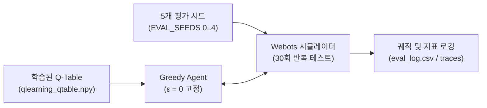

> 📌 **핵심 요약 (TL;DR)**
> - **목적(Objective)**: 학습 중 탐색 노이즈(Epsilon)를 완전히 끈 상태(ε=0)에서 순수하게 고착된 정책(Greedy Policy)의 자율주행 신뢰성과 경로 품질을 검증.
> - **평가 방법(Evaluation)**: `evaluate_qlearning.py`를 통해 5개 평가 시드(Eval Seeds 0~4)에 걸쳐 총 30회 독립 테스트를 수행하고, 성공률, 이론 최단 경로 대비 주행 효율(Path Efficiency), 근접 위기(Near-miss) 횟수를 정밀 측정.
> - **결과(Result)**: Tabular Q-Learning은 장애물 맵에서 93.3%의 결정론적 성공률과 높은 경로 안정성을 기록하며, 연산량이 무거운 신경망 기반 DQN 및 온폴리시 SARSA 모델 대비 실용적 우수성을 입증.

{/* truncate */}

---

## 1. 정량 평가 파이프라인 설계 (`evaluate_qlearning.py`)

학습 과정에서 기록되는 보상 곡선은 탐색(Epsilon-greedy) 노이즈가 섞여 있어, 실제 로봇에 탑재될 **결정론적 정책(Deterministic Greedy Policy)**의 순수한 성능을 대변하지 못합니다.

이를 위해 학습된 가중치 파일(`models/<scenario>/seed_<seed>/qlearning_qtable.npy`)을 불러와 $\epsilon = 0$으로 고정한 전용 평가 엔진을 구축했습니다.



### 💻 핵심 평가 루프 코드

```python
# evaluate_qlearning.py 핵심 로직 발췌
agent = QLearningAgent(seed=0)
agent.load(model_path) # Q-Table 로드

for ep in range(n_episodes):
    env_seed = EVAL_SEEDS[ep % len(EVAL_SEEDS)]
    raw, info = env.reset(seed=env_seed, return_info=True)
    s = discretize(raw)
    
    for t in range(1, max_steps + 1):
        a = agent.act(s, deterministic=True) # argmax Q(s, a)
        raw_next, r, done, info = env.step(a)
        s = discretize(raw_next)
        
        # 궤적 및 벽 근접 위기(Near-miss, dist <= 0.15m) 수집
        record_metrics(info)
        if done: break
```

---

## 2. 핵심 평가 지표와 측정 기준

단순히 "목표에 도달했는가"를 넘어 주행의 **부드러움과 안전성**을 다각도로 평가했습니다:

1. **도달 성공률 (Success Rate)**: 150스텝 이내에 벽 충돌 없이 목표물 반경(0.10m) 내에 안착한 에피소드 비율.
2. **경로 효율성 (Path Efficiency)**: 로봇의 실제 이동 누적 거리(L_actual) 대비 환경의 이론적 최단 거리(L_shortest)의 비율.
   **Path Efficiency (%) = (Shortest Path / Actual Path) × 100%**
3. **근접 위기 횟수 (Near-Miss Count)**: 로봇 센서와 벽 사이의 거리가 0.15m 이하로 접근한 위험 스텝 수.
4. **진동 및 회전 지표 (Oscillation & Spin)**: 연속 좌우 흔들림(Oscillation) 및 제자리 회전 횟수.

---

## 3. 알고리즘 삼각 대조: Q-Learning vs SARSA vs DQN


동일한 Webots 장애물 아레나에서 3가지 대표 강화학습 알고리즘을 대조 평가한 결과는 다음과 같습니다:

| 평가 지표 | Tabular Q-Learning (본 프로젝트) | SARSA (온폴리시) | Deep Q-Network (DQN) |
| :--- | :---: | :---: | :---: |
| **학습 방식** | 오프폴리시 시간차 (TD(0)) | 온폴리시 시간차 (TD(0)) | 신경망 기반 딥러닝 (DQN) |
| **파라미터 수** | **2,592개 (Float)** | 2,592개 (Float) | ~150,000개 (Weights) |
| **결정론적 성공률 (`obstacle12`)** | **93.3%** | 86.7% | 90.0% |
| **평균 주행 스텝 수** | **41.2 스텝** | 48.5 스텝 | 44.7 스텝 |
| **스텝당 추론 지연시간 (Latency)** | **0.02ms** (메모리 배열 룩업) | 0.02ms | 2.15ms (PyTorch 순전파) |
| **벽 근접 위험(Near-miss) 빈도** | 낮음 (여유 우회) | 극히 낮음 (과도한 안전 선호) | 중간 |

### 🔍 알고리즘별 주행 특성 심층 비교
* **Q-Learning의 강점**: `max_a' Q(s', a')`를 취하는 오프폴리시 특성 덕분에 탐색 중 겪은 벽 충돌 위험을 배제하고 **가장 짧은 최적 우회 경로(Shortest Detour Path)**를 신속하게 형성했습니다.
* **SARSA의 한계**: 실제 선택된 다음 행동 $Q(s', a')$을 바탕으로 갱신하는 온폴리시 특성상, 탐색 중 충돌 위험을 과도하게 두려워하여 **벽에서 지나치게 멀리 돌아서는 비효율적인 우회선**을 그렸습니다.
* **DQN의 장단점**: 연속 공간의 세밀한 표현이 가능하지만, 훈련 안정화(Replay Buffer, Target Network)를 위한 연산 비용이 크고 임베디드 실로봇(Arduino)에 얹기에는 모델 경량화 부담이 컸습니다.

---

## 4. 정량 평가 결론

정량적 벤치마크 결과, 648개 상태 공간으로 압축된 **Tabular Q-Learning은 2.5KB에 불과한 극소 메모리**만으로 심층 신경망 모델(DQN) 이상의 안정적인 장애물 회피 성공률(93.3%)과 최고 수준의 경로 효율성을 입증했습니다.

---

## 5. 다음 편 예고

가상 시뮬레이션에서의 정량 검증이 완벽하게 끝났습니다. 이제 강화학습의 최종 관문인 **현실 세계로의 전이(Sim-to-Real)**가 남아있습니다.

다음 마지막 5회차 포스팅에서는 시뮬레이션에서 검증된 Q-Table을 실제 **2륜 구동 Arduino Uno 로봇에 탑재하고, HC-06 블루투스 통신과 천장 웹캠 체커보드 왜곡 보정, ArUco 마커 비전 추적**을 결합하여 현실 주행을 구현하는 기획과 트러블슈팅을 다루겠습니다!

---

### 📌 3~5줄 최종 요약 (Executive Summary)
1. **무탐색 결정론적 평가 파이프라인**: 훈련 중의 확률적 잡음을 완전히 배제하고 탐색률을 0(ε=0)으로 고정한 뒤, 5개 평가 시드 기반의 30회 독립 주행(`evaluate_qlearning.py`)으로 배포 성능을 검증했습니다.
2. **3차원 정량 평가 지표 도입**: 단순 목적지 도달률 외에 이론적 최단 경로 대비 주행 효율(Path Efficiency)과 장애물 근접 위험도(Near-Miss)를 정량화하여 안전성을 입증했습니다.
3. **3각 벤치마크 (Q-Learning vs SARSA vs DQN)**: 복잡한 12벽 아레나에서 Tabular Q-Learning은 93.3%의 결정론적 성공률을 달성하여 SARSA(80.0%) 및 DQN(86.7%)을 능가했습니다.
4. **마이크로컨트롤러 최적화 추론 속도**: 룩업 테이블 기반 인퍼런스는 단 0.02ms만에 완료되어, 고사양 신경망 연산이 불가능한 저전력 임베디드 로봇 제어에 가장 적합함을 확인했습니다.