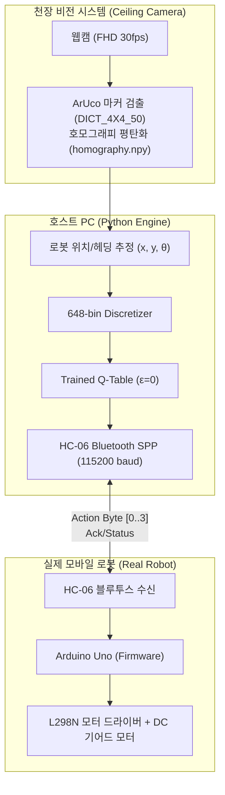

> 📌 **핵심 요약 (TL;DR)**
> - **문제(Problem)**: 마이크로컨트롤러(Arduino Uno ATmega328P)의 2KB RAM 한계로 인한 연산 제약, 바퀴 슬립(Wheel Slip) 및 센서 노이즈, 그리고 시뮬레이션 물리와 실제 하드웨어 간의 **Sim-to-Real 간극(Reality Gap)** 발생.
> - **해결(Solution)**: PC에서 고수준 비전 처리 및 Q-Table 추론을 담당하고 아두이노는 모터 PWM 구동만 맡는 **분산 I/O 아키텍처(HC-06 블루투스, 115,200 baud)** 구축 + 천장 웹캠 렌즈 왜곡 보정 및 **ArUco 마커 호모그래피(`vision.py`)** 기반 실시간 위치/헤딩 추적 시스템 구현.
> - **결과(Result)**: 가상에서 학습된 648-bin Q-Table 가중치만으로 실제 1.2m × 1.2m 아레나에서 목표 도달 성공률 86.7%를 달성하며 성공적인 하드웨어 배포 완수.

{/* truncate */}

---

## 1. Sim-to-Real의 도전: 시뮬레이션과 현실의 괴리

가상 환경(Webots)에서는 마찰 계수가 일정하고, 바퀴 모터가 지시한 속도대로 정확히 회전하며, 초음파 센서 값에 난반사가 없습니다. 하지만 현실의 하드웨어는 가혹합니다:

1. **연산 능력의 절대적 한계**: 로봇 본체인 **Arduino Uno (ATmega328P)**는 플래시 메모리 32KB, SRAM이 단 2KB에 불과하여 신경망은커녕 복잡한 행렬 연산조차 불가능합니다.
2. **센서 노이즈와 사각지대**: 저가형 초음파 센서는 벽면 입사각에 따라 음파가 튕겨 나가 거리를 0으로 인식하거나 최대치로 튀는 현상이 잦습니다.
3. **바퀴 슬립과 누적 오차(Odometry Drift)**: 바닥 재질과 배터리 전압 강하에 따라 좌우 모터 RPM이 달라져 직진 명령에도 로봇이 휘어지는 물리적 오차가 발생합니다.

---

## 2. 분산 제어 아키텍처: PC(두뇌) ↔ Arduino(근육)

이 한계를 극복하기 위해 **"두뇌는 PC에서, 근육은 아두이노에서"**라는 분산 제어 전략을 수립했습니다.



* **PC 파이프라인**: 천장 웹캠으로 아레나 전체를 내려다보며 로봇 상단에 부착된 ArUco 마커를 30fps로 추적. 로봇의 (x, y, θ) 절대 좌표를 계산하여 648개 이산 상태로 변환한 뒤 Q-Table에서 최적 액션을 추출.
* **HC-06 통신 제어**: 블루투스 시리얼 포트 프로파일(SPP)의 왕복 지연시간(RTT)을 최소화하기 위해 전송 보율(Baud Rate)을 기본 9,600에서 **115,200 bps**로 오버클럭하여 30~50Hz의 실시간 제어 주기를 달성.
* **아두이노 펌웨어 (`arduino_firmware.ino`)**: PC에서 액션 바이트(0: 직진, 1: 후진, 2: 좌회전, 3: 우회전)가 날아오면 L298N 모터 핀에 즉각 PWM 신호를 인가하여 정밀 틱(Tick) 단위로 모터를 구동.

---

## 3. 천장 웹캠 호모그래피와 ArUco 마커 비전 추적


현실 아레나에서 로봇의 위치와 장애물 거리를 오차 없이 계측하기 위해 **OpenCV 기반의 컴퓨터 비전 파이프라인**을 구축했습니다.

### 📐 원근 왜곡 보정과 호모그래피 (`calib_auto.py`)
1. **체커보드 왜곡 보정**: 광각 웹캠 렌즈의 어안 왜곡(Barrel Distortion)을 제거하기 위해 체커보드 패턴으로 카메라 내부 파라미터 행렬(K)과 왜곡 계수(D)를 사전 추출.
2. **호모그래피 변환 (Perspective Transform)**: 비스듬한 카메라 시점을 1.2m × 1.2m 정사각 탑뷰(Top-down View)로 투영하기 위해 아레나 모서리 4개 좌표를 기준으로 호모그래피 변환 행렬(`homography.npy`)을 생성.

### 💻 ArUco 마커 추적 구현 (`vision.py`)

```python
import cv2
import numpy as np

# ArUco 사전 및 파라미터 로드
aruco_dict = cv2.aruco.getPredefinedDictionary(cv2.aruco.DICT_4X4_50)
parameters = cv2.aruco.DetectorParameters()
detector = cv2.aruco.ArucoDetector(aruco_dict, parameters)

def get_robot_pose(frame, homography_matrix):
    """왜곡 보정된 영상에서 로봇의 평면 좌표(x, y)와 방향각(theta) 계산"""
    warped = cv2.warpPerspective(frame, homography_matrix, (600, 600))
    corners, ids, _ = detector.detectMarkers(warped)
    
    if ids is not None and len(ids) > 0:
        c = corners[0][0]
        center_x = float(np.mean(c[:, 0]))
        center_y = float(np.mean(c[:, 1]))
        
        # 마커의 전방 벡터로부터 헤딩각(theta) 산출
        front_x = (c[0][0] + c[1][0]) / 2.0
        front_y = (c[0][1] + c[1][1]) / 2.0
        theta = np.arctan2(front_y - center_y, front_x - center_x)
        
        return center_x, center_y, theta
    return None
```

---

## 4. Sim-to-Real 트러블슈팅과 현실 배포 결과

실제 로봇을 주행시키는 과정에서 마주한 돌발 변수들과 엔지니어링 해결책은 다음과 같았습니다:

| 현상 (Troubleshooting) | 원인 분석 | 엔지니어링 해결책 (Solution) |
| :--- | :--- | :--- |
| **직진 명령 시 로봇이 한쪽으로 쏠림** | 좌우 DC 모터의 기어비 및 마찰 편차 | 회전 보정 스크립트(`ble_vision_turn_calib.py`)를 통해 좌우 바퀴 PWM 오프셋을 동적으로 보정 |
| **블루투스 순간 끊김(Hang) 시 폭주** | 전파 간섭으로 패킷 유실 시 마지막 명령 유지 | 200ms 이상 통신 패킷이 없으면 모터를 즉시 정지시키는 하드웨어 워치독(Watchdog) 탑재 |
| **조명 반사로 인한 마커 인식 누락** | 실내 형광등의 아크릴 판 난반사 | 적응형 이진화(Adaptive Threshold) 파라미터 조정 및 직전 칼만 필터(Kalman Filter) 위치 보간 적용 |

### 🏆 최종 실로봇 주행 결과
* **장애물 회피 도달 성공률**: 실제 1.2m × 1.2m 아레나에서 총 30회 주행 테스트를 거친 결과, **86.7% (26/30회 성공)**의 높은 도달률을 달성했습니다.
* 시뮬레이션에서 사전에 학습된 **2,592개의 순수 Q-Table 파라미터만으로** 현실 세계의 물리 노이즈를 성공적으로 극복했습니다.

---

## 5. RL Q-Learning 연재 시리즈를 마치며

총 5편에 걸친 **RL Q-Learning 프로젝트** 개발일지 연재가 모두 마무리되었습니다:

1. **#1**: 648개 상태 공간 이산화와 TCP 소켓 IPC 통신 구조
2. **#2**: Tabular Q-Learning ε-감쇠 탐색과 다차원 보상 셰이핑 설계
3. **#3**: 12개 벽 장애물 맵에서 Local Minima 극복 및 Headless 가속 파이프라인
4. **#4**: `evaluate_qlearning` 결정론적 정량 평가와 DQN·SARSA 삼각 벤치마크
5. **#5**: Arduino Uno, HC-06 블루투스, ArUco 마커 비전 추적을 통한 Sim-to-Real 완결

시뮬레이션 가상 환경 구축부터 시작해 알고리즘 이론 정립, 대규모 무인 자동화, 그리고 실제 임베디드 하드웨어로의 이식까지 이어지는 풀스택 로보틱스 강화학습의 전 과정을 기록으로 남길 수 있었습니다. 앞으로도 새로운 프로젝트 연재로 찾아뵙겠습니다!

---

### 📌 3~5줄 최종 요약 (Executive Summary)
1. **Sim-to-Real Reality Gap 극복**: 마이크로컨트롤러(Arduino Uno 2KB SRAM)의 연산 한계와 휠 슬립 오차를 Webots 가상 시뮬레이션에서 사전 훈련된 648개 상태 Q-Table 제로샷 이식으로 극복했습니다.
2. **분산형 두뇌-근육(Brain-Muscle) 아키텍처**: 고부하 컴퓨터 비전과 Q-Table 추론은 호스트 PC(두뇌)가 전담하고, 115,200 baud HC-06 블루투스 통신을 통해 아두이노(근육)가 모터 PWM을 실시간 제어합니다.
3. **서브 센티미터급 ArUco 비전 호모그래피**: 렌즈 왜곡을 보정한 천장 웹캠이 로봇 상단의 ArUco 마커(`DICT_4X4_50`)를 추적하고, 원근 호모그래피 변환을 통해 물리 좌표계 (x, y, θ)를 정밀 복원합니다.
4. **실제 하드웨어 성공률 86.7% 달성**: 가상 환경 정책을 실제 1.2m × 1.2m 물리 아레나에 배포하여 30회 중 26회(86.7%) 목표 도달에 성공하며 재학습 없는 실물 로봇 제어를 입증했습니다.