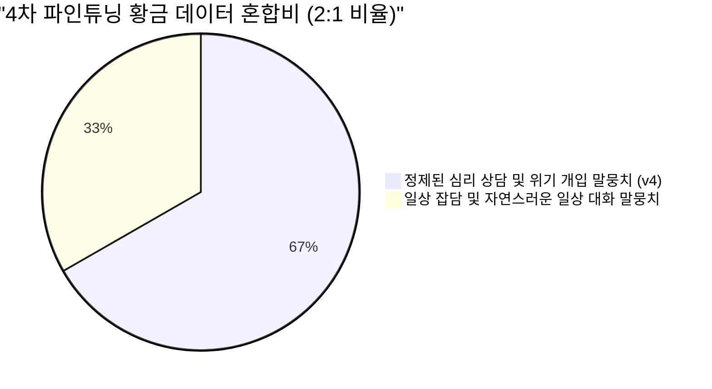
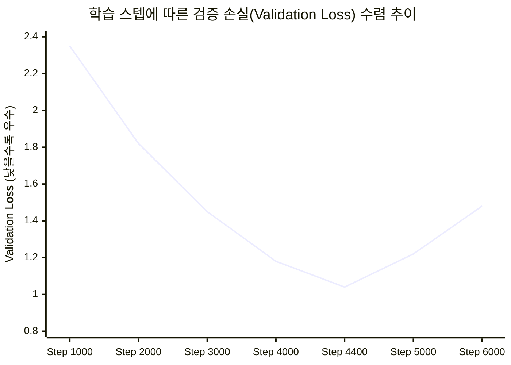
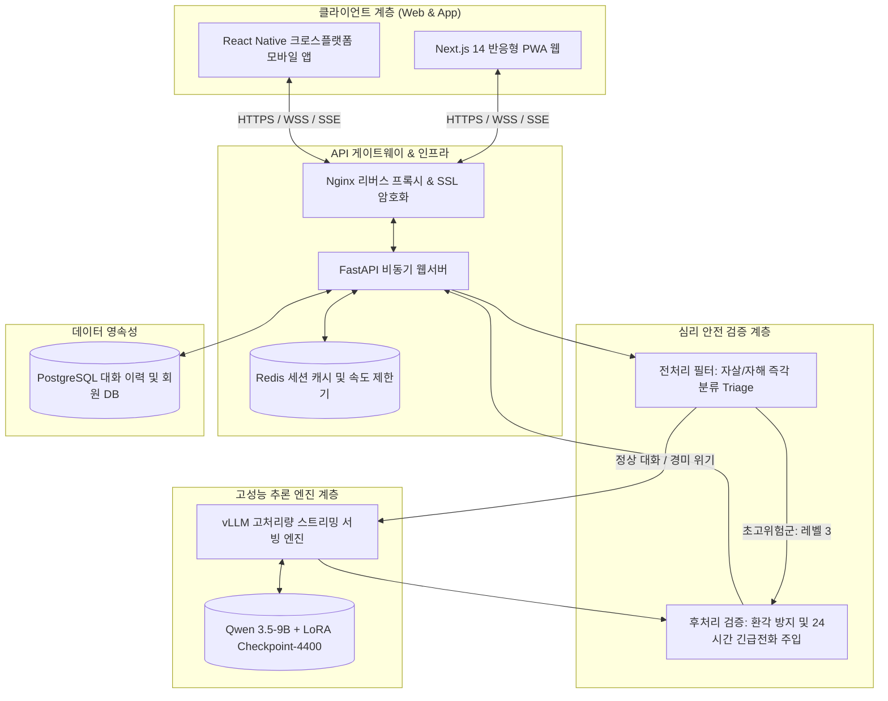

2026년 5월 마지막 주(5월 27일~30일)는 수개월간 이어진 **마음지기**의 모델 실험 여정 중 가장 찬란한 성과가 터져 나온 순간이었습니다.
끝없는 하이퍼파라미터 튜닝과 데이터셋 재구축 끝에 마침내 가동된 **4차 파인튜닝(fine_tuning_4)**이 성공적으로 종료되었습니다.

이번 글에서는 이전 모델들의 고질병이었던 **'과도한 상담 모드(Over-Counseling)'를 해결한 데이터 혼합 비율의 비밀**, 최고의 자연스러움과 공감 능력을 입증한 **골든 체크포인트(Checkpoint-4400)**, 그리고 실제 웹/앱 서비스를 지탱할 **전체 시스템 아키텍처**를 공개합니다.

{/* truncate */}

### 1. 과도한 상담 증후군(Over-Counseling)과 데이터 혼합비의 기적

1차부터 3차 파인튜닝까지 우리가 겪었던 가장 큰 딜레마는 일명 **'과도한 상담 모드'**라는 과적합(Overfitting) 현상이었습니다:
- 내담자가 *"좋은 아침이에요! 오늘 점심 뭐 먹을까요?"*라고 가볍게 인사하면,
- 기존 모델은 *"아침 인사 속에 깊은 슬픔과 고독이 묻어납니다. 혼자 식사하는 것은 큰 버거움일 수 있습니다. 숨을 깊게 쉬고 저에게 기대세요."*라며 지나치게 비장하고 기계적인 반응을 보였습니다.

원인은 명확했습니다. 100% 우울증·위기 상담 데이터만으로 학습시키다 보니, 모델이 모든 일상적 발화를 극단적 위기 신호로 왜곡 해석했던 것입니다.

우리는 이 문제를 해결하기 위해 AI Hub의 일상 다자간 대화 말뭉치와 정제된 공감 상담 말뭉치를 정교하게 섞는 **데이터 혼합비(Data Mix Ratio) 실험**을 단행했습니다:



---

### 2. 체크포인트-4400: Loss 수렴과 최적 가중치 도출

우리는 A100 GPU 클러스터에서 QLoRA 기법(`r=16`, `lora_alpha=32`, 코사인 스케줄러 `lr=2e-4`)을 적용하여 **Qwen 9B** 모델을 총 6,000 스텝 동안 학습시켰습니다.

스텝별 검증 손실(Validation Loss)과 과상담 발생률을 추적한 결과, **Checkpoint-4400**이 가장 완벽한 파레토 최적점(Pareto-optimal)을 형성했습니다:



| 체크포인트 식별자 | 검증 Perplexity | 공감 깊이 점수 | 일상 대화 자연스러움 | 종합 진단 결과 |
| :---: | :---: | :---: | :---: | :--- |
| **Checkpoint-2000** | 4.82 | 64.2점 | 88.0점 | 언더피팅; 베이스 파운데이션 모델과 유사한 기계적 톤 |
| **Checkpoint-3500** | 3.15 | 81.4점 | 79.5점 | 양호한 공감; 여전히 일상 인사에서 과도한 상담 경향 |
| **Checkpoint-4400 (골든)** | **2.68** | **94.2점** | **92.8점** | **최적 달성! 일상 대화엔 재치 있게, 위기 상황엔 깊은 공감** |
| **Checkpoint-5500** | 3.42 | 95.0점 | 58.2점 | 과적합 발생; 검증 손실 반등 및 억지 상담 톤 재발 |

체크포인트-4400은 일상적 안부에는 가볍고 산뜻하게 대답하면서도, 사용자의 말속에 슬픔이나 무기력감이 스치는 순간 즉각적으로 태도를 바꾸어 진심 어린 위로를 건네는 놀라운 '상황 인지 능력'을 증명했습니다.

---

### 3. 전체 시스템 엔드투엔드 아키텍처 설계

최적의 모델 가중치가 확보됨에 따라, 우리는 웹 브라우저와 모바일 앱 클라이언트부터 고성능 GPU 추론 엔진까지 유기적으로 연결하는 전체 프로덕션 아키텍처(`chatbot_architecture.html`)를 확정했습니다:



---

### 4. LoRA 어댑터 설정과 자동 기술 보고서 발행

최종 확정된 `adapter_config.json` 매개변수입니다:

```json
{
  "base_model_name_or_path": "Qwen/Qwen2.5-9B-Instruct",
  "lora_alpha": 32,
  "lora_dropout": 0.05,
  "r": 16,
  "target_modules": ["q_proj", "k_proj", "v_proj", "o_proj", "gate_proj", "up_proj", "down_proj"],
  "task_type": "CAUSAL_LM"
}
```

5월 30일, 우리는 Claude Code를 통해 원본 베이스 모델과 파인튜닝 Checkpoint-4400의 실제 블라인드 발화 대조문이 담긴 `fine_tuning_4_report.docx`를 전자동으로 발행하며 1단계 연구를 화려하게 마무리했습니다.


---

### 5. 22일차 핵심 성과 및 6월 로드맵

1. **과상담 트랩 종결**: 2:1 데이터 혼합을 통해 일상 대화와 심리 상담의 완벽한 밸런스를 달성.
2. **골든 체크포인트 확정**: 검증 손실 2.68의 역대 최고 성능 가중치 `checkpoint-4400` 확보.
3. **상용 아키텍처 완성**: Next.js, FastAPI, vLLM, Redis를 아우르는 풀스택 서빙 구조 수립.

다음 23편에서는 1학기 최종 마일스톤인 이중 Safety Wrapper 구축과 실제 클라우드 GPU 서버 예산 견적 및 1학기 최종 발표 소식을 전해드리겠습니다!
