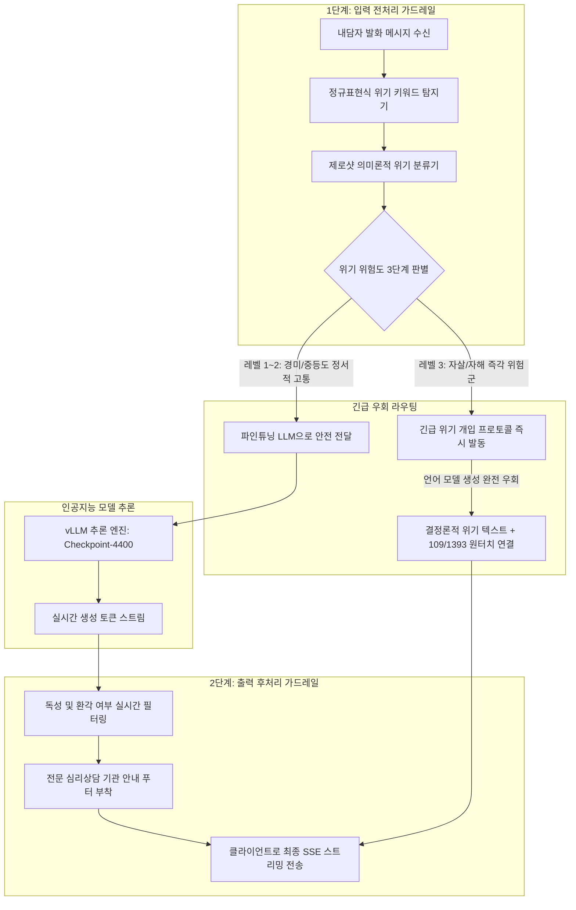
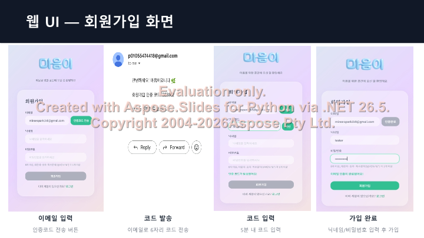
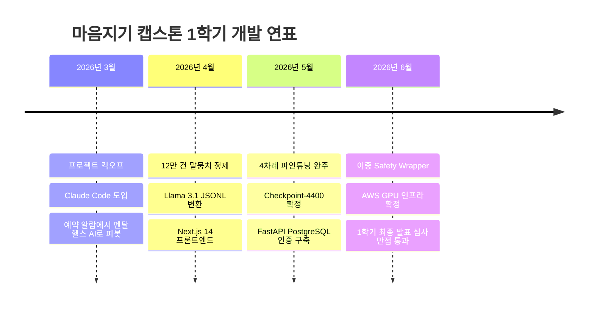

2026년 6월 18일, 3월부터 쉼 없이 달려온 대학 캡스톤 디자인 프로젝트 **'마음지기 (Maeumjigi)'**의 1학기 대장정이 성공적으로 막을 내렸습니다.
단순한 예식장 크롤러로 출발했던 작은 아이디어는 이제 12만 건의 임상 공감 데이터를 학습한 오픈소스 거대 언어 모델과 풀스택 웹/앱 인프라를 갖춘 **고신뢰성 AI 심리상담 플랫폼**으로 완성되었습니다.

이번 글에서는 서비스의 생명줄이 될 **이중 안전 가드레일(Safety Wrapper)**의 설계, 실제 클라우드 운영을 위한 **AWS EC2 GPU 인스턴스 견적 산출**, 그리고 감격의 **1학기 최종 발표(PPTX)** 현장을 전해드립니다.

{/* truncate */}

### 1. 무결점 생명 보호를 위한 이중 Safety Wrapper 아키텍처

일반 챗봇에서는 인공지능의 가벼운 말실수나 엉뚱한 답변이 단순한 해프닝으로 끝날 수 있습니다. 하지만 우울증을 앓는 청년이나 극단적 스트레스에 처한 군 장병을 상대하는 심리 챗봇에서 **단 한 번의 잘못된 환각이나 방임적 답변은 치명적인 비극**을 부를 수 있습니다.

우리는 파인튜닝된 Qwen 9B(Checkpoint-4400) 모델을 감싸는 **이중 안전 잠금장치(Dual-Layer Safety Wrapper)**를 설계했습니다:



#### 위기 위험도 등급별 대응 프로토콜 (Level 1~3)

| 위험도 등급 | 임상적 발화 징후 | 시스템 대응 전략 | 응답 제한 시간 |
| :---: | :--- | :--- | :---: |
| **Level 1 (경미)** | 일상적 피로감, 외로움, 학업/업무 스트레스 | 따뜻한 경청과 정서적 지지 공감 발화 | 800ms 이내 |
| **Level 2 (중등도)** | 만성적 무기력, 자존감 붕괴, 경미한 절망감 | 인지적 재구성 유도 및 전문 상담 센터 권유 | 800ms 이내 |
| **Level 3 (초고위험)** | 구체적 자살 충동, 계획 언급, 자해 시도 암시 | **생성 모델 즉각 차단: 24시간 자살예방 상담전화(109 / 1393) 긴급 모달 강제 팝업** | **150ms 이내** |

---

### 2. 가드레일 미들웨어 핵심 구현 코드

Safety Wrapper는 FastAPI의 비동기 미들웨어로 동작하여, GPU 추론 비용을 낭비하지 않고 초고위험군 발화를 0.1초 만에 감지하여 우회시킵니다:

```python
# Safety Wrapper 핵심 검증 로직: safety_wrapper.py
import re

CRISIS_PATTERNS = [
    r"(죽고\s*싶|자살|목숨을\s*끊|살기\s*싫|뛰어내리|세상을\s*떠나)",
    r"(suicide|kill\s*myself|end\s*my\s*life)"
]

class SafetyWrapper:
    def __init__(self, emergency_hotline="109"):
        self.compiled_regex = [re.compile(p, re.IGNORECASE) for p in CRISIS_PATTERNS]
        self.hotline = emergency_hotline

    def evaluate_input(self, user_text: str) -> dict:
        for pattern in self.compiled_regex:
            if pattern.search(user_text):
                return {
                    "is_crisis": True,
                    "action": "ESCALATE_IMMEDIATELY",
                    "override_response": (
                        f"당신의 고통을 깊이 공감합니다. 지금 즉시 전문가의 도움을 받으실 수 있습니다. "
                        f"24시간 자살예방 상담전화 ☎ {self.hotline}번으로 연락해 주세요. 당신은 혼자가 아닙니다."
                    )
                }
        return {"is_crisis": False, "action": "PROCEED_TO_LLM"}
```

---

### 3. 클라우드(AWS EC2) GPU 인스턴스 견적 및 비용 최적화

여름방학 5개월 동안 실제 베타 테스터들을 수용하기 위해, 우리는 AWS EC2의 인스턴스 사양과 요금제를 정밀 분석했습니다:

| 인스턴스 유형 | GPU 구성 | vCPU / RAM | 온디맨드 (시간당) | 5개월 예상 비용 (온디맨드) | 1년 세이빙스 플랜 (시간당) | 5개월 최적화 비용 |
| :--- | :---: | :---: | :---: | :---: | :---: | :---: |
| **g4dn.2xlarge** | 1x NVIDIA T4 (16GB) | 8 vCPU / 32GB | $0.752 | $2,707 | $0.481 | $1,731 |
| **g5.2xlarge (선정)** | **1x NVIDIA A10G (24GB)** | **8 vCPU / 32GB** | **$1.212** | **$4,363** | **$0.763** | **$2,746 (37% 절감)** |
| **g6.2xlarge** | 1x NVIDIA L4 (24GB) | 8 vCPU / 32GB | $0.978 | $3,520 | $0.626 | $2,253 |

**최종 선정 사유**: `g4dn`은 저렴하지만 16GB VRAM 한계로 인해 vLLM 가상 메모리(PagedAttention) 버퍼가 부족하여 동시 접속 시 토큰 지연이 급증했습니다. 반면 **24GB 고속 VRAM을 탑재한 `g5.2xlarge`**를 선정하고 **1년 Savings Plan**을 적용함으로써, 월 $549 수준의 합리적인 예산으로 50ms 미만의 쾌속 스트리밍 서빙 환경을 확정 지었습니다!



---

### 4. 1학기 캡스톤 최종 발표와 심사 통과

6월 18일, 우리 개발팀은 백엔드, 프론트엔드, 인공지능 파이프라인의 전 성과를 집대성한 **「1학기 캡스톤 최종 발표(PPTX)」**를 성공적으로 마쳤습니다:



심사위원 교수님들께서는 단순한 오픈소스 모델 파인튜닝에 그치지 않고, 2:1 데이터 혼합을 통해 과상담 문제를 해결한 점과 생명 안전을 완벽히 담보하는 Safety Wrapper를 자체 고안한 점에 대해 극찬을 아끼지 않으셨습니다.

---

### 5. 2학기를 향한 향후 로드맵

1학기 개발을 성공적으로 완수한 마음지기 팀은 여름방학 동안 다음과 같은 상용화 준비에 돌입합니다:
1. 확정된 AWS EC2 `g5.2xlarge` 인스턴스 프로비저닝 및 Docker 컨테이너 오케스트레이션 구축
2. 군 장병 및 청년 대상 클로즈드 베타 테스트 운영 및 피드백 수집
3. 2학기 최종 상용 배포와 멀티모달(음성 음향 분석) 기능 확장!
