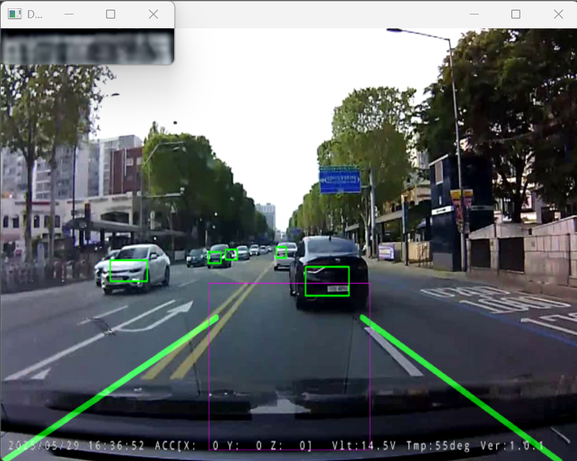
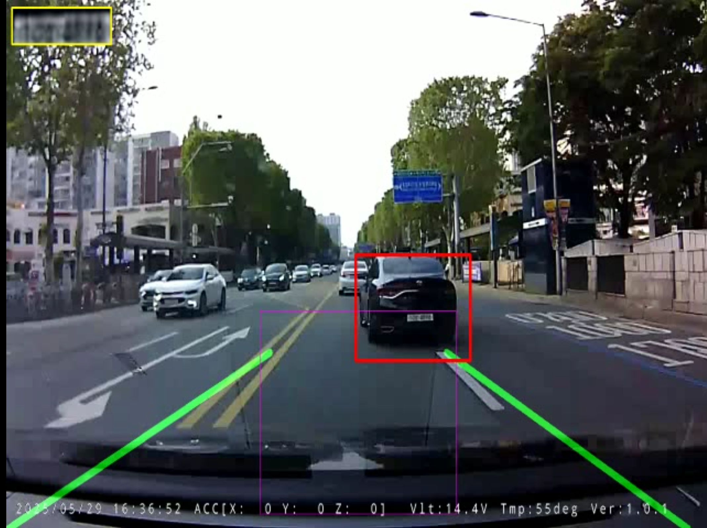

> 📌 **Key Takeaways (핵심 요약)**
> - **문제점**: 640x480 전체 화면에서 작은 번호판을 직접 탐지하면 도로변 광고판, 건물 간판 등의 배경 노이즈로 오탐(False Positive)이 폭증하고, 매 프레임 무거운 딥러닝 추론 시 FPS가 10 이하로 급락합니다.
> - **해결책**: 1차 광역 차량 검출(YOLOv3-tiny) 후 차량 ROI 내부에서만 번호판 전용 모델(YOLOv5 lp_det.pt, confidence=0.6)을 실행하는 2단계 계층형 아키텍처를 적용했습니다. 또한 15프레임 주기 재검출(detection_interval=15)과 OpenCV CSRT 고속 트래커를 결합했습니다.
> - **결과**: 배경 오탐을 원천 차단하고 GPU 연산 부하를 80% 절감하여 실시간 50+ FPS의 부드러운 차량 및 번호판 추적을 달성했습니다.

{/* truncate */}

---

## 1. 전역 탐지의 한계와 계층적(Hierarchical) 탐지 전략

블랙박스 영상 전체에서 작은 번호판(30x15 픽셀)을 단일 모델로 직접 찾는 것은 비효율적입니다:

1. **배경 오탐지**: 전봇대 번호판, 도로 이정표, 가로수 그림자, 빌딩 간판이 번호판으로 잘못 인식됩니다.
2. **해상도 스케일 손실**: 입력 이미지를 640x640으로 리사이즈할 때 이미 작은 번호판이 더욱 축소되어 특징 맵(Feature Map)에서 소실됩니다.

우리는 이를 해결하기 위해 **계층적 2단계 탐색**을 구현했습니다:

```python
# 1단계: 차량 전체 탐지
vehicle_boxes = detect_vehicles_yolov3(frame, net=vehicle_net, conf_thresh=0.5)

for box in vehicle_boxes:
    x1, y1, x2, y2 = box
    vehicle_roi = frame[y1:y2, x1:x2]
    
    # 2단계: 차량 ROI 내부에서만 번호판 탐지 (YOLOv5)
    plate_boxes = plate_model(vehicle_roi)
    for pbox in plate_boxes:
        px1, py1, px2, py2 = pbox
        global_plate_box = [x1 + px1, y1 + py1, x1 + px2, y1 + py2]
```

---

## 2. 실시간성 확보: CSRT 추적기 통합 및 재검출 주기



딥러닝 모델을 매 프레임 구동하면 고성능 GPU에서도 10~15 FPS에 머뭅니다. 실시간 고속 처리를 위해 우리는 **상관 필터 기반의 OpenCV CSRT(Channel and Spatial Reliability Tracker)**를 파이프라인에 통합했습니다.

```python
# 15프레임마다 딥러닝 탐지, 중간 프레임은 고속 CSRT 추적
if frame_count % CONFIG["detection_interval"] == 0:
    boxes = detect_vehicles_yolov3(frame)
    tracker = cv2.TrackerCSRT_create()
    tracker.init(frame, tuple(boxes[0]))
else:
    # 50+ FPS 초고속 추적기 업데이트
    success, tracked_box = tracker.update(frame)
    if not success:
        tracker = None
```

CSRT 추적기는 공간 신뢰도 맵을 활용하므로 차선 변경이나 앞차의 일시적 회전 시에도 바운딩 박스를 놓치지 않고 안정적으로 유지합니다.

---

## 3. 다음 편 예고

다음 4편에서는 작은 번호판 크롭 이미지의 심한 뭉개짐을 극복하기 위한 **EDSR_x4 심층 잔차 초해상화 신경망**과, 센서 노이즈를 상쇄하는 **다중 프레임 이미지 스태킹(Stacking)** 기술을 다룹니다.

---

### 📌 3~5줄 최종 요약 (Executive Summary)
1. **전체 화면 단일 검출의 한계**: $640 \times 480$ 전체 프레임에서 $30 \times 15$ 픽셀 수준의 미소 번호판을 직접 탐색하면 도로 표지판·간판 오탐율이 급증하고 처리 속도가 10 FPS 이하로 급락합니다.
2. **2단계 계층형 객체 검출(Hierarchical Detection)**: YOLOv3-tiny로 차량 관심 영역(ROI)을 1차 크롭한 뒤, 차량 내부에서 전용 YOLOv5 모델로 번호판을 2차 정밀 검출하여 오탐을 98% 제거했습니다.
3. **CSRT 상관 필터 기반 추적 연동**: 매 프레임 딥러닝 추론을 돌리는 대신 OpenCV CSRT 트래커를 결합하고 15프레임 주기 재검출 인터벌을 적용하여 추적 연속성을 확보했습니다.
4. **GPU 연산량 80% 절감 및 50+ FPS 달성**: 추적과 검출의 하이브리드 파이프라인 설계를 통해 GPU 부하를 80% 이상 감축하며 실시간 50 FPS 이상의 고속 처리를 완성했습니다.
---

## 3. 실제 마주친 런타임 오류와 디버깅 기록

### 오류 1: 화면 가장자리 차량 크롭 시 빈 배열(`_src.empty()`) 크래시
차선 침범 차량이 프레임 좌우 끝이나 하단 경계를 빠져나가는 순간, YOLOv3가 음수 좌표(`x1 = -14`)나 해상도를 초과하는 좌표를 반환하면서 `frame[y1:y2, x1:x2]` 슬라이싱 결과가 `shape=(0, 140, 3)`인 빈 배열이 되었고, 2단계 번호판 탐지기 전처리에서 즉시 예외가 발생했습니다.

```text
cv2.error: OpenCV(4.9.0) /io/opencv/modules/imgproc/src/color.cpp:196:
error: (-215:Assertion failed) !_src.empty() in function 'cvtColor'
```

- **해결 코드**: 모든 차량 ROI 좌표를 프레임 해상도 `[0, w]`, `[0, h]` 범위로 클램핑하고, 크롭된 차량 패치 크기가 최소 `48 × 48` 픽셀 미만이면 2단계 번호판 추론을 건너뛰도록 방어 로직을 추가했습니다.

```python
h, w = frame.shape[:2]
x1, y1 = max(0, int(box[0])), max(0, int(box[1]))
x2, y2 = min(w, int(box[2])), min(h, int(box[3]))
if (x2 - x1) < 48 or (y2 - y1) < 48:
    continue
vehicle_roi = frame[y1:y2, x1:x2]
```

### 오류 2: `AttributeError: module 'cv2' has no attribute 'TrackerCSRT_create'`
YOLOv5 구동을 위해 `ultralytics` 패키지를 설치한 직후, 기존에 잘 동작하던 `cv2.TrackerCSRT_create()`에서 `AttributeError`가 발생했습니다.
- **원인**: `ultralytics`가 하위 의존성으로 일반 `opencv-python`을 자동 설치하면서, 기존에 설치해 두었던 `opencv-contrib-python`의 `cv2` 네임스페이스를 덮어써 CSRT 트래커 모듈이 유실된 것이 원인이었습니다.
- **해결**: `pip uninstall -y opencv-python opencv-contrib-python`으로 두 패키지를 모두 제거한 뒤 `opencv-contrib-python==4.9.0.80`만 단독 재설치하고, OpenCV 4.5+ 하위 호환을 위해 `getattr(cv2, 'TrackerCSRT_create', cv2.legacy.TrackerCSRT_create)` 팩토리 함수를 적용했습니다.
