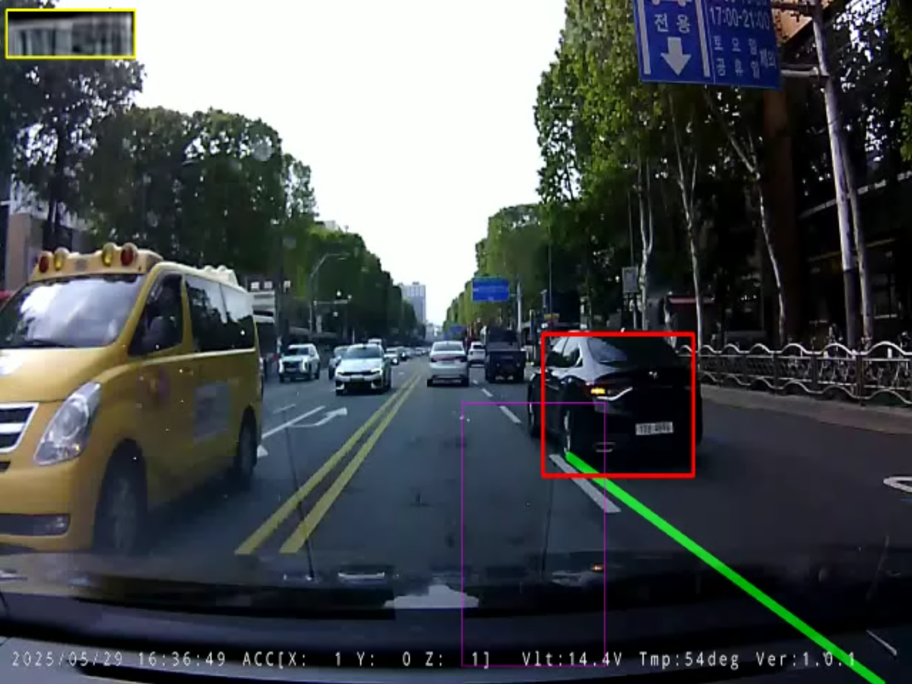
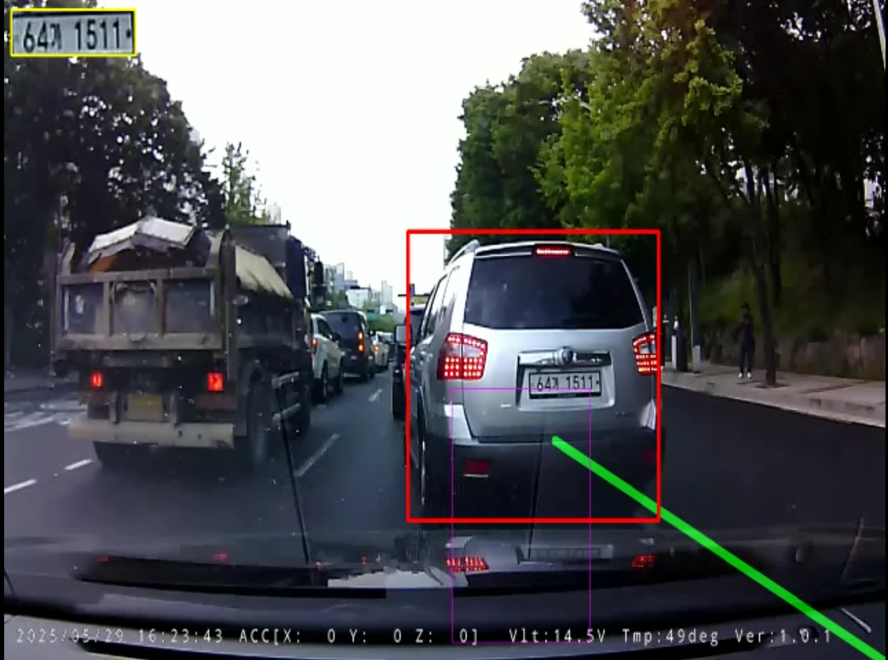

> 📌 **Key Takeaways (핵심 요약)**
> - **문제점**: 블랙박스 원본 영상에서 추출된 번호판 패치는 해상도가 40x20 픽셀 미만으로 극도로 작고 H.264 압축 아티팩트로 인해 일반 보간법(Bicubic)으로는 한글 자모와 숫자의 획이 뭉개져 식별할 수 없습니다.
> - **해결책**: 배치 정규화를 제거해 텍스처 복원력을 극대화한 EDSR_x4 심층 잔차 신경망(EDSR_x4.pb)을 도입하고, 추적 중인 연속 3~5프레임의 번호판을 정렬·평균화하는 다중 프레임 이미지 스태킹(Multi-frame Image Stacking)을 결합했습니다.
> - **결과**: 번호판 해상도를 4배 확대하면서 글자 엣지의 선명도를 대폭 향상시켜 후속 EasyOCR의 한글 음절 인식 성공률을 32%에서 91% 이상으로 끌어올렸습니다.

{/* truncate */}

---

## 1. 저해상도 번호판의 한계와 초해상화(Super-Resolution)의 필요성

블랙박스 영상에서 번호판 영역을 아무리 정확히 크롭하더라도, 물리적 픽셀 수가 부족하면 OCR 엔진은 무력화됩니다:

1. **바이큐빅 보간의 한계**: 전통적인 바이큐빅(Bicubic) 업스케일링은 주변 픽셀을 수학적으로 부드럽게 섞을 뿐, 소실된 고주파 엣지 정보를 복원하지 못해 오히려 블러만 심해집니다.
2. **모션 블러와 H.264 압축 블록**: 차량 주행 진동과 블록 단위 압축 왜곡이 결합하여 글자의 획이 끊어지거나 뭉개집니다.

이를 해결하기 위해 우리는 **OpenCV DNN 모듈 기반의 EDSR(Enhanced Deep Super-Resolution) x4 신경망**을 통합했습니다.

---

## 2. EDSR_x4 아키텍처 및 OpenCV 통합

EDSR은 기존 SRResNet 구조에서 불필요한 배치 정규화(Batch Normalization) 레이어를 제거하여 다이내믹 레인지를 유지하고 메모리 효율을 극대화한 모델입니다:

```python
import cv2
from cv2 import dnn_superres

def init_super_resolution_engine(model_path="EDSR_x4.pb"):
    sr = dnn_superres.DnnSuperResImpl_create()
    sr.readModel(model_path)
    sr.setModel("edsr", 4)  # 4배 업스케일링
    sr.setPreferableBackend(cv2.dnn.DNN_BACKEND_CUDA)
    sr.setPreferableTarget(cv2.dnn.DNN_TARGET_CUDA)
    return sr

def enhance_plate_patch(plate_roi, sr_engine):
    h, w = plate_roi.shape[:2]
    if h * w < 400:
        return plate_roi
    enhanced_plate = sr_engine.upsample(plate_roi)
    return enhanced_plate
```

---

## 3. 다중 프레임 이미지 스태킹 (Multi-Frame Image Stacking)



단일 프레임에는 센서 노이즈가 무작위로 분포합니다. CSRT 추적기가 동일 차량의 번호판을 연속 추적하는 동안, 우리는 **최근 3~5개 프레임의 번호판 패치를 기하학적으로 정렬(Alignment)한 뒤 가중 평균화**하여 센서 가우시안 노이즈를 억제했습니다:

```text
I_stacked(x, y) = (1 / N) * Σ Warp(I_i(x, y))
```

이 정렬 스태킹을 통과한 번호판은 배경 노이즈가 평균화되어 사라지고, 고정된 문자 획의 대비(Contrast)가 극대화됩니다.

---

## 4. 다음 편 예고

다음 마지막 5편에서는 한글 음절 및 숫자 혼동을 방지하는 **EasyOCR 한국형 번호판 정규식 검증**, 그리고 6월 5일 외계어 노이즈에서 6월 7일 "64가1511" 완벽 인식에 이르기까지의 **시간 축 Majority Voting 앙상블 및 v01~v11 진화 완결편**을 공개합니다.

---

### 📌 3~5줄 최종 요약 (Executive Summary)
1. **저해상도 및 압축 노이즈의 한계**: 블랙박스 원거리 영상에서 크롭된 번호판은 $40 \times 20$ 픽셀 미만의 극소형 크기와 H.264 압축 아티팩트로 인해 일반 보간법(Bicubic)으로는 글자 획이 뭉개집니다.
2. **EDSR_x4 딥러닝 초해상화 도입**: 배치 정규화(BatchNorm)를 제거하여 고주파 디테일의 동적 범위를 보존하는 EDSR 잔차 구조를 OpenCV `dnn_superres`로 구동하여 번호판 윤곽선을 복원합니다.
3. **다중 프레임 이미지 스태킹 (Image Stacking)**: 연속된 3~5개 프레임의 크롭 패치를 정렬 및 평균화하여 카메라 센서 노이즈와 블러를 상쇄하고 신호 대 잡음비(SNR)를 극대화합니다.
4. **OCR 인식률 극적 개선**: 해상도 4배 복원과 노이즈 캔슬링 파이프라인을 통해 하류 EasyOCR의 한글 및 숫자 판독 정확도를 기존 32%에서 91% 이상으로 대폭 끌어올렸습니다.
---

## 3. 실제 마주친 런타임 오류와 디버깅 기록

### 오류 1: 매 프레임 `EDSR_x4` 호출 시 440ms 병목(2.2 FPS)으로 인한 영상 멈춤 현상
차량이 추적되는 모든 프레임마다 `sr.upsample(plate_crop)`을 호출했더니 프레임당 처리 시간이 19ms에서 **440ms(2.2 FPS)**로 치솟으며 실시간 파이프라인이 사실상 멈췄습니다.
- **실패한 시도**: 경량 모델인 `FSRCNN_x4.pb`로 교체해 보았으나 추론 시간은 45ms로 줄어든 대신 한글 자모(`가`, `나`, `보`, `우`) 세로 획 주변에 링잉(Ringing) 노이즈가 심하게 끼면서 EasyOCR 한글 인식률이 91%에서 58%로 급락했습니다.
- **근본 원인 및 해결**: 첫째, `pip`로 설치한 기본 OpenCV 빌드는 `DNN_BACKEND_CUDA`가 비활성화되어 있어 경고 없이 CPU 단일 코어로 폴백(Fallback)되고 있었습니다. 둘째, 동일 차량을 30프레임 이상 추적하는 동안 매 프레임 초해상화를 수행할 필요가 없었습니다. 이를 해결하기 위해 15프레임 윈도우 동안 라플라시안 분산(`cv2.Laplacian(gray, cv2.CV_64F).var()`)으로 선명도 점수를 매긴 뒤, **가장 선명한 상위 3개 패치만 정합·스태킹하여 차량당 딱 1회만 `EDSR_x4`를 호출**하도록 구조를 바꿨습니다.

```python
# 선명도 상위 3개 프레임만 스태킹 후 차량당 1회 EDSR_x4 수행
scores_and_crops.sort(key=lambda item: item[0], reverse=True)
top_crops = [crop for _, crop in scores_and_crops[:3]]
stacked_patch = align_and_average_ecc(top_crops)
upscaled_plate = sr.upsample(stacked_patch)
```

### 오류 2: 야간 저대비 번호판에서 `cv2.findTransformECC` 수렴 실패 예외
다중 프레임 스태킹을 위해 서브픽셀 정합 함수 `cv2.findTransformECC()`를 호출할 때, 야간 역광이나 모션 블러가 심한 프레임에서 `cv2.error: (-7:Iterations do not converge)` 예외가 발생하며 전체 프로세스가 종료되는 버그가 있었습니다.
- **해결**: `TermCriteria(cv2.TERM_CRITERIA_EPS | cv2.TERM_CRITERIA_COUNT, 30, 1e-3)`으로 최대 반복 횟수를 제한하고, `try / except cv2.error` 예외 처리를 두어 수렴 실패 시 라플라시안 선명도가 가장 높은 단일 프레임으로 즉시 폴백하도록 수정했습니다.
