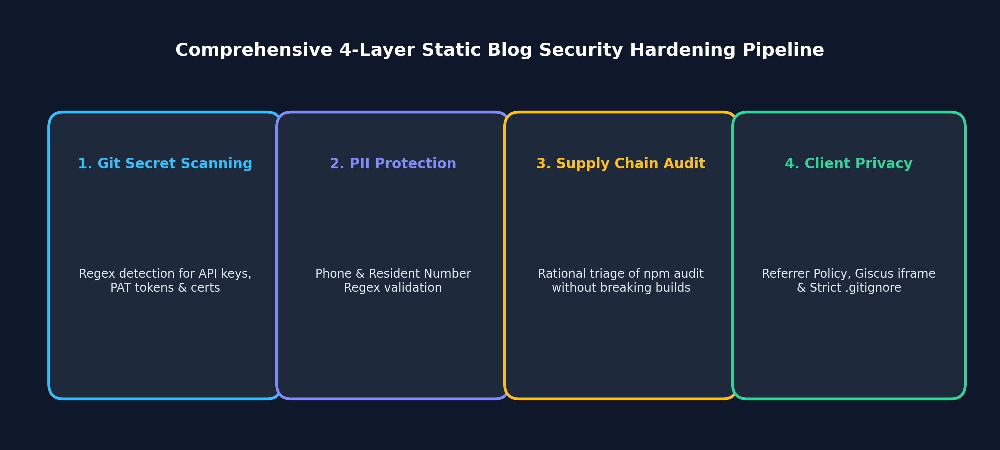

프론트엔드나 정적 블로그를 운영하는 개발자라면 누구나 한 번쯤 등골이 서늘해지는 순간을 겪어보셨을 것입니다. 평화롭게 `npm audit`을 입력했을 때, 터미널 가득 시뻘건 경고 문구가 쏟아져 내리는 장면입니다:

```text
45 vulnerabilities (15 moderate, 15 high, 15 critical)
To address all issues (including breaking changes), run:
  npm audit fix --force
```

**Critical**, **Remote Code Execution (원격 코드 실행)**, **Prototype Pollution (프로토타입 오염)** 같은 무시무시한 단어들을 보면, 당장 빨간 불을 끄기 위해 무의식적으로 `npm audit fix --force`를 타이핑하고 싶어집니다.

하지만 Docusaurus, Next.js, Hugo처럼 **정적 사이트 생성기(SSG)**를 통해 빌드된 후 GitHub Pages나 AWS S3에 배포되는 아키텍처에서는, 이러한 무지성 다운그레이드가 오히려 멀쩡한 프로덕션 빌드를 깨뜨리는 최악의 악수가 되곤 합니다.

본 포스팅에서는 **정적 웹 사이트의 위협 모델(Threat Model)**을 명확히 정의하고, 빌드 도구의 취약점과 런타임 취약점의 본질적인 차이를 파헤치며, 정적 블로그에서 진짜로 지켜야 할 **4단계 실전 보안 하드닝(Security Hardening) 청사진**을 공유합니다.

{/* truncate */}

---


---

## 1. 3줄 핵심 요약: 엔지니어링 판단 기준

1. **빌드 도구 != 프로덕션 런타임**: `npm audit`에 걸린 패키지(`tinypool`, `serialize-javascript`, `postcss-selector-parser` 등)는 개발자의 로컬 PC에서 `npm run build`를 수행할 때만 실행되는 번들러 워커입니다.
2. **CDN에는 살아있는 서버가 없다**: 빌드가 끝나면 GitHub Pages에는 순수 HTML, CSS, 번들 JS 파일만 남습니다. **실행 중인 Node.js 데몬도 없고, 열린 백엔드 포트도 없으며, 데이터베이스 커넥션도 없습니다.**
3. **`--force` 옵션의 치명적 함정**: `npm audit fix --force`를 실행하면 취약점을 없앤답시고 프레임워크(`@docusaurus/core`)를 구버전(3.7.0)으로 강제 다운그레이드하여 React 19 호환성과 플러그인을 완전히 망가뜨립니다.
4. **정적 사이트의 진짜 위협**: 정적 웹의 핵심 공격 벡터는 서버 침투가 아니라, **Git 커밋 내 API 키 유출**, **데이터셋 내 개인정보(PII) 노출**, **클라이언트 리퍼러 경로 유출**입니다.

---

## 2. 45개 취약점의 실체 분석: 빌드타임 vs 런타임

이번 보안 점검에서 검출된 주요 CVE 항목들을 구체적으로 뜯어보겠습니다:

### A. Tinypool 프로토타입 오염 (`GHSA-5gmw-xhrv-c9v3` - Critical)
- **취약점 내용**: 신뢰할 수 없는 외부 입력값이 워커 초기화 옵션에 주입될 경우 프로토타입 오염 발생 가능.
- **SSG 환경에서의 진실**: `tinypool`은 빌드 속도를 높이기 위해 로컬 CPU 코어에 번들링 작업을 분산시키는 라이브러리입니다. 입력값은 오직 내 컴퓨터의 `docusaurus.config.ts` 설정 파일뿐입니다. 외부 방문자가 배포된 웹사이트를 통해 내 빌드 워커에 악의적인 페이로드를 보낼 수 있는 통로는 존재하지 않습니다.

### B. Serialize-JavaScript RCE (`GHSA-5c6j-r48x-rmvq` - High)
- **취약점 내용**: 정규식 플래그나 날짜 객체를 역직렬화할 때 원격 코드 실행(RCE) 가능성.
- **SSG 환경에서의 진실**: 웹팩(Webpack)이 컴파일 결과물을 정적 청크로 묶을 때 내부적으로 사용합니다. `build/` 폴더로 출력된 정적 JS 파일은 HTTPS로 서빙되는 정적 텍스트일 뿐, 서버에서 역직렬화 코드가 실행되지 않습니다.

### C. PostCSS Selector Parser CPU 과부하 (`GHSA-rj75-hqrm-r3gf` - Moderate)
- **취약점 내용**: 플랫 셀렉터 파싱 시 2차 복잡도로 인한 CPU 고갈(DoS) 가능성.
- **SSG 환경에서의 진실**: 파싱 대상 CSS는 개발자가 작성한 테마 스타일시트(`custom.css`)입니다. 공격자가 깃허브 저장소 쓰기 권한을 탈취하지 않는 한, 신뢰할 수 없는 CSS가 빌드 파이프라인에 주입될 수 없습니다.

결론적으로, 이 취약점들을 잡겠다고 `npm audit fix --force`를 돌리면 **발생할 수 없는 가상의 위협을 막기 위해 실제로 작동하는 최신 기능(React 19, Docusaurus v4 플래그)을 부수는 꼴**이 됩니다.

---

## 3. 정적 블로그에서 진짜 지켜야 할 것: 4단계 실전 보안 청사진

빌드 도구의 오탐(False Positive)에 휘둘리지 않는다면, 정적 블로그 엔지니어는 어디에 보안 노력을 집중해야 할까요? 이번에 본 블로그에 적용한 4단계 방어 체계를 소개합니다.



### 1단계: Git 프리커밋 시크릿 스캐닝 자동화

공개 기술 블로그에서 발생할 수 있는 가장 치명적인 재앙은, 코드 예제나 트러블슈팅 글을 작성하다가 실수로 OpenAI API 키(`sk-...`), GitHub 토큰(`ghp_...`), AWS 인증키(`AKIA...`)를 커밋하는 일입니다.

이를 방지하기 위해 Git 추적 파일 전체를 정규식 패턴으로 자동 검사하는 보안 감사 스크립트([`tools/audit_security.py`](file:///D:/ai/antigravity/global_blog/tools/audit_security.py))를 제작하여 배포 전 전수 검사를 실행했습니다:

```python
PATTERNS = [
    (r'(?i)(api[_-]?key|secret|token|password|auth|bearer)\s*[:=]\s*["\']([^"\']{8,})["\']', "Potential Key Assignment"),
    (r'ghp_[a-zA-Z0-9]{36}', "GitHub Personal Access Token"),
    (r'sk-[a-zA-Z0-9]{32,}', "OpenAI API Key"),
    (r'AIzaSy[a-zA-Z0-9_-]{33}', "Google API Key"),
    (r'AKIA[0-9A-Z]{16}', "AWS Access Key"),
    (r'-----BEGIN\s+(RSA\s+)?PRIVATE\s+KEY-----', "Private Key Certificate"),
]
```

### 2단계: 개인정보(PII) 및 임상 데이터 필터링

인공지능 연구나 비전 AI 프로젝트를 포스팅할 때는 데이터셋의 개인정보 보호가 필수적입니다:
- **마음지기 23편 연재**: 실제 상담 기록이 아닌, HIPAA 및 임상 윤리를 준수하기 위해 대규모 언어 모델로 생성한 **합성 대화 데이터(`synth_gen`)**를 학습에 사용하여 개인정보 유출을 원천 차단했습니다.
- **정규식 PII 검사**: 주민등록번호(`\d{6}-[1-4]\d{6}`)나 휴대폰 번호(`010-\d{4}-\d{4}`)가 본문에 포함되지 않았는지 자동 검증했습니다.

### 3단계: `.gitignore` 보안 하드닝

기본 템플릿의 `.gitignore`는 `.env.local`만 제외하고 정작 `.env`는 누락하는 경우가 많습니다. 환경 변수, 인증서, 통계 CSV 덤프가 저장소에 절대 올라가지 않도록 규칙을 철저히 보강했습니다:

```gitignore
# 환경 변수 및 시크릿 보호
.env
.env.*
*.pem
*.key
*.pfx
*.cert
*credential*
*.secret

# 분석 데이터 및 CSV 덤프 보호
*.csv

# 아카이브된 템플릿 파일
_old/
```

### 4단계: 클라이언트 프라이버시 & 댓글 iframe 샌드박싱

백엔드 서버가 없더라도, 사이트를 방문하는 독자의 개인정보를 보호해야 합니다:

1. **엄격한 리퍼러 정책 (`strict-origin-when-cross-origin`)**:  
   방문자가 블로그 본문 내의 외부 링크를 클릭했을 때, 블로그의 상세 URL 쿼리나 방문 경로가 외부 서버로 전달되지 않도록 도메인 단위로 차단합니다.
   ```typescript
   // docusaurus.config.ts
   themeConfig: {
     metadata: [
       { name: 'referrer', content: 'strict-origin-when-cross-origin' },
     ],
   }
   ```

2. **Giscus 댓글창 보안 설정**:  
   GitHub Discussions 기반 댓글 시스템을 운영할 때는 `BlogPostItem/index.tsx`에서:
   - `emitMetadata="0"`: iframe 내부의 토론 메타데이터가 외부 스크립트로 브로드캐스트되지 않도록 차단.
   - `loading="lazy"`: 글 맨 아래로 스크롤하기 전까지 불필요한 iframe 리소스를 로드하지 않음.

---

## 4. 엔지니어를 위한 최종 제언

- **`npm audit`의 빨간 글씨에 당황하지 마세요**: 취약점이 보고되었을 때 해당 패키지가 **내 로컬 빌드 도구**인지, **사용자 요청을 직접 받는 프로덕션 서버**인지 먼저 구분하는 것이 진정한 보안 엔지니어링의 시작입니다.
- **`--force`를 맹신하지 마세요**: 발생하지도 않을 가상의 위협을 막기 위해 프레임워크를 강제 다운그레이드하여 시스템을 깨뜨리는 것은 보안이 아닙니다.
- **진짜 중요한 곳에 집중하세요**: Git 시크릿 스캐닝 자동화, 개인정보 배제, 리퍼러 정책 및 올바른 컴플라이언스 준수가 여러분의 기술 블로그를 진정으로 안전하고 신뢰받게 만듭니다.
