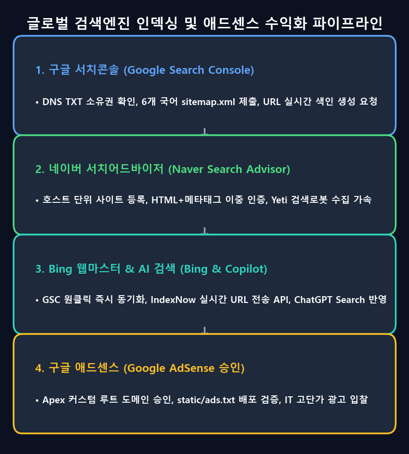

개발자 블로그를 GitHub Pages의 무료 서브도메인(`username.github.io/project`)에 배포하여 운영하는 것은 간편하지만, 전문적인 브랜딩과 수익화를 시작하는 순간 거대한 벽에 부딪힙니다. **구글 애드센스는 `*.github.io`와 같은 무료 서브도메인의 사이트 등록을 원천 차단**하기 때문입니다. 애드센스 게시자 심사를 통과하고 검색엔진 도메인 점수(Domain Authority)를 쌓으려면 반드시 독자적인 **독립 커스텀 도메인(Apex Domain)**이 필요합니다.

정적 사이트(SSG)의 도메인 이전은 단순한 DNS 주소 변경에 그치지 않습니다. 도메인 등록기관(Registrar)의 네임서버 위임, 엣지 SSL 암호화, CNAME 평탄화(Flattening), Docusaurus 빌드 파이프라인의 루트 재매핑, `ads.txt` 호스팅, 그리고 각 검색엔진 포털의 특유한 UI 트랩을 모두 해결해야 합니다.

본 포스팅에서는 기존 `jbjihwan.github.io/global_blog`에서 독립 도메인 `https://globaldevlog.com`으로의 무중단 이전 아키텍처와 구글 서치 콘솔, 네이버 서치어드바이저, 빙 웹마스터 도구의 실제 트러블슈팅 과정을 상세히 정리합니다.

{/* truncate */}

---


---

## 1. 아키텍처 설계: Porkbun + Cloudflare + GitHub Pages

GitHub Pages에 독립 도메인을 연결할 때 깃허브 IP(`185.199.108.153` 등)를 향해 원시 `A` 레코드를 직접 꽂는 전통적인 방식은 엣지 캐싱, 디도스 방어, 자동 SSL 갱신이 취약합니다.

우리는 고가용성 **3계층 아키텍처**를 구성했습니다:

| 계층 | 제공자 | 핵심 역할 |
| :--- | :--- | :--- |
| **도메인 등록기관** | **Porkbun** | 도메인(`globaldevlog.com`) 구매, 평생 무료 WHOIS 프라이버시 보호, Cloudflare로 NS 위임 |
| **엣지 DNS & 보안** | **Cloudflare** | 글로벌 Anycast DNS, 루트 도메인 CNAME 평탄화(Flattening), Universal SSL 암호화, 봇 쉴드 |
| **오리진 정적 호스팅** | **GitHub Pages** | Docusaurus 컴파일 결과물 호스팅, 서버 유지비 0원, `gh-pages` 브랜치 자동 배포 |

### Porkbun 네임서버 위임
Porkbun 도메인 관리 콘솔에서 기본 네임서버를 Cloudflare가 지정한 네임서버로 변경합니다:
```text
NS: roan.ns.cloudflare.com
NS: sneh.ns.cloudflare.com
```

### Cloudflare CNAME Flattening 설정
RFC 1034 표준에 따라 루트 도메인(`@`)에는 원래 CNAME 레코드를 지정할 수 없지만, Cloudflare의 **CNAME Flattening** 기술을 사용하면 루트에서도 GitHub Pages로 다이렉트 프록시가 가능합니다:
- **Type**: `CNAME` | **Name**: `@` | **Target**: `jbjihwan.github.io` | **Proxy status**: Proxied (주황색 구름)
- **Type**: `CNAME` | **Name**: `www` | **Target**: `jbjihwan.github.io` | **Proxy status**: Proxied
- **SSL/TLS 모드**: **Full** (또는 Full Strict)로 설정하여 엔드투엔드 HTTPS 암호화 유지.

---

## 2. Docusaurus 설정 마이그레이션

기존 서브패스(`baseUrl: '/global_blog/'`)에서 도메인 루트(`baseUrl: '/'`)로 변경하기 위해 `docusaurus.config.ts`를 수정합니다:

```typescript
const config: Config = {
  title: 'Global Dev Blog',
  url: 'https://globaldevlog.com',
  baseUrl: '/',
  organizationName: 'jbjihwan',
  projectName: 'global_blog',
  trailingSlash: false,
  // ...
};
```

### 정적 CNAME 파일 배포
GitHub Pages가 어떤 도메인의 요청을 해당 레포지토리로 라우팅할지 식별할 수 있도록 `static/CNAME` 파일을 생성합니다:
```text
globaldevlog.com
```
`npm run deploy` 시 `static/`의 모든 파일이 빌드 루트로 복사되므로, GitHub Pages 배포 브랜치(`gh-pages`)의 최상단 루트에 `CNAME`이 자동으로 배포됩니다.

---

## 3. 정적 사이트를 위한 구글 애드센스 승인 세팅

구글 애드센스 심사는 사이트 소유권, 게시자 스크립트 삽입, 루트 경로의 `ads.txt` 파일 크롤링 검증으로 이루어집니다.

### A. 게시자 스크립트 비동기 주입
`docusaurus.config.ts`의 `scripts` 배열에 애드센스 스크립트를 추가합니다:

```typescript
  scripts: [
    {
      src: 'https://pagead2.googlesyndication.com/pagead/js/adsbygoogle.js?client=ca-pub-4654073335496617',
      async: true,
      crossorigin: 'anonymous',
    },
  ],
```

### B. 루트 `ads.txt` 배포 및 라이브 검증
`static/ads.txt` 파일을 만들고 발급받은 게시자 정보를 입력합니다:
```text
google.com, pub-4654073335496617, DIRECT, f08c47fec0942fa0
```
배포 후 curl이나 브라우저로 200 OK 응답을 직접 검증합니다:
```bash
curl -I https://globaldevlog.com/ads.txt
# HTTP/2 200
# content-type: text/plain; charset=utf-8
```

---



---

## 4. 4대 검색엔진 SEO & 실전 트러블슈팅 가이드

사이트맵 제출 과정에서 발생하는 검색 포털별 특유의 UI 오류와 해결책입니다.

### A. 구글 서치 콘솔: 사이트맵 삭제 불가 트랩 해결
다국어 사이트맵(`sitemap.xml`, `ko/sitemap.xml`, `ja/sitemap.xml`, `es/sitemap.xml`)을 등록할 때 실수로 루트 경로(`https://globaldevlog.com/`)를 사이트맵으로 잘못 제출하면 영구적인 "오류 1개" 경고가 남게 됩니다.

많은 개발자들이 표 우측의 행 메뉴(`⋮`)를 누르지만, **"색인 생성 보기"만 비활성화된 채 삭제 버튼이 보이지 않는 함정**에 빠집니다.

**해결책:**
1. 표 우측의 점 세 개가 아니라, **오류가 발생한 사이트맵 주소(텍스트)를 직접 클릭**하여 **상세 페이지**로 들어갑니다.
2. 상세 화면 **오른쪽 상단 헤더에 있는 점 세 개(`⋮`)**를 클릭합니다.
3. 펼쳐지는 팝업에서 **[사이트맵 삭제]**를 누르면 잘못 등록된 항목이 즉시 깔끔하게 삭제됩니다.
4. "가져올 수 없음"이 발생한 사이트맵(예: `es/sitemap.xml`)은 상단 "새 사이트맵 추가"에 다시 입력하고 [제출]을 누르면 즉시 재크롤링되어 **성공**으로 바뀝니다.

### B. 네이버 서치어드바이저: "URL을 호스트 단위로 입력해주세요"
국내 검색 유입을 책임지는 네이버 서치어드바이저 등록 시 주의사항입니다:
1. **호스트 단위 입력 오류**: 초기 '사이트 등록' 창에 `https://globaldevlog.com/sitemap.xml`을 넣으면 *"URL을 호스트 단위로 입력해주세요"* 팝업이 뜹니다. 이 창은 메인 도메인(`https://globaldevlog.com`) 전용 등록 창입니다.
2. **소유확인 2중 배포**: HTML 인증 파일(`static/naver<hash>.html`)과 `themeConfig.metadata`의 메타 태그를 동시 배포하여 어떤 검사에도 즉시 통과되도록 구성합니다.
3. **사이트맵 & RSS 등록 위치**: 사이트 목록에서 내 도메인을 클릭하여 관리 대시보드로 진입한 후:
   - **[요청]** > **[사이트맵 제출]**: `sitemap.xml` 입력 후 확인
   - **[요청]** > **[RSS 제출]**: `https://globaldevlog.com/blog/rss.xml` 입력 후 확인
4. **Yeti 로봇 수집 촉진**: **[요청]** > **[웹 페이지 수집]**에서 핵심 경로(`blog`, `ko/blog`, 주요 아티클)를 수동 제출하여 네이버 검색 로봇의 크롤링을 즉시 앞당깁니다.

### C. 빙(Bing) 웹마스터 도구 & AI 검색(Copilot / ChatGPT) 연동
Bing 웹마스터 도구는 Bing 검색뿐 아니라 Copilot, ChatGPT Search, DuckDuckGo의 핵심 인덱스로 직결됩니다.
- **GSC 1클릭 임포트**: 구글 계정 연동 버튼을 누르면 서치 콘솔의 도메인 인증 정보가 1초 만에 자동 복사됩니다.
- **48시간 지연 건너뛰기**: 구글 서치 콘솔 데이터 동기화에 최대 48시간이 걸리므로, 좌측 **[Sitemaps]** > **[Submit sitemap]**을 통해 `https://globaldevlog.com/sitemap.xml`을 수동 제출하면 빙 로봇이 대기 시간 없이 즉각 수집을 시작합니다.

---

## 5. 프로덕션 검증 체크리스트

모든 설정을 마친 후 확인해야 할 최종 점검표입니다:

- [x] **DNS 해석**: `globaldevlog.com` 및 `www` 서브도메인이 SSL 경고 없이 정상 200 응답
- [x] **정적 CNAME**: GitHub Pages 배포 브랜치 루트에 `CNAME` 상주 확인
- [x] **애드센스 자산**: `https://globaldevlog.com/ads.txt` 접속 시 게시자 ID 일치 확인
- [x] **다국어 사이트맵**: 4개 언어 사이트맵(`sitemap.xml`, `ko/`, `ja/`, `es/`) 정상 응답
- [x] **3대 검색엔진 상태**: 구글, 네이버, 빙 모두 소유권 인증 완료 및 RSS/사이트맵 색인 중

이로써 서버 비용은 완전히 0원으로 유지하면서, 글로벌 Anycast CDN의 초고속 로딩 속도, 4개 국어 다국어 SEO 인프라, 그리고 구글 애드센스 수익화 기반까지 완벽히 구축되었습니다.

---

### 📌 3~5줄 최종 요약 (Executive Summary)
1. **비용 0원의 고성능 엣지 인프라**: 무료 `github.io`에서 Porkbun, Cloudflare DNS, GitHub Pages 결합 구조로 전환하여 서버 비용 0원으로 글로벌 Anycast 캐싱과 자동 SSL 보안을 구축합니다.
2. **CNAME 평탄화 및 정규 도메인 단일화**: RFC 1034 루트 제약을 Cloudflare CNAME Flattening으로 극복하고 `www` 접속을 apex 도메인으로 매끄럽게 리다이렉트합니다.
3. **애드센스 소유권 및 ads.txt 완벽 방어**: `<head>` 정적 메타태그 삽입과 `static/ads.txt` 루트 배포를 통해 404 크롤링 실패 및 심사 거절을 사전에 방지합니다.
4. **3대 검색엔진(구글·네이버·빙) 동시 색인**: 6개 국어 다국어 사이트맵과 RSS를 구글 서치콘솔, 네이버 서치어드바이저, 빙 웹마스터에 완벽 동기화하여 글로벌 오가닉 트래픽을 극대화합니다.
