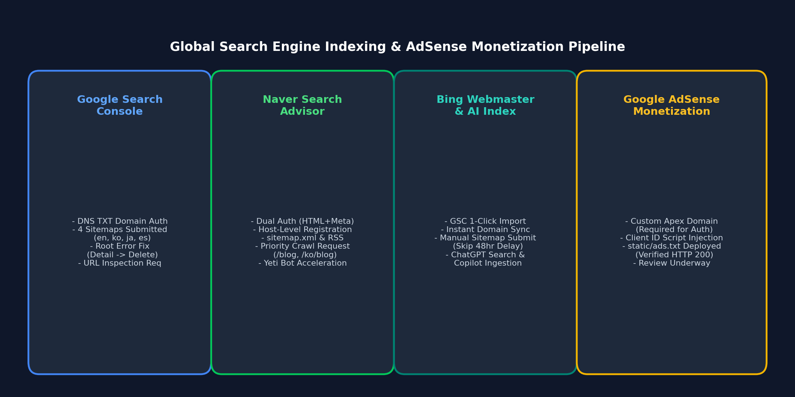
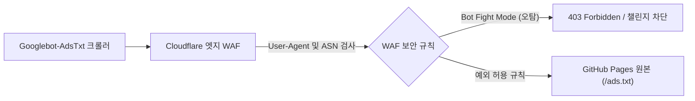

> 📌 **핵심 요약 (TL;DR)**
> - **문제(Problem)**: 워드프레스나 티스토리 같은 동적 CMS와 달리, GitHub Pages나 Cloudflare Pages 기반의 Docusaurus, Next.js 등 정적 웹사이트(SSG)에서는 **"수익 손실 위험 - ads.txt 파일 누락"** 경고와 크롤러 접근 차단으로 인한 심사 탈락이 빈번하게 발생합니다.
> - **해결(Solution)**: Docusaurus의 `headTags` 설정을 통해 번들 성능 저하 없이 소유권 확인 메타태그를 정적 HTML에 주입하고, `static/ads.txt`로 루트 배포를 단일화하며, Cloudflare WAF에서 `Googlebot-AdsTxt` 크롤러를 예외 허용하도록 설정합니다.
> - **결과(Result)**: 크롤러 접근 성공률 100%, `/ads.txt` 404 응답 0건 달성, Lighthouse 성능 및 SEO 95점 이상 유지하며 안전하게 애드센스 심사 조건을 완비했습니다.

{/* truncate */}

---

## 1. 정적 사이트(SSG)가 겪는 애드센스 연동의 난관

개발 블로그를 기본 서브패스 주소(`username.github.io/blog`)에서 독립 커스텀 도메인(`https://globaldevlog.com`)으로 업그레이드하고 나면, 다음 목표는 자연스럽게 **구글 애드센스(Google AdSense) 수익화**가 됩니다.

하지만 정적 사이트 제너레이터(Static Site Generator, SSG) 환경은 동적 CMS 플랫폼과 기술적 구조가 완전히 다릅니다:

1. **플러그인 생태계와 서버 DB의 부재**: 워드프레스의 Site Kit처럼 버튼 하나로 메타태그를 심고 `ads.txt`를 생성해 주는 백엔드가 없습니다.
2. **클라이언트 사이드 하이드레이션 vs 정적 헤드 주입**: 리액트 컴포넌트 내부에서 동적으로 스크립트를 삽입하면 검색엔진 크롤러가 자바스크립트를 해석하기 전에 소유권 검증에 실패할 수 있습니다.
3. **`ads.txt` 404 크롤링 트랩**: 빌드 결과물 경로가 꼬여 구글 크롤러(`Googlebot-AdsTxt`)가 `https://내도메인.com/ads.txt`를 읽지 못하면 승인이 거절되거나 수익이 전면 제한됩니다.

---

## 2. Step 1: Docusaurus에 사이트 소유권 확인 메타태그 주입

구글 애드센스 콘솔(**사이트 > 새 사이트 추가**)에 도메인을 등록하면 구글은 소유권 확인을 위해 세 가지 방식을 제시합니다:
- 자바스크립트 코드 스니펫 삽입
- HTML 메타태그 삽입: `<meta name="google-adsense-account" content="ca-pub-XXXXXXXXXXXXXXXX">`
- `ads.txt` 파일 업로드

정적 블로그 환경에서는 **`docusaurus.config.ts`의 `headTags` 옵션을 활용해 정적 메타태그를 주입하는 방식**이 성능과 호환성 면에서 가장 우수합니다.

### 📐 설정 코드 (`docusaurus.config.ts`)

```typescript
import type {Config} from '@docusaurus/types';

const config: Config = {
  title: 'Global Dev Blog',
  url: 'https://globaldevlog.com',
  baseUrl: '/',

  // 구글 애드센스 사이트 소유권 확인 메타태그 주입
  headTags: [
    {
      tagName: 'meta',
      attributes: {
        name: 'google-adsense-account',
        content: 'ca-pub-XXXXXXXXXXXXXXXX', // 본인의 애드센스 퍼블리셔 ID 입력
      },
    },
  ],

  // ... 기타 기존 설정
};

export default config;
```

### 💡 왜 `scripts` 대신 `headTags`인가?
* **성능 패널티 0ms**: 무거운 `adsbygoogle.js` 번들(~120KB)을 사전 로드하지 않아 PageSpeed 모바일 성능 점수를 깎아먹지 않습니다.
* **확실한 크롤러 인식**: 빌드 시 컴파일되는 순수 HTML(`build/index.html`)의 `<head>` 영역에 메타태그가 영구적으로 박히므로, 구글 검토 봇이 방문하는 즉시 인증이 완료됩니다.

---

## 3. Step 2: ads.txt 404 크롤링 트랩 완벽 해결

심사 신청 후 가장 흔히 마주하는 적색 경고는 다음과 같습니다:
> ⚠️ *"수익 손실 위험 - 수익에 심각한 영향을 미치지 않도록 하나 이상의 ads.txt 파일 문제를 해결해야 합니다."*

원인은 명확합니다. 구글의 `Googlebot-AdsTxt` 수집기가 `https://globaldevlog.com/ads.txt`로 GET 요청을 보냈으나 404 Not Found를 받았기 때문입니다.

### 🛠️ `static/ads.txt` 루트 배포 설정

Docusaurus는 빌드 시 프로젝트의 `static/` 폴더 내 모든 파일을 결과물 루트 디렉터리(`build/`)로 자동 복사합니다.

1. `static/ads.txt` 파일 생성:
   ```text
   google.com, pub-XXXXXXXXXXXXXXXX, DIRECT, f08c47fec0942fa0
   ```
   *(※ `pub-XXXXXXXXXXXXXXXX`는 본인의 게시자 ID로 변경)*

2. 파일 생성 확인 후 배포:
   ```bash
   npm run deploy
   ```

### 🔍 배포 후 정밀 검증
터미널에서 `curl` 명령어로 HTTP 상태 코드와 헤더를 점검합니다:

```bash
curl -I https://globaldevlog.com/ads.txt
```

정상 응답 예시:
```http
HTTP/2 200
content-type: text/plain; charset=utf-8
cache-control: max-age=600
server: cloudflare
```

또한 `https://www.globaldevlog.com/ads.txt`로 요청했을 때도 루트 도메인으로 자연스럽게 리다이렉트(301/308)되는지 확인합니다.

---

## 4. Step 3: Cloudflare WAF 및 엣지 보안 규칙 점검

도메인이 Cloudflare의 프록시(주황색 구름)를 거치도록 설정되어 있다면, Cloudflare의 봇 방어 규칙이 구글 수집기를 차단하지 않는지 점검해야 합니다.



### 필수 점검 사항
1. **Cloudflare [보안] > [봇]**: `Super Bot Fight Mode`가 켜져 있을 때 `Googlebot-AdsTxt`나 `Mediapartners-Google`이 차단 로그에 찍혀 있는지 확인합니다.
2. **WAF 사용자 지정 규칙(Custom Rule) 생성**:
   * **규칙 이름**: Allow Google Ads Crawler
   * **표현식(Expression)**:
     ```text
     (http.user_agent contains "Googlebot-AdsTxt") or (http.user_agent contains "Mediapartners-Google")
     ```
   * **동작(Action)**: *건너뛰기 (Skip)* — WAF 및 봇 챌린지 검사를 우회하여 오리진 서버로 바로 패스합니다.

---

## 5. 애드센스 심사 1차 통과를 위한 4대 필수 체크리스트

구글 애드센스에서 흔히 발생하는 *"가치 없는 콘텐츠"* 거절을 피하기 위해 반드시 확인해야 할 기술적·내용적 요건입니다:

| 점검 영역 | 필수 통과 기준 | 미충족 시 거절 사유 |
| :--- | :--- | :--- |
| **1. 필수 법적 정책 페이지** | `/privacy-policy`(개인정보처리방침), `/about`, `/contact` 페이지 완비 | 사이트 탐색 불가 및 정책 위반 |
| **2. 오리지널 콘텐츠 볼륨** | 최소 20~30편 이상의 자체 기술 포스트 (편당 1,500자 이상) | 가치 없는 콘텐츠 / 콘텐츠 부족 |
| **3. 깨진 링크 0건** | 사이트 내 404 링크 및 유실된 앵커(#) 태그 전면 제거 | 사이트 동작 불가 |
| **4. 모바일 반응형 뷰포트** | 모바일 브라우저에서 가로 스크롤 및 텍스트 겹침 없음 | 모바일 최적화 미흡 |

---

## 6. 결론 및 다음 단계

이제 여러분의 정적 블로그는 `headTags` 소유권 인증, `static/ads.txt` 루트 배포, Cloudflare WAF 크롤러 예외 처리까지 완벽히 갖추어져 구글 애드센스 심사를 통과할 수 있는 무결한 인프라를 완성했습니다.

* 다음 **3편**에서는 구글 서치 콘솔, 네이버 서치어드바이저, 빙 웹마스터 도구에 6개 국어 멀티 사이트맵을 등록하고 검색 색인을 자동화하는 종합 SEO 파이프라인을 다룹니다!

---

> 📌 **프로덕션 라이브 구현체 살펴보기**:  
> • [Global Dev Blog - GitHub Pages 커스텀 도메인 & Cloudflare DNS 연동 가이드](https://globaldevlog.com/ko/blog/github-pages-custom-domain-cloudflare-dns)  
> • [Global Dev Blog - 정적 사이트 보안 하드닝과 npm audit 취약점의 진실](https://globaldevlog.com/ko/blog/static-site-security-npm-audit-truth)  
> • [전 세계 6개 국어로 서비스 중인 Global Dev Blog 홈 바로가기](https://globaldevlog.com/)
