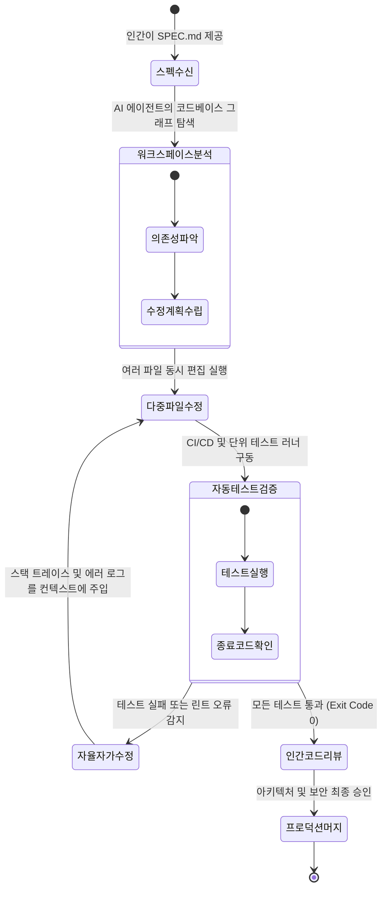
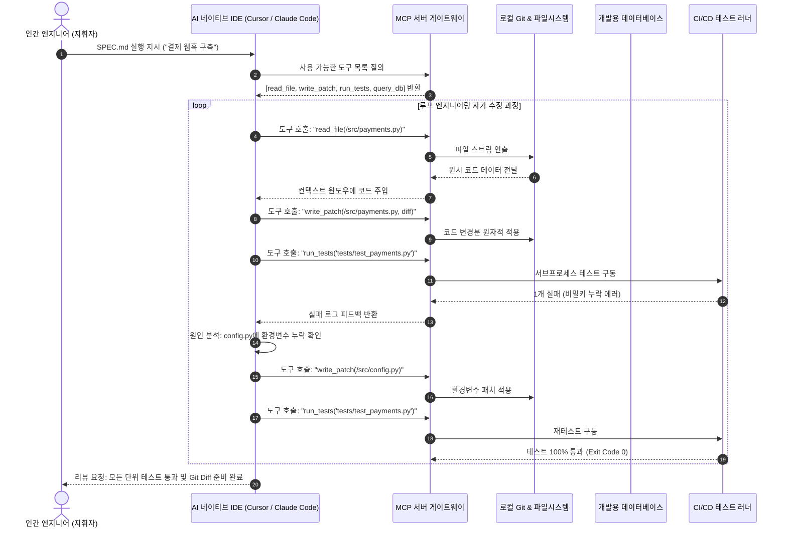

미국 스탠포드 대학교의 최신 소프트웨어 공학 강좌인 **CS146S: 현대 소프트웨어 개발자 (The Modern Software Developer)**의 1강 심층 기술 해설에 오신 것을 환영합니다.

지난 반세기 동안 컴퓨터공학 교육은 개발자를 '코드를 꼼꼼하게 한 줄 한 줄 타이핑하는 숙련공'으로 양성해 왔습니다. 문법을 외우고, 알고리즘을 밑바닥부터 구현하며, 수천 줄의 상용구(Boilerplate) 코드를 손으로 직접 쳐내던 훈련이었습니다. 하지만 컴파일러의 발명 이후 소프트웨어 산업에서 가장 거대한 지각 변동이 시작되었습니다. 바로 **수동 코딩(Manual Coding)**에서 **인간-에이전트 엔지니어링(Human-Agent Engineering)**으로의 대전환입니다.

구글, 메타, 오픈AI 등 글로벌 빅테크 기업들이 개발 생산성을 재정의하는 방식, 개발자가 단순 '타이피스트(Typist)'에서 '오케스트라 지휘자(Conductor)'로 진화해야 하는 이유, 그리고 이를 가능하게 하는 핵심 3대 기술인 **스펙 주도 개발(Spec-Driven Development)**, **에이전틱 워크플로(Agentic Workflows)**, **모델 컨텍스트 프로토콜(Model Context Protocol, MCP)**을 완벽히 정리합니다.

{/* truncate */}

---

### 1. 패러다임 전환: 신택스 타이피스트에서 시스템 지휘자로

전통적인 소프트웨어 개발 워크플로에서 가장 큰 병목은 인간의 타자 속도와 문법 기억 한계였습니다. 개발자는 머릿속으로 아키텍처를 구상한 뒤, 이를 구체적인 프로그래밍 언어의 토큰(Java, TypeScript, Python 등)으로 번역하는 작업에 근무 시간의 70% 이상을 쏟아야 했습니다. DB 스키마 인터페이스 선언, CRUD 컨트롤러 작성, 상용구 테스트 코드 타이핑, 단순 오타 디버깅이 업무의 대부분을 차지했습니다.

그러나 고도화된 추론 모델과 자율 코딩 에이전트(Claude Code, Cursor, Copilot Workspace 등)의 등장으로 **문법적으로 완벽한 코드를 작성하는 한계 비용은 사실상 '0원'**에 수렴하게 되었습니다.


현대의 소프트웨어 엔지니어는 더 이상 '하루에 몇 줄의 코드를 타이핑했는가'로 평가받지 않습니다. 대신 **수많은 AI 에이전트들로 구성된 개발팀을 이끄는 '엔지니어링 매니저(지휘자)'**의 역할을 수행합니다. 매니저가 주니어 엔지니어에게 업무를 지시할 때 타자 치는 법을 알려주지 않듯, 명확한 '스펙(Specification)'을 정의하고, 시스템의 경계를 설정하며, 결정론적 성공 기준을 부여하는 것이 개발자의 핵심 역량이 되었습니다.

---

### 2. 스펙 주도 개발 (Spec-Driven Development, SDD)

스탠포드 CS146S에서 가장 강조하는 실전 개발 방법론은 **스펙 주도 개발(SDD)**입니다.
단순한 AI 활용 코딩에서는 개발자가 챗봇 인터페이스에 *"로그인 기능 만들어 줘"*와 같이 모호한 대화형 프롬프트를 입력합니다. 이는 필연적으로 아키텍처의 왜곡, 환각 코드 생성, 예외 처리 누락을 초래합니다.

반면 스펙 주도 개발(SDD)에서는 코드 작성에 앞서 기계와 인간이 모두 오해 없이 이해할 수 있는 엄격한 **명세서 문서(`SPEC.md`)**를 작성하는 것을 엔지니어링의 최우선 산출물로 삼습니다.

```markdown
# 엔지니어링 명세서 템플릿 (SPEC.md)

## 1. 도메인 컨텍스트 및 목표
- Stripe Webhook API v2024-06 대응을 위한 멱등성(Idempotent) 결제 이벤트 수신 파이프라인 구축.
- 데이터베이스: PostgreSQL 16 (Row-Level Security 활성화 필수).

## 2. 불변 조건(Invariants) 및 비타협적 제약사항
- 모든 데이터베이스 갱신은 명시적 DB 트랜잭션 내부에서만 수행되어야 함.
- Webhook 서명 검증(HMAC-SHA256)이 실패할 경우, 페이로드 파싱 전 즉시 거부(Fail-closed)할 것.
- 성능 기준: P99 응답 시간 80ms 미만 유지.

## 3. 인터페이스 규격
- 엔드포인트: `POST /api/v1/payments/webhook` (원시 바이트 스트림 수신)
- 처리 대상 이벤트: `payment_intent.succeeded`, `payment_intent.payment_failed`

## 4. 검증 기준 및 단위 테스트 요구사항
- 동일한 이벤트 ID가 중복 유입될 때 롤백이 정상 동작하는지 테스트 커버리지 95% 이상 확보.
- 50개의 동시 다발적 중복 요청 발생 시, DB에는 정확히 1건의 결제 레코드만 생성되어야 함.
```

인간 개발자가 명확한 명세서 작성에 인지적 노력을 집중하면, AI 에이전트는 *"어떻게 구현할 것인가(How)"*를 자율적으로 완수하고, 인간은 *"무엇을 왜 만들 것인가(What & Why)"*에 대한 통제권을 완벽히 유지할 수 있습니다.

---

### 3. 에이전틱 워크플로와 루프 엔지니어링 (Loop Engineering)

CS146S 1강의 핵심 개념 중 하나는 바로 **루프 엔지니어링(Loop Engineering)**입니다.
거대 언어 모델은 확률적 추론 엔진입니다. 수십 개의 파일에 걸쳐 복잡하게 얽힌 분산 시스템 코드를 단 한 번의 프롬프트 호출로 오차 없이 짜내기를 기대하는 것은 수학적으로 불가능합니다.

따라서 현대 소프트웨어 공학은 한 번에 정답을 요구하는 대신, [코드 생성 $
ightarrow$ 자동 테스트 $
ightarrow$ 에러 피드백 $
ightarrow$ 자가 수정]이 연속되는 **폐루프 자율 순환 시스템**을 구축합니다:



#### 자율 루프 엔지니어링의 4단계:
1. **탐색 (Discovery)**: 에이전트가 프로젝트 파일 구조를 탐색하여 기존 인터페이스와 데이터 타입을 파악합니다.
2. **실행 (Multi-File Edit)**: 클라이언트, 서버, DB 마이그레이션 파일 전반에 걸쳐 원자적 diff를 적용합니다.
3. **결정론적 검증 (Verification)**: 테스트 러너(`pytest`, `vitest`, `cargo test`)를 자율 실행하여 결과를 확인합니다.
4. **자가 수정 (Self-Healing)**: 단언(Assertion) 실패 시 터미널 에러 로그를 스스로 읽고, 버그의 원인을 추론하여 통과할 때까지 코드를 다시 고칩니다.

---

### 4. 모델 컨텍스트 프로토콜 (Model Context Protocol, MCP)

AI 모델이 텍스트 프롬프트라는 샌드박스를 뚫고 나와 로컬 파일 시스템, 데이터베이스, 터미널 환경을 안전하게 제어하는 비밀은 바로 **모델 컨텍스트 프로토콜(MCP)**에 있습니다.



MCP 표준을 통해 AI 에이전트는 사람이 수작업으로 코드를 복사-붙여넣기할 필요 없이, 실제 인프라 환경과 실시간 통신하며 작업을 완결 짓습니다.

---

### 5. 전통적 타이피스트 vs. 현대 에이전트 지휘자 비교

| 비교 영역 | 전통적 패러다임 (코드 타이피스트) | 현대 CS146S 패러다임 (AI 오케스트라 지휘자) |
| :--- | :--- | :--- |
| **핵심 역량** | 문법 암기력, 빠른 타자 속도, 정규표현식 작성 | 시스템 아키텍처 설계, 정밀한 명세서 작성, 위협 모델링 |
| **개발의 기본 단위** | 함수, 코드 라인 단위, 개별 파일 수정 | 전체 시스템 명세(SPEC.md), 불변 조건, 테스트 계약 |
| **주요 작업 도구** | 정적 텍스트 에디터, 린터, 브레이크포인트 디버거 | 자율 에이전트(Claude Code, Cursor), MCP 서버, 루프 자동화 |
| **핵심 생산성 병목** | 타자 타이핑 속도, 인지적 피로, 상용구 수작업 작성 | 모호한 요구사항 명세, 불완전한 테스트 커버리지, 프롬프트 누락 |
| **코드 검증 전략** | 수동 디버깅 단계별 확인, console.log 출력 | 결정론적 자동화 테스트 스위트, 불변성 Fuzzing 검증 |
| **주요 실패 양상** | 문법 에러, 세미콜론 누락, 단순 인덱스 오차 | 시맨틱 환각, 아키텍처 일관성 왜곡, 미세한 보안 취약점 간과 |

---

### 6. 스탠포드 교수진 심층 Q&A: 컴퓨터공학 기초는 왜 더 중요해졌는가?

1강 오리엔테이션에서 스탠포드 학부생들이 가장 열정적으로 던진 질문입니다:

> **Q. 교수님, AI 에이전트가 코드의 80%를 순식간에 작성해 준다면, 우리는 알고리즘, 자료구조, 메모리 관리 같은 컴퓨터공학 기초를 덜 배워도 되는 것 아닌가요?**

이에 대한 스탠포드 교수진의 답변은 매우 단호하고 명쾌했습니다: **"컴퓨터공학 기초는 10년 전보다 지금 훨씬 더 결정적으로 중요해졌습니다."**

1. **검토자(Reviewer)로서의 책임**: AI는 그럴듯해 보이는 1,000줄의 코드를 15초 만에 생성합니다. 하지만 그 속에 숨어있는 $O(N^2)$ 알고리즘 병목, 닫히지 않은 데이터베이스 커넥션 풀 누수, 미세한 동시성 경쟁 상태(Race Condition), 잠재적 암호학적 취약점을 꿰뚫어 보려면 **컴퓨터 시스템에 대한 최고 수준의 기본기**가 필수적입니다.
2. **책임은 100% 인간의 몫**: 프로덕션 서비스가 다운되거나 고객 데이터가 유출되었을 때 AI 에이전트는 법적·직업적 책임을 질 수 없습니다. 풀 리퀘스트(PR)에 승인 도장을 찍은 인간 엔지니어가 모든 책임을 집니다.
3. **에지 케이스 트러블슈팅**: 자율 에이전트가 자가 수정 루프에 갇혀 무한 루프를 돌 때, 시스템 아키텍처와 운영체제, 네트워크 프로토콜을 깊이 이해하는 시니어 엔지니어만이 개입하여 올바른 길을 열어줄 수 있습니다.

---

### 7. 1강 핵심 요약 및 향후 연재 안내

1. **정체성을 재정의하라**: 더 이상 코드를 손으로 치는 타이피스트에 머물지 말고, 아키텍처를 설계하고 에이전트를 지휘하는 매니저가 되십시오.
2. **스펙 주도 개발을 체화하라**: 가장 가치 있는 엔지니어링 산출물은 완벽한 `SPEC.md`입니다.
3. **루프 엔지니어링 환경을 구축하라**: 한 번에 정답을 요구하지 말고, 자동화 테스트와 MCP 도구로 무장한 자가 복구 루프를 가동하십시오.

다음 **스탠포드 CS146S 2강**에서는 수천 토큰의 문맥을 효율적으로 압축하고 에이전트의 환각을 방지하는 **'컨텍스트 관리와 프롬프트 아키텍처(Context Management & Prompt Architecture)'**를 심층 분석하겠습니다. 글로벌 개발 블로그 GlobalDevLog의 연재를 계속 주목해 주세요!
