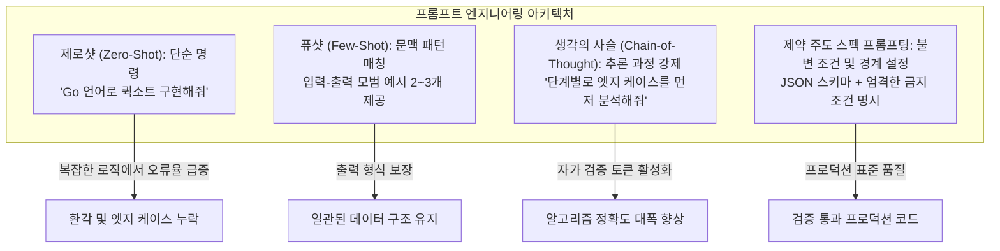
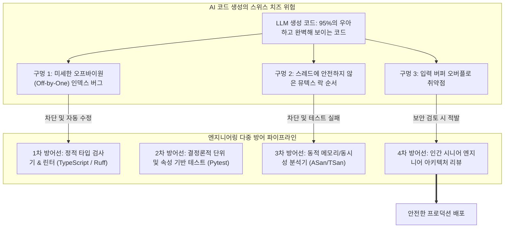

미국 스탠포드 대학교의 최신 소프트웨어 공학 강좌인 **CS146S: 현대 소프트웨어 개발자 (The Modern Software Developer)** 2강 심층 기술 해설에 오신 것을 환영합니다.

1강에서는 개발자가 단순한 문법 타이피스트에서 벗어나 여러 AI 에이전트를 조율하는 '오케스트라 지휘자'로 진화해야 한다는 거시적 아키텍처 전환을 다루었습니다. 이번 **2강(Week 1)**에서는 소프트웨어 혁명의 심장부라 할 수 있는 **코딩 대형 언어 모델(Coding LLMs)**의 내부 연산 원리와, 이 거대한 모델을 정밀하게 제어하는 소프트웨어 엔지니어링 기법인 **프롬프트 엔지니어링(Prompt Engineering)**을 정면으로 파헤칩니다.

안드레 카파시(Andrej Karpathy)의 *'Deep Dive into LLMs'*, OpenAI의 *'How OpenAI Uses Codex'*, 그리고 Google Cloud와 DAIR.AI의 최신 프롬프트 가이드를 관통하는 핵심 이론을 바탕으로, LLM이 어떻게 프로그래밍 언어를 학습하는지, 왜 AI 코드는 그럴싸하면서도 치명적인 구멍을 갖는지(**스위스 치즈 모델**), 그리고 이를 방어하기 위한 **'신뢰하되 검증하라(Trust but Verify)'** 아키텍처를 완벽하게 정리합니다.

{/* truncate */}

---

### 1. LLM의 내부 해부: 3단계 훈련 파이프라인

AI 코딩 어시스턴트를 효과적으로 제어하고 디버깅하려면, 먼저 모델의 가중치(Weights)가 어떤 과정을 거쳐 완성되었는지를 이해해야 합니다. 안드레 카파시가 강조했듯, 현대의 LLM은 단일 규칙 엔진이 아니라 엄격한 **3단계 파이프라인**을 거쳐 탄생합니다:

```mermaid
flowchart LR
    subgraph 1단계 ["1단계: 사전 학습 (Pre-training)"]
        D1[인터넷 문서 및 GitHub 소스코드<br/>수조 개의 토큰] --> N1[트랜스포머 기반 베이스 모델<br/>다음 토큰 확률 예측 P(w_t | Context)]
    end

    subgraph 2단계 ["2단계: 지도 학습 미세 조정 (SFT)"]
        N1 --> D2[고품질 프롬프트-답변 쌍<br/>대화 및 포맷 규칙 주입]
        D2 --> N2[명령어 튜닝 어시스턴트<br/>개발자 페르소나 확립]
    end

    subgraph 3단계 ["3단계: 인간 피드백 강화 학습 (RLHF)"]
        N2 --> D3[인간 선호도 랭킹 평가<br/>보상 모델(Reward Model) 교정]
        D3 --> N3[프로덕션 코딩 LLM<br/>안전하고 정렬된 코드 생성]
    end
```

#### 1.1. 사전 학습 (Pre-training): 무감독 지식 흡수
사전 학습 단계에서 디코더 전용(Decoder-only) 트랜스포머 모델은 수 페타바이트에 달하는 웹 텍스트와 오픈소스 코드를 학습합니다. 이때 텍스트는 단어가 아니라 **BPE(Byte-Pair Encoding)** 방식의 '토큰(Token)' 단위로 쪼개어 처리됩니다:
- 1개의 토큰은 대략 3~4글자 혹은 자주 쓰이는 코드 조각(`def `, `return `, `const ` 등)에 해당합니다.
- 학습의 목적 함수(Loss Objective)는 놀랍도록 단순한 **'다음 토큰 예측(Next-Token Prediction)'**입니다:

```text
P(w_t | w_1, w_2, ..., w_t-1) = Softmax(W_v * h_t-1)
```

- 수조 개의 토큰을 거치며 모델은 문법 트리, 알고리즘 패턴, 표준 라이브러리 사용법을 암묵적으로 내재화합니다. 하지만 사전 학습만 마친 베이스 모델은 단지 거대한 '자동완성 기계'일 뿐이며, 사용자의 질문에 답하는 대화 능력을 갖추지 못합니다.

#### 1.2. 지도 학습 미세 조정 (SFT): 대화 및 코딩 프로토콜 수립
자동완성 기계를 유능한 페어 프로그래머로 탈바꿈시키기 위해 **지도 학습 미세 조정(SFT)**을 진행합니다.
- 전문 소프트웨어 엔지니어가 작성한 수만 개의 정교한 `<질문, 모범 코드 답변>` 데이터셋을 모델에 학습시킵니다.
- 이를 통해 모델은 마크다운 코드 블록 작성법, 주석 설명 방식, 엣지 케이스 처리 안내와 같은 '친절하고 정확한 어시스턴트의 규칙'을 습득합니다.

#### 1.3. 인간 피드백 기반 강화 학습 (RLHF) 및 DPO
SFT를 마친 모델도 여전히 보안상 위험하거나 비효율적인 코드를 그럴듯하게 출력할 수 있습니다.
- 동일한 코딩 질문에 대해 모델이 여러 개의 코드 후보군을 생성하면, 인간 검토자가 품질, 보안성, 가독성을 기준으로 순위(Ranking)를 매깁니다.
- 이 순위 데이터를 바탕으로 **보상 모델(Reward Model)**을 훈련하고, PPO(Proximal Policy Optimization)나 DPO(Direct Preference Optimization) 알고리즘을 통해 인간의 의도와 선호에 부합하도록 가중치를 미세 조정합니다.

> **핵심 개념**: 우리가 IDE에서 마주하는 코딩 LLM의 답변은 의식을 가진 인공지능의 창작물이 아니라, *전 세계 수석 엔지니어들이 작성했을 법한 '이상적인 코드'를 통계적으로 초고속 시뮬레이션(Statistical Simulation)한 결과물*입니다.

---

### 2. 코덱스(Codex)는 코드를 어떻게 이해하는가?

OpenAI의 기념비적 연구인 *'How OpenAI Uses Codex'*에 따르면, LLM이 자연어보다 프로그래밍 언어에서 훨씬 더 뛰어난 능력을 발휘하는 세 가지 이유가 있습니다:

1. **결정론적 문법과 구문 트리(AST)**: 자연어는 중의적이고 맥락에 따라 뜻이 달라지지만, 프로그래밍 언어는 문맥 자유 문법(CFG)에 기반하여 오차 없이 **추상 구문 트리(AST)**로 완벽히 파싱됩니다.
2. **장거리 의존성(Long-range Invariants)**: 5번째 줄에 선언된 클래스 타입은 80번째 줄의 메서드 호출과 일치해야 합니다. 트랜스포머의 다중 헤드 셀프 어텐션(Multi-head Self-Attention)은 이러한 전역적 문법 관계를 포착하는 데 최적화되어 있습니다.
3. **수억 개의 오픈소스 저장소 학습**: GitHub의 수많은 공개 레포지토리를 학습하면서 현대 프레임워크와 API의 관용적 패턴을 완전히 학습했습니다.

하지만 코딩 LLM은 코드를 생성하는 동안 실제로 컴파일러를 돌리거나 실행해 보지 않습니다. 철저히 '통계적 토큰 연쇄'로 코드를 작성하기 때문에, 최신 버전에서 제거된 API를 태연하게 호출하거나 인자 순서를 바꾸는 치명적 런타임 에러를 쉽게 유발합니다.

---

### 3. 소프트웨어 공학으로서의 프롬프트 엔지니어링

많은 사람들이 프롬프트 엔지니어링을 '단순히 말을 잘 거는 요령'으로 오해합니다. 하지만 스탠포드 CS146S에서는 이를 **확률적 모델로부터 결정론적(Deterministic) 산출물을 이끌어내기 위한 엄격한 소프트웨어 설계 기법**으로 정의합니다.



#### 3.1. 제로샷(Zero-shot)과 퓨샷(Few-shot)의 실전 구분
- **제로샷**: 예시 없이 바로 명령하는 방식입니다. 단순한 보일러플레이트 변환(예: "이 JSON을 TypeScript 타입으로 바꿔줘")에는 충분합니다.
- **퓨샷**: 원하는 형태의 입출력 예시를 2~3개 제공하는 방식입니다. 가중치 수정 없이 트랜스포머의 **인컨텍스트 러닝(In-context Learning)**을 유도하여, 사내 표준 로깅 래퍼나 엄격한 응답 JSON 규격을 100% 준수하게 만듭니다.

#### 3.2. 생각의 사슬 (Chain-of-Thought, CoT)
복잡한 알고리즘이나 동시성 코드를 작성시킬 때 바로 코드를 짜라고 하면 모델은 십중팔구 논리적 오류를 범합니다.

이때 다음과 같은 추론 유도 프롬프트를 주입합니다:
> *"코드를 작성하기 전에, 먼저 발생 가능한 3가지 동시성 경합 상태(Race Condition)를 단계별로 분석하고, 메모리 배리어(`memory_order`) 불변 조건을 텍스트로 명시하십시오."*

트랜스포머는 이전 토큰에 의존하여 다음 토큰을 생성하므로, 모델이 중간 추론 과정(CoT)을 먼저 출력하게 만들면 그 추론 토큰들이 자체적인 문맥이 되어 **최종 코드의 정답률이 비약적으로 상승**합니다.

#### 3.3. 방어적 프롬프팅과 환각 억제
- **명시적 부정 제약(Negative Constraints)**: *"외부 라이브러리를 임포트하지 말고, 표준 라이브러리만을 사용할 것."*
- **불확실성 선언 강제**: *"제공된 DDL에서 컬럼 정보를 확인할 수 없는 경우 임의로 지어내지 말고 `SCHEMA_ERROR`를 반환할 것."*

---

### 4. AI 코드 생성의 '스위스 치즈 모델'

1주차 강의에서 안드레 카파시가 인용한 가장 중요한 비유는 바로 **'스위스 치즈 모델(Swiss Cheese Model)'**입니다.

항공 및 의료 안전 공학에서 제임스 리즌(James Reason)의 스위스 치즈 모델은 여러 겹의 방어선에 뚫린 구멍들이 우연히 일직선으로 정렬될 때 대형 참사가 발생한다는 이론입니다. AI 코딩에서는 이 현상이 정반대로 위험하게 작용합니다:



#### 왜 코딩 LLM은 치즈처럼 구멍이 뚫려 있는가?
AI는 겉보기에 완벽하고 현란한 디자인 패턴이 적용된 200줄의 코드를 10초 만에 작성하지만, 187번째 줄에 치명적인 배열 경계 초과 버그를 숨겨놓거나, 멀티스레드 환경에서 데드락을 유발하는 코드를 천연덕스럽게 섞어 넣습니다.

코드가 너무나 깔끔하게 작성되어 있기 때문에, 인간 엔지니어는 시스템을 무비판적으로 신뢰하는 **자동화 편향(Automation Bias)**에 빠지기 쉽습니다. AI가 작성한 PR을 대충 훑어보고 머지하는 순간, 치즈의 구멍을 뚫고 서비스 장애가 터지게 됩니다.

---

### 5. "신뢰하되 검증하라(Trust but Verify)" 엔지니어링 아키텍처

스탠포드 CS146S에서는 AI 에이전트를 실무에 투입할 때 반드시 **'신뢰하되 검증하라'**는 방어적 아키텍처를 강제합니다:

```mermaid
sequenceDiagram
    autonumber
    actor Dev as 엔지니어 (시스템 설계자)
    participant Spec as SPEC.md 명세 및 제약조건
    participant LLM as 코딩 LLM 에이전트
    participant Gate as 자동화 검증 게이트 (Test Gate)
    participant Prod as 메인 배포 브랜치

    Dev->>Spec: 명세서 및 불변 조건(Invariants) 작성
    Dev->>LLM: 컨텍스트 및 스펙 기반 구현 요청
    LLM->>LLM: 생각의 사슬(CoT) 단계별 추론 수행
    LLM->>Gate: 코드 및 단위 테스트 스위트 커밋

    rect rgb(30, 41, 59)
        note over Gate: 자동화 다중 검증 파이프라인
        Gate->>Gate: 1. 엄격한 정적 타입 검사 (tsc / mypy)
        Gate->>Gate: 2. 자동화 단위/통합 테스트 실행 (Pytest)
        Gate->>Gate: 3. 속성 기반 무작위 엣지케이스 퍼징 (Fuzzing)
    end

    alt 검증 게이트 실패
        Gate-->>LLM: 에러 스택 트레이스 반환 (루프 엔지니어링)
        LLM->>Gate: 자가 치유 패치 코드 제출
    else 전 관문 무결점 통과
        Gate-->>Dev: 100% 통과 지표 및 클린 Git Diff 제출
        Dev->>Dev: 비즈니스 로직 및 아키텍처 최종 검토
        Dev->>Prod: 프로덕션 메인 머지 완료
    end
```



#### 4대 방어 관문:
1. **1관문: 무경고 정적 분석**: `tsc --strict`, `mypy --strict`와 같이 타입 불일치를 0건으로 통제하고 엄격한 린터(Ruff, ESLint)를 통과해야 합니다.
2. **2관문: 결정론적 단위 테스트 계약**: AI가 코드를 짤 때 반드시 검증용 테스트 코드도 함께 작성시켜, 격리된 샌드박스 환경에서 $N=0$, 음수 입력, 중복 요청 등의 엣지 케이스를 테스트합니다.
3. **3관문: 속성 기반 퍼징(Fuzzing)**: 핵심 알고리즘의 경우 Hypothesis 등의 퍼저를 돌려 수천 번의 극단적인 입력을 무작위로 주입해 불변 조건이 깨지는지 검증합니다.
4. **4관문: 인간의 최종 서명**: AI가 짠 코드는 데이터 마이그레이션 안정성, 보안 위협 모델, 아키텍처 정렬 관점에서 인간 엔지니어의 최종 승인을 거쳐야만 프로덕션에 진입합니다.

---

### 6. 프롬프트 패러다임 비교 분석 매트릭스

| 비교 차원 | 대화형 제로샷 프롬프트 | 퓨샷 스키마 프롬프트 | 스탠포드 CS146S 스펙 주도 프롬프트 |
| :--- | :--- | :--- | :--- |
| **입력 형태** | 일상적 자연어 대화 (`"이 버그 고쳐줘"`) | 시스템 프롬프트 + 입출력 JSON 예시 2~3개 | 정형 마크다운 명세(`SPEC.md`) + 불변 계약 |
| **모델 사고 과정** | 제약 없는 단발성 토큰 생성 | 예시 스키마에 맞춘 조건부 토큰 생성 | 생각의 사슬(CoT) 단계별 추론 + 도구 호출 |
| **환각 발생률** | **높음** (새로운 엣지 케이스에서 30~40%) | 구문상 **낮음**, 비즈니스 로직 **중간** | **극도로 낮음** (자동화 테스트 하네스가 차단) |
| **재현 가능성** | 낮음 (어조나 표현에 따라 결과 요동) | 높음 (정형화된 데이터 추출) | 완벽함 (Git으로 스펙과 테스트 코드 버전 관리) |
| **적합한 작업** | 아이디어 브레인스토밍, 단순 문법 검색 | 데이터 구조 변환, 정형 API 파서 개발 | 대규모 엔터프라이즈 기능 구현, 인프라 코드 |

---

### 7. 스탠포드 CS146S 2강 심층 Q&A

2강 강의실에서 학부생들과 교수진 사이에 오간 핵심 질의응답입니다:

> **Q. 교수님, 코딩 LLM이 작은 백준/리트코드 문제는 완벽하게 푸는데, 실제 10만 줄짜리 기업용 레포지토리에서는 왜 엉뚱한 코드를 짜고 환각을 일으키나요?**

**스탠포드 교수진 답변:**
이것이 바로 **'컨텍스트 포화(Context Saturation)'와 '주의력 희석(Attention Dilution)'** 문제입니다.
1. 수만 줄의 소스코드를 무작정 프롬프트 컨텍스트에 쏟아붓게 되면, 트랜스포머의 셀프 어텐션 가중치가 불필요한 토큰 전체로 흩어집니다.
2. 특히 컨텍스트가 수만 토큰을 넘어가면 **'중간 유실(Lost in the Middle)'** 현상이 발생하여, 맨 앞의 시스템 지시문과 맨 뒤의 질문만 기억하고 중간에 적힌 핵심 아키텍처 규칙을 까맣게 잊어버립니다.
3. 따라서 현대 엔지니어링에서는 전체 코드를 다 주는 것이 아니라, **AST 심볼 맵과 의존성 그래프만을 정확히 추출하여 최소한의 고밀도 컨텍스트만 주입하는 기법**이 필수적입니다. (이것이 바로 3강에서 다룰 핵심 주제입니다.)

---

### 8. 2강 핵심 요약 및 3강 예고

1. **도구의 본질을 알라**: 코딩 LLM은 사전학습, SFT, RLHF를 거친 통계적 토큰 시뮬레이터입니다.
2. **프롬프트를 엔지니어링하라**: 생각의 사슬(CoT)과 명시적 제약 조건을 주입하여 중간 추론 과정을 확보하십시오.
3. **스위스 치즈를 경계하라**: AI 코드가 화려해 보일수록 자동화 편향을 버리고 숨겨진 구멍을 의심하십시오.
4. **신뢰하되 검증하라**: 린터, 단위 테스트, 퍼저로 이어지는 자동화 검증 게이트를 구축하여 인간의 최종 검토 부담을 줄이십시오.

**3강**에서는 대규모 코드베이스에서 에이전트의 컨텍스트를 스마트하게 제어하는 **Tree-sitter AST 파싱, 벡터 저장소, 그리고 모델 컨텍스트 프로토콜(MCP) 심층 실전 아키텍처**를 다루겠습니다. GlobalDevLog를 구독해 주시기 바랍니다!

---

### 📌 3~5줄 최종 요약 (Executive Summary)
1. **3단계 훈련의 본질**: 코딩 LLM은 의식을 가진 존재가 아니라, 사전 학습(다음 토큰 확률 예측), SFT(지시 프로토콜 튜닝), RLHF/DPO(인간 선호도 정렬)를 거쳐 완성된 '수석 엔지니어 코드의 초고속 통계 시뮬레이터'입니다.
2. **소프트웨어 공학으로서의 프롬프트**: 복잡한 비즈니스 로직과 동시성 제어 시 생각의 사슬(CoT)을 강제하여 중간 추론 토큰을 확보하고, 엄격한 부정 제약 조건을 부여해야 환각을 차단할 수 있습니다.
3. **스위스 치즈 모델의 경고**: AI가 생성한 코드는 겉보기에 유려해도 배열 인덱스 초과, 경합 상태, 보안 취약점이라는 치명적인 구멍(Hole)을 내포하므로 '자동화 편향'을 경계해야 합니다.
4. **Trust but Verify (신뢰하되 검증하라)**: 정적 타입 분석(Gate 1) → 단위 테스트 계약(Gate 2) → 속성 기반 퍼징(Gate 3) → 인간 아키텍처 서명(Gate 4)으로 이어지는 다층 방어 하네스를 구축해야만 안전하게 프로덕션에 배포할 수 있습니다.

### References & Course Materials
- **Official Course Video Playlist**: [Stanford CS146S: The Modern Software Development (YouTube Playlist)](https://www.youtube.com/playlist?list=PLxpwjSdVZQ95OWe3QvkVEcU1f1X-6NDj9)
- **Primary Literature**: Andrej Karpathy, *Deep Dive into LLMs*; OpenAI, *How OpenAI Uses Codex*; Google Cloud & DAIR.AI, *Prompt Engineering Guide*.
- **Academic Institution**: Stanford University, Department of Computer Science