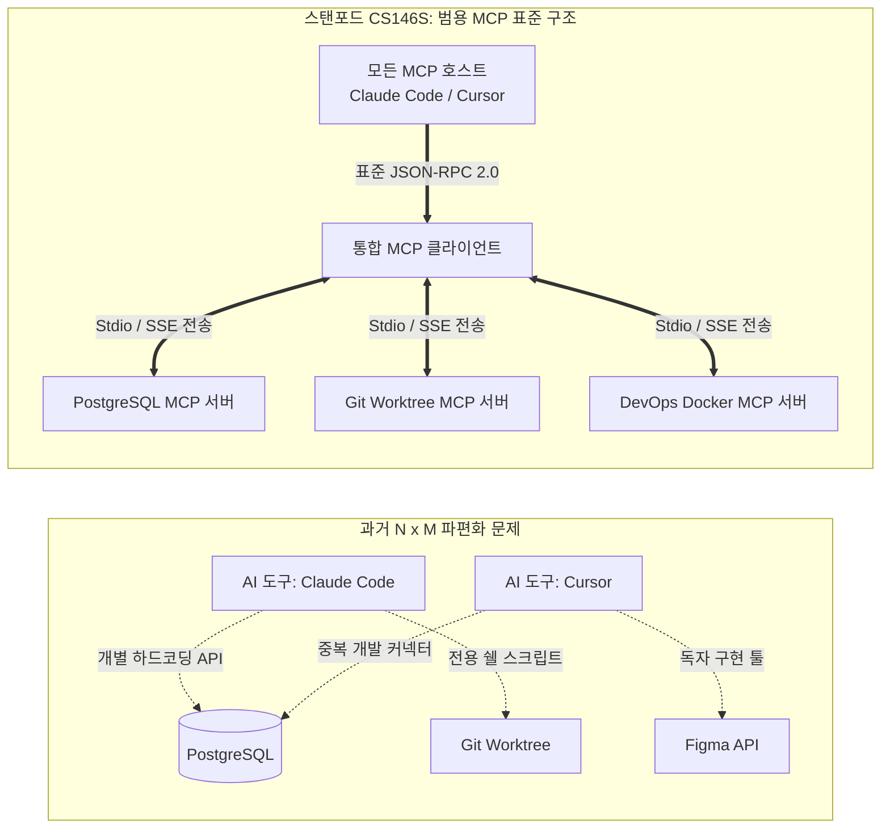
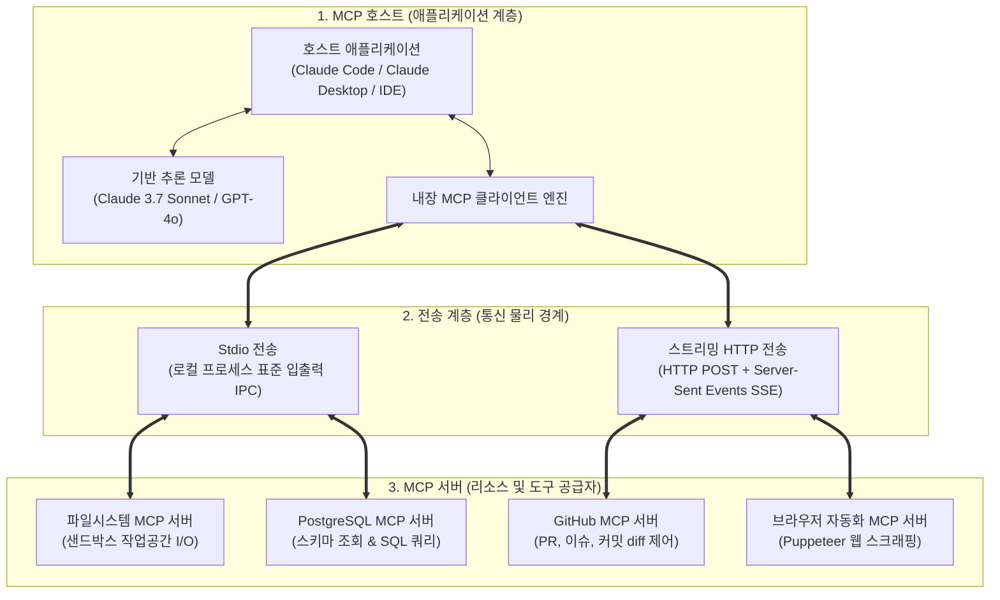

미국 스탠포드 대학교의 최신 소프트웨어 공학 강좌인 **CS146S: 현대 소프트웨어 개발자 (The Modern Software Developer)** 3강 심층 기술 해설에 오신 것을 환영합니다.

1강에서는 개발자가 단순한 문법 타이피스트에서 벗어나 AI 에이전트들을 이끄는 지휘자로 도약해야 함을 배웠고, 2강에서는 코딩 LLM의 통계적 본질과 스위스 치즈 모델을 방어하는 'Trust but Verify' 아키텍처를 다루었습니다. 이번 **3강(Week 2)**에서는 현대 AI 엔지니어링의 가장 거대한 병목이었던 문제를 해결합니다: **"고립된 언어 모델을 어떻게 외부 도구, 데이터베이스, 터미널과 안전하고 일관된 표준으로 연결할 것인가?"**

2024년 이전까지는 AI에 데이터베이스나 터미널을 붙이려면 매번 하드코딩된 커스텀 API 코드를 작성해야 했습니다. 앤트로픽(Anthropic)이 주도하는 개방형 표준이자 스탠포드 강의의 핵심 주제인 **모델 컨텍스트 프로토콜(Model Context Protocol, MCP)**은 마이크로소프트의 **LSP(Language Server Protocol)**가 에디터 생태계를 통일했듯, AI 에이전트 생태계를 표준화하는 범용 어댑터로 자리잡았습니다.

{/* truncate */}

---

### 1. 파편화 위기: 왜 "AI를 위한 LSP"가 필요했는가?

과거에는 Claude Code, Cursor, GitHub Copilot 등 새로운 AI 도구가 나올 때마다 동일한 외부 자원(Git, PostgreSQL, Slack, AWS 등)에 연결하기 위해 각자 고유한 접착제(Glue Code)를 중복해서 개발해야 했습니다.

2010년대 마이크로소프트는 모든 IDE가 수십 개 언어의 파서를 직접 구현하는 비효율을 **언어 서버 프로토콜(LSP)**을 만들어 단번에 해결했습니다. 

**모델 컨텍스트 프로토콜(MCP)**은 AI 에이전트 생태계에서 완벽히 동일한 혁신을 이뤄냈습니다. 모델의 추론 엔진과 외부 도구 실행을 완전히 분리하여, **JSON-RPC 2.0 기반의 플러그 앤 플레이 표준 규약**을 확립한 것입니다.

---

### 2. MCP의 3계층 시스템 아키텍처

MCP 규격은 두 계층에 걸쳐 세 가지 핵심 참여자로 구성됩니다:

1. **MCP 호스트 (Host)**: 사용자 경험을 총괄하고, 컨텍스트 윈도우를 관리하며, 인간의 실행 승인(Permission)을 제어하는 상위 애플리케이션 (Claude Code CLI, Cursor 등).
2. **MCP 클라이언트 (Client)**: 호스트 내부에 상주하며 개별 MCP 서버와 1:1 연결을 유지하고 통신 수명주기를 관리하는 통신 모듈.
3. **MCP 서버 (Server)**: 데이터와 실행 가능한 도구를 안전하게 노출하는 독립된 경량 프로세스.

---

### 3. 두 가지 전송 계층: Stdio vs. Streamable HTTP/SSE

| 전송 방식 | Stdio 전송 (로컬 고속 IPC) | Streamable HTTP/SSE 전송 (원격 연결) |
| :--- | :--- | :--- |
| **통신 메커니즘** | 자식 프로세스의 표준 입력(`stdin`)과 표준 출력(`stdout`) 파이프 | 클라이언트 요청은 HTTP POST, 서버 스트림은 SSE(Server-Sent Events) |
| **지연 시간** | **지연 시간 제로** (네트워크/TLS 핸드셰이크 없음) | 네트워크 레이턴시 및 TLS 암호화 오버헤드 발생 |
| **보안 경계** | 로컬 OS 파일시스템 권한 및 프로세스 격리 | OAuth 2.0 Bearer 토큰, mTLS, 방화벽 인가 |
| **적합한 작업** | 로컬 파일 읽기/쓰기, git 명령, 로컬 DB 쿼리 | 사내 엔터프라이즈 DB 클러스터, SaaS API 연동 |

---

### 4. MCP의 3대 핵심 프리미티브 (Core Primitives)

1. **리소스 (Resources - 읽기 전용 컨텍스트)**: GET 요청과 유사합니다. 파일 내용, DB 스키마, 로그 등을 URI(`postgres://db/users`) 형태로 모델에 부작용(Side-effect) 없이 주입합니다.
2. **도구 (Tools - 실행 함수)**: 모델이 호출할 수 있는 실행 가능한 함수입니다. 엄격한 JSON Schema로 인자 규격을 정의하며, 호스트는 실행 전 사용자의 동의를 구합니다.
3. **프롬프트 (Prompts - 재사용 템플릿)**: 서버가 제공하는 표준 작업 템플릿으로, 사내 표준 코드 리뷰 규칙이나 장애 분석 템플릿을 파라미터와 함께 호출할 수 있습니다.

---

### 5. Claude Code의 실전 도구 실행 루프 (Tool-Calling Loop)

스탠포드 CS146S 강의에서 시연된 실전 도구 실행 시퀀스는 다음과 같이 작동합니다:

```mermaid
sequenceDiagram
    autonumber
    actor Dev as 개발자
    participant Host as Claude Code (호스트)
    participant Model as Claude 3.7 Sonnet (LLM)
    participant Client as MCP 클라이언트
    participant Server as PostgreSQL MCP 서버

    Dev->>Host: "결제 실패 원인을 진단해줘 (User ID: 8492)"
    Host->>Client: 사용 가능한 도구 목록 조회 (tools/list)
    Client->>Server: JSON-RPC tools/list
    Server-->>Client: [query_orders, inspect_logs] 반환
    Client-->>Host: 도구 스키마를 모델 프롬프트에 주입

    Host->>Model: 시스템 프롬프트 + 도구 규격 + 질의 전송
    Model->>Model: 생각의 사슬(CoT): 주문 DB 조회가 필요하다고 판단
    Model-->>Host: 중단 이유: tool_use (query_orders, args: {id: 8492})

    rect rgb(30, 41, 59)
        note over Host,Dev: 인간 중심 승인 가드레일 (Security Gate)
        Host->>Dev: DB 조회 도구를 실행할까요? query_orders(8492) [Y/n]
        Dev-->>Host: 승인: Y
    end

    Host->>Client: 도구 호출 명령 전달
    Client->>Server: JSON-RPC tools/call (query_orders)
    Server-->>Client: {status: 'failed', error: '잔액 부족'} 반환
    Client-->>Host: Tool Result 페이로드 반환

    Host->>Model: 도구 실행 결과를 컨텍스트 윈도우에 재주입
    Model->>Model: 결과 데이터 분석 및 종합 보고서 작성
    Model-->>Host: "결제 게이트웨이 웹훅에서 잔액 부족 예외가 발생했습니다."
    Host-->>Dev: 최종 진단 리포트 출력
```

---

---

### 5.5 실무 프로덕션의 함정 (Production Gotchas): MCP 서버 엔지니어링 3대 난제

Model Context Protocol(MCP)은 우아한 JSON-RPC 표준이지만, 실제 상용 에이전트 인프라에 MCP 서버를 연동할 때 맞닥뜨리는 3가지 시스템 레벨의 함정이 있습니다:

#### 함정 1: Stdio 파이프 버퍼 오버플로우로 인한 프로세스 프리징 (64KB Deadlock)
Stdio 모드에서 MCP 서버가 디버그 로그를 `stderr`가 아닌 `stdout`으로 한 줄이라도 출력하거나, 대규모 Git diff 등 툴 반환 데이터가 OS 표준 파이프 버퍼(리눅스/윈도우 64KB)를 초과하면, 서브프로세스는 버퍼가 비워지기를 기다리며 무한 대기에 빠지고 IDE 전체가 멈춰버립니다.
- **실무 방어책**: `stdout`은 오직 순수 JSON-RPC 패킷 전용으로 엄격히 격리하고 모든 로그는 `stderr`로 우회해야 합니다. 대용량 데이터는 페이징 처리하거나 로컬 파일 포인터 참조 방식으로 반환해야 합니다.

#### 함정 2: SSE 연결 끊김 시 멱등성 상실 (중복 부수효과)
원격 HTTP/SSE 전송 모드에서 일시적인 네트워크 순단이 발생했을 때, MCP 서버가 `Last-Event-ID` 기반 재연결 복구를 지원하지 않으면 서버에서는 툴이 실행 완료되었는데 에이전트는 실패로 판단하여 동일한 작업을 재시도하는 중복 커밋/중복 DB 쓰기 사고가 발생합니다.
- **실무 방어책**: 상태를 변경하는 모든 도구에 멱등성 키(Idempotency Key)를 부여하고, 최근 이벤트 링 버퍼를 유지하여 재연결 시 안전하게 상태를 동기화해야 합니다.

#### 함정 3: 동적 툴 스키마 변조를 통한 프롬프트 인젝션
사용자 프롬프트나 레포지토리 파일 내용에 따라 도구 스키마(Tool Schema)를 동적으로 변경하도록 설계하면, 악의적인 프롬프트 인젝션 공격자가 가짜 도구 설명을 주입하여 에이전트가 임의의 셸 명령을 실행하도록 유도할 수 있습니다.
- **실무 방어책**: 툴 스키마는 서버 초기화 시점에 정적(Static)으로 확정되어야 하며, 신뢰할 수 없는 외부 입력에 따라 툴 정의를 동적으로 변경하지 않아야 합니다.

### 6. 스탠포드 CS146S 3강 핵심 Q&A

> **Q. 교수님, MCP와 기존의 랭체인(LangChain) 툴이나 OpenAI 함수 호출(Function Calling)은 무엇이 다른가요?**

**교수진 답변:**
함수 호출은 단지 **'LLM API의 기능'**일 뿐입니다. 모델이 JSON 인자를 만들어낼 뿐, 그 함수를 누가 실행하고, 어떤 보안 프로토콜로 인증하며, 다른 개발자가 어떻게 재사용할지에 대한 규격이 없었습니다. 그래서 수많은 기업들이 스파게티 접착제 코드를 짰습니다.

MCP는 기능이 아니라 **'산업 개방형 표준 프로토콜'**입니다. 오늘 여러분이 작성한 PostgreSQL MCP 서버 하나는 Claude Code에서도, Cursor에서도, 향후 등장할 어떤 AI 에이전트에서도 코드 단 한 줄 수정 없이 그대로 작동합니다.

---

### 7. 3강 핵심 요약 및 4강 예고

1. **표준을 따르라**: AI 도구 연동을 하드코딩하지 말고, MCP 표준 서버로 모듈화하십시오.
2. **두뇌와 손을 분리하라**: LLM은 논리 추론에만 집중하게 하고, I/O 작업은 독립된 샌드박스 MCP 서버에 위임하십시오.
3. **인간 승인 가드레일을 유지하라**: 상태를 변경하는 파괴적 도구는 반드시 인간의 확인 절차를 거치도록 설계하십시오.

**4강**에서는 스펙 주도 개발(SDD)과 회귀 테스트 하네스를 결합하여, Claude Code와 Cursor가 **프로덕션 수준의 기능을 버그 없이 스스로 구현하고 자가 치유하는 실전 워크플로**를 다루겠습니다. GlobalDevLog를 계속 지켜봐 주시기 바랍니다!

---

### 📌 3~5줄 최종 요약 (Executive Summary)
1. **MCP 표준화의 패러다임**: Model Context Protocol(MCP)은 AI 에이전트 계의 LSP(Language Server Protocol)로서, $N \times M$ 스파게티 연동 문제를 해결하고 개방형 JSON-RPC 2.0 표준 통신을 확립했습니다.
2. **두뇌와 물리적 손의 완벽한 분리**: LLM은 복잡한 논리 추론에만 집중하고, 파일 I/O와 데이터베이스 쿼리 등 상태를 변경하는 물리적 작업은 샌드박스화된 MCP 서버가 전담합니다.
3. **이원화된 전송 계층 (Stdio vs HTTP/SSE)**: 로컬 개발 환경에서는 밀리초 미만의 초고속 Stdio 파이프라인을 사용하고, 원격 엔터프라이즈 환경에서는 OAuth 2.0 기반의 스트리밍 HTTP/SSE 전송을 채택합니다.
4. **인간 승인 기반의 보안 가드레일**: 강력한 에이전트 자율성 뒤에 '최소 권한의 원칙'과 파일 삭제·DB 수정 시 개발자의 명시적 승인을 요구하는 Human-in-the-Loop 방어선을 구축해야 안전합니다.

### References & Course Materials
- **Official Course Video Playlist**: [Stanford CS146S: The Modern Software Development (YouTube Playlist)](https://www.youtube.com/playlist?list=PLxpwjSdVZQ95OWe3QvkVEcU1f1X-6NDj9)
- **Primary Literature**: Model Context Protocol Specification (modelcontextprotocol.io); Anthropic Claude Tool Use Architecture; Microsoft Language Server Protocol (LSP).
- **Academic Institution**: Stanford University, Department of Computer Science