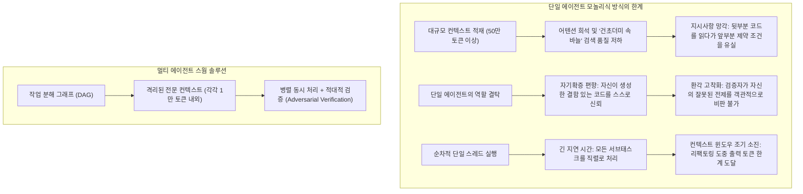
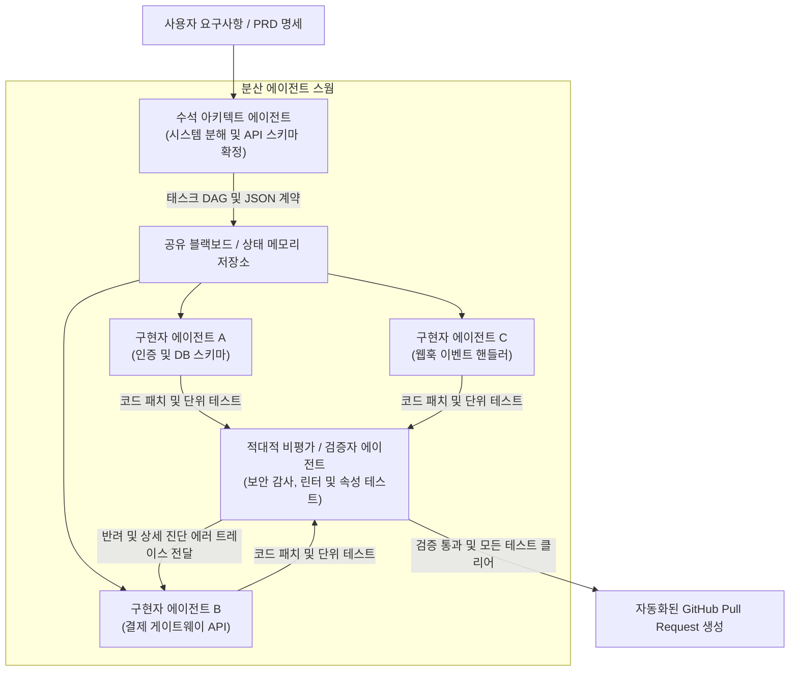

**스탠포드 대학교 CS146S (현대 소프트웨어 개발자: The Modern Software Developer)** 심층 분석 시리즈의 5번째 강의에 오신 것을 환영합니다.

지난 강의들에서 우리는 프롬프트 엔지니어링, 코딩 특화 모델의 내부 어텐션 메커니즘, 모델 컨텍스트 프로토콜(MCP)을 통한 자율 도구 활용, 그리고 스펙 주도 자가 치유 테스트 하네스까지 다루었습니다. 지금까지 살펴본 모든 패러다임에는 한 가지 공통된 묵시적 전제가 있었습니다: 바로 **단일 주요 LLM 세션**이 개발자 및 단일 IDE 워크스페이스와 대화형으로 상호작용한다는 점입니다.

하지만 소프트웨어 프로젝트가 수천 줄을 넘어 분산 마이크로서비스와 수십만 줄의 대규모 저장소로 확장되는 순간, 이러한 단일 에이전트 패러다임은 급격히 붕괴합니다. 모놀리식 에이전트는 **컨텍스트 윈도우 포화, 어텐션 희석(Attention Dilution), 인지적 요동(Cognitive Thrashing)** 문제를 겪게 됩니다.

오늘 강의에서 스탠포드 교수진은 차세대 AI 네이티브 엔지니어링의 핵심인 **멀티 에이전트 시스템(MAS, Multi-Agent Systems)과 스웜 오케스트레이션(Swarm Orchestration)**을 공개합니다. **아키텍트(Architect), 구현자(Implementer), 비평가(Critic)** 역할을 엄격히 분리하고, 방향성 비순환 그래프(DAG)와 정형화된 메시지 버스로 이를 조율함으로써 코드 생성의 정확도와 엔지니어링 스케일을 극적으로 확장하는 방법을 살펴봅니다.

{/* truncate */}

---

### 1. 단일 컨텍스트 모놀리식 LLM의 스케일링 한계

50만 줄의 엔터프라이즈 코드베이스를 100만 토큰 컨텍스트 윈도우를 가진 최신 LLM에 한꺼번에 던져 넣고 "결제 파이프라인 리팩토링해줘"라고 요청하면 왜 실패할까요?

스탠포드 연구진은 단일 에이전트의 스케일링을 가로막는 3대 구조적 병목을 다음과 같이 정의합니다:



1. **어텐션 희석 및 '중간 분실(Lost in the Middle)' 현상**: 컨텍스트가 10만 토큰을 초과하면 어텐션 메커니즘의 검색 신뢰도가 급락합니다. 중간 파일에 숨겨진 세밀한 DB 무결성 제약이나 API 규칙이 손쉽게 무시됩니다.
2. **역할 결탁 및 확증 편향**: 단일 LLM이 시스템 설계자, 코더, 품질 검증자 역할을 동시에 수행하면 심각한 확증 편향이 발생합니다. 자신이 짠 코드의 숨은 엣지 케이스를 스스로 찾아내기란 거의 불가능합니다.
3. **컨텍스트 오염 및 요동**: 15개 파일을 하나의 대화 세션에서 연속 수정하다 보면, 중간 bash diff, 컴파일러 오류, 버려진 가설들로 컨텍스트 버퍼가 오염되어 결국 출력이 중단되거나 헛소리를 시작합니다.

---

### 2. 3자 분립 스웜 아키텍처: 아키텍트, 구현자, 비평가

스탠포드 CS146S에서는 상용 프로덕션 수준의 안정성을 확보하기 위해 **3자 에이전트 스웜 패턴(Tripartite Agent Swarm Pattern)**을 공식 제안합니다:



#### 전문 에이전트 역할 정의:
1. **수석 아키텍트 에이전트 (Lead Architect Agent)**:
   - **입력**: 사용자 PRD, 리포지토리 의존성 트리, 비즈니스 목표.
   - **출력**: 모듈별로 디커플링된 태스크 DAG, 엄격한 JSON Schema 인터페이스, 데이터 계약.
   - **핵심 제약**: 아키텍트는 구현 코드를 단 한 줄도 작성하지 않습니다. 오직 전체 구조 분해와 API 인터페이스 안정화에 인지적 자원을 집중합니다.
2. **구현자 에이전트 스웜 (Implementer Swarm)**:
   - **입력**: DAG에서 할당받은 단일 태스크 슬라이스, API 계약 스키마, 대상 디렉터리 파일 트리.
   - **출력**: 모듈식 소스 코드, 단위 테스트 케이스, 패키지 의존성.
   - **실행**: 독립된 샌드박스 브랜치나 임시 컨테이너에서 여러 구현자가 완전히 병렬로 동시 코딩합니다.
3. **적대적 비평가/검증자 에이전트 (Adversarial Critic & Verifier Agent)**:
   - **입력**: 구현자가 제출한 코드 diff, 아키텍트의 원본 스펙, 자동화된 테스트 하네스 실행 로그.
   - **출력**: 정적 분석 메트릭, 보안 취약점 감사(AST 검사, 시크릿 누출), 최종 통과/반려 판정.
   - **피드백 루프**: 테스트 실패 시 스택 트레이스와 함께 구체적인 진단 diff를 생성하여 해당 구현자에게 즉각 반환함으로써 자가 치유 패치 루프를 가동합니다.

---

### 3. 에이전트 간 통신 토폴로지: 혼돈을 막는 구조화된 제어

에이전트들이 자유롭게 잡담하듯 대화하게 두면 환각이 눈덩이처럼 불어나고 무한 메시지 루프에 빠집니다. CS146S에서는 두 가지 결정론적 제어 방식을 제시합니다:

#### A. 중앙 집중식 블랙보드(Blackboard) 패턴
에이전트들이 서로 직접 통신하지 않고, 검증된 중앙 JSON 상태 저장소를 통해서만 비동기로 데이터를 교환합니다:

```json
{
  "task_id": "TASK-402-AUTH",
  "status": "in_review",
  "dependencies": ["TASK-401-DB-SCHEMA"],
  "assigned_agent": "worker-claude-code-01",
  "contract_schema_hash": "sha256:7f8a92...",
  "artifacts": {
    "patch_path": "/workspace/patches/auth_service.patch",
    "test_coverage": 94.2
  },
  "critic_feedback": null
}
```

#### B. 방향성 비순환 그래프 (DAG) 워크플로우
태스크 간의 의존성을 DAG 그래프로 정의합니다. 모듈 B가 모듈 A의 데이터 스키마에 의존한다면, 구현자 A의 코드가 비평가(Critic)의 엄격한 검증을 통과하기 전까지 구현자 B는 절대 실행되지 않습니다.

---

### 4. 실전 구현: 파이썬 기반 비동기 스웜 오케스트레이터

다음은 Pydantic 정형 데이터 검증을 기반으로 아키텍트-구현자-비평가 루프를 구동하는 비동기 스웜 엔진의 핵심 코드입니다:

```python
# swarm_orchestrator.py - 프로덕션 멀티 에이전트 스웜 엔진
import asyncio
from typing import List, Dict, Optional
from pydantic import BaseModel, Field

class SubTaskContract(BaseModel):
    task_id: str
    description: str
    file_targets: List[str]
    interface_schema: Dict[str, str]

class ArchitectPlan(BaseModel):
    plan_title: str
    subtasks: List[SubTaskContract]

class PatchResult(BaseModel):
    task_id: str
    code_diff: str
    unit_tests: str

class CriticAudit(BaseModel):
    passed: bool
    score: float = Field(ge=0.0, le=100.0)
    diagnostic_trace: Optional[str] = None

class SwarmOrchestrator:
    def __init__(self, architect_llm, coder_llm, critic_llm):
        self.architect = architect_llm
        self.coder = coder_llm
        self.critic = critic_llm

    async def execute_task(self, user_prd: str):
        print("[오케스트레이터] 1단계: 아키텍처 계획 및 서브태스크 분해 중...")
        plan: ArchitectPlan = await self.architect.generate_plan(user_prd)
        
        print(f"[오케스트레이터] 아키텍트가 {len(plan.subtasks)}개의 서브태스크 DAG를 생성했습니다.")
        
        # 다수의 병렬 구현자 워커에게 비동기 작업 분배
        tasks = [self._worker_critic_loop(task) for task in plan.subtasks]
        results = await asyncio.gather(*tasks)
        
        print("[오케스트레이터] 모든 서브태스크가 검증을 통과하여 통합되었습니다!")
        return results

    async def _worker_critic_loop(self, task: SubTaskContract, max_retries: int = 3) -> PatchResult:
        attempt = 0
        error_context = None

        while attempt < max_retries:
            attempt += 1
            print(f"[{task.task_id}] 구현자 코딩 진행 중 (시도 {attempt}/{max_retries})...")
            
            patch: PatchResult = await self.coder.implement_task(task, feedback=error_context)
            
            print(f"[{task.task_id}] 비평가 에이전트의 독립 감사 및 테스트 검증 중...")
            audit: CriticAudit = await self.critic.verify(task, patch)
            
            if audit.passed:
                print(f"[{task.task_id}] 최종 통과 승인 (품질 점수: {audit.score}/100)!")
                return patch
            
            print(f"[{task.task_id}] 비평가 반려: {audit.diagnostic_trace}")
            error_context = audit.diagnostic_trace

        raise RuntimeError(f"태스크 {task.task_id}가 {max_retries}회 재시도 후에도 비평가 검증을 통과하지 못했습니다.")
```

---

### 5. 5강 핵심 정리 및 다음 강의 안내

1. **모놀리식 단일 에이전트의 한계**: 컨텍스트 희석과 자기확증 편향을 극복하기 위해 대규모 소프트웨어 개발에는 멀티 에이전트 분할이 필수적입니다.
2. **3자 분립 전문화**: 아키텍트(설계 분해), 구현자(병렬 샌드박스 코딩), 비평가(적대적 검증 및 보안 감사)의 역할을 명확히 격리합니다.
3. **구조화된 결정론적 조율**: 비정형 텍스트 대화 대신 Pydantic JSON 스키마와 DAG 기반 태스크 의존성을 통해 스웜을 안정적으로 통제합니다.

**6강**에서는 **AI 보조 디버깅 및 프로파일링: eBPF, 동적 트레이싱, 그리고 런타임 장애 복구 LLM 활용법**을 집중 조명하겠습니다!

---

### 📌 요약 (Executive Summary)
1. **멀티 에이전트 확장성 필수**: 단일 LLM 세션의 어텐션 희석, 지시사항 망각, 자기확증 편향 문제를 극복하기 위해 작업을 분산 멀티 에이전트 스웜으로 전환함.
2. **3자 분립 역할 모델**: 시스템을 분해하고 계약을 수립하는 아키텍트, 샌드박스에서 병렬 구현하는 구현자, 엄격한 테스트와 감사를 수행하는 비평가 3자 구조를 정립함.
3. **구조화된 통신 제어**: 비정형 채팅 대신 Pydantic JSON 계약, 중앙 블랙보드 상태 저장소, 방향성 비순환 그래프(DAG) 워크플로우로 에이전트 간 환각과 루프를 차단함.
4. **비동기 자가 치유 피드백 루프**: 비평가의 구체적 진단 트레이스를 구현자에게 반환하여 모든 회귀 테스트가 통과할 때까지 자율 패치를 반복 완성함.

### 참고 자료 및 스탠포드 CS146S 강의 정보
- **강의명**: Stanford CS146S (The Modern Software Developer), 2026.
- **주관**: 스탠포드 대학교 컴퓨터공학과.
- **관련 오케스트레이션 프레임워크**: LangGraph, AutoGen, CrewAI, Anthropic Multi-Agent Orchestration Protocols.