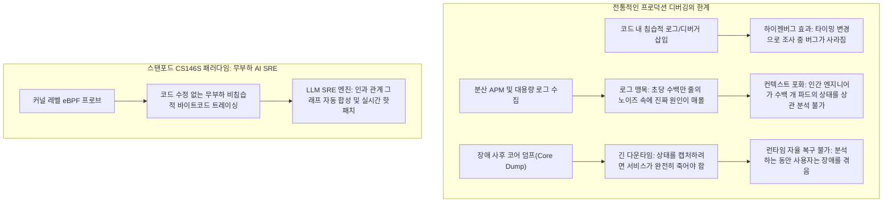
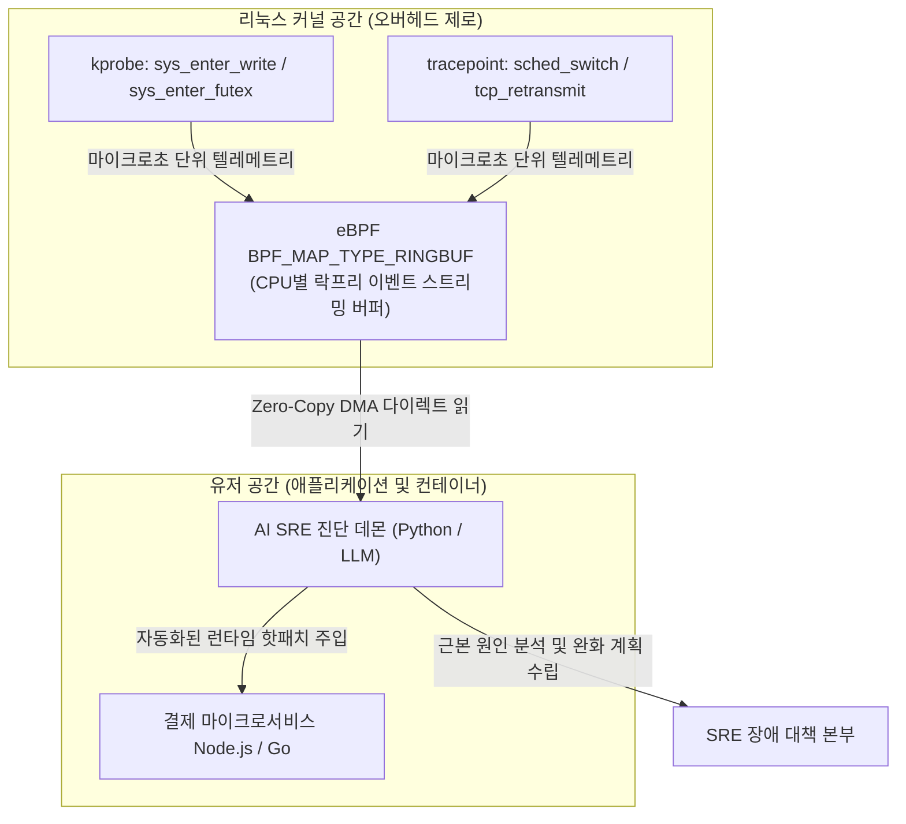

**스탠포드 대학교 CS146S (현대 소프트웨어 개발자: The Modern Software Developer)** 심층 분석 시리즈의 6번째 강의에 오신 것을 환영합니다.

지난 강의에서 우리는 수석 아키텍트, 병렬 구현자, 적대적 비평가 LLM을 정형화된 DAG 워크플로우로 엮어 대규모 코드베이스를 완성하는 멀티 에이전트 스웜 오케스트레이션을 살펴보았습니다. 하지만 아무리 철저한 테스트를 거친 소프트웨어라도, 실제 프로덕션 환경의 예측 불가능한 부하 속에서는 예기치 못한 장애를 마주하게 됩니다.

새벽 3시, 분산 결제 클러스터에서 미묘한 동시성 데드락(Deadlock)이 발생하여 스레드가 멈추거나, 데이터베이스의 쿼리 지연 시간이 갑자기 12초로 치솟는 순간, 전통적인 개발자의 디버깅 워크플로우는 완전히 무력화됩니다. 정적 분석은 런타임 레이스 컨디션을 예측할 수 없고, 코드에 무작정 로그(`printf`)를 심으면 시스템 타이밍이 바뀌어 버그가 숨어버리는 **하이젠버그(Heisenbug) 현상**이 발생합니다. 또한 분산 APM 도구들은 수 기가바이트의 무의미한 로그 노이즈로 SRE 엔지니어들의 인지 능력을 마비시킵니다.

오늘 강의에서 스탠포드 교수진은 소프트웨어 자율 복원력(Autonomous Resilience)의 최전선인 **AI 보조 디버깅 및 런타임 프로파일링** 기술을 공개합니다. 오버헤드가 전혀 없는 **eBPF(extended Berkeley Packet Filter)**의 커널 레벨 추적 기술과 **LLM 전문 SRE 진단 에이전트**를 결합하여, 커널 수준의 실행 상태를 실시간으로 포착하고 수 분 만에 근본 원인을 규명하여 핫패치를 생성하는 방법을 상세히 다룹니다.

{/* truncate */}

---

### 1. 프로덕션 장애의 위기: 기존 디버깅이 실패하는 이유

고처리량 마이크로서비스가 트래픽 급증 시 장애를 일으킬 때, 엔지니어들은 세 가지 치명적인 관찰성(Observability) 역설에 직면합니다:



1. **하이젠버그(Heisenbug) 딜레마**: 디버깅 로그를 추가하거나 대화형 디버거(`gdb`)를 붙이는 순간 스레드가 멈추고 락 획득 순서가 바뀌며 CPU 캐시가 리셋되어, 간헐적으로 터지던 동시성 버그가 조사 중에는 온데간데없이 사라집니다.
2. **원격 측정 데이터의 홍수와 문맥 맹목**: 최신 모니터링 시스템은 수 페타바이트의 로그를 쏟아냅니다. 하지만 하나의 장애로 인해 45개의 알람이 동시에 울릴 때, 어느 것이 근본 원인(Primary Cause)이고 어느 44개가 파생 증상(Downstream Symptom)인지 가려내는 데 수 시간을 낭비하게 됩니다.
3. **커널과 애플리케이션 간의 시맨틱 단절**: "HTTP 504 게이트웨이 타임아웃"이라는 고수준 에러만으로는, 그 배후가 스레드 풀 고갈 때문인지, TCP 소켓 버퍼 팽창 때문인지, 아니면 리눅스 VFS 레이어의 더티 페이지 플러시 지연 때문인지 알 수 없습니다.

---

### 2. eBPF 혁명: 운영체제 커널 수준의 비침습적 관측성

하이젠버그 문제를 근본적으로 해결하기 위해 스탠포드 CS146S는 **eBPF (extended Berkeley Packet Filter)**를 전면 도입합니다. eBPF는 커널 소스 코드를 수정하거나 위험한 커널 모듈을 로드할 필요 없이, 리눅스 커널 내부에서 안전하게 샌드박스화된 검증 바이트코드를 직접 실행할 수 있게 해주는 혁신적인 기술입니다.



#### AI 디버깅에서 eBPF가 필수적인 이유:
- **극도로 낮은 오버헤드**: eBPF 프로그램은 엄격한 커널 검증기(Verifier)를 거쳐 네이티브 머신 코드로 JIT 컴파일되며, 풀 트래픽 부하 상태에서도 CPU 점유율을 1.5% 미만으로 유지합니다.
- **전방위 무차별 관측**: `kprobes`(커널 함수 진입), `kretprobes`(커널 함수 반환), `uprobes`(유저 공간 함수 심볼), 소켓 필터에 훅을 걸어 모든 컨테이너와 스레드의 시스템 콜, 락 경합, 패킷 전송을 단 한 줄의 애플리케이션 코드 수정 없이 관측합니다.
- **락프리 링 버퍼(Lockless Ring Buffer)**: 초당 수백만 건의 고주파 커널 이벤트를 CPU별 락프리 링 버퍼(`BPF_MAP_TYPE_RINGBUF`)로 유저 공간에 다이렉트 스트리밍하여 관측 자체가 서비스 병목을 유발하지 않도록 보장합니다.

---

### 3. 시맨틱 갭 극복: 커널 트레이스를 LLM 진단 에이전트로 연결하기

수백만 줄의 16진수 포인터와 나노초 단위 타임스탬프로 구성된 원시 eBPF 덤프를 LLM 프롬프트에 그대로 넣으면 토큰 한도가 즉시 고갈되고 환각이 발생합니다.

스탠포드 CS146S에서는 **2단계 텔레메트리 증류 엔진(Two-Stage Distillation Engine)**을 구축합니다:

1. **결정론적 압축 및 플레임 그래프 폴딩(Flame-Graph Folding)**:
   - 유저 공간 데몬이 호출 스택을 가중치가 부여된 폴디드 포맷(예: `process;thread;function_A;function_B;futex_wait 450ms`)으로 1차 압축합니다.
   - 평상시의 정상 트레이스 분포와 장애 구간 트레이스를 차등 비교(Differential Analysis)하여 통계적 이상치만을 추출합니다.
2. **인과 관계 그래프 및 가설 생성**:
   - LLM은 정제된 이상치 델타, 관련 마이크로서비스 소스 코드, 쿠버네티스 파드 상태만을 주입받습니다.
   - **사고 연쇄(Chain-of-Thought, CoT) 진단 프롬프트**를 통해 저수준 커널 블로킹을 애플리케이션 로직 결함(예: 닫히지 않은 DB 커넥션 풀로 인한 뮤텍스 대기)으로 매핑합니다.

---

### 4. 실전 구현: 파이썬 & C 기반 eBPF 지연 추적 및 LLM 장애 복구 파이프라인

다음은 BCC(BPF Compiler Collection)를 활용해 프로덕션 환경의 느린 시스템 콜을 포착하고 비동기 LLM SRE 에이전트를 가동하는 핵심 코드입니다:

```python
# ebpf_ai_debugger.py - eBPF 옵저버빌리티 및 AI SRE 복구 파이프라인
import asyncio
import json
from bcc import BPF
from pydantic import BaseModel, Field
from typing import List, Optional

# 1. C 언어로 작성된 eBPF 커널 프로브 프로그램
EBPF_PROGRAM = """
#include <uapi/linux/ptrace.h>
#include <linux/sched.h>

struct event_t {
    u32 pid;
    u64 latency_ns;
    char comm[TASK_COMM_LEN];
};

BPF_HASH(start_time, u32, u64);
BPF_PERF_OUTPUT(latency_events);

int trace_sys_enter_write(struct pt_regs *ctx) {
    u32 pid = bpf_get_current_pid_tgid() >> 32;
    u64 ts = bpf_ktime_get_ns();
    start_time.update(&pid, &ts);
    return 0;
}

int trace_sys_exit_write(struct pt_regs *ctx) {
    u32 pid = bpf_get_current_pid_tgid() >> 32;
    u64 *tsp = start_time.lookup(&pid);
    if (tsp == 0) return 0;

    u64 delta = bpf_ktime_get_ns() - *tsp;
    start_time.delete(&pid);

    // 50ms 이상의 심각한 시스템 콜 지연만 필터링하여 보고
    if (delta > 50000000) {
        struct event_t evt = {};
        evt.pid = pid;
        evt.latency_ns = delta;
        bpf_get_current_comm(&evt.comm, sizeof(evt.comm));
        latency_events.perf_submit(ctx, &evt, sizeof(evt));
    }
    return 0;
}
"""

class IncidentRemediationPlan(BaseModel):
    root_cause: str
    culprit_function: str
    confidence_score: float = Field(ge=0.0, le=1.0)
    remediation_script: str
    mitigation_strategy: str

class AIDiagnosticEngine:
    def __init__(self, llm_client):
        self.llm = llm_client

    async def diagnose_and_mitigate(self, event_data: dict, source_context: str) -> IncidentRemediationPlan:
        prompt = f"""
        [긴급 장애 진단 알림]
        커널 원격 측정: 프로세스 '{event_data['comm']}' (PID: {event_data['pid']})에서 
        심각한 시스템 콜 블로킹 발생: 지연 시간 {event_data['latency_ms']:.2f} ms.
        
        애플리케이션 소스 코드 문맥:
        {source_context}
        
        근본 원인을 분석하고, 영향을 받는 함수와 즉각 완화 패치를 포함한 구조화된 JSON 복구 계획을 출력하라.
        """
        response = await self.llm.generate_structured(prompt, schema=IncidentRemediationPlan)
        return response

class eBPFTelemetryMonitor:
    def __init__(self, ai_engine: AIDiagnosticEngine):
        self.bpf = BPF(text=EBPF_PROGRAM)
        self.bpf.attach_kprobe(event="__x64_sys_write", fn_name="trace_sys_enter_write")
        self.bpf.attach_kretprobe(event="__x64_sys_write", fn_name="trace_sys_exit_write")
        self.ai = ai_engine

    def handle_event(self, cpu, data, size):
        event = self.bpf["latency_events"].event(data)
        latency_ms = event.latency_ns / 1_000_000.0
        print(f"[경보] {event.comm} (PID: {event.pid}) write() 시스템 콜에서 {latency_ms:.2f}ms 지연 감지!")
        
        # 비동기 LLM SRE 에이전트 트리거
        asyncio.create_task(self.ai.diagnose_and_mitigate(
            event_data={"comm": event.comm, "pid": event.pid, "latency_ms": latency_ms},
            source_context="// 관련 애플리케이션 컨트롤러 소스 코드..."
        ))

    def start_polling(self):
        self.bpf["latency_events"].open_perf_buffer(self.handle_event)
        print("[eBPF 모니터] 커널 프로브 활성화 완료. 시스템 콜 지연 모니터링 중...")
        while True:
            self.bpf.perf_buffer_poll()
```

---

### 5. 6강 핵심 정리 및 다음 강의 안내

1. **비침습적 관측성의 절대적 중요성**: 프로덕션 디버깅은 코드 수정이나 무거운 프로파일러 대신 리눅스 커널 레벨의 eBPF 무부하 추적을 기반으로 삼아야 합니다.
2. **LLM 투입 전 정형화된 데이터 증류**: 수백만 개의 원시 커널 트레이스를 플레임 그래프 이상치로 압축하여 전달해야 LLM이 환각 없이 정확한 원인을 진단합니다.
3. **폐쇄 루프 SRE 자율화**: AI 진단 에이전트를 결합하여 사후 분석에 머물던 디버깅을 실시간 장애 감지 및 핫패치 생성의 선제적 복구 체계로 전환합니다.

**7강**에서는 **대규모 코드 리뷰 자동화: AST 기반 린터, 보안 오염 분석(Taint Analysis), 그리고 LLM PR 자율 리뷰어**를 집중 조명하겠습니다!

---

### 📌 요약 (Executive Summary)
1. **프로덕션 디버깅의 한계 극복**: 침습적 코드 수정에 의한 하이젠버그 효과와 대용량 로그 노이즈 문제를 비침습적 eBPF 커널 트레이싱으로 완벽히 해결함.
2. **오버헤드 제로 커널 계측**: 리눅스 커널 kprobe/tracepoint에 샌드박스 바이트코드를 배치하고 락프리 링 버퍼를 활용하여 CPU 부하 1.5% 미만으로 마이크로초 지연을 계측함.
3. **원격 측정-LLM 증류 엔진**: 원시 시스템 콜 스트림을 플레임 그래프 이상치 및 인과 관계 그래프로 압축하여 커널 저수준 데이터와 애플리케이션 로직 간의 시맨틱 갭을 해소함.
4. **실시간 자율 장애 복구**: 지연 시간 스파이크 감지 즉시 LLM SRE 에이전트가 원인을 진단하고 실시간 핫패치 복구 스크립트를 생성하는 자율 SRE 아키텍처를 구현함.

### 참고 문헌 및 스탠포드 CS146S 강의 정보
- **강의명**: Stanford CS146S (The Modern Software Developer), Fall 2026.
- **주관**: 스탠포드 대학교 컴퓨터공학과.
- **관련 기술 및 프레임워크**: Linux eBPF/BCC, bpftrace, Cilium, Pixie, OpenTelemetry, LangChain SRE Agents.
