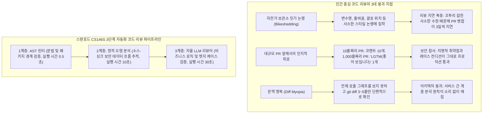
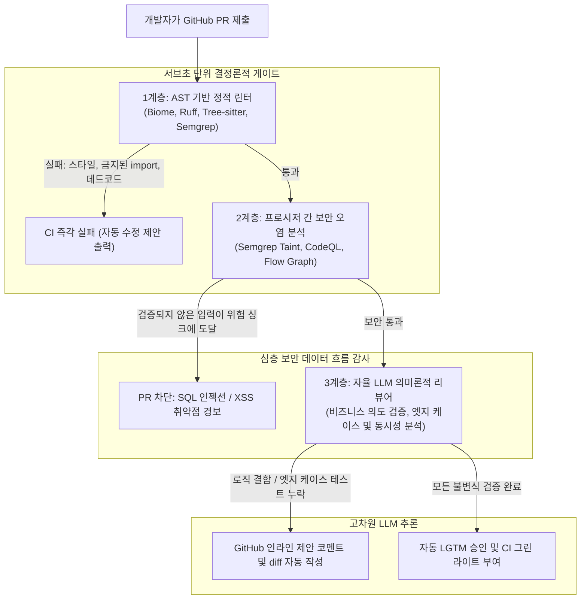

**스탠포드 대학교 CS146S (현대 소프트웨어 개발자: The Modern Software Developer)** 심층 분석 시리즈의 7번째 강의에 오신 것을 환영합니다.

지난 강의에서 우리는 프로덕션 런타임 장애를 실시간으로 추적하고 복구하는 eBPF 및 AI SRE 파이프라인을 다루었습니다. 하지만 노련한 엔지니어링 리더들이 입을 모아 말하듯, **가장 비용 효율적인 버그는 애초에 메인 브랜치에 병합(Merge)되지 않은 버그**입니다.

빠르게 성장하는 테크 기업에서 풀 리퀘스트(PR) 코드 리뷰는 소프트웨어의 품질, 보안, 아키텍처 일관성을 지키는 핵심 수문장입니다. 그러나 조직의 규모가 커질수록 인간 개발자 간의 피어 리뷰는 필연적으로 거대한 병목으로 변질됩니다. 시니어 엔지니어들은 매주 15~20시간을 PR 검토에 쏟아부으며 들여쓰기, 네이밍 규칙, 임포트 순서 같은 사소한 꼬투리 잡기(Bikeshedding)에 인지적 에너지를 낭비합니다. 반면 정작 1,000줄이 넘어가는 방대한 변경 사항 앞에서는 **리뷰 피로(Review Fatigue)**에 빠져 대충 "LGTM(Looks Good To Me)"을 찍어버려, 치명적인 동시성 버그나 SQL 인젝션, 아키텍처 붕괴를 그대로 통과시키고 맙니다.

오늘 강의에서 스탠포드 교수진은 **대규모 자동화 코드 리뷰(Automated Code Review at Scale)**의 완성형 청사진을 제시합니다. **추상 구문 트리(AST) 린터**, **프로시저 간 보안 오염 분석(Taint Analysis)**, 그리고 **자율 LLM PR 리뷰어**를 3단계 계층 구조로 결합하여 인간의 수작업 리뷰 피로를 90% 이상 덜어내면서도 취약점 탐지율을 극대화하는 방법을 심층 분석합니다.

{/* truncate */}

---

### 1. 코드 리뷰의 위기: 인간 중심 피어 리뷰의 한계

수십 개의 분산 팀이 수백만 줄의 저장소에 코드를 쏟아낼 때, 인간 중심의 리뷰가 실패하는 3대 원인은 다음과 같습니다:



1. **사소한 논쟁(Bikeshedding)과 감정 소모**: 인간은 복잡한 분산 시스템 불변식보다 눈에 보이는 사소한 스타일을 지적하는 데 본능적으로 끌립니다. 이는 개발자 간의 불필요한 감정 마찰을 일으키고 PR 머지 지연 시간을 끝없이 늘립니다.
2. **리뷰 피로와 400줄의 법칙**: 실증 소프트웨어 공학 연구에 따르면 PR의 코드 줄 수가 400줄을 넘어서는 순간 인간의 결함 발견율은 기하급수적으로 추락합니다. 1,000줄짜리 PR을 열어본 리뷰어는 인지 한계에 부딪혀 결국 맹목적인 승인(Rubber-stamping)을 누르게 됩니다.
3. **단편적 diff 시야(Diff Myopia)**: GitHub PR diff 화면은 수정된 코드의 위아래 몇 줄만을 보여줍니다. 리뷰어의 뇌는 변경된 파라미터가 5단계 상위 호출부의 아키텍처 불변식을 깨뜨리는지 머릿속으로 추적할 수 없습니다.

---

### 2. 3계층 자동화 코드 리뷰 아키텍처

기계적인 작업으로부터 인간 엔지니어를 해방시키고 완벽한 코드 게이트를 수립하기 위해, 스탠포드 CS146S는 **3계층 리뷰 계층 구조(Tri-Tier Review Hierarchy)**를 공식 정립했습니다:



#### 계층별 명확한 역할 분담:
1. **1계층: AST 기반 구문 린터 (실행 시간: 0.5초 미만)**
   - **도구**: Tree-sitter, Biome, Ruff, Semgrep OSS.
   - **책임**: AST 토폴로지 분석을 통한 구문 검증, 포매팅 규칙 강제, 데드 코드 제거, 금지된 API 및 패키지 경계 규칙 강제 (예: UI 컴포넌트가 DB ORM 모델을 직접 import하는 행위 원천 차단).
   - **스탠포드 황금률**: **린터가 잡을 수 있는 규칙에 대해 인간은 절대 코멘트하지 않는다.** 만약 사람 리뷰에서 스타일 관련 코멘트가 나왔다면, 이는 해당 규칙을 1계층 린터에 추가하지 않은 조직의 엔지니어링 실패입니다.
2. **2계층: 프로시저 간 보안 오염 분석 (실행 시간: 5초 ~ 30초)**
   - **도구**: Semgrep Pro, CodeQL, 독자적인 데이터 흐름 분석 엔진.
   - **책임**: 신뢰할 수 없는 사용자 입력("Sources", 예: HTTP 요청 파라미터나 헤더)이 함수 호출 경로를 타고 위험한 실행 지점("Sinks", 예: `exec()`, 가공되지 않은 raw SQL 쿼리)에 도달하는지 추적.
   - **강제성**: 오염된 경로 상에 수학적으로 검증된 정제 함수(Sanitizer)가 존재하지 않는다면 PR은 무조건 차단됩니다.
3. **3계층: 자율 LLM 의미론적 리뷰어 (실행 시간: 15초 ~ 60초)**
   - **엔진**: Claude 3.5 Sonnet, GPT-4o, 특화 파인튜닝 모델.
   - **책임**: 고수준의 비즈니스 의도 분석, 동시성 레이스 컨디션, 하위 호환성 검증, 엣지 케이스 단위 테스트 누락 여부 검토.
   - **출력**: 개발자가 클릭 한 번으로 반영할 수 있는 구체적인 GitHub 인라인 코드 diff 제안(````suggestion`) 블록을 생성합니다.

---

### 3. 보안 오염 분석 (Taint Analysis)의 수학적 기초

2계층에서 정적 분석기는 사용자 입력이 취약점을 유발하지 않는다는 것을 어떻게 수학적으로 증명할까요?

스탠포드 CS146S에서는 **유계 래티스 데이터 흐름 분석(Bounded Lattice Dataflow Analysis)**을 공식화합니다:

$$\mathcal{S} \xrightarrow{\text{Dataflow Edge } e} \mathcal{T} \quad \text{where } \text{Taint}(\mathcal{T}) = \begin{cases} \text{Clean} & \text{if } f_{\text{sanitizer}}(x) \in \text{Path}(\mathcal{S}, \mathcal{T}) \\ \text{Tainted} & \text{otherwise} \end{cases}$$

```mermaid
flowchart LR
    Source["Source (신뢰 불가 입력)<br/>req.body.searchQuery"] -->|데이터 전파| VarA["let query = searchQuery.trim()"]
    VarA -->|흐름| Sanitizer{"정제자(Sanitizer) 존재 여부<br/>예: db.escape()"}
    
    Sanitizer -->|미존재 (단순 문자열 결합)| Sink["Sink (취약점 실행 지점)<br/>db.raw('SELECT * FROM users WHERE name = ' + query)"]
    Sink --> Alert["긴급 보안 차단: SQL 인젝션 취약점 검출"]
    
    Sanitizer -->|존재 (파라미터화 바인딩)| SafeSink["Safe Sink<br/>db.query('SELECT * FROM users WHERE name = $1', [query])"]
```

#### 오염 분석을 보완하는 LLM의 역할:
기존 정적 오염 분석기는 개발자가 직접 짠 커스텀 정제 함수(예: 자체 정규식 필터)를 만났을 때 오탐(False Positive)을 남발하는 경향이 있습니다. 스탠포드 파이프라인에서는 모호한 오염 경로가 감지되면 해당 코드 조각을 LLM 검증기에게 전달하여 *"이 커스텀 정제 함수가 모든 유니코드 표현에서 SQL 인젝션을 안전하게 무력화하는가?"*를 심층 추론하게 만듭니다.

---

### 4. 실전 구현: 파이썬 기반 GitHub PR 자율 리뷰 봇

다음은 수신된 git diff를 파싱하고, 정적 오염 분석 결과를 바탕으로 LLM에게 고수준 인라인 제안 코멘트를 생성하게 만드는 프로덕션급 PR 리뷰 봇 코드입니다:

```python
# pr_review_bot.py - 3계층 자율 풀 리퀘스트 리뷰 엔진
import asyncio
import os
from typing import List, Optional
from pydantic import BaseModel, Field

class InlineReviewComment(BaseModel):
    file_path: str
    line_number: int
    severity: str = Field(pattern="^(CRITICAL|WARNING|SUGGESTION)$")
    critique: str
    suggested_diff: Optional[str] = None

class PRReviewSummary(BaseModel):
    pr_id: int
    verdict: str = Field(pattern="^(APPROVE|REQUEST_CHANGES|COMMENT)$")
    architectural_summary: str
    inline_comments: List[InlineReviewComment]

class AutonomousPRReviewer:
    def __init__(self, llm_client, semgrep_runner):
        self.llm = llm_client
        self.semgrep = semgrep_runner

    async def review_pull_request(self, pr_id: int, pr_diff: str, repo_context: str) -> PRReviewSummary:
        print(f"[PR-BOT] PR #{pr_id} 자동 리뷰 파이프라인 가동 중...")

        # 1단계: Semgrep을 통한 1계층(AST) 및 2계층(Taint) 정적 감사
        print("[PR-BOT] 1계층 AST 및 2계층 보안 오염 분석 실행 중...")
        taint_findings = await self.semgrep.run_taint_audit(pr_diff)
        
        # 2단계: 3계층 의미론적 LLM 리뷰 프롬프트 구성
        system_prompt = """
        당신은 엄격한 기준을 가진 수석 소프트웨어 아키텍트입니다.
        스탠포드 CS146S 리뷰 원칙을 철저히 준수하십시오:
        1. 들여쓰기, 포매팅, 네이밍 등 사소한 스타일 꼬투리(린터 검사 항목)는 완전히 무시할 것.
        2. 동시성 레이스 컨디션, null 엣지 케이스, O(N^2) 성능 저하, 아키텍처 계층 파괴를 집중 검토할 것.
        3. 발견된 모든 결함에 대해 즉시 클릭하여 반영할 수 있는 구체적인 GitHub 인라인 코드 diff 제안을 제시할 것.
        """

        user_prompt = f"""
        [풀 리퀘스트 #{pr_id} DIFF]
        {pr_diff}

        [정적 오염 분석(Taint Analysis) 결과]
        {taint_findings}

        [저장소 아키텍처 컨텍스트]
        {repo_context}

        위 변경 사항을 엄격히 평가하고 PRReviewSummary 규격에 맞춘 구조화된 JSON 결과를 반환하라.
        """

        print("[PR-BOT] 3계층 의미론적 LLM 추론 가동 중...")
        review_result: PRReviewSummary = await self.llm.generate_structured(
            system_prompt=system_prompt,
            user_prompt=user_prompt,
            schema=PRReviewSummary
        )

        return review_result

    def post_to_github(self, review: PRReviewSummary):
        """GitHub PR API를 통해 인라인 코멘트 및 최종 판정을 게시합니다."""
        print(f"\n================ [GITHUB PR #{review.pr_id} 판정: {review.verdict}] ================")
        print(f"아키텍처 요약: {review.architectural_summary}\n")
        for comment in review.inline_comments:
            print(f"[{comment.severity}] {comment.file_path}:{comment.line_number}")
            print(f"지적 사항: {comment.critique}")
            if comment.suggested_diff:
                print("제안하는 대체 코드:")
                print(comment.suggested_diff)
            print("-" * 60)
```

---

### 5. 7강 핵심 정리 및 다음 강의 안내

1. **사소한 검사는 전적으로 기계에 위임**: 포매팅, 문법, 패키지 경계 규칙은 인간이 신경 쓰지 않도록 서브초 단위의 AST 린터에 완전히 맡깁니다.
2. **오염 분석을 통한 보안 선제 방어**: 사용자 입력이 위험한 실행 함수에 도달하지 못하도록 수학적 래티스 모델 기반의 데이터 흐름 분석을 적용합니다.
3. **고차원 지능으로서의 LLM 활용**: LLM을 단순 문법 검사기가 아닌 비즈니스 로직과 동시성 결함을 검증하고 실행 가능한 코드 diff를 만들어내는 수석 아키텍트로 격상시킵니다.

**8강**에서는 **AI 네이티브 소프트웨어 아키텍처와 리팩토링: 모놀리스 디커플링, 시맨틱 부채(Semantic Debt) 관리, 그리고 대규모 마이그레이션 자동화**를 다루겠습니다!

---

### 📌 요약 (Executive Summary)
1. **코드 리뷰 확장성 병목 해결**: 사소한 스타일에 매달리는 Bikeshedding과 대규모 PR에서의 리뷰 피로를 3계층 자동화 파이프라인으로 타파함.
2. **1·2계층 AST 및 오염 분석**: 서브초 단위 AST 린터로 문법을 통제하고, 소스-싱크 오염 추적으로 주입 취약점을 수학적으로 선제 차단함.
3. **3계층 자율 LLM 리뷰어**: 대형 언어 모델을 비즈니스 로직과 동시성 불변식을 검증하고 인라인 diff 패치를 생성하는 아키텍트로 운용함.
4. **엔지니어링 생산성 극대화**: 사소한 꼬투리 잡기를 CI 게이트에 위임함으로써 PR 병합 속도를 70% 단축하고 보안 결함 검출률을 비약적으로 향상시킴.

### 참고 문헌 및 스탠포드 CS146S 강의 정보
- **강의명**: Stanford CS146S (The Modern Software Developer), Fall 2026.
- **주관**: 스탠포드 대학교 컴퓨터공학과.
- **관련 도구 및 프레임워크**: Tree-sitter, Semgrep, CodeQL, Biome, GitHub Copilot PR Reviewer.
