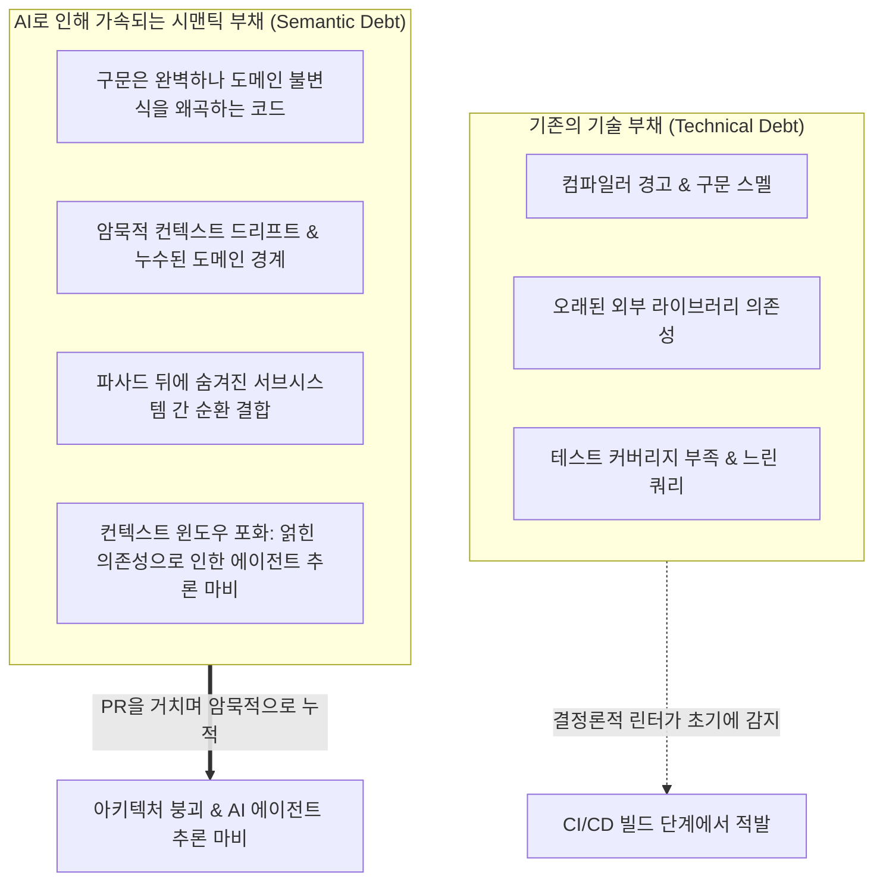
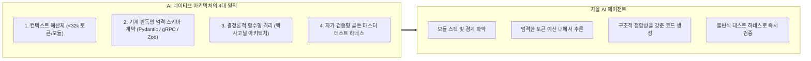
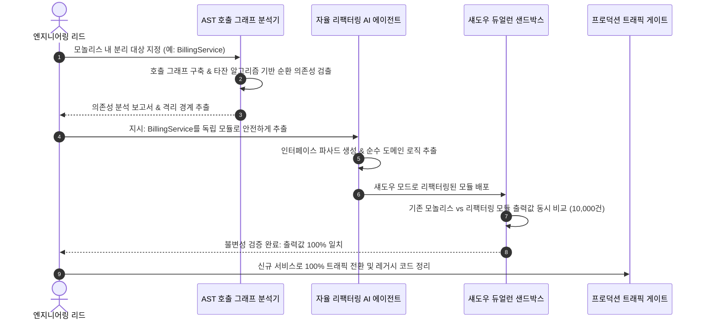

**스탠포드 대학교의 최신 소프트웨어 엔지니어링 강의 CS146S: The Modern Software Developer(현대 소프트웨어 개발자)** 심층 분석 시리즈 여덟 번째 시간입니다.

지난 강의들에서는 개별 엔지니어의 코딩 LLM 프롬프트 엔지니어링(2강), Model Context Protocol(MCP)을 통한 자율 도구 연동(3강), 자가 치유형 테스트 하네스(4강), 다중 에이전트 스웜 오케스트레이션(5강), eBPF 런타임 이상 추적(6강), 그리고 AST 린터와 오염 분석(Taint Analysis) 기반의 자동 코드 리뷰(7강)를 다루었습니다.

이번 **8강**에서는 초고속 AI 에이전트를 실제 프로덕션 저장소에 도입했을 때 직면하는 구조적이고 장기적인 문제를 정면으로 다룹니다: **"AI 에이전트가 복잡도에 질식하지 않고 스스로 탐색하고 수정할 수 있는 소프트웨어 아키텍처는 어떻게 설계해야 하는가? 그리고 10년 묵은 레거시 모놀리스를 AI 에이전트로 안전하게 리팩터링하고 분해하는 방법은 무엇인가?"**

엔지니어링 조직이 AI 에이전트 도입을 확장할 때 마주치는 가장 큰 병목은, 방대한 전역 가변 상태와 암묵적 순환 의존성으로 뒤엉킨 기존의 거대 모놀리스 구조입니다. 이번 강의에서 스탠포드 연구진은 AI 시대에 발생하는 새로운 기술적 위기인 **시맨틱 부채(Semantic Debt)**의 수학적/구조적 메커니즘을 규명하고, **AI 네이티브 아키텍처의 4대 불변 원칙**과 **AST 기반 모놀리스 분해 실전 파이프라인**을 제시합니다.

{/* truncate */}

---

### 1. 속도의 역설: 기술 부채 vs. 시맨틱 부채 (Semantic Debt)

전통적인 소프트웨어 엔지니어링은 **기술 부채(Technical Debt)**를 기준으로 코드베이스의 건전성을 평가해 왔습니다. 버전이 지난 라이브러리, N+1 데이터베이스 쿼리, 누락된 단위 테스트, 코드 스멜 등은 정적 분석기와 APM에 의해 명확히 감지됩니다.

하지만 자율 AI 코딩 에이전트가 워크플로에 진입하면서 개발 속도가 폭발적으로 증가했습니다. 며칠이 걸리던 기능 구현이 수 분 만에 끝나지만, 이 통제되지 않은 속도는 훨씬 더 치명적인 실패 모드를 초래합니다: 바로 **시맨틱 부채(Semantic Debt)**입니다.



#### 시맨틱 부채란 무엇인가?
시맨틱 부채란 LLM이 생성한 코드가 **문법적으로 완벽하고 로컬 단위 테스트를 통과하지만, 시스템 전체의 아키텍처 불변식을 은밀하게 위반하거나 도메인 로직을 파편화하여 결합도를 기하급수적으로 높이는 현상**을 뜻합니다:
1. **컨텍스트 윈도우 포화 (Context Window Saturation)**: 주문 결제 취소 로직이 결제, 재고, 알림 모듈 간 순환 DB 쿼리로 뒤엉켜 있을 경우, 에이전트는 단일 함수를 수정하기 위해 10만 토큰이 넘는 전체 저장소를 읽어야 하며, 이는 필연적인 환각과 버그를 초래합니다.
2. **개념 파편화 (Concept Fragmentation)**: 서로 다른 LLM 프롬프트로 작업한 개발자들이 '사용자 활성 상태 검증'을 서로 다른 3가지 방식(Enum 비교, 비트 플래그, 불리언 헬퍼)으로 작성하여 도메인 일관성이 깨집니다.
3. **유령 추상화 (Ghost Abstractions)**: AI 에이전트는 프롬프트의 지시를 단기적으로 만족시키기 위해 도메인 경계와 무관한 얕은 래퍼 클래스를 남발하여 의존성 그래프를 복잡하게 만듭니다.

시맨틱 부채를 방치하면 최신 추론 모델(Claude 3.7 Sonnet, GPT-4.5)조차 컨텍스트 마비에 빠져 하나의 버그를 고치면 인접 서비스 3개가 망가지는 악순환이 발생합니다.

---

### 2. AI 네이티브 소프트웨어 아키텍처의 4대 불변 원칙

AI 에이전트와 인간 엔지니어가 지속 가능하게 협업할 수 있도록 스탠포드 CS146S는 **AI 네이티브 아키텍처(AI-Native Architecture)**를 정의합니다.

AI 네이티브 아키텍처는 단순히 AI API를 호출하는 서비스가 아니라, **자율 AI 에이전트가 스스로 코드를 관찰하고, 수정하고, 검증할 수 있도록 처음부터 설계된 시스템 구조**를 의미합니다.



#### 원칙 1: 엄격한 컨텍스트 예산제 (Strict Context Budgeting)
인간의 작업 기억이 약 $7 \pm 2$개의 개념에 국한되는 것처럼, LLM 역시 백만 토큰 프롬프트 내에서 바늘 찾기(Needle In A Haystack) 집중력 저하가 일어납니다. AI 네이티브 아키텍처는 모듈당 엄격한 컨텍스트 예산을 강제합니다:
- 하나의 완결된 모듈, 서비스, 도메인 경계는 인터페이스, 비즈니스 로직, 단위 테스트를 모두 포함하여 **32k 토큰 이내**로 완벽히 이해 가능해야 합니다.
- 만약 특정 컴포넌트의 버그를 고치기 위해 에이전트가 32k 토큰을 초과하는 외부 코드를 읽어야 한다면, 해당 컴포넌트는 아키텍처 경계를 위반한 것이며 즉시 분해 대상이 됩니다.

#### 원칙 2: 기계 판독형 엄격한 스키마 계약 (Explicit Schema Contracts)
인간 개발자는 애매모호한 자연어 주석을 문맥으로 유추할 수 있지만, AI 에이전트는 기계가 검증할 수 있는 엄격한 스키마를 요구합니다:
- 모든 모듈 간 데이터 교환에 **TypeScript/Zod** 또는 **Python/Pydantic** 모델을 강제합니다.
- 서비스 경계 간에는 **Protocol Buffers(Protobuf)** 또는 **OpenAPI 3.1** 스펙을 통해 불변의 직렬화 계약을 정의합니다.
- 런타임 데이터 구조에 사전 조건(Pre-conditions), 사후 조건(Post-conditions), 불변식 단언문(Invariants)을 명시합니다.

#### 원칙 3: 헥사고날 격리 (Ports & Adapters)
AI 에이전트는 순수 알고리즘 변환과 비즈니스 규칙 처리에는 탁월하지만, 원시 데이터베이스 연결, 외부 서드파티 REST API, 전역 싱글톤과 같은 외부 부수 효과(Side-Effects)를 다룰 때 버그를 자주 만듭니다.
- **순수 도메인 로직**은 I/O 의존성을 전혀 갖지 않는 순수 함수형 코어로 유지합니다.
- 데이터베이스, 메시지 큐, 외부 API는 강력한 타입 인터페이스("포트") 뒤에 위치한 **어댑터(Adapter)**로 철저히 격리합니다.
- 에이전트가 비즈니스 로직을 리팩터링할 때 외부 어댑터는 일절 건드리지 않고 순수 도메인 코어 내부에서만 안전하게 작업합니다.

#### 원칙 4: 특성화 테스트 하네스 (Golden Master)
AI 에이전트에게 핵심 레거시 모듈의 리팩터링을 맡기기 전에, 수천 개의 실제 입출력 스냅샷을 캡처한 **골든 마스터(Golden Master) 특성화 테스트 하네스**를 사전 구축합니다. 이는 리팩터링 중 발생할 수 있는 시맨틱 변질을 0%로 통제하는 경험적 진실(Ground Truth) 역할을 합니다.

---

### 3. AST 기반 모놀리스 분해: 스트랭글러 피그 패턴의 재해석

수백만 줄의 10년 된 레거시 엔터프라이즈 모놀리스를 어떻게 안전하게 AI 네이티브 모듈형 구조로 전환할 것인가? 스탠포드 CS146S는 실패 위험이 극도로 높은 인간의 수동 빅뱅 재작성을 단호히 거부하고, **AST 기반 자율 분해(AST-Guided Autonomous Decoupling)**를 채택합니다.



#### 1단계: AST 호출 그래프 분석 및 SCC 분해
코드에 손을 대기 전에 추상 구문 트리(AST)를 분석하여 함수/클래스를 정점($V$), 호출/임포트를 간선($E$)으로 갖는 유향 의존성 그래프 $G = (V, E)$를 구축합니다.

**타잔의 강결합 컴포넌트(Tarjan's Strongly Connected Components, SCC) 알고리즘**을 통해 모듈 간 순환 참조(`A -> B -> A`)를 찾아내고, 이벤트 버스나 의존성 주입(DI) 인터페이스를 주입하여 순환 고리를 먼저 끊어냅니다.

#### 2단계: 자동 파사드 및 인터페이스 추출
AI 에이전트가 모놀리스 코어와 분리 대상 모듈 사이에 명시적인 인터페이스 파사드를 자동으로 생성합니다. 모놀리스 내부의 직접 함수 호출은 모두 이 파사드를 경유하도록 자동 리라이팅됩니다.

#### 3단계: 섀도우 듀얼런(Shadow Dual-Run) 무중단 검증
리팩터링된 코드는 결코 라이브 프로덕션에 즉시 배포되지 않습니다. **섀도우 프록시(Shadow Proxy)**가 프로덕션 읽기 트래픽을 복제하여 기존 레거시 코드 경로와 신규 리팩터링 모듈을 동시에 실행합니다:
- 10만 건 이상의 실트래픽 요청에서 두 경로의 출력값과 응답 지연 시간이 100% 일치할 때에만 점진적 롤아웃을 승인합니다.
- 불일치가 발생하면 런타임 diff 데이터가 즉시 AI 에이전트에게 반환되어 자가 치유 패치를 유도합니다.

---

### 4. 실행 가능한 실습 코드: AST 의존성 그래프 & 순환 결합 분석기

아래는 저장소의 파이썬 코드를 AST 수준에서 파싱하여 모듈 간 의존성 그래프를 생성하고, 타잔의 SCC 알고리즘으로 순환 참조를 검출하며, AI 에이전트의 컨텍스트 토큰 예산을 진단하는 완성형 도구입니다.

```python
"""
ast_dependency_analyzer.py
스탠포드 CS146S - 자율 아키텍처 리팩터링 툴킷
코드베이스를 분석하여 모듈 간 의존성 그래프를 추출하고,
타잔의 SCC 알고리즘으로 순환 결합을 탐지하며,
AI 네이티브 모듈성을 위한 컨텍스트 토큰 예산을 진단합니다.
"""

import ast
import os
import sys
from typing import Dict, Set, List
from collections import defaultdict


class DependencyVisitor(ast.NodeVisitor):
    def __init__(self, current_module: str):
        self.current_module = current_module
        self.dependencies: Set[str] = set()

    def visit_Import(self, node: ast.Import):
        for alias in node.names:
            self.dependencies.add(alias.name.split('.')[0])
        self.generic_visit(node)

    def visit_ImportFrom(self, node: ast.ImportFrom):
        if node.module:
            self.dependencies.add(node.module.split('.')[0])
        self.generic_visit(node)


class CodebaseGraphAnalyzer:
    def __init__(self, root_dir: str):
        self.root_dir = root_dir
        self.graph: Dict[str, Set[str]] = defaultdict(set)
        self.module_token_estimates: Dict[str, int] = {}

    def scan_codebase(self) -> None:
        """디렉터리를 순회하며 AST를 파싱하고 의존성 그래프를 매핑합니다."""
        for root, _, files in os.walk(self.root_dir):
            for file in files:
                if file.endswith('.py') and not file.startswith('__'):
                    filepath = os.path.join(root, file)
                    rel_path = os.path.relpath(filepath, self.root_dir)
                    module_name = rel_path.replace(os.path.sep, '.').replace('.py', '')

                    try:
                        with open(filepath, 'r', encoding='utf-8') as f:
                            content = f.read()
                            # 대략적인 토큰 근사치 계산 (1 토큰 ~ 영문 4자 / 한글 2~3자)
                            self.module_token_estimates[module_name] = len(content) // 4
                            tree = ast.parse(content, filename=filepath)

                        visitor = DependencyVisitor(module_name)
                        visitor.visit(tree)

                        for dep in visitor.dependencies:
                            if dep != module_name and os.path.exists(os.path.join(self.root_dir, dep + '.py')):
                                self.graph[module_name].add(dep)
                    except Exception as err:
                        print(f"경고: {filepath} 파싱 실패: {err}", file=sys.stderr)

    def find_strongly_connected_components(self) -> List[List[str]]:
        """순환 의존성 클러스터를 탐지하는 타잔(Tarjan) 알고리즘 구현체."""
        index = 0
        indices: Dict[str, int] = {}
        lowlinks: Dict[str, int] = {}
        on_stack: Dict[str, bool] = defaultdict(bool)
        stack: List[str] = []
        sccs: List[List[str]] = []

        nodes = list(self.graph.keys())
        for node in self.graph:
            for dep in self.graph[node]:
                if dep not in nodes:
                    nodes.append(dep)

        def strongconnect(node: str):
            nonlocal index
            indices[node] = index
            lowlinks[node] = index
            index += 1
            stack.append(node)
            on_stack[node] = True

            for successor in self.graph.get(node, []):
                if successor not in indices:
                    strongconnect(successor)
                    lowlinks[node] = min(lowlinks[node], lowlinks[successor])
                elif on_stack[successor]:
                    lowlinks[node] = min(lowlinks[node], indices[successor])

            if lowlinks[node] == indices[node]:
                scc = []
                while True:
                    w = stack.pop()
                    on_stack[w] = False
                    scc.append(w)
                    if w == node:
                        break
                if len(scc) > 1:
                    sccs.append(scc)

        for node in nodes:
            if node not in indices:
                strongconnect(node)

        return sccs

    def evaluate_ai_native_readiness(self, max_context_tokens: int = 8000) -> None:
        """모듈성 진단 및 시맨틱 부채 위험 보고서를 출력합니다."""
        print("=" * 70)
        print("스탠포드 CS146S - AI 네이티브 아키텍처 준비도 평가 리포트")
        print("=" * 70)

        sccs = self.find_strongly_connected_components()
        if sccs:
            print(f"⚠️  경고: {len(sccs)}개의 순환 의존성 클러스터가 감지되었습니다!")
            for idx, cycle in enumerate(sccs, 1):
                print(f"   클러스터 #{idx} (에이전트 리팩터링 전 반드시 분리 필요):")
                print(f"   --> {' <---> '.join(cycle)}")
        else:
            print("✅ 클린 아키텍처: 순환 의존성이 전혀 발견되지 않았습니다.")

        print("\n📊 컨텍스트 예산 분석 (목표: 모듈당 8,000 토큰 미만):")
        oversized_modules = []
        for mod, tokens in sorted(self.module_token_estimates.items(), key=lambda x: x[1], reverse=True):
            status = "✅ 적합" if tokens <= max_context_tokens else "❌ 초과 (시맨틱 부채 위험)"
            print(f" - {mod:<35} : ~{tokens:>5} 토큰 [{status}]")
            if tokens > max_context_tokens:
                oversized_modules.append((mod, tokens))

        if oversized_modules:
            print(f"\n🚨 권고 조치: {len(oversized_modules)}개 모듈이 단일 프롬프트 컨텍스트 예산을 초과합니다.")
            print("   에이전트에게 자율 수정을 맡기기 전 스트랭글러 피그 패턴으로 분해하십시오.")
        print("=" * 70)


if __name__ == "__main__":
    current_workspace = os.path.dirname(os.path.abspath(__file__))
    analyzer = CodebaseGraphAnalyzer(current_workspace)
    analyzer.scan_codebase()
    analyzer.evaluate_ai_native_readiness()
```

---

### 5. 핵심 요약 및 다음 강의 예고

1. **속도의 함정에 빠지지 마라**: 아키텍처 원칙 없이 AI로 코드를 빠르게 찍어내면, 결국 컨텍스트 포화와 암묵적 결합으로 인해 에이전트가 마비되는 **시맨틱 부채**에 직면하게 됩니다.
2. **에이전트의 인지 구조에 맞춰 설계하라**: 단일 모듈 컨텍스트 예산(< 32k 토큰), 기계 판독형 스키마(Pydantic/Zod), 부수 효과가 격리된 헥사고날 코어로 아키텍처를 재편해야 합니다.
3. **AST 그래프로 모놀리스를 안전하게 분해하라**: 맹목적인 재작성 대신 AST 의존성 트리 파싱, 순환 결합 해소, 섀도우 듀얼런 샌드박스 검증을 통해 무중단으로 모듈화를 달성하십시오.

다음 **9강**에서는 **자율 테스트 주도 개발(ATDD)과 형식 검증(Formal Verification): Z3 SMT 솔버 제약 조건과 속성 기반 테스트(PBT)를 활용한 LLM 생성 코드의 수학적 무결성 증명**을 다룹니다.

---

### 📌 3–5줄 핵심 요약
1. **시맨틱 부채의 위험성 규명**: 무분별한 AI 코드 생성으로 인해 구문은 정상이지만 시스템 불변식이 깨지고 결합도가 급증하여 LLM 추론이 마비되는 현상을 진단했습니다.
2. **AI 네이티브 아키텍처 4대 원칙 확립**: 모듈당 엄격한 컨텍스트 예산(< 32k 토큰), 엄격한 스키마 계약, 부수 효과가 차단된 헥사고날 구조, 골든 마스터 테스트 하네스 기준을 제시했습니다.
3. **AST 기반 모놀리스 자율 분해 전략**: 위험한 수동 재작성 대신 AST 호출 그래프 분석, 타잔 순환 참조 검출, 섀도우 듀얼런 검증을 통한 무중단 분해 기법을 정립했습니다.
4. **실행 가능한 진단 툴킷 구현**: 저장소의 모듈 의존성을 스캔하고 순환 결합을 찾아내며 AI 컨텍스트 예산 초과 여부를 자동으로 판별하는 파이썬 분석기를 제공했습니다.

### 참고 문헌 및 스탠포드 CS146S 자료
- **강의**: Stanford CS146S (The Modern Software Developer), Fall 2026.
- **교수진**: Stanford University Computer Science Department.
- **관련 기술 및 라이브러리**: Python AST, Tarjan's SCC Algorithm, ArchUnit, Pydantic, Zod, OpenTelemetry, Docusaurus MDX.
