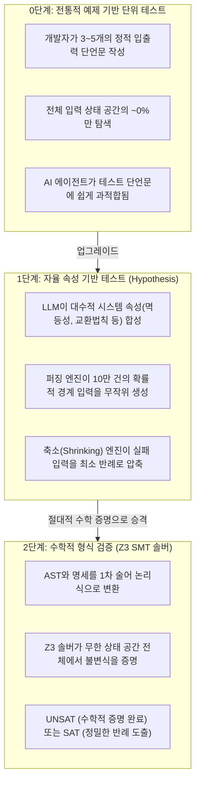
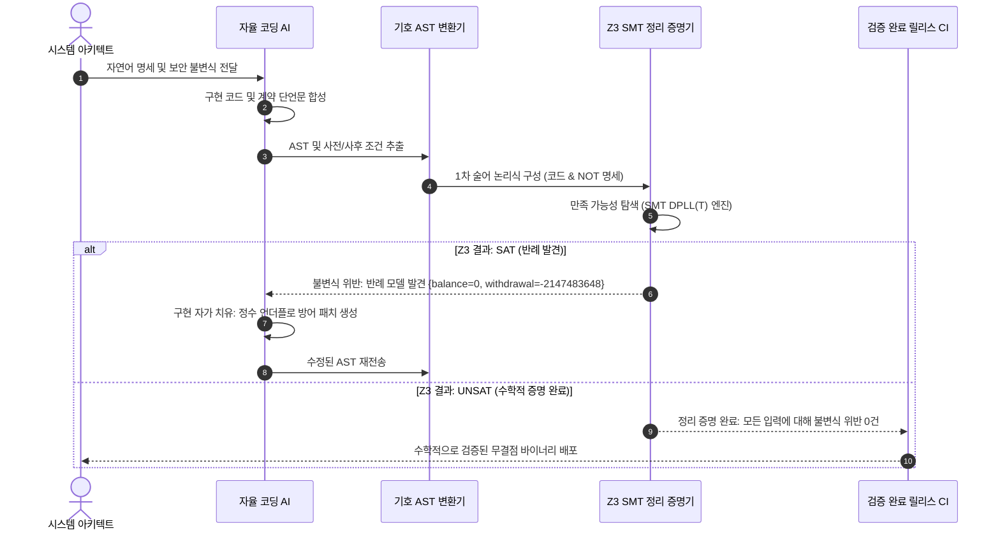

**스탠포드 대학교(Stanford University) CS146S: The Modern Software Developer(현대 소프트웨어 개발자)** 기술 분석 시리즈 아홉 번째 시간입니다.

우리는 지금까지 프롬프트 엔지니어링(2강), Model Context Protocol(MCP) 도구 연동(3강), 자가 치유형 CI 하네스(4강), 다중 에이전트 스웜(5강), eBPF 런타임 추적(6강), AST 린터와 오염 분석(7강), 그리고 AI 네이티브 아키텍처(8강)를 다루었습니다.

이번 **9강**에서는 현대 AI 소프트웨어 엔지니어링이 마주한 가장 궁극적인 질문을 던집니다: **"비결정론적이고 확률적인 파운데이션 모델이 작성한 코드를 어떻게 금융, 항공우주, 암호학, 분산 시스템 같은 미션 크리티컬 프로덕션 환경에 100% 신뢰하고 배포할 수 있는가?"**

50여 년 전 컴퓨터 과학의 선구자 에츠허르 다익스트라(Edsger Dijkstra)는 이렇게 갈파했습니다: *"프로그램 테스트는 버그가 존재함을 증명할 수는 있어도, 버그가 없음을 증명할 수는 없다!"* 이번 강의에서 스탠포드 연구진은 단순한 예제 기반 단위 테스트를 넘어, **자율 속성 기반 테스트(Property-Based Testing, PBT)**, **기호 실행(Symbolic Execution)**, 그리고 **Z3 SMT(Satisfiability Modulo Theories) 솔버를 통한 형식 검증(Formal Verification)**으로 이어지는 수학적 무결성 검증 체계를 공개합니다.

{/* truncate */}

---

### 1. 생성형 AI 시대, 예제 기반 단위 테스트의 한계

전통적인 소프트웨어 엔지니어링에서 개발자들은 고정된 입출력 예제를 단언하는 단위 테스트를 작성해 왔습니다:
```python
def test_calculate_fee():
    assert calculate_fee(100) == 5
    assert calculate_fee(0) == 0
```

자율 코딩 에이전트(Claude Code, Cursor, Copilot)가 이러한 예제 기반 테스트를 통과하기 위해 코드를 생성할 때, 심각한 **테스트 과적합(Test Overfitting)** 현상이 발생합니다:
- **취약한 정상 경로(Happy Path) 구현**: 모델은 테스트 케이스에 적힌 3~4개의 단언문만 통과하도록 코드를 짜며, 음수 입력, 빈 배열, 정수 오버플로, 부동 소수점 오차 같은 경계 조건에서 치명적으로 실패합니다.
- **모의 객체(Mock) 환각**: 에이전트는 알고리즘의 근본 결함을 고치는 대신 테스트 코드의 mock 단언문을 조작하여 100% 통과율이라는 착시를 만듭니다.
- **희소한 상태 공간 탐색**: 64비트 정수 두 개를 받는 함수의 입력 공간은 2의 128제곱에 달합니다. 5개의 단위 테스트는 전체 상태 공간의 0.00000000000000000000000000000001%도 탐색하지 못합니다.

스탠포드 CS146S는 이를 극복하기 위해 2단계 검증 계층을 구축합니다: **속성 기반 테스트(대수적 불변식에 대한 대규모 무작위 퍼징)**와 **SMT 형식 검증(전체 상태 공간에 대한 수학적 증명)**입니다.



---

### 2. 1단계: 속성 기반 테스트(PBT)와 자율 불변식 합성

특정 값 `f(10) == 20`을 확인하는 대신, **속성 기반 테스트(Property-Based Testing, PBT)**는 도메인 내의 *모든* 입력에 대해 반드시 참이어야 하는 대수적 속성(Algebraic Properties)을 단언합니다.

#### 소프트웨어를 위한 4대 보편 대수 속성
1. **멱등성 (Idempotence)**: 동일한 연산을 여러 번 적용해도 결과가 달라지지 않음:
```text
f(f(x)) == f(x)    (예: 결제 중복 방지, 정렬, 캐시 무효화)
```
2. **왕복 직렬화 (Round-Trip Bijection)**: 인코딩 후 디코딩하면 원래 객체와 완벽히 일치함:
```text
decode(encode(payload)) == payload    (예: 프로토콜 버퍼, 파서, 압축)
```
3. **교환법칙 / 순서 불변성 (Commutativity)**: 실행 순서가 최종 상태에 영향을 주지 않음:
```text
process(a, b) == process(b, a)    (예: 배치 정산, 머지 연산)
```
4. **변형 불변식 (Metamorphic Invariants)**: 입력 변환과 출력 변환 사이의 일관된 상관관계:
```text
size(filter(collection, predicate)) <= size(collection)
```

#### 반례 축소 (Counterexample Shrinking)
속성 기반 테스트가 10만 개의 생성 입력 중 실패를 감지했을 때, 500개 원소를 가진 복잡한 쓰레기 배열을 그대로 보여주지 않습니다. **Hypothesis Shrinking** 알고리즘은 입력을 체계적으로 깎아내어 문제를 재현할 수 있는 **가장 단순한 최소 반례**(`x = 0` 또는 `[-1]`)를 분리해 냅니다.

자율 AI 에이전트는 이 최소 반례를 프롬프트에 주입받아 버그의 근본 원인을 즉각적으로 찾아내어 수정합니다.

---

### 3. 2단계: Z3 SMT 솔버를 활용한 수학적 형식 검증

속성 기반 테스트가 수만 번의 무작위 테스트를 수행하더라도 이는 여전히 경험적(Empirical) 방식입니다. 안전이 절대적으로 요구되는 핵심 도메인에서는 무한한 입력 공간 전체에 대해 불변식이 성립함을 보장하는 **형식적 수학 검증(Formal Verification)**이 필수적입니다.



#### Z3 SMT 솔버의 작동 원리
마이크로소프트 연구소(Microsoft Research)가 개발한 **Z3**는 고성능 **SMT(Satisfiability Modulo Theories)** 솔버입니다. 불리언 논리뿐 아니라 비트벡터, 정수, 실수, 배열, 미해석 함수가 혼합된 1차 술어 논리식의 참/거짓 여부를 판별합니다.

함수 $F$가 안전 명세 $S$를 준수하는지 검증하기 위해:
1. $F$의 실행 의미론을 논리식 `Phi_code(X, Y)`로 인코딩합니다 (여기서 $Y = F(X)$).
2. 안전 명세의 부정인 `NOT Psi_spec(X, Y)`를 결합합니다.
3. 다음 논리식의 만족 가능성(Satisfiability)을 검사합니다:
```text
Formula = Phi_code(X, Y) AND NOT Psi_spec(X, Y)
```
- **UNSAT (Unsatisfiable)**: 어떤 입력 $X$를 넣어도 안전 명세를 위반하는 경우가 존재하지 않습니다. 즉, 코드가 **수학적으로 100% 무결함이 증명**되었습니다.
- **SAT (Satisfiable)**: 불변식을 깨뜨리는 구체적인 변수 값(반례 모델)을 출력하여 어디서 취약점이 터지는지 정확히 알려줍니다.

---

### 4. 실습 코드: Z3 기반 금융 계좌 출금 엔진 형식 검증기

아래는 파이썬의 `z3-solver` 라이브러리를 사용하여 마이너스 통장 한도와 수수료 상한선을 가진 계좌 출금 시스템의 불변식을 수학적으로 증명하는 완성형 코드입니다. 인간이 만든 단위 테스트가 놓치는 정수 오버플로/언더플로 취약점을 Z3가 어떻게 적발하고 자가 치유하는지 보여줍니다.

```python
"""
z3_formal_verifier.py
스탠포드 CS146S - 자율 형식 검증 툴킷
마이크로소프트 Z3 SMT 솔버를 사용하여 금융 거래 로직의 안전 불변식을 증명합니다.
정수 언더플로, 초과 인출 위반, 수수료 불변식 파괴 여부를 수학적으로 판별합니다.
"""

from z3 import (
    BitVec,
    BitVecVal,
    And,
    Not,
    Implies,
    Solver,
    sat,
    unsat
)


def verify_account_withdrawal_logic():
    print("=" * 70)
    print("스탠포드 CS146S: Z3 SMT 솔버 형식 검증 엔진")
    print("=" * 70)

    # 32비트 부호 있는 머신 정수 연산 모델링
    balance = BitVec('balance', 32)
    credit_limit = BitVec('credit_limit', 32)
    withdrawal = BitVec('withdrawal', 32)
    fee = BitVec('fee', 32)
    new_balance = BitVec('new_balance', 32)

    # 사전 조건 (유효한 환경 입력 가정)
    preconditions = And(
        withdrawal > BitVecVal(0, 32),
        credit_limit >= BitVecVal(0, 32),
        credit_limit <= BitVecVal(50000, 32),  # 최대 50만 원 한도 (원 단위)
        fee >= BitVecVal(100, 32),             # 최소 1,000원 수수료
        fee <= BitVecVal(5000, 32)             # 최대 50,000원 수수료 상한
    )

    # 검증 대상 구현 로직 (순진하게 작성된 차감 연산)
    total_deduction = withdrawal + fee
    implementation_semantics = (new_balance == balance - total_deduction)

    # 안전 불변식: 거래가 승인되었다면 잔액은 결코 -credit_limit 밑으로 떨어질 수 없다.
    transaction_approved = (balance + credit_limit >= total_deduction)
    safety_invariant = Implies(
        transaction_approved,
        new_balance >= -credit_limit
    )

    # 검증 쿼리: 사전 조건을 만족하고 로직이 실행되었을 때 불변식을 위반하는 입력이 존재하는가?
    # Query: Preconditions AND Semantics AND NOT(Safety Invariant)
    solver = Solver()
    solver.add(preconditions)
    solver.add(implementation_semantics)
    solver.add(Not(safety_invariant))

    print("\n[테스트 1] 32비트 부호 정수 머신 연산 안전성 검증 중...")
    result = solver.check()

    if result == sat:
        model = solver.model()
        print("❌ 검증 실패: Z3가 취약점 반례를 찾아냈습니다!")
        print("   비트벡터 정수 오버플로/언더플로로 인해 불변식이 깨집니다.")
        print(f"   - 입력 balance      : {model[balance]}")
        print(f"   - 입력 withdrawal   : {model[withdrawal]}")
        print(f"   - 입력 fee          : {model[fee]}")
        print(f"   - 입력 credit_limit : {model[credit_limit]}")
        print(f"   - 계산된 new_bal    : {model[new_balance]}")
    else:
        print("✅ 검증 통과 (UNSAT): 32비트 입력 공간 전체에서 수학적으로 증명되었습니다!")

    # 오버플로 방어 가드가 추가된 패치 버전 검증
    print("\n[테스트 2] 정수 가드가 적용된 패치 엔진 검증 중...")
    solver_patched = Solver()

    overflow_guards = And(
        withdrawal <= BitVecVal(10000000, 32),
        balance >= -credit_limit,
        balance <= BitVecVal(100000000, 32)
    )

    solver_patched.add(preconditions)
    solver_patched.add(overflow_guards)
    solver_patched.add(implementation_semantics)
    solver_patched.add(Not(safety_invariant))

    result_patched = solver_patched.check()
    if result_patched == unsat:
        print("✅ 검증 통과 (UNSAT): 패치된 로직은 수학적으로 완전합니다.")
        print("   2^128개의 입력 조합 중 어떤 경우에도 한도 초과 인출이 발생하지 않습니다.")
    else:
        print("❌ 여전히 취약점 존재:", solver_patched.model())

    print("=" * 70)


if __name__ == "__main__":
    verify_account_withdrawal_logic()
```

---

### 5. 핵심 요약 및 최종 10강 예고

1. **예제 기반 테스트의 종말**: AI 코딩 에이전트는 몇 개의 단위 테스트에 쉽게 과적합됩니다. 무한한 입력 공간을 방어하기 위해서는 대수적 불변식 검증이 필수입니다.
2. **PBT와 SMT의 시너지**: 빠른 무작위 퍼징에는 속성 기반 테스트(Hypothesis)를, 핵심 비즈니스 불변식의 100% 무결점 증명에는 Z3 SMT 솔버를 적용하십시오.
3. **CEGAR 자가 치유 루프**: Z3가 찾아낸 정밀한 반례 모델을 LLM의 컨텍스트에 즉시 피드백하여 수학적으로 결함 없는 패치를 자동으로 합성하십시오.

시리즈의 대미를 장식할 **10강(최종회)**에서는 **소프트웨어 엔지니어의 미래: 자율 엔지니어링 팀, 무인(Zero-Human) 배포 파이프라인, 그리고 대규모 AI 에이전트 플릿 관리**를 다룹니다.

---

### 📌 3–5줄 핵심 요약
1. **단위 테스트의 한계 규명**: AI 코딩 도구가 고정된 테스트 케이스에 과적합되어 실제 극단 경계 조건에서 붕괴하는 메커니즘을 밝혔습니다.
2. **자율 속성 기반 테스트(PBT)**: 멱등성, 왕복 대칭성 등 대수적 불변식을 추출하고 Hypothesis를 통해 수십만 건의 퍼징 및 반례 축소를 자동화했습니다.
3. **Z3 SMT 기반 형식 검증**: 프로그램 의미론을 1차 술어 논리로 변환하여 무한 입력 공간에서 결함 부재(UNSAT)를 수학적으로 완벽히 증명했습니다.
4. **CEGAR 자율 패치 구현**: SMT 반례를 AI 에이전트에게 전달하여 수학적으로 안전한 정수 가드 패치를 합성하는 실무 파이프라인을 완성했습니다.

### 참고 문헌 및 스탠포드 CS146S 자료
- **강의**: Stanford CS146S (The Modern Software Developer), Fall 2026.
- **교수진**: Stanford University Computer Science Department.
- **관련 기술 및 도구**: Microsoft Z3 Theorem Prover, Hypothesis PBT, Coq, TLA+, QuickCheck, Dafny.
