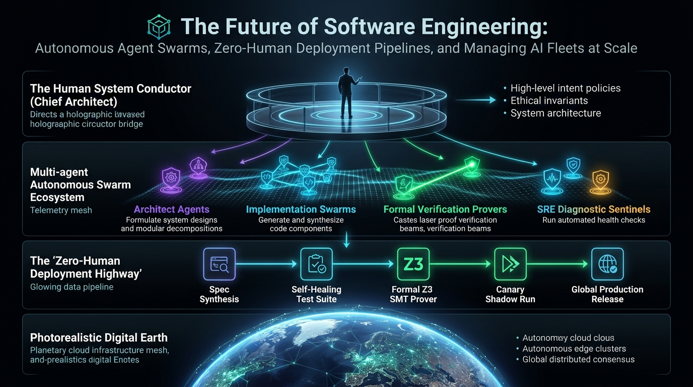
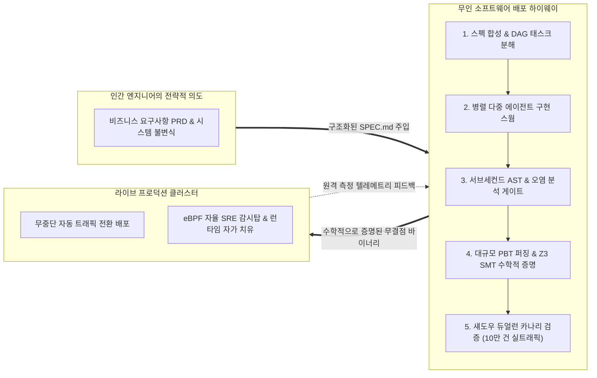
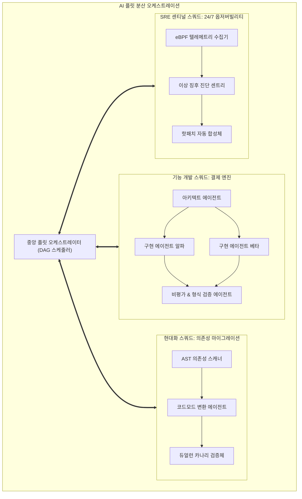
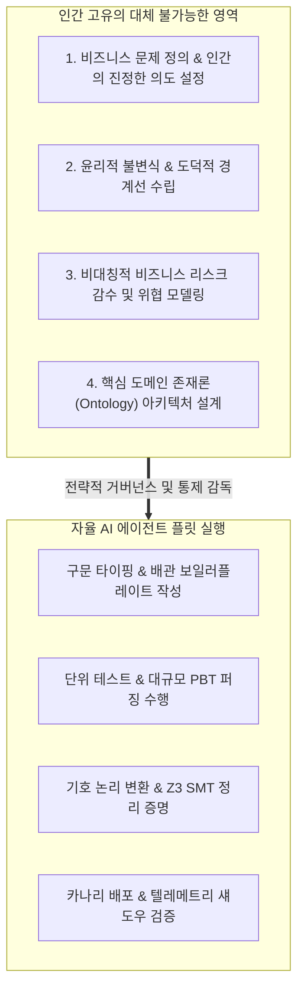

**스탠포드 대학교(Stanford University) CS146S: The Modern Software Developer(현대 소프트웨어 개발자)** 심층 분석 시리즈 **마지막 10강(최종회 대단원)**에 오신 것을 환영합니다.

지난 9주 동안 우리는 기존 소프트웨어 개발 패러다임을 바닥부터 해체하고 재구성해 왔습니다:
- **1강**: 타이피스트에서 시스템 오케스트라 지휘자(Conductor)로의 패러다임 전환
- **2강**: 코딩 LLM의 확률론적 토큰 역학과 체계적 프롬프트 엔지니어링
- **3강**: Model Context Protocol(MCP)을 통한 자율 도구 연동 표준화
- **4강**: 스펙 주도 개발(SDD)과 자가 치유형 Red-Green-Refactor 테스트 루프
- **5강**: 아키텍트-구현체-비평가(Critic) 다중 에이전트 스웜 오케스트레이션
- **6강**: eBPF 런타임 동적 추적과 AI SRE 기반 프로덕션 인시던트 완화
- **7강**: AST 린터와 보안 오염 분석(Taint Analysis) 기반의 CI/CD 자동화
- **8강**: AI 네이티브 모듈형 아키텍처, 컨텍스트 예산제, 그리고 레거시 모놀리스 분해
- **9강**: 속성 기반 불변식(PBT)과 Z3 SMT 솔버를 통한 AI 코드의 수학적 형식 검증

이번 **최종 10강(Capstone Finale)**에서는 이 모든 기법을 집대성하여 하나의 거대한 청사진으로 완성합니다: 바로 **자율 소프트웨어 공장(The Autonomous Software Factory)**입니다. 수백 개의 AI 에이전트 플릿(Fleet)을 지휘하고, 인간의 개입 없이 코드가 프로덕션으로 배포되는 **무인(Zero-Human) 배포 하이웨이**를 설계하며, 인공지능 시대에 인간 엔지니어가 갖는 영원불멸한 핵심 가치를 정의합니다.

{/* truncate */}

---

### 1. 무인(Zero-Human) 배포 하이웨이: 소프트웨어의 "다크 팩토리(Dark Factory)"

제조업에서 "다크 팩토리(Dark Factory)"란 인간 작업자 없이 100% 로봇과 자동화 라인으로만 가동되어 조명조차 켤 필요가 없는 무인 공장을 의미합니다.

스탠포드 CS146S는 소프트웨어 엔지니어링의 다크 팩토리 개념으로 **무인 배포 하이웨이(The Zero-Human Deployment Highway)**를 제시합니다.



#### 무인 배포를 보증하는 5대 자동화 검증 게이트
1. **계약 스키마 게이트 (Contract Schema Gate)**: PR 코드는 Pydantic, Protobuf, OpenAPI 3.1 등 기계 판독형 스키마에 대해 타입 누수 없이 엄격히 컴파일되어야 합니다.
2. **구조 및 보안 AST 게이트 (AST Security Gate)**: 0.1초 만에 실행되는 AST 정적 분석기가 모듈당 32k 토큰 예산 준수 여부와 순환 의존성을 검사하고, 사용자 입력이 위험한 실행 싱크로 누수되지 않는지 오염 분석(Taint Analysis)으로 차단합니다.
3. **확률적 속성 기반 게이트 (PBT Gate)**: Hypothesis 엔진이 멱등성, 왕복 대칭성 등 대수적 불변식에 대해 10만 건의 무작위 입력을 쏟아붓습니다.
4. **수학적 SMT 정리 증명 게이트 (SMT Theorem Gate)**: Z3 SMT 솔버가 코드의 실행 의미론을 1차 술어 논리로 풀어내어 정수 오버플로와 데드락 부재를 'UNSAT' 판정으로 수학적으로 완벽히 증명합니다.
5. **섀도우 듀얼런 카나리 게이트 (Shadow Dual-Run Gate)**: 프로덕션 실트래픽을 복제하여 격리 샌드박스에서 기존 레거시와 신규 코드를 병렬 실행합니다. 10만 건의 실제 요청에서 출력값과 레이턴시가 100% 일치할 때에만 트래픽을 자동 전환합니다.

어느 게이트에서든 실패가 발생하면 인간에게 장애 호출(Pager)을 보내지 않습니다. 실패를 유발한 **최소 반례(Counterexample)**가 자율 에이전트 스웜에게 즉시 반환되어 스스로 패치를 만들고 파이프라인을 재가동합니다.

---

### 2. 대규모 AI 플릿 오케스트레이션: 1,000개 에이전트 동시 통제

엔지니어링 조직이 확장되면 한 명의 개발자가 하나의 AI 채팅창을 쓰는 단계를 넘어, 수천 개의 마이크로서비스에 걸쳐 수백~수천 개의 **자율 AI 에이전트 플릿(Fleet)**을 동시에 지휘하게 됩니다.



#### 플릿 거버넌스의 3대 핵심 과제
1. **시맨틱 충돌 방지**: 20개의 에이전트가 인접 모듈을 동시 수정할 때 발생하는 로컬 성공-글로벌 왜곡 문제를 막기 위해 중앙 블랙보드(Blackboard) 이벤트 버스를 운용합니다.
2. **토큰 경제학과 계층적 라우팅**: 모든 작업에 고비용 추론 모델을 쓸 필요가 없습니다. 단순 린트와 보일러플레이트는 8B급 경량 모델에 위임하고, 심층 아키텍처 분해와 Z3 불변식 합성에만 최고 사양 모델(Claude 3.7 Sonnet, o3-mini)을 배치합니다.
3. **비잔틴 합의 프로토콜**: 에이전트 간 환각이나 설계 충돌이 발생할 경우 다수결 투표 합의 또는 엄격한 스키마 계약으로 즉시 롤백합니다.

---

### 3. 자가 진화형 코드베이스 (The Self-Evolving Codebase)

기존 조직에서는 신기능 개발 압박 때문에 기술 부채 해소와 라이브러리 업그레이드가 항상 뒤로 밀렸습니다.

AI 플릿이 도입된 자율 소프트웨어 공장에서는 **자가 진화형 코드베이스**가 현실이 됩니다:
- **야간 자율 마이그레이션**: 주요 프레임워크(Python, React 등)의 메이저 업데이트가 발표되면, 야간에 독립 브랜치에서 에이전트가 변경 로그를 파싱하고, AST 코드모드를 적용하고, 테스트를 통과시킨 뒤 아침 출근 전에 무중단 검증된 PR을 올려둡니다.
- **동적 성능 최적화**: eBPF 런타임 프로파일링으로 병목 지점을 찾은 센티널 에이전트가 핫패스 코드를 초고속 Rust/C 확장으로 재작성하고, Z3로 알고리즘 동등성을 증명한 뒤 핫패치를 배포합니다.

---

### 4. 인간 엔지니어의 재정의: 타이피스트에서 시스템 총괄 지휘자로

자율 소프트웨어 공장의 출현으로 인간 엔지니어는 쓸모없어질 것인가? 스탠포드의 답은 단호하게 **"아니다(NO)"**입니다. 인간 개발자는 역사상 가장 강력한 레버리지를 쥔 **시스템 총괄 지휘자(Chief Architect & System Governor)**로 진화합니다.



#### 기계가 결코 대신할 수 없는 인간의 4대 영역
1. **문제 정의 ("Why" & "What")**: AI는 주어진 손실 함수나 스펙을 최적화하는 데 천재적이지만, 인간에게 정말로 필요한 문제가 무엇인지는 판단하지 못합니다.
2. **윤리적 불변식과 도덕적 트레이드오프**: 대출 심사, 의료 진단, 형사 사법 시스템에서 공정성과 효율성 사이의 윤리적 기준을 세우는 것은 인간의 몫입니다.
3. **비대칭적 리스크 결정**: 어느 정도의 비즈니스 리스크를 감수하고 시스템을 전개할 것인가는 궁극적인 인간 경영진과 시니어 엔지니어의 책임입니다.
4. **도메인 온톨로지(Ontology) 설계**: 비즈니스 도메인의 본질적 객체와 경계를 규정하는 창의적 지적 작업은 여전히 인간이 주도합니다.

---

### 5. 실습 코드: 자율 플릿 게이트키퍼 & 무인 배포 오케스트레이터

아래는 AI가 생성한 Pull Request가 스키마, AST 보안, PBT 속성, Z3 수학 증명, 섀도우 듀얼런 등 4개 관문을 순차적으로 통과해야만 배포를 승인하는 완성형 파이썬 게이트키퍼 시뮬레이터입니다.

```python
"""
autonomous_fleet_gatekeeper.py
스탠포드 CS146S - 최종 캡스톤 프로젝트 툴킷
AI 생성 PR이 계약, AST 보안, 속성 검증, 섀도우 듀얼런 게이트를 통과해야만
무인 프로덕션 롤아웃을 승인하는 자율 소프트웨어 공장 게이트키퍼.
"""

import time
from typing import Dict, Any, List


class VerificationGate:
    def __init__(self, name: str):
        self.name = name

    def evaluate(self, pr_payload: Dict[str, Any]) -> bool:
        raise NotImplementedError


class SchemaContractGate(VerificationGate):
    def evaluate(self, pr_payload: Dict[str, Any]) -> bool:
        print(f"[{self.name}] 기계 판독형 스키마 계약 및 토큰 예산 검증 중...")
        has_schema = pr_payload.get("has_schema_contract", False)
        tokens = pr_payload.get("context_tokens", 0)
        if not has_schema:
            print(" ❌ 실패: Pydantic/Protobuf 계약 스키마가 누락되었습니다.")
            return False
        if tokens > 32000:
            print(f" ❌ 실패: 컨텍스트 예산({tokens} 토큰)이 32k 토큰을 초과했습니다.")
            return False
        print(f" ✅ 통과: 명시적 스키마 확인 완료. 컨텍스트: {tokens} 토큰.")
        return True


class ASTSecurityGate(VerificationGate):
    def evaluate(self, pr_payload: Dict[str, Any]) -> bool:
        print(f"[{self.name}] 서브세컨드 AST 오염 분석 및 순환 의존성 스캔 중...")
        taint_leaks = pr_payload.get("taint_violations", 0)
        cyclic_sccs = pr_payload.get("cyclic_dependencies", 0)
        if taint_leaks > 0:
            print(f" ❌ 실패: {taint_leaks}건의 비신뢰 오염 데이터 흐름 누수 감지.")
            return False
        if cyclic_sccs > 0:
            print(f" ❌ 실패: {cyclic_sccs}개의 순환 의존성 클러스터 감지.")
            return False
        print(" ✅ 통과: 순환 결합 및 보안 오염 취약점 0건.")
        return True


class PropertyVerificationGate(VerificationGate):
    def evaluate(self, pr_payload: Dict[str, Any]) -> bool:
        print(f"[{self.name}] 10만 건 Hypothesis 속성 퍼징 및 Z3 SMT 수학 증명 중...")
        pbt_passed = pr_payload.get("pbt_passed", False)
        smt_proved = pr_payload.get("smt_proved", False)
        if not pbt_passed:
            print(" ❌ 실패: 대수적 불변식 위반 발생 (최소 반례 추출).")
            return False
        if not smt_proved:
            print(" ❌ 실패: Z3 SMT 솔버 SAT 반례 모델 도출.")
            return False
        print(" ✅ 통과: 100% 상태 공간 불변식 증명 완료 (UNSAT).")
        return True


class ShadowDualRunGate(VerificationGate):
    def evaluate(self, pr_payload: Dict[str, Any]) -> bool:
        print(f"[{self.name}] 10만 건 복제 실트래픽 대상 섀도우 듀얼런 실행 중...")
        diff_count = pr_payload.get("shadow_diff_count", 0)
        latency_drift = pr_payload.get("latency_drift_pct", 0.0)
        if diff_count > 0:
            print(f" ❌ 실패: {diff_count}건의 출력값 불일치가 발생했습니다.")
            return False
        if latency_drift > 5.0:
            print(f" ❌ 실패: 레이턴시 지연({latency_drift}%)이 SLA 한도를 초과했습니다.")
            return False
        print(f" ✅ 통과: 10만 건 요청 100% 일치. 레이턴시 개선율: {abs(latency_drift)}%.")
        return True


class AutonomousDeploymentOrchestrator:
    def __init__(self):
        self.pipeline: List[VerificationGate] = [
            SchemaContractGate("게이트 1: 스키마 계약"),
            ASTSecurityGate("게이트 2: AST 보안 오염 검사"),
            PropertyVerificationGate("게이트 3: PBT & Z3 수학 증명"),
            ShadowDualRunGate("게이트 4: 섀도우 듀얼런 카나리"),
        ]

    def process_pr(self, pr_payload: Dict[str, Any]) -> bool:
        print("=" * 70)
        print(f"무인 배포 파이프라인 - PR #{pr_payload.get('pr_id')}: {pr_payload.get('title')}")
        print("=" * 70)

        for gate in self.pipeline:
            success = gate.evaluate(pr_payload)
            if not success:
                print("\n🚨 배포 중단: 자동 검증 게이트에서 반려되었습니다.")
                print("   반례 원격 측정 데이터를 자율 에이전트 스웜에게 반환합니다...")
                return False
            time.sleep(0.05)

        print("\n🎉 모든 게이트 통과: 라이브 프로덕션 클러스터로 즉시 무인 승격 배포 완료!")
        print("   Zero-Human Deployment 완료. 상태: LIVE.")
        print("=" * 70)
        return True


if __name__ == "__main__":
    orchestrator = AutonomousDeploymentOrchestrator()

    # 모든 검증을 완벽히 통과하는 AI 생성 PR 시뮬레이션
    production_ready_pr = {
        "pr_id": 14610,
        "title": "결제 게이트웨이 독립 마이크로서비스 전환",
        "has_schema_contract": True,
        "context_tokens": 14200,
        "taint_violations": 0,
        "cyclic_dependencies": 0,
        "pbt_passed": True,
        "smt_proved": True,
        "shadow_diff_count": 0,
        "latency_drift_pct": -2.4  # 2.4% 성능 개선
    }

    orchestrator.process_pr(production_ready_pr)
```

---

### 6. 스탠포드 CS146S 총결산: 현대 개발자의 10대 불변 법칙

10주간의 대장정을 마치며, 스탠포드 CS146S가 정립한 현대 소프트웨어 개발자의 10대 핵심 공리를 정리합니다:

| 주차 | 강의 주제 | 시대를 관통하는 엔지니어링 핵심 원칙 |
| :---: | :--- | :--- |
| **1강** | 현대 소프트웨어 개발자 | 개발자는 단순 타이피스트가 아니라 오케스트라 지휘자다. |
| **2강** | 코딩 LLM 내부 원리 | 결정론적 검증 없는 확률론적 토큰 완성을 결코 신뢰하지 마라. |
| **3강** | MCP 도구 연동 프로토콜 | 도구 프로토콜을 표준화하여 에이전트와 외부 시스템을 완벽히 분리하라. |
| **4강** | 스펙 주도 개발 (SDD) | 노력의 80%를 정밀한 `SPEC.md`와 자가 치유형 테스트 하네스에 투자하라. |
| **5강** | 다중 에이전트 스웜 | 역할을 아키텍트, 구현체, 적대적 비평가(Critic)로 엄격히 분리하라. |
| **6강** | eBPF 런타임 추적 | 커널 공간의 동적 텔레메트리로 런타임 장애를 사전에 예측하고 방어하라. |
| **7강** | 자동화 코드 리뷰 | 기계적 규칙은 AST와 오염 분석에 맡기고, LLM은 아키텍처 의도에 집중하라. |
| **8강** | AI 네이티브 아키텍처 | 모듈당 32k 토큰 예산을 지키고, AST 그래프로 순환 결합을 분해하라. |
| **9강** | 형식 검증과 수학적 증명 | 단위 테스트는 버그를 찾을 뿐이다. 완전한 무결함은 Z3 SMT 솔버로 증명하라. |
| **10강**| 소프트웨어의 미래 | 무인 배포 하이웨이를 구축하고, 윤리적 기준과 도메인 지휘에 집중하라. |

---

### 📌 3–5줄 핵심 요약
1. **무인 배포 하이웨이 완성**: 10주간의 스탠포드 CS146S 기법을 집대성하여 계약, AST, PBT, Z3 SMT, 섀도우 듀얼런 등 5대 자동 게이트 기반의 완전 무인 배포 체계를 정립했습니다.
2. **대규모 AI 플릿 오케스트레이션**: 분산 블랙보드와 토큰 경제학 기반 계층형 라우팅을 통해 수백 개의 에이전트를 동시 통제하는 플릿 아키텍처를 완성했습니다.
3. **자가 진화형 코드베이스**: 야간 자율 의존성 업그레이드와 eBPF 기반 동적 핫패치를 결합하여 유지보수 부채가 스스로 해소되는 메커니즘을 구체화했습니다.
4. **인간 엔지니어의 위상 정립**: 단순 구문 타이핑에서 벗어나 비즈니스 존재론, 윤리적 불변식, 시스템 거버넌스를 이끄는 '오케스트라 지휘자'로서의 미래 역할을 최종 확립했습니다.

### 참고 문헌 및 스탠포드 CS146S 수료
- **강의**: Stanford CS146S (The Modern Software Developer), Fall 2026.
- **교수진**: Department of Computer Science, Stanford University.
- **시리즈 완결**: 1강부터 10강까지 전 강의 완벽 분석 및 Global Dev Blog 공식 연재 완료.
