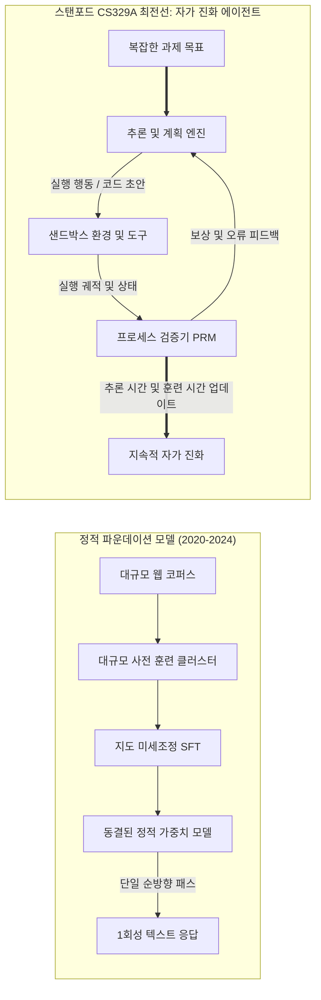

**스탠포드 대학교(Stanford University) CS329A: Self-Improving AI Agents (스스로 발전하는 AI 에이전트, Autumn 2025)**의 기술 심층 해설에 오신 것을 환영합니다.

지난 4년간 인공지능 학계와 산업계는 하나의 강력한 도그마에 의해 지배되어 왔습니다. 그것은 바로 *"더 거대한 텍스트 코퍼스에서 더 큰 모델을 사전 훈련(Pre-training)할수록 인지 능력이 예측 가능하게 향상된다"*는 스케일링 법칙이었습니다. 비록 이 패러다임이 현대 생성형 AI 혁명을 촉발하고 GPT-4, Claude 3.5, Gemini 같은 모델들을 탄생시켰지만, 머신러닝 연구의 최전선은 이제 중대한 변곡점에 도달했습니다.

정적 파운데이션 모델(Static Foundation Model)은 파라미터가 아무리 거대할지라도 본질적인 한계를 갖습니다. 그것은 사전 훈련이 끝나고 가중치가 동결(Frozen)된 후 개루프(Open-loop) 체제에서 작동하는 수동적, 자기회귀적(Autoregressive) 다음 토큰 예측기에 불과하다는 점입니다. 이러한 모델은 어려운 문제를 만났을 때 동적으로 더 많은 연산을 투입할 수 없고, 자신이 생성한 해답의 사실적 정확성을 스스로 검증할 수 없으며, 환경의 피드백을 바탕으로 실수를 자율적으로 교정하지 못합니다.



스탠포드 CS329A는 향후 10년의 인공지능을 관통할 핵심 질문을 던집니다: **"단순히 텍스트를 출력하는 데 그치지 않고, 자신의 추론과 코드를 스스로 검사하고, 검증하며, 계획하고, 개선해 나가는 소프트웨어 에이전트를 어떻게 설계할 것인가?"**

이번 1강 개요에서는 파운데이션 LLM에서 자율 에이전트로의 진화 궤적을 해부하고, 사전 훈련 스케일링 법칙과 추론 시간 연산 할당의 수학적 기초를 정립하며, 4대 정규 에이전트 워크플로 패턴과 자율 지능의 최대 병목인 **'생성자-검증자 격차(Generator-Verifier Gap)'**를 철저히 파헤칩니다.

{/* truncate */}

---

### 1. 진화의 궤적: 우리는 어떻게 여기에 도달했는가?

스스로 발전하는 AI 에이전트의 향후 방향을 이해하기 위해, 현대 파운데이션 모델 엔지니어링의 세 가지 역사적 단계를 조망해야 합니다:

```
  1단계: 사전 훈련 (자기지도 다음 토큰 예측)
  [웹 데이터 / 수조 개 토큰] ────────> 베이스 LLM (자기회귀적 문장 완성기)
                                                    │
  2단계: 사후 훈련 정렬                            ▼
  [엄선된 프롬프트-답변 쌍]  ────────> 지도 미세조정 SFT (명령어 준수)
  [인간 선호도 쌍 (RLHF/DPO)] ────────> 정렬된 대화형 챗봇 (안전성 및 유용성)
                                                    │
  3단계: CS329A 최전선                             ▼
  [실행 피드백 + PRM 정형 검증] ─────> 자율적 자가 개선 에이전트
```

#### 1단계: 비지도 사전 훈련 (Unsupervised Pre-Training)
베이스 언어 모델은 최대 우도 추정(MLE, Maximum Likelihood Estimation) 목적 함수를 통해 수조 개의 토큰을 학습합니다:
$$\mathcal{L}_{\text{MLE}}(\theta) = - \sum_{i=1}^{T} \log P_\theta(x_i \mid x_{1:i-1})$$
이 목적 함수는 모델이 문법, 세계 지식, 의미론적 관계를 수천억 개의 가중치에 압축하도록 강제하지만, 베이스 모델은 본질적으로 제약 없는 확률적 모방자에 불과합니다. "프랑스의 수도는?"이라는 프롬프트를 주면 답을 말하기보다는 웹 문서에서 흔히 연속으로 등장하는 "독일의 수도는 베를린입니다"라는 문장을 이어 쓸 가능성이 높습니다.

#### 2단계: 명령어 미세조정 및 RLHF ("ChatGPT 레시피")
자유분방한 문장 완성기를 유용한 비서로 바꾸기 위해 두 단계의 사후 훈련 파이프라인이 개발되었습니다:
1. **지도 미세조정 (SFT):** 고품질 질의-응답 쌍을 학습시켜 정중하고 명확한 대화 페르소나를 모델에 주입합니다.
2. **인간 피드백 기반 강화학습 (RLHF) / DPO:** 인간의 선호도를 모사하는 보상 모델 $r_\psi(x, y)$을 기준으로 정책을 최적화합니다:
$$\max_\theta \mathbb{E}_{(x, y) \sim \mathcal{D}} \left[ r_\psi(x, y) \right] - \beta \, \mathbb{D}_{\text{KL}}\left(\pi_\theta(y \mid x) \,||\, \pi_{\text{ref}}(y \mid x)\right)$$
RLHF는 모델의 대화 능력과 윤리적 안전성을 해결했으나, 진정한 문제 해결 자율성을 부여하지는 못했습니다. 정렬된 챗봇은 여전히 깊은 검증이나 계획, 도구 사용 없이 한 번의 순방향 패스로 즉시 답변을 출력해야 하기 때문입니다.

#### 3단계: CS329A 최전선 — 자율 에이전틱 루프
자가 개선 에이전트는 단일 순방향 패스의 족쇄를 끊어냅니다. 컴파일러, 웹 브라우저, 파이썬 REPL 같은 외부 도구, 계층형 메모리 구조, 자동화된 검증 루프를 결합함으로써, 환경을 능동적으로 관찰하고 행동을 취하며 중간 결과를 자체 평가하고 목표가 수학적·물리적으로 입증될 때까지 내부 상태를 수정합니다.

---

### 2. 스케일링 법칙의 수학: 훈련 시간 vs. 추론 시간

현대 머신러닝의 초석은 **스케일링 가설(Scaling Hypothesis)**입니다. 2020년 카플란(Kaplan et al., OpenAI)과 2022년 호프만(Hoffmann et al., DeepMind Chinchilla) 연구진은 자기회귀 언어 모델의 테스트 크로스 엔트로피 손실 $L$이 컴퓨팅 예산 $C$, 파라미터 수 $N$, 훈련 데이터셋 크기 $D$에 대해 멱법칙(Power Law)을 따른다는 사실을 입증했습니다:

$$L(N, D) = E + \frac{A}{N^\alpha} + \frac{B}{D^\beta}$$

여기서 $E$는 자연어 자체의 환원 불가능한 고유 엔트로피이고, $A$와 $B$는 스케일링 계수이며, $\alpha \approx 0.34, \beta \approx 0.28$은 실증적 멱지수입니다.

```
크로스 엔트로피 손실 L
 ▲
 │ ╲  10^21 FLOPs (GPT-2 세대)
 │  ╲
 │   ╲  10^23 FLOPs (GPT-3 세대)
 │    ╲
 │     ╲  10^25 FLOPs (GPT-4 세대)
 │      └─── 사전 훈련 한계벽 (공개 웹 데이터 고갈 및 전력 제약)
 └─────────────────────────────────────────────────────────────►
                       컴퓨팅 자원 예산 C (FLOPs)
```

그러나 사전 훈련 스케일링은 엄격한 물리적·경제적 한계에 부딪혔습니다:
- **데이터 고갈:** 인터넷상의 고품질 인간 작성 텍스트는 수년 내에 완전히 고갈될 것으로 추정됩니다.
- **자본과 전력 밀도:** $10^{26}$ FLOPs를 초과하는 거대 클러스터를 구축하려면 기가와트(GW)급 전용 변전소와 수천억 원의 설비 투자가 필요합니다.

#### 제2의 프론티어: 추론 시간(Inference-Time) 연산 스케일링
훈련 과정에서 가중치를 업데이트하는 데 수백억 원을 쏟아붓는 대신, **"답변을 생성하는 추론 시점에 연산량을 더 투입하여 더 깊은 지능을 얻을 수는 없을까?"**

인간 전문가가 복잡한 증명이나 코딩 과제를 마주할 때, 한 호흡에 단숨에 정답을 완성하지 않습니다. 다양한 가설을 스케치하고, 중간 단계를 검증하며, 막다른 길을 만나면 뒤로 물러나(Backtracking) 다른 길을 찾습니다.

**추론 시간 연산 스케일링**은 다음과 같은 세 가지 주요 축으로 테스트 연산을 배분합니다:
1. **반복 샘플링 (Best-of-$N$ / Large Language Monkeys):** 정책 $\pi_\theta$로부터 $N$개의 후보 궤적을 병렬 생성하고, 검증기를 통해 최적의 해답을 선택합니다. 이때 적어도 하나의 정답이 포함될 확률은 $\text{Pass@}k$ 지표를 따릅니다:
$$\text{Pass@}k = \mathbb{E}\left[ 1 - \frac{\binom{n - c}{k}}{\binom{n}{k}} \right]$$
여기서 $n$은 총 샘플 수, $c$는 그중 정답의 수입니다.
2. **단계별 검증 (PRM vs. ORM):** 최종 답안만을 평가하는 결과 보상 모델(ORM)은 긴 다단계 추론에서 중간 오류 위치를 특정하지 못합니다. 반면 프로세스 보상 모델(PRM)은 각 추론 단계마다 $r_t = R(x, y_{1:t})$의 스칼라 보상을 부여하여 정밀한 신용 할당(Credit Assignment)을 가능하게 합니다.
3. **트리 탐색 알고리즘 (MCTS, Beam Search):** 몬테카를로 트리 탐색(MCTS)을 통해 방대한 추론 경로 그래프를 탐색하며, 유망한 중간 노드는 확장(Exploit)하고 새로운 경로는 발견(Explore)합니다.

OpenAI o1 및 DeepSeek-R1과 같은 최신 프론티어 모델들이 입증하듯, 추론 연산량을 100배에서 1,000배로 스케일링하는 전략은 거대한 모델을 단순히 훈련시키는 것보다 국제 수학 올림피아드(IMO)와 SWE-bench에서 훨씬 압도적인 성능을 뿜어냅니다.

---

### 3. 에이전트 워크플로의 4대 표준 아키텍처

소프트웨어 에이전트를 구축할 때 단일 프롬프트에만 의존하면 확률적 오류가 급속히 누적됩니다. 스탠포드 CS329A는 이를 해결하기 위한 4대 모듈형 워크플로 패턴을 정립했습니다:

```mermaid
flowchart TD
    subgraph 패턴1 ["1. 프롬프트 체이닝 (Prompt Chaining)"]
        P1_In[과제 입력] --> P1_M1[모델 1단계 처리]
        P1_M1 -->|중간 결과물 전달| P1_M2[모델 2단계 정밀화]
        P1_M2 --> P1_Out[최종 산출물]
    end

    subgraph 패턴2 ["2. 동적 라우팅 (Dynamic Routing)"]
        P2_In[사용자 질의] --> P2_Router{의도 분류 라우터}
        P2_Router -->|수학 문제| P2_Math[기호 수학 엔진]
        P2_Router -->|코드 수정| P2_Code[SWE 에이전트]
        P2_Router -->|일반 질의| P2_LLM[범용 대형 모델]
    end

    subgraph 패턴3 ["3. 병렬화 (Parallelization)"]
        P3_In[입력 과제] --> P3_A[에이전트 1: 보수적 시각]
        P3_In --> P3_B[에이전트 2: 창의적 시각]
        P3_In --> P3_C[에이전트 3: 적대적 비판자]
        P3_A --> P3_Agg[합의 도출 및 통합 집계기]
        P3_B --> P3_Agg
        P3_C --> P3_Agg
    end

    subgraph 패턴4 ["4. 오케스트레이터-워커 (Orchestrator-Worker)"]
        P4_In[고수준 요구사항] --> P4_Orch[총괄 오케스트레이터]
        P4_Orch -->|하위 작업 1| P4_W1[특화 워커 1]
        P4_Orch -->|하위 작업 2| P4_W2[특화 워커 2]
        P4_W1 -->|상태 피드백| P4_Orch
        P4_W2 -->|상태 피드백| P4_Orch
        P4_Orch --> P4_Out[통합 시스템 배포]
    end
```



#### 1. 프롬프트 체이닝 (Prompt Chaining: 순차적 분해)
거대한 모놀리식 작업을 결정론적 하위 단계들로 쪼개고, $k$ 단계의 출력이 $k+1$ 단계의 입력 컨텍스트로 전달되는 파이프라인입니다. 각 단계 사이에 유효성 검사 게이트(예: 목차 생성 $\to$ 누락 검증 $\to$ 초안 작성 $\to$ 교정)를 삽입하여 오류 증폭을 원천 차단합니다.

#### 2. 동적 라우팅 (Dynamic Routing: 전문성 분배)
입력된 요청의 특성을 분석하여 가장 적합한 도메인 특화 모델이나 도구로 작업을 분기합니다. 수식 처리는 파이썬 샌드박스로, 대규모 코드 리팩터링은 전용 SWE 에이전트로 라우팅하여 전체 시스템의 비용과 지연 시간을 극적으로 최적화합니다.

#### 3. 병렬화 (Parallelization: 독립 분할과 앙상블)
- **섹셔닝 (Sectioning):** 서로 의존성이 없는 독립적인 하위 과제들을 여러 에이전트가 동시에 분담하여 처리합니다.
- **투표 앙상블 (Voting):** 다양한 시스템 프롬프트나 온도(Temperature) 시드로 여러 해답을 동시 생성한 뒤 다수결 또는 크리틱을 통해 stochastic 노이즈를 필터링합니다.

#### 4. 오케스트레이터-워커 (Orchestrator-Worker: 계층형 지휘)
중앙 지휘관 모델이 상위 목표를 방향성 비순환 그래프(DAG)로 분해하고, 하위 워커 에이전트들에게 병렬 배분하며, 실행 결과와 예외를 실시간 모니터링하여 최종 산출물을 완성합니다.

---

### 4. 자율 지능의 최대 병목: 생성자-검증자 격차 (Generator-Verifier Gap)

스스로 발전하는 에이전트를 구축하는 것이 왜 그토록 어려울까요?
그 핵심에는 **생성자-검증자의 비대칭성**이 존재합니다:

$$\text{복잡도}(\text{검증}) \ll \text{복잡도}(\text{생성}) \quad \text{닫힌 정형 도메인 (수학, 코딩)}$$
$$\text{복잡도}(\text{검증}) \approx \text{복잡도}(\text{생성}) \quad \text{열린 자연어 도메인 (전략, 글쓰기)}$$

```
검증 능력
 ▲
 │   정형 도메인 (수학, 파이썬 코드, Lean 4)
 │   ┌────────────────────────────────────────────────────────┐
 │   │ 검증자 (컴파일러 / 단위 테스트 / Z3 SMT 솔버)         │
 │   │ 결정론적이며, 계산 비용이 저렴하고, 100% 신뢰할 수 있음 │
 │   └────────────────────────────────────────────────────────┘
 │
 │   열린 자연어 도메인 (문학, 정책 제안, 비즈니스 전략)
 │   ┌────────────────────────────────────────────────────────┐
 │   │ 검증자 (LLM 판사)                                      │
 │   │ 잡음이 심하고, 편향(길이 편향, 동조 현상)에 취약함      │
 │   └────────────────────────────────────────────────────────┘
 └─────────────────────────────────────────────────────────────►
                     생성 복잡도
```

수학 증명이나 프로그래밍 같은 정형 환경에서는 검증이 결정론적입니다. 코드가 컴파일되는지, 단위 테스트가 `assert`를 통과하는지는 100% 명확합니다. 따라서 이 영역에서는 자가 개선 루프가 매끄럽게 작동합니다. 후보 코드를 생성하고, 테스트 러너를 실행하여 통과하지 못한 코드를 폐기하고, 통과한 패치만을 가중치나 프롬프트에 축적하면 됩니다.

그러나 열린 자연어 도메인에서는 **"이 답안이 진정으로 우수한가"를 평가하는 일이 처음부터 답안을 작성하는 것만큼이나 어렵습니다.** LLM을 또 다른 LLM의 판사로 세울 경우, 장황한 답변을 더 높게 평가하는 길이 편향(Verbosity Bias)이나, 자신의 오류를 스스로 눈치채지 못하는 순환 망상에 빠지게 됩니다.

이 생성자-검증자 격차를 극복하기 위해 자연어를 정형 제약 조건으로 변환하고 외부 실행 환경과 연결하는 연구가 CS329A 전체를 관통하는 핵심 탐구 과제입니다.

---

### 5. 스탠포드 CS329A 4단계 커리큘럼 로드맵

스탠포드 CS329A는 다음과 같은 4단계 엔지니어링 스택으로 구성되어 있습니다:

```
┌─────────────────────────────────────────────────────────────────────────────┐
│                    스탠포드 CS329A 전체 아키텍처 스택                       │
├─────────────────────────────────────────────────────────────────────────────┤
│  Part 4 · Frontiers (최전선, L13 - L17)                                     │
│  - 수학적 추론과 AlphaProof, Lean 4 정형 검증                               │
│  - 자율 시스템 신뢰성의 3계층과 AI Control 안전 경계                       │
│  - 멀티모달 및 체화된 로보틱스 에이전트 (VLA, RT-2, π0)                     │
│  - 완결편: 미래 미해결 과제와 자가 개선 정렬 침식                           │
├─────────────────────────────────────────────────────────────────────────────┤
│  Part 3 · Agent Engineering (엔지니어링, L10 - L12)                         │
│  - 소프트웨어 엔지니어링 에이전트 (SWE-bench, ASI 인터페이스)               │
│  - 계층형 OS 스타일 메모리 아키텍처 (MemGPT, CacheBlend)                    │
│  - 장기 과제 평가 체계와 경제적 효용성 (METR Time Horizons)                 │
├─────────────────────────────────────────────────────────────────────────────┤
│  Part 2 · Training & Evolution (훈련과 진화, L6 - L9)                       │
│  - 훈련기 스케일링과 강화학습 (DeepSeekMath & GRPO)                         │
│  - 개방형 자가 진화 및 아키텍처 탐색 (ADAS, AlphaEvolve)                   │
│  - 자율 딥 리서치 워크플로 (AlphaCode, Search-o1)                           │
│  - 사후 훈련의 대전환: SFT -> RLHF -> RLVR -> Agent RL                     │
├─────────────────────────────────────────────────────────────────────────────┤
│  Part 1 · Foundation (기초, L1 - L5)                                        │
│  - 추론 시간 연산 스케일링과 최적화 법칙                                    │
│  - 프로세스 보상 모델과 답변 검증 (PRM800K)                                 │
│  - 도구 사용과 코드 실행 폐루프 피드백 (ReAct, RLEF)                        │
│  - 다단계 계획과 몬테카를로 트리 탐색 (LATS MCTS)                           │
└─────────────────────────────────────────────────────────────────────────────┘
```

---

### 6. 핵심 요약 및 Q&A

#### 핵심 요약
1. **패러다임의 도약:** 단순 1회성 텍스트 완성을 넘어, 관찰·실행·검증·반성이 연속되는 자율 피드백 루프로 인공지능의 중심축이 이동했습니다.
2. **이중 스케일링 최전선:** 사전 훈련 파라미터 확대와 더불어, 추론 시점의 연산량(Best-of-$N$, PRM 검증, 트리 탐색)을 지능적으로 늘려 작은 모델로도 초고난도 문제를 해결할 수 있게 되었습니다.
3. **핵심 척추:** 모든 성공적인 에이전트 시스템은 **《생성 $\to$ 검증 $\to$ 순환》**의 삼각 고리를 구현합니다.
4. **검증의 병목:** 에이전트의 자가 진화 속도는 모델이 스스로 답안의 진위를 얼마나 객관적이고 엄밀하게 검증할 수 있는가에 의해 결정됩니다.

---

#### 학술 심화 Q&A

**Q. 추론 시간 스케일링은 기존의 프롬프트 엔지니어링이나 단순 Chain-of-Thought(CoT)와 무엇이 다른가요?**
**A.** 단순 CoT는 중간 풀이 과정을 단 한 번의 방향성 텍스트로 쭉 이어서 생성할 뿐입니다. 만약 2단계에서 사소한 계산 실수를 저지르면, 그 오류는 후속 토큰으로 걷잡을 수 없이 증폭됩니다. 반면 추론 시간 연산 스케일링은 외부 탐색 트리와 검증 체크포인트를 도입합니다. 생성된 각 단계를 프로세스 보상 모델(PRM)이나 컴파일러가 평가하여, 유망한 경로는 깊게 파고들고 막다른 골목은 가지치기(Pruning)하여 되돌아오는 능동적 연산 배분이 이루어집니다.

**Q. 모든 과제를 완벽하게 검증할 수 있는 궁극의 초대형 검증자 LLM을 학습시키면 되지 않나요?**
**A.** 확률적 신경망은 객관적인 외부 환경과의 상호작용(Ground-truth Anchor) 없이는 자신의 확률적 오류를 스스로 완전히 바로잡지 못하기 때문입니다. 자연어 영역에서 LLM 판사는 답변이 길수록 점수를 후하게 주는 길이 편향, 아첨 편향(Sycophancy)을 필연적으로 보입니다. 진정한 신뢰성 검증은 자연어 주장을 실행 가능한 코드, 데이터베이스 쿼리, 린 4(Lean 4) 수학 정리, 로봇 센서 반사 루프 같은 결정론적 실행 환경에 접지(Grounding)시킬 때 비로소 달성될 수 있습니다.

---

### 다음 강의 예고

**Lecture 2**에서는 추론 시간 연산 스케일링의 심층 수학적 메커니즘을 본격적으로 파고듭니다:
- 스넬(Snell et al.)의 연산 최적 스케일링 법칙 (Compute-Optimal Scaling Frontiers)
- 반복 샘플링의 커버리지와 순차 탐색 깊이 사이의 트레이드오프
- *Archon*과 *Large Language Monkeys*가 입증한 생성 예산과 검증 예산의 최적 황금비

스스로 발전하는 인공지능의 심장부로 함께 들어가 봅시다!