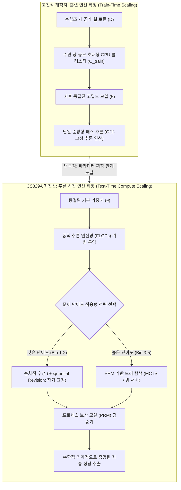
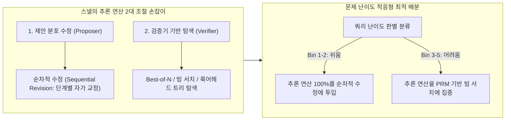

스탠포드 대학교의 2025년 가을 학기 최신 대학원 강좌, **CS329A: Self-Improving AI Agents (스스로 발전하는 AI 에이전트)** 두 번째 엔지니어링 해설에 오신 것을 환영합니다.

지난 제1강에서 우리는 정적(Static) 차세대 토큰 예측기에 불과하던 거대 언어 모델(LLM)이 환경과 피드백 루프를 주고받는 완전 자율 에이전트로 진화하는 거대한 패러다임 전환을 개괄했습니다. 오늘 제2강에서는 이 자율성을 지탱하는 가장 본질적인 수학적·컴퓨팅적 기둥, 바로 **추론 시간 연산 확장 (Test-Time Compute Scaling / Inference-Time Scaling)**을 다룹니다.

지난 수년간 AI 산업을 지배한 유일한 교리는 사전 훈련 단계의 스케일링 법칙(Kaplan et al., Chinchilla)이었습니다: *더 거대한 GPU 클러스터를 구축하고, 파라미터 크기 N을 수천억 단위로 키우며, 수십조 개의 웹 텍스트 토큰 D를 투입하라*. 그러나 사전 훈련을 마친 가중치 θ가 동결(Frozen)된 모델에게 질문을 던졌을 때, 50밀리초 만에 성급한 탐욕적(Greedy) 답변을 내놓게 두는 대신 **10초, 1분, 10분 동안 깊이 사고하고, 중간 단계를 검증하며, 가설을 스스로 수정하도록 연산(FLOPs)을 쏟아붓는다면** 어떤 일이 벌어질까요?

*Large Language Monkeys* (Brown et al., 2024), 스탠포드-버클리 Charlie Snell 연구팀의 *Compute-Optimal Scaling* (Snell et al., 2024), 그리고 *Archon* 모듈형 아키텍처 탐색 프레임워크를 통해 **"추론 연산(FLOPs)을 투입하여 파라미터 용량을 압도하는 현대 인공지능의 최신 최적화 법칙"**을 정밀하게 파헤쳐 보겠습니다.



{/* truncate */}

---

### 1. 고전적 스케일링 vs 추론 시간 연산: 패러다임의 대전환

현대 딥러닝은 검증 손실(Validation Loss)이 훈련 연산량의 멱법칙(Power-law) 함수로 감소한다는 경험적 발견 위에 세워졌습니다:

```text
L(N, D) = E + A / N^α + B / D^β
```

여기서 N은 비임베딩 파라미터 수이고, D는 토큰 단위의 훈련 데이터셋 크기입니다. 그러나 이 고전적 공식은 추론 연산을 지극히 단순하고 정적인 상수로 취급합니다. 즉, 자기회귀적(Autoregressive) 디코딩 과정에서 생성되는 토큰당 파라미터 수에 비례하는 정확히 2 FLOPs만을 배정합니다.

#### 사전 훈련 연산 확장의 물리적 한계
산업계가 10^26 FLOPs(GPT-4 클래스) 이상으로 사전 훈련 연산을 확장함에 따라, 세 가지 치명적인 물리적·정보적 암초가 드러났습니다:
1. **공개 웹 토큰 고갈 경계:** 인터넷상의 고품질 인간 작성 텍스트는 유한합니다(약 10^14 토큰 규모). 신뢰할 수 있는 외부 검증기 없이 합성 데이터(Synthetic Data)를 무분별하게 재귀 주입하면 모델 붕괴(Model Collapse)와 엔트로피 축퇴가 발생합니다.
2. **지수적 비용 폭증:** 멱법칙 곡선의 평탄한 꼬리 부분에서 벤치마크 점수를 단 1% 끌어올리려면 사전 훈련 연산량을 10배 이상 투입해야 하며, 이는 수천억 원 규모의 천문학적 자본 지출(CAPEX)을 요구합니다.
3. **정적 순방향 패스(Forward Pass)의 맹점:** 모델 파라미터가 7B이든 1T이든 상관없이, 표준 디코딩은 고정된 횟수의 행렬 곱셈만으로 다음 토큰 t_i를 즉시 방출합니다:

```text
t_i ~ Softmax( W_u · LayerNorm( h_L(t_{1:i-1}) ) )
```

복잡한 NP-완전 수학 증명, 수십 개 소스코드 파일에 걸친 소프트웨어 결함 디버깅은 되돌아보기(Backtracking), 가설 검증, 단계별 오류 수정 없이는 단일 순방향 패스로 해결할 수 없습니다.

---

### 2. 무한 원숭이 정리의 귀환: Large Language Monkeys

고전 확률론에는 프랑스의 수학자 에밀 보렐이 제안한 유명한 사고실험인 **무한 원숭이 정리(Infinite Monkey Theorem)**가 있습니다. "무한히 많은 원숭이에게 타자기를 주고 무작위로 키를 누르게 하면, 언젠가 셰익스피어의 햄릿 전권을 작성해 낼 것이다."

2024년 말, UC 버클리와 구글 리서치 연구진은 이 사고실험을 현대 프론티어 LLM을 대상으로 실증 분석했습니다: **《Large Language Monkeys: Scaling Inference Compute with Repeated Sampling》** (Brown et al., 2024).

```
커버리지 (Pass@k %)
 ▲
100│                                     ┌────────────── Pass@k 커버리지 이론적 상한선
 90│                                ┌────┘ (MATH 및 CodeContests에서 99% 도달)
 80│                           ┌────┘
 70│                      ┌────┘
 60│                 ┌────┘ ◄── SWE-bench Lite: DeepSeek-Coder-V2 (k=250 -> 56.0%)
 50│            ┌────┘
 40│       ┌────┘   ◄── Claude 3.5 Sonnet 단일 실행 (43.0%)
 30│  ┌────┘
 20│ ┌┘
 10│┌┘  ◄── Gemma-2B Pass@1 (0.02%)
  0└┴──────┬──────────┬──────────┬──────────┬──────────►
    k=1    k=10       k=100      k=1,000    k=10,000   (샘플 생성 수 k)
```

#### 무편향 pass@k 추정치의 수학적 정의
언어 모델로부터 N개의 독립적인 답변 후보를 생성하고, 이 중 단위 테스트 하네스를 완벽히 통과한 정답이 정확히 C개 존재할 때, 무작위로 추출한 k개 후보 중 최소 하나 이상의 정답이 포함될 확률의 무편향 최소 분산 추정치(MVUE)는 다음과 같이 정의됩니다:

```text
Pass@k = (1 / P) · ∑_{i=1}^P [ 1 - C(N - C_i, k) / C(N, k) ]
```

여기서 P는 전체 평가 문제 수, C_i는 i번째 문제의 정답 샘플 수, C(n, r)은 조합(Binomial Coefficient)을 나타냅니다. N = 10,000 규모로 확장할 때 팩토리얼 연산의 부동소수점 오버플로우를 방지하기 위해, 실제 코드베이스에서는 다음과 같은 수치 안정 곱셈 루프를 채택합니다:

```text
Pass@k = 1 - ∏_{j=0}^{k-1} ( 1 - C_i / (N - j) )
```

#### 실증적 충격: 소형 모델이 거대 모델을 압도하다
반복 샘플링을 통한 추론 연산 확장은 인공지능 평가의 판도를 뒤흔들었습니다:
* **SWE-bench Lite (깃허브 실전 소프트웨어 엔지니어링 버그 수정):**
  * 오픈소스 모델인 `DeepSeek-Coder-V2-Instruct`의 단일 시도(k=1) 성공률은 **15.9%**에 불과했습니다.
  * 그러나 샘플 수를 k=250으로 확장하자, pass@250은 **56.0%**로 수직 상승했습니다.
  * 이는 단일 실행 최강자였던 GPT-4o와 Claude 3.5 Sonnet의 앙상블(43.0%)을 **무려 13%p 차이로 압도**한 결과였습니다.
* **CodeContests (극난도 알고리즘 경시대회):**
  * 경량 모델 `Gemma-2B`의 단일 정답률(pass@1)은 **0.02%**로 사실상 0에 수렴했습니다.
  * 그러나 k=10,000으로 스케일링하자 정답률은 **7.1%**로 폭증하여, **355배의 성능 점프**를 기록했습니다.
* **비용 효율성의 역전:**
  * SWE-bench Lite에서 DeepSeek-Coder-V2로 5번 샘플링하여 29.62%를 달성하는 데 소요된 API 비용은 **$10.80**이었습니다.
  * 반면 단일 실행 GPT-4o(24.0%)는 **$39.00 (3.6배 비용)**, Claude 3.5 Sonnet(26.7%)은 **$51.00 (4.7배 비용)**이 소요되었습니다.

```text
┌───────────────────────────────┬──────────┬────────────┬─────────────┐
│ 모델 및 추론 전략             │ SWE-bench│ 소요 비용  │ 비용 배수   │
├───────────────────────────────┼──────────┼────────────┼─────────────┤
│ DeepSeek-Coder-V2 (k=5)       │ 29.62%   │ $10.80     │ 1.0x (기준) │
│ GPT-4o (k=1 탐욕적 단일)      │ 24.00%   │ $39.00     │ 3.6배 고비용│
│ Claude 3.5 Sonnet (k=1)       │ 26.70%   │ $51.00     │ 4.7배 고비용│
│ DeepSeek-Coder-V2 (k=250)     │ 56.00%   │ $540.00    │ 최고 성능   │
└───────────────────────────────┴──────────┴────────────┴─────────────┘
```

#### 커버리지-정밀도 격차 (Coverage-Precision Gap): 검증기의 벽
그러나 무작정 샘플만 늘리는 방식은 치명적인 구조적 한계에 부딪힙니다. 바로 **커버리지-정밀도 격차**입니다.

컴파일러나 단위 테스트 같은 결정론적 오라클(Oracle)이 존재하는 닫힌 도메인에서는 **커버리지(Coverage)가 곧 성공률**입니다. 250개 중 단 하나라도 모든 테스트를 통과하면 기계적으로 선별해 낼 수 있기 때문입니다.

반면 외부 검증기가 없는 주관식 수학이나 일반 자연어 도메인에서는 상황이 완전히 달라집니다:
* MATH 데이터셋에서 `Llama-3-8B-Instruct`의 커버리지는 k=10,000에서 **98.44%**에 달했습니다(즉, 10,000개 풀이 안에 정답이 98% 확률로 존재함).
* 그러나 단순 **다수결 투표(Majority Voting)**를 적용했을 때 정답률은 40.5%에서 **41.41%**로 겨우 0.9%p 상승하는 데 그쳤습니다.
* 결과 보상 모델(ORM)을 활용한 **Best-of-N 선별** 역시 약 k=100 지점에서 완전히 정체(Plateau)되어, 나머지 57%의 정답을 걸러내지 못하고 거짓 양성(False Positive)의 바다에 빠졌습니다.

> **핵심 엔지니어링 원칙:** 정밀한 검증기(Verifier) 없이 무작정 샘플 수만 늘리는 것은 건초더미의 부피만 키우는 행위입니다. 건초더미 속에 바늘(정답)이 들어있을 확률이 99%에 달하더라도, 바늘을 감지할 자석(검증기)이 없다면 아무런 가치를 창출할 수 없습니다.

---

### 3. 스넬(Snell)의 연산 최적 확장 법칙 (Compute-Optimal Scaling)

무작정 주사위를 10,000번 굴리는 대신, 고정된 추론 연산 예산(FLOPs) 하에서 수학적으로 가장 최적의 성과를 내려면 어떻게 연산을 소비해야 할까요?

2024년 가을, 스탠포드 대학교와 UC 버클리의 Charlie Snell, 서재훈, 류하오, 아비랄 쿠마르, 세르게이 레빈 연구팀은 인공지능 역사에 남을 기념비적 논문을 발표합니다: **《Scaling LLM Test-Time Compute Optimally can be More Effective than Scaling Model Parameters》**.



#### 추론 연산의 2대 조절 손잡이
Snell 연구팀은 모든 추론 기법을 **제안자(Proposer)**와 **검증자(Verifier)**라는 두 축으로 체계화했습니다:
1. **제안 분포 수정 (Proposer 수정):** 모델이 처음부터 더 완성도 높은 사고 궤적을 산출하도록 유도하는 전략:
   ```text
   y_{t+1} ~ P_θ( y | x, y_1, ..., y_t, Critique_t )
   ```
2. **검증기 기반 탐색 (Verifier 탐색):** 프로세스 보상 모델(PRM)을 가이드 삼아 유망한 중간 추론 노드들을 체계적으로 탐색:
   ```text
   Score(Node_t) = PRM_ψ( x, y_{1:t} )
   ```

#### 문제 난이도에 따른 최적 배분의 역전 원리
Snell 논문의 가장 눈부신 발견은 **"문제의 난이도에 따라 최선의 추론 전략이 정반대로 전환된다"**는 사실이었습니다:

```text
난이도 Bin 1-2 (쉬운 문제)   ───>  순차적 수정(Sequential Revision)의 압승
난이도 Bin 3-5 (어려운 문제) ───>  PRM 기반 빔 서치(Beam Search)의 압승
```

1. **쉬운 문제 (Bins 1–2):** 
   * 쉬운 문제는 모델의 첫 번째 시도가 이미 정답에 근접해 있습니다.
   * 여기에 복잡한 빔 서치나 Best-of-N을 적용하면, 검증기(Verifier)의 미세한 평가 노이즈가 누적 증폭되어 **연산량을 늘릴수록 오히려 오답을 고르는 역효과(Over-optimization)**가 발생합니다.
   * **최적 전략:** 모델에게 이전 풀이의 사소한 오타나 부호 실수를 고치게 하는 순차적 수정(Revision)이 최소 연산으로 최고 정확도를 냅니다.
2. **어려운 문제 (Bins 3–5):**
   * 극난도 수학 경시대회 문제에서는 한 번 잘못된 논리 분기로 진입하면 단순 수정만으로는 회복이 불가능합니다.
   * **최적 전략:** 단계별 PRM 보상값을 기반으로 비유망한 사고 가지를 조기에 쳐내는 빔 서치가 Best-of-N 대비 압도적으로 우수한 성과를 보였습니다.
3. **연산 최적화의 결실:**
   * 쉬운 문제엔 Revision을, 어려운 문제엔 PRM 빔 서치를 동적으로 배치하는 연산 최적(Compute-optimal) 정책은 단순 Best-of-N 대비 **동일 정확도를 달성하는 데 무려 4배(4x) 적은 연산량**만을 소모했습니다.

#### 14배 파라미터 등가성 (The 14x Parameter Equivalence)
Snell 논문의 정점은 **"사전 훈련 모델 파라미터를 14배 키우는 것"과 "작은 모델에 14배의 추론 연산을 부여하는 것"의 직접 대결**이었습니다:

```text
14배 거대 파라미터 모델 (탐욕적 디코딩)   vs   1배 기본 소형 모델 + 14배 추론 연산
```

* MATH 및 GSM8K의 쉬움~중간 난이도 문제에서, 최적 추론 연산이 부여된 소형 모델은 14배 더 큰 거대 모델의 성능을 완전히 따라잡거나 능가했습니다.
* 그러나 극난도 문제(Bin 5)에서는 거대 모델의 내재적 지능이 필수적이었습니다. 기본 모델이 문제를 이해하기 위한 기초적인 의미 표상조차 형성하지 못한다면, 추론 단계에서의 탐색은 근거 없는 환각의 반복으로 퇴화하기 때문입니다.

---

### 4. 시스템 엔지니어링: Archon 모듈형 복합 에이전트 아키텍처

이론적 스케일링 법칙을 실제 상용 소프트웨어로 구현하려면 어떻게 해야 할까요? 생성기, 비평기, 랭커, 실행 샌드박스를 매번 하드코딩하지 않고 체계적으로 조립할 수 있을까요?

**Archon** 프레임워크(arxiv:2409.15254)는 딥러닝에서 신경망 레이어를 쌓듯, LLM의 텍스트 변환 단위들을 **계층형(Layered) 파이프라인**으로 추상화하여 이 문제를 해결했습니다:

```mermaid
flowchart TD
    Q[사용자 프롬프트 / 문제 요구사항] --> G[Layer 1: 생성기 앙상블 (Generator)]
    G -->|후보 풀이군| C[Layer 2: 다각도 비평기 (Critic)]
    C -->|비평 및 취약점 분석| R[Layer 3: 토너먼트 랭커 (Ranker)]
    R -->|상위 유망 후보군| F[Layer 4: 융합 합성기 (Fuser)]
    F -->|통합 고품질 답변| V[Layer 5: 자동 검증기 및 단위 테스트 샌드박스]
    V -->|실행 결과 피드백| Dec{모든 테스트 통과?}
    Dec -- 예 --> Final[검증 완료된 프로덕션 산출물]
    Dec -- 아니오 (재생성 루프) --> G
```

#### Archon의 5대 아키텍처 레이어
1. **생성기 레이어 (Generator):** 온도(T=0.2 ~ 0.8)와 프롬프트 템플릿을 다변화하거나, 서로 다른 모델(Claude 3.5 Sonnet + DeepSeek-V2)을 교차 배포하여 다양성 있는 후보군을 대량 생성.
2. **비평기 레이어 (Critic):** 생성된 각 후보 답변의 논리적 비약, 계산 오류, 경계값 취약점을 텍스트로 조목조목 지적.
3. **랭커 레이어 (Ranker):** 비평기의 피드백을 바탕으로 후보군 간 1:1 토너먼트 비교 평가를 수행하여 순위 부여.
4. **융합기 레이어 (Fuser):** 상위권 후보들의 핵심 아이디어만을 추출하여 하나의 완성도 높은 답변으로 재합성 (+8.9% 벤치마크 점수 향상).
5. **검증기 레이어 (Verifier):** 코딩 작업 시 LLM이 5~10개의 경계값 단위 테스트를 직접 작성하고, 격리된 가상 환경에서 실행하여 통과율을 측정 (+56% 성능 폭증).

Archon은 이 컴포넌트들을 조합할 수 있는 **9,576개의 아키텍처 공간**을 정의한 뒤, **베이지안 최적화(Bayesian Optimization)**를 통해 주어진 비용 및 지연 시간 예산 내에서 파레토 최적(Pareto-optimal)의 에이전트 시스템을 자동으로 탐색해 냅니다.

---

### 5. 아키텍처 사례 분석: OpenAI o1 추론 모델의 내막 해부

스탠포드 CS329A 제2강의 이론들은 OpenAI o1 및 DeepSeek-R1 등 최신 추론 전문 모델의 내부 동작 원리를 완벽하게 설명해 줍니다:

```
┌────────────────────────────────────────────────────────────────────────┐
│                   o1 내부 '생각(Thinking)' 트레이스의 실체             │
├────────────────────────────────────────────────────────────────────────┤
│ 1. 은닉된 숙고 과정 (Test-Time Tokens):                                │
│    첫 번째 가시적 답변을 내놓기 전, 수천 토큰에 달하는 내부 생각의 사슬│
│    (Chain-of-Thought)을 먼저 생성하며 연산을 대량 소비.                │
│                                                                        │
│ 2. 내재화된 프로세스 보상 모델 (PRM):                                  │
│    단계별 보상 피드백을 통한 강화학습(RL)으로 훈련되어, 막다른 골목에   │
│    도달했을 때 스스로 이전 분기점으로 되돌아가는(Backtracking) 역량 탑재│
│                                                                        │
│ 3. 자가 수정 루프 (Snell Revision):                                    │
│    "잠깐, 이 공식이 맞지 않는 것 같다, 다시 검토해보자"와 같은 문구는  │
│    자가 일관성 검사에 의해 트리거된 순차적 수정 정책의 발현.           │
└────────────────────────────────────────────────────────────────────────┘
```

o1이 보여주는 긴 생각의 과정은 마법이 아닙니다. 그것은 순차적 수정, 프로세스 보상 모델 기반의 트리 가지치기, 그리고 적응형 연산 배분이 **단일 인공신경망 가중치 내부로 내재화된 '추론 시간 연산 확장'의 결정체**입니다.

---

### 6. 요약 및 핵심 엔지니어링 교훈

1. **지능 확장의 양대 축:** 인공지능 성능 향상은 더 이상 사전 훈련에만 종속되지 않습니다. 추론 시간 연산 확장은 소형 모델이 산업용 초대형 모델을 제칠 수 있도록 돕는 독립적인 지능 확장 축입니다.
2. **커버리지-정밀도 원칙:** 반복 샘플링(pass@k)은 정답 커버리지를 비약적으로 끌어올리지만(DeepSeek-Coder-V2 15.9% -> 56.0%), 이를 회수하기 위해서는 정밀한 프로세스 검증기(PRM)가 필수적입니다.
3. **스넬의 최적 배분 법칙:** 무작정 샘플만 뽑는 것보다 난이도 적응형 배분이 4배 효율적입니다. 쉬운 문제에는 순차적 수정(Revision)을, 어려운 문제에는 PRM 기반 빔 서치(Beam Search)를 배치하십시오.
4. **모듈형 에이전트 시스템:** Archon 프레임워크가 입증하듯, 생성기·비평기·랭커·샌드박스를 결합하는 소프트웨어 아키텍처 설계가 모델 자체의 크기만큼이나 최종 시스템의 정확도를 좌우합니다.

---

### 스탠포드 CS329A 다음 편 예고:
이어지는 **제3강**에서는 자율 에이전트의 심장인 **《Robust Verification: 프로세스 보상 모델(PRM), 앙상블, 그리고 확장 가능한 감독(Scalable Oversight)》**을 다룹니다. 보상 해킹(Reward Hacking)을 방지하고 인간 개입 없이 자율적으로 진위를 검증하는 프로덕션 검증기 구축 기법을 상세히 분석합니다. 기대해 주십시오!
