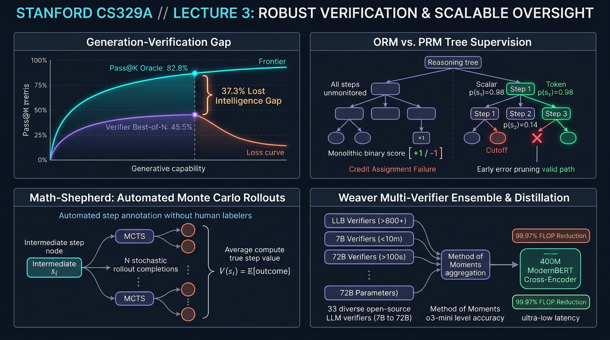
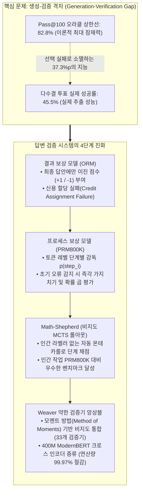
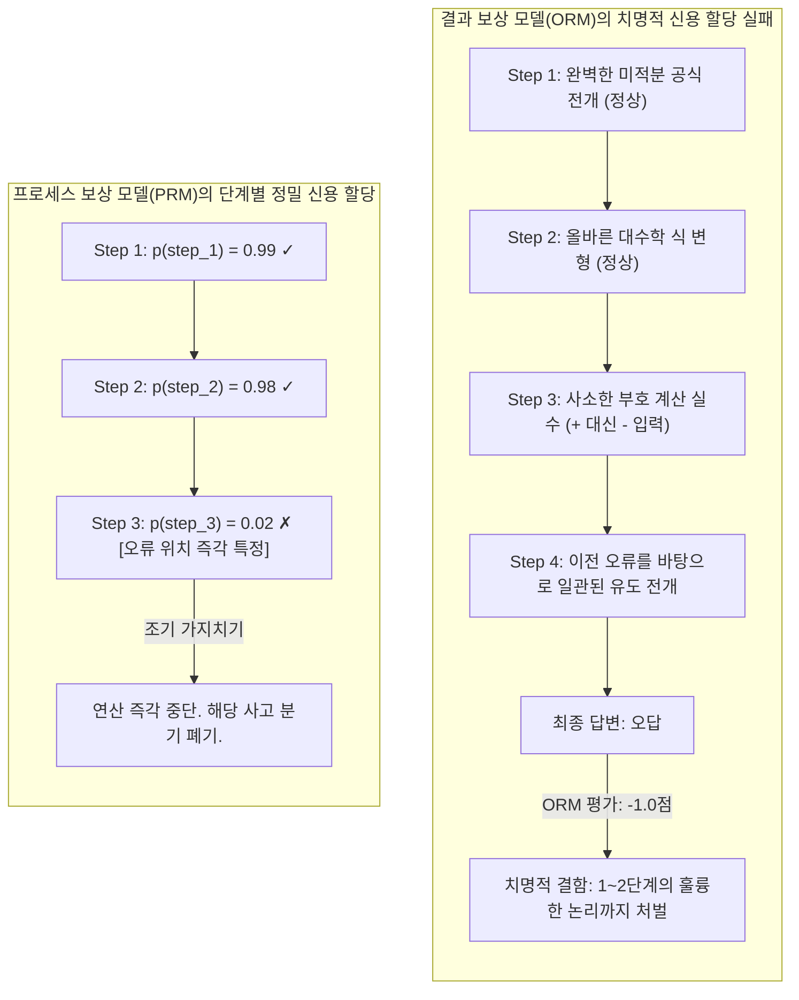
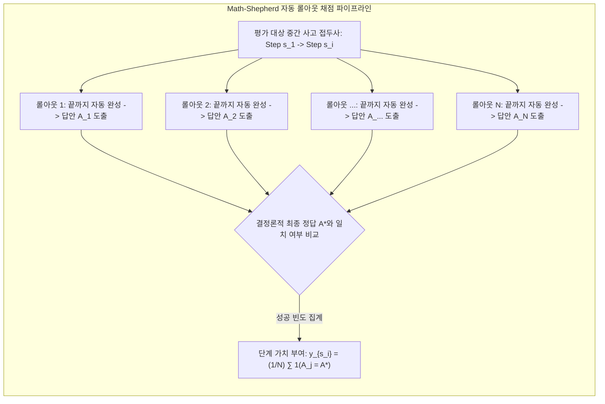
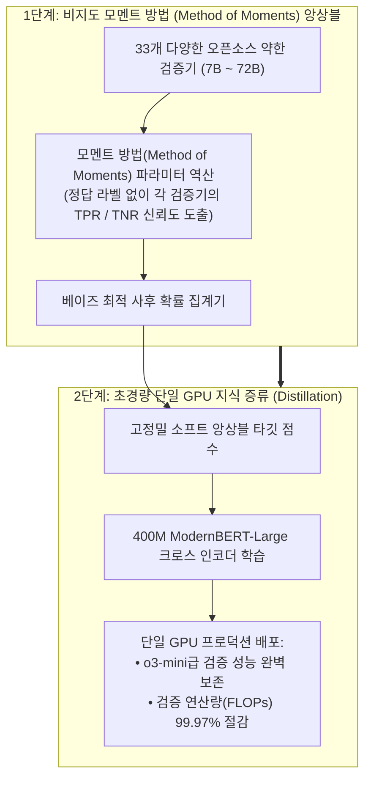

스탠포드 대학교의 2025년 가을 학기 최신 대학원 강좌, **CS329A: Self-Improving AI Agents (스스로 발전하는 AI 에이전트)** 세 번째 엔지니어링 해설에 오신 것을 환영합니다.

지난 제2강에서 우리는 추론 시간 연산 확장(Test-time Compute Scaling)을 배우며 매우 중요하고 본질적인 결론에 도달했습니다: 수천 개의 답변 후보($pass@k$)를 생성하면 정답 커버리지는 99%를 상회하지만, **"그 수많은 오답의 더미 속에서 진짜 정답을 골라낼 정밀한 검증기(Verifier)가 없다면 다수결 투표(Majority Vote)든 뭐든 성능이 완전히 정체(Plateau)된다"**는 사실이었습니다.

오늘 제3강에서는 이 병목을 정면으로 돌파하는 핵심 시스템 기술, 바로 **견고한 답변 검증 (Robust Verification)**을 다룹니다.

인간 수학자나 소프트웨어 엔지니어도 복잡한 문제를 풀 때 한 번의 거침없는 직진으로 정답에 도달하지 않습니다. 한 줄의 논리를 전개하고, 수식의 정합성을 검토하며, 사소한 부호 실수를 발견하면 즉시 이전 단계로 되돌아가(Backtracking) 수정을 거칩니다. 반면, 표준적인 자기회귀(Autoregressive) 언어 모델은 오직 앞 방향으로만 토큰을 방출합니다. 초반에 사소한 논리적 비약이 발생하면, 모델은 자신의 초기 오류를 정당화하기 위해 갈수록 더 그럴듯한 환각(Hallucination)을 지어내게 됩니다.

그렇다면 **"모델이 생성한 중간 추론 단계를 다른 검증 모델이 꼼꼼하게 검사하고 가지치기(Pruning)하게 만들 수는 없을까?"**

OpenAI의 기념비적 연구인 Cobbe의 GSM8K 검증기부터, Lightman의 단계별 과정 감독(PRM800K), 인간 라벨러 없이 몬테카를로 롤아웃으로 자가 채점하는 Math-Shepherd, 그리고 여러 개의 약한 검증기를 통계역학적으로 엮어 o3-mini급 성능을 뽑아내는 최신 Weaver(NeurIPS 2025) 연구까지, **검증기 엔지니어링(Verifier Engineering)의 정점**을 체계적으로 마스터해 보겠습니다.



{/* truncate */}

---

### 1. 생성-검증 격차 (Generation-Verification Gap): 병목의 수학적 정의

구체적인 검증기 아키텍처를 분석하기에 앞서, 모델이 생성할 수 있는 잠재력과 실제로 회수할 수 있는 성능 간의 격차를 수식으로 정의해야 합니다:

```text
Gap(K) = Pass@K - Actual_Success_Rate
```

최신 고난도 벤치마크인 GPQA Diamond에서 `Llama-3.3-70B-Instruct`의 $Pass@100$은 **82.8%**에 달합니다. 즉, 100개의 후보 풀이를 생성하면 10문제 중 8문제 이상에서 최소 하나 이상의 완벽한 정답 풀이가 포함되어 있습니다.

그러나 이 100개의 후보를 놓고 가장 일반적인 **다수결 투표(Majority Voting)**를 적용하면, 실제 측정되는 최종 정답률은 **45.5%**로 폭락합니다.

```
정답률 (%)
 ▲
100│                                     ┌────────────── Pass@100 오라클 상한선 (82.8%)
 90│                                ┌────┘
 80│                           ┌────┘
 70│                      ┌────┘
 60│                 ┌────┘
 50│            ┌────┘ ◄── 선택의 오류로 소멸하는 37.3%p 지능
 40│  ──────────┴──────────────────────── 다수결 투표 성능 평탄화 (45.5%)
 30│
 20│
 10│
  0└┴────────────────────────────────────────────────► 샘플 예산 K
```

무려 **37.3%p에 달하는 모델의 잠재 지능**이 순전히 "후보를 올바르게 선택하지 못해서" 허공으로 증발해 버립니다. 여러 개의 엉터리 풀이가 동일하게 매력적인 오답 함정(Plausible Distractor)으로 수렴할 때, 빈도수에만 의존하는 다수결은 필연적으로 거짓 양성(False Positive)을 정답으로 오판합니다.

#### 독립 검증기의 시초: Cobbe et al. (GSM8K, 2021)
이 격차를 좁히기 위해 OpenAI의 Karl Cobbe 연구팀은 전설적인 초등 수학 벤치마크 **GSM8K**를 발표하며, 생성기와 완전히 분리된 **독립 검증기(Verifier)** 구조를 제안했습니다:

1. **가중치 디커플링 (Decoupled Architecture):** 생성기와 검증기는 추론 시 순방향 가중치를 공유하지 않습니다. 생성기는 샘플의 엔트로피(다양성)를 유지하기 위해 2 에포크만 훈련하며, 검증기는 생성기가 출력한 후보 풀이군을 학습 데이터로 삼습니다.
2. **토큰 레벨 가치 헤드 (Token-Level Value Heads):** 풀이 전체의 끝에서만 단일 스칼라를 출력하는 대신, 트랜스포머의 모든 토큰 위치마다 선형 분류 헤드를 연결하여 해당 토큰 시점의 성공 확률을 추정합니다:
   ```text
   V(t_i) = W_v · h_L(t_i) + b_v
   ```
   전체 손실 함수는 언어 모델링 크로스 엔트로피 손실과 최종 검증 평균제곱오차(MSE)의 결합으로 최적화됩니다:
   ```text
   L_total = L_LM(θ) + λ · || V(t_end) - y_true ||^2
   ```
3. **30배 파라미터 배당 (The 30x Parameter Dividend):**
   * 불과 **6B 크기의 소형 검증기**를 붙여 100개 후보 중 최선의 답을 선별하게 한 결과, 단일 실행 **175B 거대 모델의 정답률과 맞먹는 성능**을 달성했습니다.
   * 단순히 생성과 검증을 분리한 것만으로 **약 30배의 파라미터 확장 효과**를 창출한 것입니다.

---

### 2. 결과 감독 vs 과정 감독: Lightman의 PRM800K

Cobbe의 검증기는 획기적이었으나, 본질적으로 **결과 감독(Outcome Reward Models, ORMs)**의 한계에 묶여 있었습니다.

2023년 5월, Hunter Lightman이 이끄는 OpenAI 연구팀은 인공지능 역사에 한 획을 그은 논문을 발표합니다: **《Let's Verify Step by Step》** (Lightman et al., 2023).



#### 추론에서의 신용 할당 문제 (Credit Assignment Problem)
10단계에 걸친 복잡한 수학 증명을 가정해 봅시다:
* **거짓 음성의 비극:** 모델이 1단계부터 6단계까지는 학술적으로 완벽한 논리를 전개하다가, 7단계에서 사소한 사칙연산 실수 하나로 최종 답이 틀렸습니다.
  * *ORM의 판정:* "답이 틀렸으므로 이 풀이는 통째로 감점(-1점)이다."
  * 1~6단계의 뛰어난 수학적 추론마저 부당하게 처벌받아 학습 신호가 오염됩니다.
* **거짓 양성의 비극 (우연한 정답, Lucky Error):** 3단계에서 심각한 논리적 오류를 범했으나, 8단계에서 또 다른 실수를 저질러 우연히 최종 수치 답안이 맞아떨어졌습니다.
  * *ORM의 판정:* "답이 맞았으므로 완벽한 풀이(+1점)이다."
  * 모델은 엉터리 추론에 대해 보상을 받으며, 보상 해킹(Reward Hacking)이 가속화됩니다.

이처럼 시간적 신용 할당의 실패는 결과 기반 검증기의 스케일링을 가로막는 치명적 장벽이었습니다.

#### PRM의 수학적 설계
Lightman 연구팀은 인간 전문가를 동원하여 75,000개 해법의 80만 개 추론 단계(Step)마다 긍정/부정/중립을 태깅한 **PRM800K** 데이터셋을 구축했습니다.

비용 효율을 위해 도입된 핵심 기법은 **"최초 오류 종료 규칙(First-Error Termination Rule)"**이었습니다. 유효하지 않은 유도 과정에서 발생한 후속 단계는 인식론적으로 무의미하므로, 라벨러는 첫 오류가 발생한 즉시 작업을 중단했습니다.

PRM은 각 추론 단계의 끝(개행 토큰)에서 해당 단계가 논리적으로 건전할 확률을 예측합니다:

```text
p(s_i) = σ( W_p · h_L( Token_{\text{newline}, i} ) )
```

전체 사고 궤적 $S = (s_1, s_2, ..., s_M)$에 대한 종합 검증 점수는 **확률 곱셈 법칙(Product Rule)**으로 계산됩니다:

```text
Score_PRM(S) = ∏_{i=1}^M p(s_i \text{ is correct})
```

#### PRM의 압도적 실증 성능
고난도 MATH 벤치마크에서 $N = 1,860$까지 Best-of-N 탐색을 수행했을 때의 실증 결과는 명확했습니다:

```text
┌───────────────────────────────┬──────────────┬──────────────┬─────────────┐
│ 답변 선택 전략                │ Best-of-1    │ Best-of-100  │ Best-of-1860│
├───────────────────────────────┼──────────────┼──────────────┼─────────────┤
│ 다수결 투표 (Majority Vote)   │ 52.4%        │ 68.3%        │ 69.6%       │
│ 결과 보상 모델 (ORM)          │ 52.4%        │ 70.1%        │ 72.4%       │
│ 프로세스 보상 모델 (PRM)      │ 52.4%        │ 74.8%        │ 78.2%       │
└───────────────────────────────┴──────────────┴──────────────┴─────────────┘
```

1. **지속적인 스케일링 곡선:** 다수결과 ORM이 $N = 100$ 전후에서 조기 정체되는 반면, PRM은 수천 개 샘플에 도달할 때까지 단조 증가(Monotonic Scaling)를 이어갔습니다.
2. **음의 정렬세 (Negative Alignment Tax):** 전통적인 정렬(RLHF)이 모델의 순수 수학 능력을 깎아먹는 "정렬세"를 유발했던 것과 달리, 과정 감독은 추론의 투명성과 안전성을 극대화하면서도 성능까지 동시에 폭발시키는 무손실 정렬 기법임이 입증되었습니다.

---

### 3. 무인 자동 과정 감독: Math-Shepherd 몬테카를로 롤아웃

PRM의 압도적 우수성에도 불구하고, 산업계 도입을 가로막은 유일한 장애물은 **"80만 단계에 달하는 고비용 인간 라벨링"**이었습니다.

2023년 말, Yu, Shen, Zhou 등 연구팀은 몬테카를로 트리 탐색(MCTS)의 롤아웃 기법을 차용한 **Math-Shepherd** 프레임워크를 발표하며 이 한계를 무너뜨렸습니다.



#### 핵심 알고리즘 직관
바둑 AI(AlphaGo)가 형세를 판단하듯, 기계가 기계의 중간 단계를 채점합니다:
> "어떤 중간 추론 단계 $s_i$가 참인지 알고 싶다면, 그 단계에서부터 언어 모델에게 풀이를 $N$번 끝까지 완성시켜 보라(Rollout). 만약 완성된 풀이들이 최종 정답 $A^*$에 빈번히 도달한다면, 그 중간 단계는 훌륭한 디딤돌이었을 것이다!"

#### 하드 추정 vs 소프트 추정
Math-Shepherd는 두 가지 단계별 가치 라벨링 함수를 정의했습니다:

1. **하드 추정 (Hard Estimation, HE):** $N$개의 롤아웃 중 단 하나라도 정답에 도달하면 해당 단계에 $+1$, 전혀 도달하지 못하면 $0$을 부여:
   ```text
   y^{HE}_{s_i} = 1( ∃ j \in {1, ..., N} : A_j = A^* )
   ```
2. **소프트 추정 (Soft Estimation, SE):** $N$개의 롤아웃 중 정답에 도달한 빈도의 비율을 연속적인 확률값으로 부여:
   ```text
   y^{SE}_{s_i} = (1 / N) · ∑_{j=1}^N 1( A_j = A^* )
   ```

#### 충격적인 결과: 기계 라벨이 인간 라벨을 압도하다
연구진은 라벨이 없는 원시 문제 코퍼스에서 자동 롤아웃을 실행하여, PRM800K보다 2배 이상 방대한 **170만 개 주석 단계**를 인건비 0원으로 생성했습니다.

* **인간 주석 vs 기계 주석:** 오픈소스 LLaMA 백본에서 평가했을 때, Math-Shepherd 기계 데이터로 학습된 PRM은 **인간이 라벨링한 PRM800K보다 MATH 벤치마크에서 더 높은 점수**를 기록했습니다.
* **역전의 원인:** PRM800K의 인간 라벨러는 GPT-4가 작성한 풀이만을 검토했기 때문에 오픈소스 모델 고유의 오답 분포를 교정하지 못했습니다. 반면 Math-Shepherd는 해당 모델의 실제 롤아웃 분포에서 직접 학습했기 때문에 완벽한 맞춤형 검증기를 공짜로 확보할 수 있었습니다.
* **단계별 강화학습(PPO) 적용:** Math-Shepherd의 단계별 보상을 활용해 강화학습을 진행하자, `Mistral-7B`의 MATH 점수는 기존 28.6%에서 **43.5%로 수직 상승**했습니다.

---

### 4. 앙상블 이론: Weaver 프레임워크 (NeurIPS 2025)

Math-Shepherd로 PRM을 자동 구축하더라도, 단일 7B~13B 소형 검증기만으로는 여전히 미세한 오판이 발생합니다. 반면 70B 이상의 대형 검증기를 프로덕션에서 매번 실행하는 것은 지연 시간과 비용 면에서 감당할 수 없습니다.

스탠포드 대학교와 위스콘신 대학교 매디슨 연구진은 NeurIPS 2025에서 이 난제를 우아한 통계역학으로 풀어냈습니다: **《Weaver: Shrinking the Generation-Verification Gap with Weak Verifiers》** (Zhang et al., 2025).



#### 정답 라벨 없이 검증기의 실력을 역산하는 모멘트 방법 (Method of Moments)
Weaver는 7B부터 72B까지 다양한 오픈소스 약한 검증기(Weak Verifier) 33개를 결합합니다. 정답 라벨이 전혀 없는 테스트 환경에서, **어떤 검증기의 말을 더 신뢰해야 할까요?**

Weaver는 이 문제를 **잠재 변수 나이브 베이즈 모델(Latent Variable Naive Bayes)**로 공식화했습니다:
* 후보 풀이의 실제 정답 여부 `Y in {0, 1}`는 알 수 없는 잠재 변수입니다.
* 각 검증기 `k`는 미지의 참 양성률(민감도, ``w_{k,1}``)과 참 음성률(특이도, ``w_{k,0}``)을 갖습니다:
  ```text
  `w_{k,1}` = P(S_k = 1 | Y = 1), \quad `w_{k,0}` = P(S_k = 0 | Y = 0)
  ```
* $Y$가 주어졌을 때 검증기들이 조건부 독립이라고 가정하면, 두 검증기 $i, j$가 동시에 정답으로 판정할 결합 확률은 다음과 같이 전개됩니다:
  ```text
  P(S_i = 1, S_j = 1) = π · w_{i,1} · w_{j,1} + (1 - π) · (1 - w_{i,0}) · (1 - w_{j,0})
  ```
  여기서 $\pi = P(Y=1)$은 전체 정답 기저 비율입니다.

Weaver는 관측된 예측값들의 2차 및 3차 공분산 모멘트 방정식을 수학적으로 역산하여, **정답 라벨 단 하나 없이도 33개 검증기 각각의 정확도 가중치 ``(`w_{k,1}`, `w_{k,0}`)``를 완벽하게 추정**해 냈습니다.

이 신뢰도를 기반으로 도출된 최적의 베이지안 사후 합의 확률은 다음과 같습니다:

```text
P( Y=1 | S_1, ..., S_K ) = 1 / ( 1 + exp( - ( l_0 + ∑_{k=1}^K l_k(S_k) ) ) )
```

#### Weaver의 경이적인 성과
1. **OpenAI o3-mini 능가:**
   * 순수 생성기인 `Llama-3.3-70B-Instruct`에 Weaver 앙상블을 결합한 결과, 최고 난도 STEM 경시대회 벤치마크에서 **87.7%**를 기록했습니다.
   * 이는 단일 추론 최강자였던 **OpenAI o3-mini (86.7%)와 GPT-4o (69.0%)를 완전히 제친 수치**였습니다.
2. **400M 초경량 크로스 인코더 증류:**
   * 프로덕션에서 33개 모델을 동시 실행하는 것은 불가능합니다. 연구진은 Weaver의 앙상블 예측값을 소프트 타깃으로 삼아 단 **400M 파라미터의 `ModernBERT-Large` 크로스 인코더**로 지식 증류했습니다.
   * 그 결과, 앙상블 성능의 **98.7%를 그대로 유지하면서 검증 연산량(FLOPs)을 99.97% 절감**하여 단일 상용 GPU 1장에서도 실시간 o3-mini급 선별이 가능해졌습니다.

---

### 5. 아키텍처 사례 연구: 산업용 프로덕션 검증기 설계 체크리스트

스탠포드 CS329A 제3강의 이론을 상용 소프트웨어, 금융, 법률 AI 에이전트에 적용하기 위한 아키텍처 가이드라인입니다:

```text
┌────────────────────────────────────────────────────────────────────────┐
│             엔터프라이즈 프로덕션 검증기 아키텍처 체크리스트           │
├────────────────────────────────────────────────────────────────────────┤
│ 1. 정형화된 닫힌 도메인 (코딩, 형식 수학 증명):                        │
│    • 컴파일러 및 단위 테스트 실행 샌드박스를 결정론적 오라클로 배치.   │
│    • Docker / gVisor 기반의 실행 피드백 ORM 적용.                      │
│                                                                        │
│ 2. 반정형 / 다단계 추론 도메인 (금융 분석, 법률 검토, 시스템 설계):   │
│    • 무인 롤아웃(Math-Shepherd 방식)으로 학습된 프로세스 보상 모델      │
│      (PRM) 구축.                                                       │
│    • 확률 곱셈 법칙(Product Rule)으로 후보군 스코어링.                 │
│    • 단계 점수 p < 0.2 이하인 사고 가지는 조기에 가지치기(Pruning).    │
│                                                                        │
│ 3. 실시간 지연 시간 및 인프라 비용 최적화:                             │
│    • 오프라인에서 모멘트 방법(Weaver) 기반의 약한 검증기 앙상블 구축.   │
│    • 앙상블 신호를 1B 미만의 경량 크로스 인코더로 증류(Distillation). │
│    • 단일 엣지 GPU에서 10ms 이내 초고속 검증 수행.                     │
└────────────────────────────────────────────────────────────────────────┘
```

---

### 6. 요약 및 핵심 엔지니어링 교훈

1. **검증 병목의 법칙:** 지능 향상의 병목은 생성이 아니라 선택입니다. 30%p 이상의 생성-검증 격차를 해소하려면 분리된 독립 검증기가 필수적입니다.
2. **신용 할당의 우위:** 결과 보상 모델(ORM)은 다단계 추론에서 심각한 신용 할당 실패를 겪습니다. 단계별 유효성을 평가하는 프로세스 보상 모델(PRM)만이 Best-of-N 스케일링의 우상향을 보장합니다.
3. **무인 감독 혁신:** 인간 단계별 주석은 과거의 유물입니다. 몬테카를로 롤아웃(Math-Shepherd)을 통해 모델 자신의 분포에 최적화된 기계 라벨을 공짜로 무한 생성할 수 있습니다.
4. **앙상블과 증류의 시너지:** 정답 라벨 없는 통계적 모멘트 앙상블(Weaver)은 최첨단 독점 모델을 능가하며, 400M 소형 모델로의 증류를 통해 연산량을 99.97% 절감할 수 있습니다.

---

### 스탠포드 CS329A 다음 편 예고:
이어지는 **제4강**에서는 텍스트 확률을 넘어 외부 환경의 냉혹한 실시간 피드백으로 나아갑니다: **《Tool Use & Code Feedback: 컴파일러, 실행 샌드박스, 그리고 자율 자가 교정 루프》**. 파이썬 인터프리터, 배시 터미널, 단위 테스트와 상호작용하며 스스로 치유되는 코드 생성 에이전트의 비밀을 파헤칩니다. 기대해 주십시오!