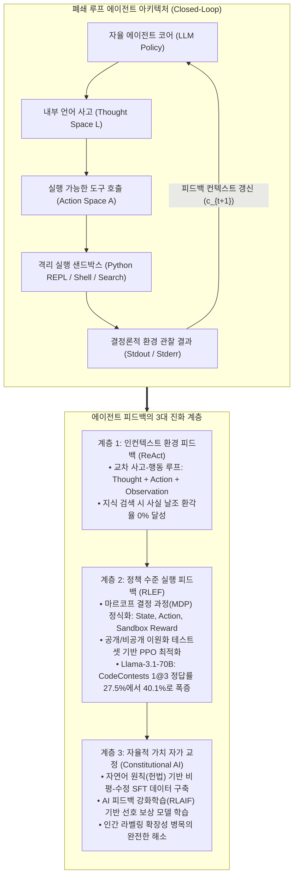
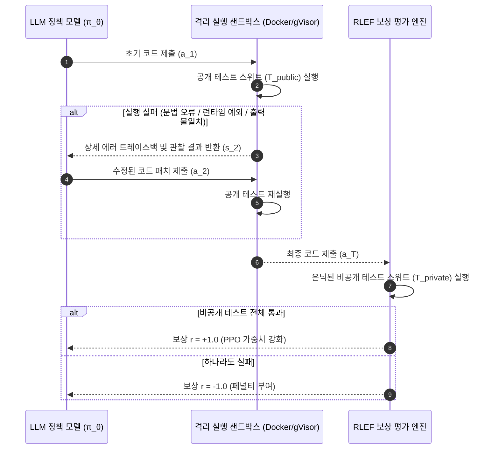
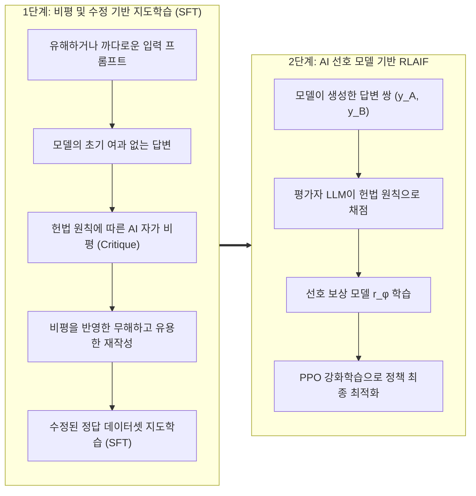

스탠포드 대학교의 최신 2025 가을학기 대학원 강좌, **CS329A: Self-Improving AI Agents (스스로 발전하는 AI 에이전트)** 네 번째 기술 해설에 오신 것을 환영합니다.

지난 제2강과 제3강에서 우리는 추론 시간 연산 확장(Test-time Compute Scaling)과 프로세스 보상 모델(PRM)을 통해 언어 모델이 추론 트리를 탐색하고 중간 수학적 단계를 스스로 검증하는 원리를 깊이 있게 살펴보았습니다. 그러나 정교한 추론 체인을 아무리 전개할지라도, 순수 텍스트 생성에만 머무르는 언어 모델은 여전히 **"방 안에 갇혀 시험지만 푸는 수험생"**과 같습니다. 모델은 사전 훈련 과정에서 습득한 정적이고 동결된 파라미터 기억(Parametric Memory)에만 전적으로 의존하기 때문입니다. 끊임없이 변하는 외부 사실, 동적 API, 혹은 문법적으로 엄격한 코드 실행 환경과 마주했을 때, 현실 세계와 단절된 모델은 필연적으로 그럴듯한 환각(Hallucination)에 빠지고 맙니다.

오늘 제4강은 모델을 폐쇄된 방 밖으로 끄집어내는 결정적인 패러다임 전환점입니다. 바로 **도구 사용(Tool Use)과 실행 피드백 루프(Execution Feedback Loops)**를 다룹니다.

현대 자율형 에이전트는 코드나 API 호출을 단순한 텍스트 출력 결과물로 취급하지 않고, 외부 환경과 상호작용하는 **센서이자 액추에이터**로 활용합니다. 이번 강의에서는 정적 언어 모델을 자율형 폐쇄 루프 에이전트로 탈바꿈시키는 3대 핵심 피드백 계층을 분해하고 재설계합니다:
1. **프롬프트 수준 환경 피드백 (Prompt-Level):** 사고와 행동을 유기적으로 엮어내는 **ReAct** (Yao et al., 2022)
2. **정책 수준 실행 피드백 (Policy-Level):** 컴파일러와 테스트 러너의 실행 진단 결과를 신경망 가중치에 직접 새겨넣는 **RLEF** (Reinforcement Learning from Execution Feedback, 2024)
3. **자가 감독 가치 정렬 (Self-Supervision):** 고비용 인간 평가자를 자연어 원칙 기반의 비평-수정 루프로 대체하는 **Constitutional AI** (Anthropic, 2022)



{/* truncate */}

---

### 1. 생각과 행동의 공존: ReAct 프레임워크 (Yao et al., 2022)

2022년 ReAct(프린스턴 대학교 및 구글 리서치)가 등장하기 전까지 AI 에이전트 진영은 크게 두 갈래로 나뉘어 평행선을 달리고 있었습니다:
1. **순수 추론 진영 (Chain-of-Thought / CoT):** 모델에게 내부 사고 과정을 단계별로 생성하도록 유도합니다. 닫힌 수학 문제에서는 효과적이지만, 외부 환경에 접근할 수 없기 때문에 잘못된 지식을 한 번 떠올리면(Hallucination) 그 거짓 가정을 정당화하기 위해 갈수록 더 그럴듯한 궤변을 만들어냅니다.
2. **순수 행동 진영 (Action-only / WebGPT, Act):** 모델이 즉시 API 호출이나 검색 명령을 내립니다. 그러나 복잡한 다단계 과제에서 "내가 왜 이 검색을 했는지", "다음 목표가 무엇인지"를 추적하는 내부 작업 기억(Working Memory)이 없어 무한 루프에 빠지거나 길을 잃습니다.

#### 행동 공간의 수학적 확장

ReAct는 에이전트의 전체 행동 공간을 **외부 물리적 행동 공간 $A$**와 **내부 자연어 사고 공간 $L$**의 합집합으로 우아하게 결합했습니다:

```text
A_hat = A ∪ L
```

여기서:
* `A`는 외부 환경에 명령을 내리는 실행 가능한 행동 집합입니다 (예: `Search[query]`, `ExecutePython[code]`, `Click[element]`).
* `L`은 자유로운 자연어 사고(Thought) 공간입니다.

핵심적인 수학적 특징은 사고 토큰 $a_t \in L$이 **외부 환경에 어떠한 상태 전이(State Transition)도 일으키지 않는다**는 점입니다. 대신 에이전트의 내부 컨텍스트만을 갱신합니다:

```text
c_{t+1} = ( c_t, a_t )   (a_t ∈ L인 경우)
```

반면 에이전트가 행동 토큰 $a_t \in A$를 방출하면, 외부 환경이 실행되어 결정론적 관찰 결과(Observation)를 반환합니다:

```text
c_{t+1} = ( c_t, a_t, o_t )   (a_t ∈ A, o_t = Env(a_t)인 경우)
```

#### 교차 상호작용 사이클의 실제 예시

ReAct의 실행 흐름은 다음과 같이 사고와 행동, 관찰이 유기적으로 교차합니다:

```text
Thought 1: 사용자의 질문을 2개의 세부 하위 문제로 분해하자. 먼저 앨런 튜링의 출생 연도를 검색해야 한다.
Action 1: Search["앨런 튜링 출생일"]
Observation 1: 앨런 매시슨 튜링(1912년 6월 23일 ~ 1954년 6월 7일)은 영국의 수학자이자...
Thought 2: 튜링은 1912년에 태어났다. 이제 1912년 당시 런던의 총 인구 통계를 검색해야 한다.
Action 2: Search["런던 인구 1912년"]
Observation 2: 1912년 행정구역상 런던주의 공식 인구는 약 452만 명으로 집계되었다...
Thought 3: 두 값이 모두 확실히 확인되었다. 최종 정답은 452만 명이다.
Action 3: Finish["452만 명"]
```

#### 실험적 입증: 환각의 극적 소멸과 제어력 향상

Yao et al.의 벤치마크 결과는 놀라웠습니다:
* **다단계 지식 검색 (HotpotQA):**
  * CoT 모델의 실패 원인을 정밀 분석한 결과, **전체 오류의 56%가 명백한 사실 날조(존재하지 않는 인물이나 날짜 창작)**였습니다.
  * 그러나 ReAct 루프를 적용하자 사실 날조 환각은 **0%**로 소멸했습니다. 모르는 정보가 나오면 외부 환경에 직접 질의해야만 다음 단계로 나아갈 수 있기 때문입니다.
* **대화형 텍스트 환경 (ALFWorld):**
  * 여러 방을 이동하며 물건을 찾아 조작하는 과제에서, 순수 행동(Act) 모델의 성공률은 작업 기억 상실로 인해 45%에 불과했으나 ReAct는 **71%**를 달성했습니다.
* **프로덕션 엔지니어링 필수 규칙 (Stop Sequence):**
  * 자기회귀 모델은 다음 단어를 끊임없이 생성하려는 본능이 있습니다. 그대로 두면 모델은 외부 도구의 응답을 기다리지 않고 자기가 상상한 가짜 `Observation:`을 스스로 써 내려가기 시작합니다.
  * **구현 지침:** 백엔드 추론 엔진에 반드시 중단 시퀀스(`stop=["\nObservation:"]`)를 설정해야 합니다. 모델이 `Action:`을 출력하는 순간 생성을 강제 중단하고, 호스트 오케스트레이터가 실제 샌드박스를 실행한 뒤 진짜 출력을 이어 붙여 다음 턴을 깨워야 합니다.

---

### 2. 실행 피드백을 가중치에 새기다: RLEF (Reinforcement Learning from Execution Feedback)

ReAct가 프롬프트 기반의 상호작용을 열었다면, 복잡한 소프트웨어 엔지니어링 문제에서는 훨씬 더 깊은 능력이 필요합니다: 바로 **컴파일러 에러와 테스트 실패 내역을 보고 스스로 버그를 고치는 자가 디버깅(Self-Debugging) 능력**입니다.

#### 프롬프트 기반 자가 디버깅의 역설

동결된 사전 훈련 모델(Frozen LLM)에게 버그가 난 코드와 터미널 에러 트레이스백(Traceback)을 프롬프트로 붙여주고 "이 에러를 보고 코드를 고쳐줘"라고 요청하면 놀랍게도 다음과 같은 현상이 관찰됩니다 (Olausson et al., 2024; Kapoor et al., 2024):

> **"동결된 모델에게 에러 메시지를 주며 수정을 요구하는 것보다, 에러를 아예 보여주지 않고 처음부터 완전히 새로운 코드를 독립적으로 다시 샘플링(Independent Sampling)하게 만드는 편이 훨씬 정답률이 높다!"**

사전 훈련된 언어 모델은 본질적으로 에러 메시지의 라인 번호와 자신의 코드 논리 사이의 상관관계를 해석하도록 훈련받은 적이 없기 때문입니다. 에러를 마주하면 모델은 공황에 빠져 변수 이름만 바꾸거나 동일한 버그를 줄바꿈만 바꿔 그대로 재생산합니다.

2024년 말 발표된 **RLEF (arxiv:2410.02089)**는 이 한계를 프롬프트 기교가 아닌 **강화학습(PPO)**으로 근본적으로 해결했습니다.

#### 다회차 코드 생성을 MDP로 정식화

RLEF는 "코드 작성 $\to$ 실행 피드백 $\to$ 수정"의 최대 $T$회 상호작용 과정을 이산 시간 마르코프 결정 과정(MDP)으로 정의합니다:
* **상태 공간 ($S$):** 문제 명세서, 이전 코드 시도 및 컴파일러/런타임 에러 진단 내역:
  ```text
  s_t = ( Problem_Spec, Code_1, Err_1, ..., Code_{t-1}, Err_{t-1} )
  ```
* **행동 공간 ($A$):** 모델이 새롭게 생성한 코드 패치 또는 완성형 프로그램 $a_t$.
* **환경 전이:** 자동화된 테스트 하네스를 갖춘 격리 실행 샌드박스에서 코드가 컴파일 및 실행됩니다.



#### 이원화 테스트 스위트: 보상 해킹(Reward Hacking)의 방지

RLEF의 핵심 설계는 모델의 꼼수(치팅)를 차단하는 **공개/비공개 테스트 분리**입니다:
1. **공개 테스트 (`T_public`):** 디버깅 과정에서 모델에게 제공되는 테스트 케이스입니다. 컴파일러 경고, 어설션 실패, 표준 출력/에러가 관찰 상태 $s_t$로 주어집니다.
2. **비공개 테스트 (`T_private`):** 모델의 컨텍스트에서 철저히 은닉되며, 에피소드 종료 시 최종 보상을 계산할 때만 실행됩니다.

만약 모델이 공개 테스트만을 통과하기 위해 하드코딩 편법(`if input == test_1: return val_1`)을 부리면, 비공개 테스트에서 전멸하여 극심한 강화학습 페널티를 받게 됩니다.

#### 목적 함수 및 환경 보상 설계

정책 $\pi_\theta$는 참조 모델 $\rho$와의 KL 발산(Kullback-Leibler Divergence) 페널티를 포함한 PPO 알고리즘으로 최적화됩니다:

```text
R(s_t, a_t) = r(s_t, a_t) - β * log( π_θ(a_t | s_t) / ρ(a_t | s_t) )
```

환경 스칼라 보상 함수는 다음과 같이 설계됩니다:

```text
r(s_t, a_t) = {
    +1.0,  에피소드 종료 시 T_private의 모든 테스트 통과
    -1.0,  최대 재시도 예산 T 소진 후에도 테스트 실패
    -0.2,  a_t가 문법 오류로 컴파일조차 불가능한 불법 코드일 때 (중간 페널티)
}
```

#### 벤치마크 결과: CodeContests에서 AlphaCodium을 압도하다

알고리즘 경시대회 난제들로 구성된 **CodeContests** 벤치마크에서 RLEF는 충격적인 성능 도약을 보여주었습니다:
* 오픈소스 가중치 모델인 `Llama-3.1-70B-Instruct`에 RLEF를 적용하자, 단 3번의 재시도 예산($1@3$)만으로 정답률이 **27.5%에서 40.1%로 폭증**했습니다.
* 이는 100개의 후보 코드를 대량으로 뽑아내던 GPT-4 기반 **AlphaCodium ($pass@100$, 29.0%)을 11.1%p 차이로 완전히 제친 결과**입니다.

#### 무작위 피드백 소거 실험 (Ablation Study)

연구진은 모델이 에러 메시지를 진짜로 이해한 것인지 증명하기 위해 기발한 대조 실험을 진행했습니다:
* 모델에게 다른 엉뚱한 문제의 에러 메시지를 가짜로 주자 정답률이 기준선 이하로 폭락했습니다.
* 이는 RLEF로 훈련된 정책이 단순한 시행착오의 우연이 아니라, **에러 트레이스백의 라인 번호와 예외 유형을 자신의 소스 코드와 대조하여 버그의 근본 원인을 표적 타격하는 법을 신경망에 새겼음**을 수학적으로 입증합니다.

---

### 3. AI가 AI를 훈육하다: Constitutional AI와 RLAIF

ReAct는 외부 검색 API를, RLEF는 결정론적 컴파일러를 피드백으로 사용했습니다. 하지만 다음과 같은 주관적이고 개방적인 영역에서는 어떻게 피드백을 주어야 할까요?
* 이 아키텍처 설계 제안서가 시스템 확장성과 모듈화 원칙을 충족하는가?
* 이 코드 리뷰 피드백이 상대방에게 무례하지 않으면서도 보안 취약점을 정확히 지적하고 있는가?
* 이 대답이 적대적 탈옥(Jailbreak) 프롬프트에 넘어가 위험한 침투 코드를 알려주고 있지 않은가?

수천 명의 인간 작업자에게 수십만 개의 답변 쌍을 비교 채점시키는 전통적인 인간 피드백 강화학습(RLHF)은 막대한 비용, 작업자 간 편향, 피로도, 불투명한 판단 기준으로 인해 치명적인 확장성 한계에 직면합니다.

2022년 앤트로픽(Anthropic)은 자연어로 작성된 명시적 원칙(헌법, Constitution)만으로 AI가 스스로를 정렬하는 **Constitutional AI (RLAIF: AI 피드백 기반 강화학습)**를 제안했습니다.



#### 2단계 헌법적 학습 파이프라인

1. **제1단계: 비평 및 수정 (Critique $\to$ Revision $\to$ SFT)**
   * 유해하거나 까다로운 질문에 대해 모델이 초기 답변 $y_0$를 생성합니다.
   * 헌법 문서에서 무작위로 원칙 하나를 추출하여 모델 자신에게 명령합니다:
     * **비평 프롬프트:** *"너의 방금 답변을 헌법 제3조('시스템 보안 취약점을 노출하지 말고 정적 타입 안정성을 강제할 것')에 비추어 검토하라. 위반된 모든 구체적 항목을 지적하라."*
     * **수정 프롬프트:** *"지적된 모든 결함을 제거하고, 엄격한 엔지니어링 깊이를 유지하면서 답변을 완전히 새로 작성하라."*
   * 이렇게 자가 정제된 고품질 데이터셋 $`{y*}`$을 구축하여 1차 지도학습(SFT)을 수행합니다.

2. **제2단계: AI 피드백 강화학습 (RLAIF)**
   * 파인튜닝된 모델이 동일한 입력 $x$에 대해 두 개의 후보 답변 $(y_A, y_B)$를 생성합니다.
   * 인간 평가자 대신 독립된 AI 판사 모델에게 헌법 원칙을 주고 소프트 레이블 확률을 계산합니다:
     ```text
     P( y_A > y_B | x, Constitution )
     ```
   * 이 AI 채점 결과로 선호 보상 모델 $r_\phi(x, y)$를 학습시키고, 대상 에이전트 정책을 PPO로 최종 강화학습합니다.

#### 확장 가능한 감독(Scalable Oversight)의 완성

Constitutional AI는 수만 시간의 인간 노동을 **"단 한 장의 선언적 자연어 원칙(헌법)"**으로 치환할 수 있음을 증명했습니다. 인간 설계자는 고차원적인 규범과 가치를 정의하는 데 집중하고, AI 평가자 함대가 수십억 토큰에 달하는 자가 정렬 루프를 실시간으로 확장합니다.

---

### 4. 엔터프라이즈 아키텍처: 산업용 에이전트 실행 메시 설계

프로덕션 환경에서 자율형 도구 사용과 코드 피드백을 안전하게 구동하기 위해서는 다계층의 방어적 인프라가 필수적입니다. 스탠포드 CS329A에서 제시하는 엔터프라이즈 표준 청사진은 다음과 같습니다:

```text
┌────────────────────────────────────────────────────────────────────────┐
│             엔터프라이즈 도구 및 코드 실행 샌드박스 아키텍처             │
├────────────────────────────────────────────────────────────────────────┤
│                                                                        │
│  [ 사용자 요구사항 / PRD ]                                             │
│          │                                                             │
│          ▼                                                             │
│  ┌──────────────────────────────────────────────────────────────────┐  │
│  │                    오케스트레이션 에이전트 코어                  │  │
│  │  • 엄격한 중단 시퀀스(Stop Sequence)가 적용된 ReAct 프롬프트     │  │
│  │  • 컨텍스트 매니저 (슬라이딩 작업 기억 + AST 코드 인덱스)        │  │
│  │  • JSON-RPC 스키마 유효성 검증 기반 도구 디스패처                 │  │
│  └───────────────────┬──────────────────────────────▲───────────────┘  │
│                      │ 정형 도구 호출 규격          │ 정제된 관찰 텔레메트리│
│                      ▼                              │ (Stdout/Stderr)  │
│  ┌──────────────────────────────────────────────────┴───────────────┐  │
│  │                     보안 샌드박스 게이트웨이                     │  │
│  │  • MicroVM / gVisor 컨테이너 격리 (호스트 파일시스템 접근 차단)   │  │
│  │  • 네트워크 아웃바운드 방화벽 (화이트리스트 도메인만 통과)        │  │
│  │  • 엄격한 자원 할당: 2.0 CPU 코어, 2GB RAM, 5초 타임아웃 제한     │  │
│  ├──────────────────────────────────────────────────────────────────┤  │
│  │                    격리된 실행 런타임 환경                       │  │
│  │  ┌─────────────────────────┐     ┌────────────────────────────┐  │  │
│  │  │ 휘발성 Python REPL       │     │ 제한된 Bash 셸 환경        │  │  │
│  │  │ • Pytest 공개 하네스     │     │ • AST 정적 분석 린터       │  │  │
│  │  │ • 에러 트레이스백 정제기 │     │ • Semgrep 보안 스캐너      │  │  │
│  │  └─────────────────────────┘     └────────────────────────────┘  │  │
│  └──────────────────────────────────────────────────────────────────┘  │
│                                                                        │
└────────────────────────────────────────────────────────────────────────┘
```

#### 프로덕션 핵심 3대 보안 원칙
1. **일회성 휘발성 격리 (Ephemeral Sandboxing):** 모든 코드 실행은 gVisor 또는 Firecracker 기반의 MicroVM에서 일회용으로 구동되어야 하며, 실행 종료 즉시 파기되어야 합니다.
2. **네트워크 유출 차단 (Egress Isolation):** 악의적인 프롬프트 인젝션이나 탈옥 코드가 호스트의 환경변수나 데이터베이스 토큰을 외부 서버로 전송하지 못하도록 아웃바운드 네트워크를 원천 차단합니다.
3. **트레이스백 정제 (Traceback Sanitization):** 터미널의 에러 출력을 에이전트 컨텍스트로 전달하기 전에 호스트 절대 경로 및 비밀 키를 마스킹하여 컨텍스트 낭비와 정보 유출을 방지합니다.

---

### 5. 엔지니어링 Q&A 및 기술 심층 분석

**Q: ReAct 에이전트가 도구 결과를 기다리지 않고 가짜 Observation을 날조하는 문제를 완벽히 차단하는 방법은 무엇인가요?**
**A:** 가장 많은 초보 엔지니어들이 겪는 함정입니다. 자기회귀 모델은 이전 대화의 리듬을 이어가려는 성향이 있어 `Action: Search[...]`를 출력한 뒤 혼자서 가상의 `Observation: 검색 성공...`을 적어버립니다. 이를 막는 유일하고 확실한 해결책은 추론 매개변수에 `stop=["\nObservation:"]`을 지정하는 것입니다. 모델이 `Action:` 토큰을 끝마치는 즉시 추론을 멈추고, 파이썬 백엔드가 실제 도구를 실행한 뒤 그 진짜 출력을 문자열로 이어붙여 다음 턴으로 모델을 호출해야 합니다.

**Q: 정적인 에러 로그 데이터셋으로 지도학습(SFT)을 시키는 것보다 RLEF 강화학습이 왜 훨씬 일반화 성능이 뛰어난가요?**
**A:** 정적 SFT 데이터셋은 **분포 변화(Distributional Shift)** 문제를 피할 수 없습니다. 모델이 실제 서비스에서 과거 학습 데이터셋에 없던 사소한 실수를 저지르면, 한 번도 가본 적 없는 상태 공간(Unvisited State Space)에 빠져 완전히 무너집니다. 반면 RLEF는 MDP 상에서 모델 자신의 고유한 실수 패턴을 직접 탐색하고, 실제로 실패 페널티를 받으며, 이를 자가 복구하는 정책 가중치를 PPO로 갱신하므로 극도로 견고한 복원력을 갖게 됩니다.

---

### 6. 핵심 요약 및 테이크어웨이

1. **상호작용을 통한 실체화:** 정적인 기억에만 의존하는 모델은 필연적으로 환각을 낳습니다. ReAct는 사고와 행동 공간을 결합($\hat = A \cup L$)하여 다단계 검색에서의 환각율을 0%로 떨어뜨렸습니다.
2. **실행 피드백의 신경망 전이:** 동결된 모델에 에러를 보여주는 프롬프트 기교는 한계가 명확합니다. RLEF는 컴파일러와 테스트 스위트를 MDP로 연결하여 70B 오픈소스 모델로 GPT-4 기반 100회 탐색 프레임워크를 압도했습니다.
3. **자율적 헌법 정렬:** Constitutional AI는 인간 노동 집약적인 RLHF를 자연어 원칙 기반의 자가 비평-수정 루프로 대체하여 무한히 확장 가능한 자율 정렬(Scalable Oversight)의 길을 열었습니다.
4. **방어적 실행 인프라:** 상용 에이전트 시스템은 중단 시퀀스(Stop Sequence), 일회용 MicroVM, 이원화 테스트 하네스가 결합된 격리 샌드박스를 통해 신뢰성과 안전성을 보장해야 합니다.

---

### 다음 강의 예고
다음 **제5강**에서는 단일 턴 수준의 도구 사용을 넘어 수십 수 앞을 내다보는 다단계 장기 계획의 세계로 들어갑니다: **《Multi-Step Planning & Tree Search: ADaPT, LATS, SPRINT, 그리고 언어 에이전트를 위한 MCTS》**. 체스 그랜드마스터처럼 스스로 탐색 트리를 확장하고 백트래킹하는 에이전트 계획 알고리즘의 정수를 파헤칩니다. 기대해 주세요!