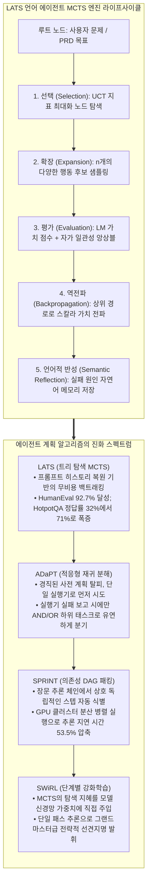
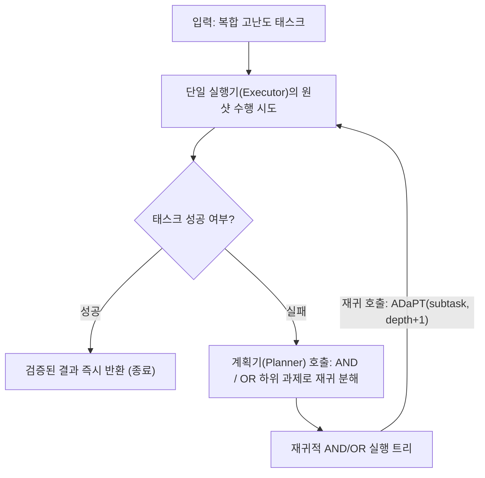
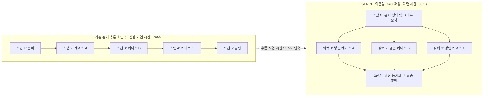

스탠포드 대학교의 2025 가을학기 최신 대학원 강좌, **CS329A: Self-Improving AI Agents (스스로 발전하는 AI 에이전트)** 다섯 번째 기술 해설에 오신 것을 환영합니다.

지난 제4강에서 우리는 언어 모델이 터미널에서 코드를 실행하고 컴파일러 에러를 독해하며 스스로 버그를 고치는 도구 사용과 실행 피드백 루프(ReAct, RLEF)를 배웠습니다. 그러나 주니어 개발자가 사소한 신택스 에러를 수정하는 것과, 수석 아키텍트가 10만 라인 규모의 분산 시스템을 설계하고 장기 과제를 완수하는 것은 차원이 완전히 다른 문제입니다.

기존의 ReAct나 CoT 방식은 본질적으로 **'눈앞의 한 걸음만 보고 내딛는 탐욕적(Greedy) 단일 경로 방식'**입니다. 체스를 둘 때 오직 다음 한 수만 보고 말을 움직이는 초보자가 3수 뒤에 외통수(Checkmate)에 걸려 패배하듯, 탐욕적 언어 모델 역시 복잡한 다단계 과제에서 초반에 잘못된 결정을 내리면 되돌아오지 못하고 막다른 골목에 갇히게 됩니다.

오늘 다룰 **제5강**은 강좌의 전반부인 **Part 1 (Foundation · 기초 기반)**을 집대성하는 웅장한 피날레입니다: 바로 **다단계 계획(Multi-Step Planning)과 트리 탐색(Tree Search)**입니다.

바둑에서 세계 챔피언을 꺾었던 알파고(AlphaGo)의 핵심 수학적 엔진, **몬테카를로 트리 탐색(MCTS)**을 자기회귀 언어 모델에 이식하여, 모델이 체스 그랜드마스터처럼 수십 수를 내다보며 자율적으로 계획을 세우고, 실패하면 과거 분기점으로 백트래킹(Backtracking)하여 다른 가능성을 탐색하는 놀라운 지능 시스템들을 해체하고 재설계합니다:
1. **추론, 행동, 계획의 완벽한 삼위일체:** 언어 에이전트 트리 탐색 **LATS** (Zhou et al., 2023)
2. **실패할 때만 똑똑하게 쪼개는 적응형 분해:** **ADaPT** (Allen AI, 2023)
3. **추론 지연 시간을 53.5% 단축하는 병렬 DAG 패킹:** **SPRINT** (Stanford Future Data, 2025)
4. **톰슨 샘플링 기반의 적응형 브랜칭:** 넓힐 것인가 깊게 팔 것인가를 해결하는 **AB-MCTS** (Sakana AI, 2025)
5. **계획 능력을 모델 가중치에 새겨넣는:** **SWiRL** (Step-Wise RL, 2025)



{/* truncate */}

---

### 1. 탐욕적 생성의 함정: 장기 과제에서 단일 경로 추론이 붕괴하는 이유

단순한 질의응답에서는 탐욕적 자기회귀 디코딩이나 단일 Chain-of-Thought(CoT) 프롬프트로도 충분합니다. 그러나 의사결정의 깊이가 깊어지는 장기 과제($H > 10$)에서, 단일 경로 방식은 치명적인 **오류 누적(Error Propagation)**에 직면합니다:

```text
P(Success) = ∏_{t=1}^H P(Correct_Action_t | History_{<t})
```

만약 각 단계의 추론이나 도구 호출 성공률이 90%에 달하더라도, 15단계에 걸친 복합 소프트웨어 엔지니어링 과제를 수행하는 에이전트의 전체 성공 확률은 처참하게 하락합니다:

```text
P(Success) = 0.90^{15} ≈ 0.2059  (전체 성공률 약 20.6%)
```

표준적인 자기회귀 언어 모델에서는 $t=3$ 시점에 사소한 논리적 실수가 발생하더라도, 그 잘못된 토큰들이 컨텍스트에 영구히 덧붙여집니다. 모델은 시간을 되돌려 이전 상태로 복귀하거나 막다른 길을 버릴 수 있는 네이티브 메커니즘이 없습니다. 진정한 자율성을 달성하기 위해 에이전트는 단일 경로가 아닌 **상태 탐색 트리(Search Tree of States)** 상에서 사고해야 합니다.

---

### 2. 언어 에이전트와 MCTS의 융합: LATS (Zhou et al., 2023)

바둑이나 체스 같은 고전적 강화학습 환경에서는 MCTS가 가상의 미래를 시뮬레이션할 수 있는 결정론적 게임 엔진(World Model)이 존재했습니다. 그러나 프로그래밍이나 학술 연구처럼 규칙 엔진이 없는 열린 도메인에서 가상의 미래를 어떻게 시뮬레이션할 수 있을까요?

2023년 말 발표된 **LATS (Language Agent Tree Search, UIUC 및 Google DeepMind)**의 핵심 통찰은 실로 기발했습니다:

> **"언어 모델 에이전트의 모든 환경 상태는 프롬프트 텍스트 히스토리 그 자체이다. 과거의 특정 의사결정 시점으로 되돌아가고 싶다면 복잡한 물리 엔진이 필요 없다. 그저 과거 시점의 텍스트 프롬프트를 다시 모델에 주입하기만 하면 된다!"**

언어 모델의 본질 자체가 MCTS가 요구하는 **'완벽한 상태 가역성(State Reversibility / Backtracking)'을 완벽하게 무비용으로 제공**하고 있었던 것입니다.

#### LATS의 5단계 순환 라이프사이클

LATS는 하나의 대규모 언어 모델에게 **에이전트(행동가)**, **가치 평가자(비평가)**, **반성자(회고가)**의 세 가지 역할을 부여하고 다음 루프를 순환합니다:

```text
                            [ 루트: 사용자 과제 ]
                                     │
                     1. 선택 (Selection, UCT 공식)
                                     ▼
                            [ 유망한 리프 노드 s ]
                                     │
                     2. 확장 (Expansion, n개 행동 샘플링)
                                     ▼
                         [ 샌드박스 실행 및 관찰 ]
                                     │
                     3. 평가 (Evaluation, LM 점수 + SC)
                                     ▼
                     4. 역전파 (Backpropagation, 가치 갱신)
                                     │
                     5. 반성 (Reflection, 실패 시 자연어 회고)
```

#### 1. UCT 공식을 통한 노드 선택 (Selection)
루트 노드에서 출발하여 UCT(Upper Confidence Bound for Trees) 점수가 가장 높은 자식 노드를 탐욕적으로 따라 내려갑니다. 이를 통해 이미 높은 보상을 입증한 경로(활용, Exploitation)와 아직 덜 방문한 미지의 경로(탐색, Exploration) 사이의 균형을 유지합니다:

```text
UCT(s) = V(s) + w * sqrt( ln N(p) / N(s) )
```

여기서:
* $V(s)$는 상태 $s$의 추정 평균 가치입니다.
* $N(s)$는 상태 $s$의 방문 횟수입니다.
* $N(p)$는 부모 노드 $p$의 방문 횟수입니다.
* $w$는 탐색의 적극성을 조절하는 가중치입니다 (통상 $w = sqrt(2)$).

#### 2. 확장 단계 (Expansion)
리프 노드에 도달하면, 모델로부터 $n$개의 서로 다른 후보 행동 $`a^(1), ..., a^(n)`$을 다양하게 샘플링합니다. 각 행동은 격리된 파이썬 REPL이나 터미널 샌드박스에서 실행되어 실제 관찰 결과 $`o^(1), ..., o^(n)`$을 획득합니다.

#### 3. 가치 평가 (Value Evaluation)
도달한 상태의 보상 가치 $V(s)$는 정성적 평가와 통계적 일관성의 앙상블로 산출됩니다:

```text
V(s) = λ * LM_Score(s) + (1 - λ) * Self_Consistency(s)
```

* **`LM_Score(s)`:** 언어 모델이 환경 관찰 결과를 분석하여 1~10점 사이로 매긴 정성적 타당성 점수.
* **`Self_Consistency(s)`:** 해당 상태로부터 다회차 롤아웃을 수행했을 때 동일한 결론에 도달하는 빈도.

#### 4. 가치 역전파 (Backpropagation)
리프 노드에서 얻은 스칼라 보상 $r$을 경로상의 모든 부모 노드로 거슬러 올라가며 방문 횟수와 누적 평균 가치를 갱신합니다:

```text
N(s_i) = N(s_i) + 1
V(s_i) = ( V(s_i)_old * N(s_i)_old + r ) / N(s_i)_new
```

#### 5. 언어적 반성 (Semantic Reflection)
만약 특정 경로가 테스트 실패나 환경적 교착 상태로 끝나면, 단순 스칼라 감점($r = -1$)에 그치지 않고 **언어적 반성(Semantic Reflection)**을 발동합니다.
모델에게 *"왜 이 경로가 실패했는가? 어떤 가정이 잘못되었는가?"*를 묻고 이를 자연어 회고록으로 작성하여 에피소드 메모리 풀에 저장합니다. 이 텍스트는 다음 롤아웃의 시스템 프롬프트에 동적으로 주입되어 동일한 실수를 원천 차단합니다.

#### 경이로운 벤치마크 성과
* **HotpotQA (복합 추론):** 단일 ReAct의 정답률은 32.0%에 불과했으나, LATS는 **71.0% (2.2배 이상)**로 폭등했습니다.
* **HumanEval (파이썬 코드 생성):** LATS는 **92.7% Pass@1**을 기록하며 기존의 모든 자가 수정 기법(Reflexion 91.0%, Base LM 80.1%)을 꺾고 당시 세계 1위 SOTA를 달성했습니다.
* **소거 실험:** MCTS 대신 단순 깊이 우선 탐색(DFS)을 적용하면 성능이 42%로 반토막 났으며, 이는 체계적인 UCT 탐색의 절대적 필요성을 입증합니다.

---

### 3. 실패할 때만 똑똑하게 쪼갠다: ADaPT (Allen AI, 2023)

LATS가 가로 방향으로 여러 후보 경로를 탐색하는 수평적 탐색이라면, **ADaPT (Allen Institute for AI, 2023)**는 세로 방향으로 과제의 복잡도를 낮추는 **적응형 수직 분해**의 정점입니다.

기존의 계획형 에이전트(Plan-and-Execute)는 시작하자마자 거창한 10단계 계획을 수립합니다. 그러나 동적 환경에서는 2단계에서 사소한 변수가 터지면 나머지 8단계 계획이 즉시 무용지물이 됩니다.

ADaPT는 인간 엔지니어의 일 처리 방식을 그대로 모방합니다:

> **"처음부터 거창하게 계획을 쪼개지 마라. 우선 전체 과제를 단일 실행기(Executor)에게 통째로 맡겨라. 실행기가 스스로 해보다가 '도저히 못 하겠다'고 실패를 보고했을 때만, 계획기(Planner)를 호출해 3~5개의 하위 태스크로 유연하게 쪼개어라!"**



#### AND / OR 논리 재귀 실행 엔진

ADaPT는 하위 과제를 논리적 AND/OR 연산자로 구조화합니다:
* **AND 노드:** 순차적으로 모든 하위 작업이 성공해야 하는 과제 (예: `데이터 수집` $\to$ `스키마 변환` $\to$ `DB 적재`).
* **OR 노드:** 여러 대안 가설 중 하나만 성공하면 되는 탐색 과제 (예: `로컬 캐시 확인` OR `외부 API 질의`).

#### 실증적 효율성
* 복합 과제 환경인 ALFWorld(Pick2)에서 기존 ReAct 계열은 12% 미만으로 전멸했으나, ADaPT는 **52.9% (4배 이상)**의 성공률을 기록했습니다.
* 쉬운 문제는 한 번에 끝내고 어려운 문제에서만 쪼개므로, 사전 계획 방식 대비 토큰 소모량을 **40% 이상 대폭 절감**했습니다.

---

### 4. 생각의 병렬 고속도로: SPRINT (Stanford Future Data, 2025)

2025년 초 DeepSeek-R1 등 장문 추론(Long CoT) 모델이 등장하며 성능이 크게 도약했습니다. 그러나 실무 엔지니어들에게는 끔찍한 병목이 발생했습니다: 바로 **응답 하나에 2분씩 걸리는 극심한 지연 시간(Latency)**이었습니다.

스탠포드 Future Data 연구소의 **SPRINT** 팀은 긴 순차적 추론 체인을 분석하여 거대한 비효율을 발견했습니다:

> **"모델이 수천 토큰을 한 줄로 줄 서서 생성하고 있지만, 논리적으로 따져보면 '보조정리 A 검증', '케이스 B 탐색', '반론 C 검토'는 서로 완전히 독립적이다. 왜 이것을 직렬로 계산하고 있는가? 의존성이 없는 단계들을 병렬 DAG로 묶어 동시에 돌릴 수는 없는가?"**



#### 위상 정렬 패킹 알고리즘

SPRINT는 추론 과정을 방향성 비순환 그래프(DAG)로 정식화합니다. 각 스텝 $S_i$의 인과적 의존성 집합 $D$를 기반으로 위상 단계 번호 $\sigma(S_i)$를 계산합니다:

```text
σ(S_i) = {
    1,                                                         (Parents(S_i) = ∅인 경우)
    max_{S_p ∈ Parents(S_i)} ( σ(S_p) + 1[ E_p ≠ ∅ ] ),        (그 외의 경우)
}
```

동일한 위상 단계 번호 $\sigma$를 부여받은 모든 독립적 추론 브랜치는 여러 GPU 워커에 분산되어 **동시에 병렬 실행**됩니다. 모든 워커가 완료되면 동기화 장벽(Sync Barrier)에서 결과를 종합하고, 플래너가 다음 단계의 병렬 지평을 계산합니다:

```text
계획 (Plan)  ──►  병렬 디스패치  ──►  위상 동기화  ──►  재계획 (Re-Plan)
```

#### 결과: 정확도는 오르고 지연 시간은 절반으로
* 고난도 수학 벤치마크(MATH-500)에서 순차 실행 대비 **정확도가 89.1%에서 92.5%로 상승**했습니다 (병렬 브랜치 간 교차 검증 효과).
* 동시에 사용자가 체감하는 순차적 토큰 지연 시간(Wall-clock Time)은 **53.5%나 감소**하여, 2분 걸리던 고난도 추론이 50초대로 압축되었습니다.

---

### 5. 자율 탐색과 내재화: AB-MCTS와 SWiRL

트리 탐색 기술이 성숙하면서 두 가지 최신 연구 프론티어가 열렸습니다:

#### 1. AB-MCTS: 가로로 넓힐까, 세로로 깊게 팔까? (Sakana AI, 2025)
전통적인 MCTS는 분기 계수(Branching Factor)가 고정되어 있어 탐색과 심화 사이에서 비효율이 발생했습니다. **AB-MCTS (Adaptive Branching MCTS)**는 이를 **톰슨 샘플링(Thompson Sampling)** 기반의 실시간 의사결정으로 해결했습니다:
* 기존 자식 노드를 선택하면 $\to$ 해당 풀이를 더 깊게 파고듭니다 (Deeper).
* 가상의 `GEN` 메타 액션을 선택하면 $\to$ 즉시 새로운 자식 브랜치를 생성하여 트리를 가로로 넓힙니다 (Wider).
* 각 선택지의 기대 보상을 사후 확률 분포로 추정하여, 쉬운 분기는 1~2회 만에 넘어가고 난해한 병목 지점에만 수십 개의 가지를 자율적으로 뻗어나가는 최적의 유기적 탐색을 구현했습니다.

#### 2. SWiRL: 계획 지능을 모델 시냅스에 각인하다 (2025)
런타임에 매번 무거운 MCTS 트리를 돌리는 것은 막대한 비용이 듭니다. **SWiRL (Step-Wise Reinforcement Learning)**은 탐색의 지혜를 모델의 가중치로 흡수시킵니다:
* 다단계 궤적을 스텝별로 쪼갠 뒤, 최종 정답 여부뿐만 아니라 **"중간 계획과 도구 호출의 논리적 타당성"**을 평가하는 생성적 보상 모델을 구축했습니다.
* 단계별 PPO로 모델을 훈련시킨 결과, 모델은 무거운 외부 MCTS 없이도 단일 패스 추론 내부에서 스스로 계획을 세우고 가지치기하는 **내재화된 계획 지능(Internalized Planning)**을 획득하게 되었습니다.

---

### 6. 엔터프라이즈 아키텍처: 계층형 MCTS 계획 메시 청사진

프로덕션 환경에서 MCTS 계획 엔진을 안전하고 비용 효율적으로 운영하기 위한 표준 아키텍처 청사진은 다음과 같습니다:

```text
┌────────────────────────────────────────────────────────────────────────┐
│             엔터프라이즈 계층형 MCTS 계획 메시 아키텍처                │
├────────────────────────────────────────────────────────────────────────┤
│                                                                        │
│  [ 비즈니스 목표 / 요구 명세서 PRD ]                                    │
│          │                                                             │
│          ▼                                                             │
│  ┌──────────────────────────────────────────────────────────────────┐  │
│  │                    적응형 계획 오케스트레이터                    │  │
│  │  • 1단계: 단일 실행기 원샷 시도 (탐색 비용 0원)                  │  │
│  │  • 2단계: 실패 시 ADaPT 동적 AND/OR 하위 태스크 분해             │  │
│  │  • 3단계: 고난도 불확실성 과제 -> LATS MCTS 트리 탐색 가동       │  │
│  └───────────────────┬──────────────────────────────▲───────────────┘  │
│                      │ 병렬 하위 태스크 DAG         │ 평가된 상태      │
│                      ▼                              │ 가치 신호        │
│  ┌──────────────────────────────────────────────────┴───────────────┐  │
│  │                     SPRINT 분산 디스패처                         │  │
│  │  • 위상 정렬 및 데이터 의존성 분석 엔진                          │  │
│  │  • 비동기 GPU 워커 풀 (경량 7B/8B 모델 기반 고속 후보 샘플링)     │  │
│  │  • 동시성 동기화 장벽 및 컨텍스트 패킹 레이어                     │  │
│  ├──────────────────────────────────────────────────────────────────┤  │
│  │                     검증 및 서킷 브레이커 가드레일               │  │
│  │  • UCT 노드 가지치기 엔진 (V < 0.2 불량 브랜치 조기 정리)         │  │
│  │  • 조기 종료 서킷 브레이커 (100% 검증 통과 노드 발견 시 즉시 반환)│  │
│  │  • 에피소딕 언어적 반성(Reflection) 메모리 버퍼                  │  │
│  └──────────────────────────────────────────────────────────────────┘  │
│                                                                        │
└────────────────────────────────────────────────────────────────────────┘
```

#### 프로덕션 핵심 3대 가드레일
1. **조기 종료 서킷 브레이커 (Early-Stopping):** 단 하나의 브랜치라도 유닛 테스트 100% 통과 등 확실한 검증을 통과하면, 즉시 전체 MCTS 루프를 중단하고 해당 결과를 반환하여 불필요한 토큰 낭비를 원천 차단합니다.
2. **계층형 모델 협업 (Hierarchical Serving):** 잎 노드의 단순 행동 샘플링에는 7B~8B 소형 모델을 투입하고, 핵심 분기점의 가치 평가에만 70B+ 프론티어 모델을 투입하여 서빙 비용을 80% 이상 절감합니다.
3. **탐색 예산 쿼터제:** 트리 최대 깊이($`d_max` \le 6$)와 최대 롤아웃 반복 횟수($N \le 30$)를 하드코딩된 임계값으로 강제하여 비용 폭주를 방지합니다.

---

### 7. 엔지니어링 Q&A 및 기술 심층 분석

**Q: SPRINT처럼 추론 브랜치를 병렬로 돌리면, 한 브랜치의 실수가 다른 브랜치로 전파되어 전체 결과를 오염시키지 않나요?**
**A:** SPRINT의 진정한 강점이 바로 여기에 있습니다. SPRINT는 무작정 병렬화하는 것이 아니라, 스텝 간의 의존성 그래프(DAG)를 사전에 분석하여 **"선행 데이터가 전혀 필요 없는 독립된 계산"만을 선별하여 병렬화**합니다. 만약 B 단계가 A 단계의 출력을 필요로 한다면, 위상 정렬 알고리즘에 의해 B 단계는 A 단계가 완료될 때까지 절대 실행되지 않습니다. 또한 병렬 브랜치들의 결과를 종합하는 과정에서 상호 검증이 이루어지므로, 오히려 단일 경로 대비 정확도가 상승합니다.

**Q: LATS의 언어적 반성(Semantic Reflection)은 전통적인 수치 역전파와 어떻게 다른가요?**
**A:** 전통적 MCTS는 방문 횟수와 평균 점수라는 단순 스칼라 숫자($N, V$)만 업데이트합니다. 하지만 코딩이나 논리 추론에서는 숫자가 *"왜 파이썬 코드가 실패했는지"*, *"어떤 수학적 가정이 틀렸는지"*를 알려주지 못합니다. 언어적 반성은 실패의 원인을 자연어 진단서로 작성하여 메모리에 저장합니다. 이후 에이전트가 유사한 상태에 도달했을 때 이 반성 텍스트가 프롬프트 제약 조건으로 주입되어, 모델이 같은 실수를 반복하지 않도록 정교하게 유도합니다.

---

### 8. 핵심 요약 및 테이크어웨이

1. **탐욕적 생성의 한계 극복:** 자기회귀 모델은 긴 의사결정 경로에서 기하급수적인 오류 누적을 겪습니다. MCTS는 모델에게 탐색, 가지치기, 백트래킹 능력을 부여하여 체스 그랜드마스터급 전략가로 격상시킵니다.
2. **프롬프트 기반의 무비용 가역성:** LATS는 언어 모델의 텍스트 히스토리가 곧 상태라는 점을 활용하여, 외부 물리 시뮬레이터 없이도 완벽한 상태 복원과 MCTS를 구현했습니다.
3. **적응형 재귀 분해:** ADaPT는 불필요한 사전 계획을 배제하고 단일 실행기로 먼저 시도한 뒤, 실패 시에만 유연하게 AND/OR 하위 태스크로 분기하여 토큰을 절감합니다.
4. **병렬 DAG 가속:** SPRINT는 장문 추론 체인에서 독립적인 스텝들을 위상 정렬 DAG로 묶어 분산 처리함으로써, 지연 시간을 53.5% 단축하고 정확도를 동시에 끌어올렸습니다.
5. **검색에서 모델 가중치로:** SWiRL은 단계별 강화학습(Step-Wise RL)을 통해 MCTS의 계획 지혜를 신경망에 직접 새겨넣어, 단일 패스 추론으로도 탁월한 선견지명을 발휘하도록 만듭니다.

---

### 축하합니다: Part 1 (기초 기반) 완결 및 Part 2 예고!
오늘 제5강을 끝으로 우리는 스탠포드 CS329A 강좌의 첫 번째 대단원인 **Part 1: Foundation (기초 기반, 제1강~제5강)**을 완벽하게 완주했습니다!
* **L1:** 거대 언어 모델에서 스스로 발전하는 자율 에이전트로의 거대한 패러다임 전환
* **L2:** 추론 시간 연산 확장(Test-time Compute)과 커버리지의 멱법칙
* **L3:** 단계별 프로세스 보상 모델(PRM)과 약한 검증기 앙상블(Weaver)
* **L4:** 생각과 행동의 결합(ReAct), 런타임 피드백(RLEF), 그리고 헌법적 AI
* **L5:** MCTS 트리 탐색(LATS), 적응형 분해(ADaPT), 병렬 DAG 패킹(SPRINT)

우리는 에이전트가 어떻게 생각하고, 도구를 활용하며, 스스로 계획을 세우는지에 대한 모든 수학적·공학적 기반을 정복했습니다.

다음 시간부터 시작되는 **Part 2: Training & Evolution (훈련 및 자가 진화, 제6강~제9강)**에서는, 단순한 프롬프트 기법이나 테스트 타임 탐색을 완전히 넘어서 **"AI가 강화학습과 진화 알고리즘을 통해 스스로 모델 가중치를 영구히 업그레이드하는 자가 진화의 세계"**로 들어갑니다.

다음 제6강의 주제는 다음과 같습니다:
**《Lecture 6: Train-Time Scaling & RL: 강화학습과 훈련기 스케일링 (DeepSeekMath, GRPO, DAPO)》**
DeepSeek이 어떻게 값비싼 비평가(Critic) 모델 없이 오픈소스 강화학습만으로 세계 최정상급 추론 지능을 완성했는지, 그 수학적 비밀을 파헤칩니다. 다음 파트에서 만납시다!