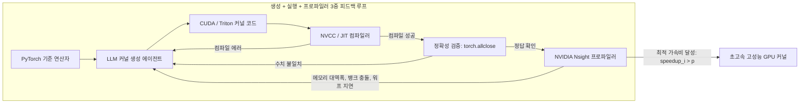

# 스탠포드 CS329A (10강): SWE-Agents — 소프트웨어 엔지니어링 에이전트, CodeMonkeys, KernelBench, 그리고 시스템 인터페이스(ASI)

현실의 실제 소프트웨어 엔지니어링 현장은 단일 함수를 작성하는 알고리즘 퀴즈나 장난감 벤치마크와는 완전히 다릅니다. 깃허브(GitHub)에 등록되는 수많은 실제 버그 이슈는 단독 파일에 국한되지 않으며, 수백 개의 모듈, 복잡한 레거시 의존성, 그리고 수백만 줄의 대규모 분산 코드베이스 속에 복잡하게 얽혀 있습니다. 더욱이 프로덕션 환경에서 소프트웨어는 단순히 기능적으로 '올바르다(Correct)'는 것을 넘어, '충분히 빠른가(Fast)', 그리고 '물리적 병렬 하드웨어와 완벽히 정렬되어 있는가(Aligned)'라는 냉혹한 다차원 평가를 통과해야 합니다.

오늘부터 시작되는 **스탠포드 CS329A: Self-Improving AI Agents (스스로 발전하는 AI 에이전트)**의 세 번째 거대한 산맥인 **Part 3 · Agent Engineering (L10~L12)**은 연구실의 모델 훈련을 벗어나 프로덕션 소프트웨어 공학의 최전선으로 진입합니다:
> **"수백만 토큰에 달하는 대규모 엔터프라이즈 레포지토리를 에이전트가 어떻게 탐색하고, 버그를 재현하는 검증 스크립트를 스스로 작성하며, 기존 인간의 PyTorch 베이스라인보다 더 빠른 초고속 GPU 커스텀 커널을 합성해 낼 수 있는가?"**

이번 포스팅에서는 **SWE-Agent Autonomous Coding(소프트웨어 엔지니어링 에이전트 자율 코딩)** 프론티어를 탐구하며, **SWE-bench Benchmark GitHub**에서 세계 최고 수준의 성과를 거둔 **CodeMonkeys Automated Refactoring(코드몽키스 자동 리팩토링)**, 하드웨어 프로파일러 피드백을 결합한 **KernelBench GPU Performance Tuning(커널벤치 GPU 성능 최적화)**, 그리고 스탠포드 대학교가 제안한 **Agent-Computer Interface ACI(에이전트-컴퓨터 인터페이스 / Agent-System Interface ASI)**의 3대 혁신을 완벽 해부합니다.

{/* truncate */}


---

## 1. 실전 소프트웨어 엔지니어링 에이전트의 현실적 난제

실제 깃허브 오픈소스 레포지토리의 버그를 자율 해결하려면 세 가지 치명적인 엔지니어링 병목을 돌파해야 합니다:
1. **컨텍스트 폭발(Context Explosion):** 평균적인 프로덕션 레포지토리는 300만 토큰을 초과합니다. 이를 최신 LLM에 통째로 밀어 넣으면 토큰 비용만 수천 달러가 들 뿐만 아니라, 어텐션 분산으로 인해 버그의 핵심 위치를 놓치게 됩니다.
2. **검증의 기만(Self-Deceptive Verification):** 에이전트가 코드를 먼저 고치게 하면, 버그를 근본적으로 고치는 대신 자기가 방금 고친 엉터리 코드에 맞추어 테스트를 조작하는 치팅이 빈번하게 발생합니다.
3. **하드웨어 최적화의 장벽:** 파이썬 접착 코드를 넘어 저수준 CUDA/Triton 가속으로 내려가면, 메모리 정렬, 워프 다이버전스, 레지스터 압박 등 하드웨어 지식을 요구하여 단발성 생성이 100% 실패합니다.

```
┌─────────────────────────────────────────────────────────────────────────┐
│               실전 소프트웨어 엔지니어링 에이전트의 3대 기둥            │
└────────────────────────────────────┬────────────────────────────────────┘
                                     │
       ┌─────────────────────────────┼─────────────────────────────┐
       ▼                             ▼                             ▼
┌──────────────────────────┐  ┌──────────────────────────┐  ┌──────────────────────────┐
│  CodeMonkeys SWE-bench   │  │   KernelBench 프로파일러 │  │    스탠포드 ASI 인터페이스│
├──────────────────────────┤  ├──────────────────────────┤  ├──────────────────────────┤
│ • 50.5배 컨텍스트 압축   │  │ • fast_p 속도 평가 지표  │  │ • 14배 DSL 코드 압축    │
│ • 상호 디버깅 상태 머신 │  │ • 컴파일+프로파일러 피드백│  │ • AutoGuide 에러 번역기  │
│ • 차별화 테스트 선택기   │  │ • 융합 & 공유메모리 최적화│  │ • 의도-구현 불일치 해소  │
│ • SWE-bench Verif. 57.4% │  │ • 최대 13배 GPU 가속 달성 │  │ • 튜너 대비 3.8배 가속   │
└──────────────────────────┘  └──────────────────────────┘  └──────────────────────────┘
```

---

## 2. 실제 깃허브 버그를 해결하는 완전한 시스템: CodeMonkeys (2025)

Django, SymPy, scikit-learn 등 실제 대규모 오픈소스 레포지토리의 버그를 다루는 **SWE-bench Verified**에서, 2025년 초 공개된 **CodeMonkeys**는 **57.4%**라는 압도적인 해결률을 기록하며 전 세계를 놀라게 했습니다.

CodeMonkeys의 성공 비결은 복잡한 소프트웨어 수리 과정을 세 가지 공학적 단계로 분해한 데 있습니다:

```
                  [실제 깃허브 이슈 리포트 및 300만 토큰 코드베이스]
                                         │
                                         ▼
           1. 컨텍스트 파이프라인 (Context Pipeline, 50.5배 압축)
              (가벼운 Qwen2.5-Coder 로컬 전수 스캔 -> 요약 -> 랭킹 -> 128k)
                                         │
                                         ▼
           2. 생성 상태 머신 (Two-Sided Debugging State Machines)
              ┌────────────────────────────────────────────────────────┐
              │ Testing Machine: 버그 재현 테스트 스크립트 작성 (Exit 2) │
              │                       │                                │
              │                       ▼                                │
              │ Editing Machine: 코드 패치 수정 -> 테스트 통과 (Exit 0) │
              └────────────────────────────────────────────────────────┘
                                         │
                                         ▼
           3. 선택 상태 머신 (Selection State Machine, 차별화 테스트)
              (후보 패치 간 미세 동작을 갈라내는 변별력 테스트 자율 합성)
                                         │
                                         ▼
                         [최종 검증된 깃허브 패치 제출]
                     (SWE-bench Verified 57.4% 해결 달성)
```

### 1단계: 컨텍스트 파이프라인 (50.5배 압축)
- 수백만 토큰의 레포지토리를 Claude 3.5 Sonnet과 같은 프론티어 상용 모델로 매번 전수 검색하면 비용이 기하급수적으로 폭증합니다.
- CodeMonkeys는 로컬에서 비용 없이 돌릴 수 있는 `Qwen2.5-Coder-32B`를 사용하여 레포지토리 내의 모든 파이썬 파일을 샅샅이 스캔합니다.
- 관련 클래스와 함수 시그니처만을 정제하여 요약한 뒤 중요도 순으로 정렬하여, **128,000 토큰 컨텍스트 윈도우 안에 쏙 들어가도록 50.5배 압축**합니다.
- 이 전수 스캔 결과는 뒤에서 실행될 10개의 병렬 생성 궤적에 N분의 1로 분산(Amortized)되므로, 전체 작업 비용의 **15% 미만**으로 억제됩니다.

### 2단계: 생성 단계 — 상호 디버깅 상태 머신 (Two-Sided Debugging)
코드를 고칠 때 가장 치명적인 문제는 "고쳤다고 생각했는데 실제로는 버그가 전혀 해결되지 않은 허위 통과"입니다. CodeMonkeys는 두 개의 상태 머신을 맞물려 돌립니다:
1. **Testing State Machine:** 버그 지문을 읽고, 그 버그가 실제로 존재함을 증명하는 **독립 실행형 재현 테스트 스크립트(`reproduce_issue.py`)**를 먼저 작성합니다. 이 스크립트는 버그가 있는 원본 코드베이스에서 실행했을 때 반드시 **Exit Code 2 (실패)**를 뱉어야 합니다. 통과해 버리면 테스트를 다시 짭니다.
2. **Editing State Machine:** 실패하는 재현 테스트가 확보되면, 이를 지표 삼아 실제 코드를 수정합니다. 수정 후 테스트를 실행하여 **Exit Code 0 (성공)**이 뜰 때까지 에러 로그를 피드백받으며 최대 8회 수정 루프를 돕니다.

### 3단계: 선택 단계 — 오라클을 향한 추적 (Selection State Machine)
10개의 병렬 궤적을 실행하면 최소 하나 이상의 정답 패치가 포함되어 있을 확률(Coverage)은 **69.8%**에 달합니다. 하지만 10개 중 무작위로 하나를 골라 제출하면 성공률은 **45.8%**로 곤두박질칩니다. 정답을 만들어 놓고도 고르지 못하는 것입니다!

CodeMonkeys의 진정한 돌파구는 **차별화 테스트(Discriminator Test)** 기반 선택 머신입니다:
- 단순히 모델에게 "어느 코드가 가장 예쁜가?"라고 묻지 않습니다.
- 모델에게 **"후보 패치 A와 B가 서로 다르게 동작하도록 만드는 새로운 엣지 케이스 테스트 코드를 짜라"**고 명령합니다.
- 그 테스트를 실행하여 미세한 결함이 있는 패치들을 하나씩 탈락시키고, 최종 정답 패치를 추출하여 **57.4%**의 실전 해결률을 달성했습니다.

---

## 3. 정답을 넘어 실행 속도까지: KernelBench (2025)

소프트웨어 엔지니어링에서 기능적 정답은 시작에 불과합니다. AI 인프라의 핵심인 GPU 커널의 경우, 실행 속도가 2배 빨라지면 전 세계 데이터센터의 전기세를 수조 원 절감할 수 있습니다. 

2025년 2월 공개된 **KernelBench**는 250개의 다양한 PyTorch 연산자를 대상으로, 에이전트가 작성한 커스텀 CUDA/Triton 커널의 정확성과 물리적 실행 속도를 동시 평가하는 벤치마크입니다.

```text
정확성과 하드웨어 가속비를 결합한 fast_p 평가 지표:
========================================================================================
fast_p = (1 / N) * Σ_{i=1}^N  1[ correct_i  AND  speedup_i > p ]

지표의 물리적 의미:
  • fast_0 : 기능적 정답률 (출력 텐서가 PyTorch 기준치와 완벽 일치: torch.allclose)
  • fast_1 : 기능적 정답이면서 표준 PyTorch 대비 실행 속도가 더 빠른 비율 (Speedup > 1.0x)
  • fast_2 : 기능적 정답이면서 표준 PyTorch 대비 2배 이상 빠른 비율 (Speedup > 2.0x)
========================================================================================
```



### 프로파일러 피드백의 위력
단발성(One-shot) 생성 환경에서는 아무리 뛰어난 OpenAI o1이나 DeepSeek-R1이라도 **PyTorch보다 빠른 커널을 짜는 비율($fast_1$)이 20% 미만**에 불과했습니다. 스레드 인덱싱 오류로 인한 세그멘테이션 폴트(Segfault)나 메모리 병목 때문입니다.

그러나 **생성(Generation) + 컴파일 실행(Execution) + Nsight 프로파일러 피드백(Profiler)**의 3중 루프를 결합하자 기적이 일어났습니다:
- DeepSeek-R1의 복합 연산자 최적화 성공률이 36%에서 **72%로 2배 폭등**했습니다.
- 에이전트가 프로파일러의 메모리 대역폭 병목 신호를 보고, 스스로 연산자 융합(Operator Fusion), 타일링(Tiling), 공유 메모리(Shared Memory) 리덕션을 적용하여 **표준 PyTorch 대비 최대 13배 빠른 커널을 합성**해 냈습니다.

---

## 4. 의도와 구현의 일치: Agent-System Interface (ASI, Stanford 2025)

에이전트에게 C++ 분산 시스템이나 하드웨어 레지스터 제어를 직접 맡기면 또 다른 병목이 발생합니다. 스탠포드 대학교 Alex Aiken 교수 연구팀(ICML 2025)이 규명한 **Agent-System Interface (ASI)**는 이 간극을 해결합니다:
> **"에이전트에게 저수준 C++ 코드나 생(Raw) 시스템 로그를 던져주는 것은 지극히 비효율적이다. 에이전트의 '고수준 의도(Intent)'와 하드웨어의 '물리적 구현(Implementation)' 사이를 매끄럽게 번역해 주는 전용 인터페이스가 필요하다!"**

```text
┌─────────────────────────────────────────────────────────────────────────┐
│                          LLM 추론 에이전트                              │
│              (고수준 선언적 의도 및 알고리즘 최적화 전략 수립)          │
└────────────────────────────────────▲────────────────────────────────────┘
                                     │
          ┌──────────────────────────┴──────────────────────────┐
          │ 고수준 선언적 DSL        ▲ 행동 가능한 자연어      │
          │ 최적화 지시문            │ 시스템 가이드 (AutoGuide)│
          ▼                          │                          │
┌────────────────────────────────────┴────────────────────────────────────┐
│                    Agent-System Interface (ASI 계층)                    │
│  • 도메인 특화 언어 (DSL): 코드 복잡도 14배 압축 (추상화 인터페이스)    │
│  • AutoGuide 진단 번역기: 난해한 C++ 어설션 에러를 실행 가능한 조언으로 번역│
└────────────────────────────────────▲────────────────────────────────────┘
                                     │
          │ 저수준 C++ 시스템 코드   ▲ 하드웨어 폴트 및         │
          │ 및 메모리 할당           │ 컴파일러 어설션 로그     │
          ▼                          │                          │
┌────────────────────────────────────┴────────────────────────────────────┐
│                     물리적 병렬 하드웨어 시스템                         │
│                 (분산 메모리, GPU 코어, 공유 VRAM 구조)                 │
└─────────────────────────────────────────────────────────────────────────┘
```

### ASI의 2대 구성 요소
1. **도메인 특화 언어 (DSL):** 수천 줄의 C++ 포인터와 템플릿 대신, 텐서 분할과 메모리 매핑 결정만을 10여 줄의 선언적 DSL로 추상화하여 **코드 복잡도를 14배 압축**하고 문법 에러를 근천 차단합니다.
2. **AutoGuide (자동 가이드):** 하드웨어가 `"Assertion failed: stride mismatch at dim 1"` 같은 난해한 에러를 뱉었을 때, AutoGuide가 이를 가로채 에이전트가 이해할 수 있는 행동 지침으로 번역합니다:
   > *"진단 결과: 텐서의 1번 축이 32바이트 정렬되지 않아 메모리 스트라이드 충돌이 발생했습니다. Row-major 메모리 배치 지시문을 수정하여 32바이트 패딩을 적용하십시오."*

### 결과: 10번의 반복이 1,000번을 이기다
ASI를 장착한 에이전트는 단 **10번의 최적화 반복(Iteration)** 만에, 기존 업계 최고의 자동 튜닝 도구인 OpenTuner가 **1,000번을 돌린 결과보다 3.8배 더 빠른 병렬 코드를 도출**했습니다. 인간 전문가가 며칠 동안 씨름해야 했던 복잡한 회로 및 텐서 시뮬레이션 튜닝을 **단 10분** 만에 해결한 것입니다.

---

## 5. 소프트웨어 엔지니어링 패러다임 비교 분석

```text
=========================================================================================================
비교 차원              단순 코드 보조 도구 (Copilot) CodeMonkeys (SWE-bench)   KernelBench + ASI
---------------------------------------------------------------------------------------------------------
대상 코드 단위          단일 함수 및 몇 줄의 스니펫   수백만 토큰 다중 파일 패치   초고속 커스텀 CUDA/Triton
컨텍스트 관리          활성 파일 중심 (4k~8k 토큰)   50.5배 압축된 128k 윈도우   선언적 DSL (14배 압축)
검증 메커니즘          단순 컴파일 여부              상호 디버깅 상태 머신       Nsight 프로파일러 (fast_p 지표)
피드백 신호            기본 스택 트레이스 문자열     Exit 2 -> Exit 0 상태 전환   AutoGuide 행동 지침 번역
최종 지향점            문법적 코드 완성              프로덕션 회귀 버그 박멸     실제 하드웨어 벽시계 가속
=========================================================================================================
```

---

## 6. 심화 기술 Q&A

### Q1. CodeMonkeys에서 왜 소스코드 수정 전에 '재현 테스트 스크립트'를 반드시 먼저 작성해야 하나요?
코드를 먼저 고치고 나서 테스트를 짜게 하면, 모델은 자기가 방금 고친 결함 있는 코드의 동작에 맞추어 **'엉터리 테스트'를 만들어 자화자찬하며 통과**시켜 버리는 치명적인 자기기만(Self-Deception)에 빠집니다.

따라서 반드시 **"버그가 있는 원본 상태에서 실행했을 때 명백히 실패(Exit 2)하는 독립 재현 스크립트"**를 코드 수정 전에 완벽히 확보해 두어야만, 이후 코드를 수정했을 때 실제로 버그가 박멸되어 정상 종료(Exit 0)로 전환되었는지를 수학적으로 엄밀히 입증할 수 있습니다.

### Q2. 언어 모델이 CUDA 커널을 짤 때 가장 빈번하게 실패하는 원인과 프로파일러의 해결책은?
언어 모델은 고수준 텐서 연산은 잘 이해하지만, 수천 개의 GPU 스레드가 동시에 메모리에 접근할 때 발생하는 저수준 하드웨어 인덱싱에서 취약합니다:
- **메모리 경계 초과(Out-of-Bounds):** `threadIdx.x + blockIdx.x * blockDim.x` 계산에서 엣지 케이스를 놓쳐 세그멘테이션 폴트 발생.
- **공유 메모리 뱅크 충돌(Bank Conflict):** 여러 스레드가 동일한 메모리 뱅크에 동시 접근하여 연산 직렬화 발생.

단순 컴파일러는 문법 에러만 알려줄 뿐 런타임 성능 병목을 알려주지 못합니다. **프로파일러 피드백 루프(E+P)**는 실제 실행 시의 메모리 대역폭 점유율과 워프 지연 정보를 에이전트 컨텍스트에 직접 주입하여, 공유 메모리 패딩이나 레지스터 재사용 같은 정밀한 하드웨어 최적화를 가능하게 만듭니다.

---

## 요약 및 다음 강의 예고

소프트웨어 엔지니어링 에이전트는 단순한 자동 완성을 넘어섰습니다. **CodeMonkeys**는 50.5배 컨텍스트 압축과 상호 디버깅으로 실제 깃허브 버그를 해결했고, **KernelBench**와 **ASI**는 프로파일러 피드백과 도메인 특화 언어를 통해 하드웨어 인프라 자체를 가속화했습니다.

이어지는 **제11강**에서는 장기 과제를 수행하는 에이전트의 최대 난제인 **Agent Memory — 장단기 기억 시스템, Cartridges, CacheBlend, 그리고 평생 학습 에이전트(MemGPT)**의 세계를 탐구합니다!

---

### 핵심 요약 노트
- **분할 상환 컨텍스트 탐색:** 경량 모델을 활용한 전수 스캔(50.5배 압축)을 통해 300만 토큰 대규모 레포지토리 공학의 경제성을 확보한다.
- **상호 디버깅(Two-Sided Debugging):** 버그가 있는 상태에서 실패(Exit 2)하고 수정 후 성공(Exit 0)하는 재현 테스트만이 허위 통과를 원천 차단한다.
- **성능은 최적화 루프의 산물:** 단발성 생성으로는 고성능 GPU 커널을 짤 수 없으며, 실행 및 프로파일러 피드백(fast_p)이 필수적이다.