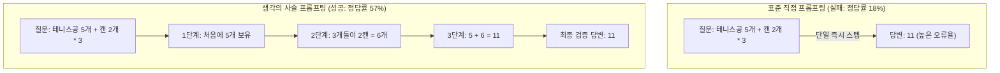
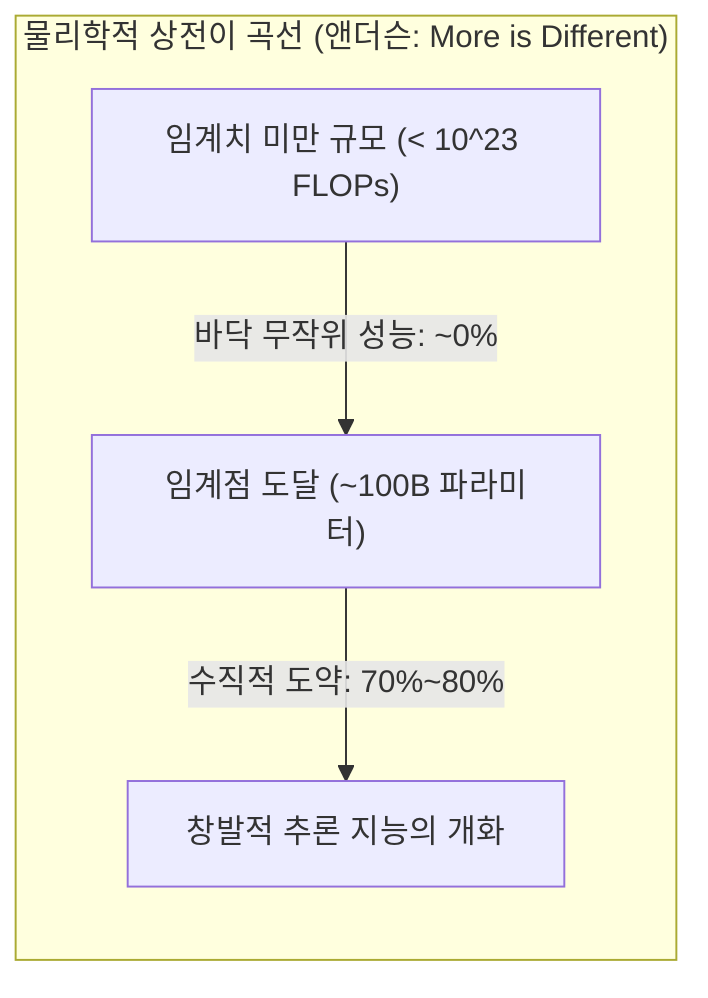

# Stanford CS329A (Ep 13): LLM Reasoning — 언어 모델 추론의 본질과 생각의 사슬 (CoT, Self-Consistency, Emergent Abilities)

수십 년 동안 인공지능 학계에는 인공신경망에 대한 깊은 회의론이 지배하고 있었습니다:
> *"거대 언어 모델은 그저 통계적으로 그럴듯한 다음 단어를 이어 붙이는 확률적 앵무새(Stochastic Parrot)에 불과하다. 다단계 연산, 형식 논리, 인과적 추론이 필요한 복잡한 문제를 주면 그럴듯한 거짓말(환각)을 내뱉을 뿐, 진정한 연역적 사고는 불가능하다."*

실제로 초기 모델들은 초등학교 수준의 복합 문장제 수학 문제를 주었을 때 곧바로 틀린 숫자를 찍어내며 참담하게 실패했습니다.

오늘부터 시작되는 **Stanford CS329A: Self-Improving AI Agents**의 마지막 대망의 **Part 4: 최전선(Frontiers, Lectures 13 through 17)**에서는 기계 지능의 가장 심오한 지적 심연인 **LLM Reasoning Foundations**로 도약합니다. 구글 딥마인드(Google DeepMind)의 추론 연구 총괄이자 생각의 사슬(CoT)의 창시자인 **데니 저우(Denny Zhou)** 박사의 기념비적 연구를 바탕으로, 언어 모델 안에서 '추론'이라는 신비로운 불꽃이 어떻게 점화되는지 그 원리를 해부합니다:
- **생각의 사슬 프롬프팅 (Chain of Thought CoT Prompting, NeurIPS 2022):** 자연어 중간 추론 단계를 거치게 하는 것만으로 모델 가중치 변경 없이 PaLM 540B의 정답률을 18%에서 57%로 폭등시킨 원리.
- **자가 일관성 디코딩 (Self-Consistency Decoding LLM, ICLR 2023):** "정답의 길은 하나로 수렴하고, 오답의 길은 무한히 흩어진다"는 톨스토이 수렴 법칙에 기반한 표본추출과 다수결 투표.
- **창발적 인지 능력 (Emergent Cognitive Abilities AI, 2022):** 복잡계 물리학의 상전이("More is Different")와 "창발은 비선형 지표가 만든 착시인가?"라는 산지브 아로라 교수와의 위대한 학술 논쟁.

{/* truncate */}


---

## 1. 확률적 앵무새 신화의 붕괴

초기 연구자들은 언어 모델에게 퓨샷 예시(Few-Shot Exemplars)를 제공할 때 다음과 같이 질문과 답만을 직결시켰습니다:

```text
[표준 퓨샷 프롬프팅 (실패 모드)]
-----------------------------------------------------------------------------------------
Q: 로저에게 테니스공이 5개 있었습니다. 테니스공 캔을 2개 더 샀습니다. 
   각 캔에는 3개의 공이 들어있습니다. 이제 로저에게는 공이 몇 개 있습니까?
A: 정답은 11개입니다.
-----------------------------------------------------------------------------------------
```

이 방식은 모델에게 복잡한 계산 그래프 전체를 '단 한 번의 다음 토큰 예측 스텝' 안에 우겨넣도록 강요하는 병목을 유발했습니다. 중간 상태를 계산할 작업 공간(Scratchpad)이 주어지지 않았기 때문에, 모델은 엉뚱한 숫자를 뱉어내며 자멸했습니다.

데니 저우와 제이슨 웨이 연구팀은 예시의 단 한 줄을 바꿈으로써 AI의 역사를 완전히 뒤바꾸었습니다:

```text
[생각의 사슬 프롬프팅 (Chain-of-Thought)]
-----------------------------------------------------------------------------------------
Q: 로저에게 테니스공이 5개 있었습니다. 테니스공 캔을 2개 더 샀습니다. 
   각 캔에는 3개의 공이 들어있습니다. 이제 로저에게는 공이 몇 개 있습니까?
A: 로저는 처음에 5개의 공을 가지고 있었습니다. 
   각각 3개의 공이 든 캔 2개는 6개의 테니스공입니다. 
   5 + 6 = 11입니다. 
   따라서 정답은 11개입니다.
-----------------------------------------------------------------------------------------
```

```
┌─────────────────────────────────────────────────────────────────────────┐
│                 기계 인지 추론을 완성하는 3대 핵심 기둥                 │
└────────────────────────────────────┬────────────────────────────────────┘
                                     │
       ┌─────────────────────────────┼─────────────────────────────┐
       ▼                             ▼                             ▼
┌──────────────────────────┐  ┌──────────────────────────┐  ┌──────────────────────────┐
│ 생각의 사슬 (CoT)        │  │ 자가 일관성 (Self-Cons.) │  │   창발적 능력 (Emergent) │
├──────────────────────────┤  ├──────────────────────────┤  ├──────────────────────────┤
│ • <질문, 추론단계, 답>   │  │ • Sample-and-Marginalize │  │ • 앤더슨의 'More is Diff'│
│ • 가중치 업데이트 0회    │  │ • 톨스토이 수렴 법칙     │  │ • 임계 연산량 > 10^23 FL │
│ • GSM8K: 18% -> 57% 폭등 │  │ • 다수결 투표 (T=0.7)    │  │ • 신기루 가설 논쟁 (p^L) │
│ • 자연어 순차 논리 전개  │  │ • 정답률: 56% -> 74.4%   │  │ • 거시적 인지 상전이     │
│ • 수식/점(Dot) 소거 검증 │  │ • 자기 확신도 불확실성   │  │ • 지능의 비선형적 도약   │
└──────────────────────────┘  └──────────────────────────┘  └──────────────────────────┘
```

---

## 2. 생각의 사슬 프롬프팅 (Wei, Zhou et al., NeurIPS 2022)

2022년 말 발표된 **《Chain-of-Thought Prompting Elicits Reasoning in Large Language Models》**는 추론 연산의 지형을 뒤흔들었습니다.

이전까지 복합 추론을 풀기 위해서는 수만 건의 지도 학습 데이터로 모델을 미세조정(Fine-tuning)하거나 별도의 검증기(Verifier)를 훈련해야 한다는 것이 정설이었습니다:
- 초등 수학 추론 벤치마크인 **GSM8K**에서 당대 최강의 모델이었던 `PaLM 540B`의 표준 프롬프팅 정답률은 **18%**에 불과했습니다.
- 그런데 자연어 중간 풀이 과정이 포함된 **단 8개의 CoT 예시**를 프롬프트에 주입하자, 정답률은 **57%로 폭등**했습니다!
- 이는 오픈AI가 수만 건의 데이터로 거대 모델을 미세조정하고 검증기까지 결합해 달성했던 당시 최고 기록(33%)을 **단 1회의 가중치 업데이트도 없이 순수 인컨텍스트 추론만으로 24%p 이상 가볍게 추월한 사건**이었습니다.



### 엄밀한 소거 실험(Ablation): 추론의 진짜 원동력은 무엇인가?
회의론자들은 CoT가 단순히 수식을 주었기 때문이거나, 토큰을 많이 생성하며 생각할 시간을 벌었기 때문이 아니냐고 반문했습니다. 데니 저우 연구팀은 정밀한 소거 실험으로 답했습니다:
1. **수식 전용 소거 (Equation Only):** 자연어 설명 없이 `5 + (2 * 3) = 11`처럼 수식만 주었더니 성능이 다시 **18%로 급락**했습니다.
2. **연산량 시뮬레이션 소거 (Dots Only):** 생각할 시간을 주기 위해 중간에 `......` 점을 찍게 했더니 성능 향상이 전혀 없었습니다.
3. **정답 후 추론 (Reasoning after Answer):** 정답을 먼저 말하고 그 뒤에 해설을 쓰게 했더니 역시 참담하게 실패했습니다.
- **결론:** 기계 추론을 점화한 핵심은 수식도, 연산 지연도 아닌 **"인간의 사고 과정을 모방하여 자연어로 한 단계씩 전개해 나가는 순차적 언어 논리(Natural Language Reasoning Steps)"** 그 자체였음이 증명되었습니다.

---

## 3. 다양한 생각의 민주주의: Self-Consistency (Wang, Zhou et al., ICLR 2023)

CoT는 위대했지만, 표준적인 **탐욕적 디코딩(Greedy Decoding)** 방식 때문에 치명적인 취약점을 안고 있었습니다:
> *"탐욕적 디코딩은 매 순간 가장 확률이 높은 단 하나의 단어만을 선택하며 단일 외길로 질주한다. 만약 10단계의 추론 중 3단계에서 사소한 계산 실수 하나를 저지르면, 뒤이어 나오는 4~10단계는 아무리 완벽해도 오답의 구렁텅이로 직행한다."*

2023년, 데니 저우와 왕쉐즈 연구원은 **Self-Consistency Decoding LLM**을 통해 이 단일 경로의 함정을 통계적으로 극복했습니다.

### 톨스토이의 수렴 법칙: "정답의 길은 하나로 모이고, 오답의 길은 흩어진다"
레프 톨스토이의 명작 *《안나 카레니나》*는 다음과 같이 시작합니다:
> *"행복한 가정은 모두 엇비슷하지만, 불행한 가정은 제각기 다른 이유로 불행하다."*

데니 저우 박사는 이 원리가 수학 추론 공간의 위상수학에서도 정확히 작동함을 발견했습니다:
- 하나의 복잡한 수학 문제를 풀 때, 대수적 치환을 쓰든, 기하학적 보조선을 긋든, 역방향 유도를 하든, **올바른 논리를 편 다양한 사고 궤적들은 결국 단 하나의 유일한 진리($Answer = 42$)로 강력하게 수렴(Converge)**합니다.
- 반면 논리적 오류를 저지른 경로들은 어떤 경로는 $-14$, 어떤 경로는 $108$, 어떤 경로는 $3.14$를 내놓으며 **무한한 오답의 공간으로 무질서하게 발산(Diverge)**합니다!

```text
                                [문제 입력 프롬프트]
                                         │
        ┌────────────────┬───────────────┼───────────────┬────────────────┐
        ▼                ▼               ▼               ▼                ▼
   [경로 1: 대수적] [경로 2: 기하학] [경로 3: 부호오류] [경로 4: 귀납추론] [경로 5: 공식오류]
    ... 단계별 ...  ... 단계별 ...   ... 단계별 ...   ... 단계별 ...  ... 단계별 ...
        │                │               │               │                │
        ▼                ▼               ▼               ▼                ▼
     답: 42           답: 42          답: -14         답: 42           답: 108
     (득표!)          (득표!)                         (득표!)
        │                │                               │
        └────────────────┴───────────────┬───────────────┘
                                         ▼
                         [다수결 최빈값 채택: 42]
                        (노이즈를 제거한 최종 정답)
```

### 표본추출과 주변화 (Sample-and-Marginalize)
Self-Consistency는 적절한 온도($T = 0.7$)를 부여하여 서로 다른 $m$개의 독립적 CoT 추론 궤적을 샘플링한 뒤, 최종 답변 공간에서 다수결 투표(Majority Vote)를 실행합니다:

```text
========================================================================================
자가 일관성 (Self-Consistency) 다수결 투표 수식:
========================================================================================
Final Answer = argmax_a  Σ_{i=1}^m  1[ a_i = a ]

여기서:
  • m   : 샘플링된 독립 추론 경로의 개수 (통상 5~40개)
  • a_i : i번째 추론 궤적이 도출한 최종 이산 답변 값
  • 1[·]: 궤적의 답변이 후보 a와 일치할 때 1을 반환하는 지시 함수
========================================================================================
```

### 벤치마크 결과 및 자가 불확실성(Uncertainty) 발견
- `PaLM 540B` 환경에서 CoT(56.5%)에 Self-Consistency를 결합하자 정답률은 **74.4% (+17.9%p)**로 수직 상승했습니다.
- **내재적 확신도 척도:** 최빈값 답변이 얻은 득표율(예: 40표 중 38표 vs 40표 중 12표)은 모델이 자기 답변에 대해 느끼는 실제 정확도와 완벽한 양의 상관관계를 보였습니다. 에이전트가 별도의 외부 판별기 없이도 **스스로 자신의 추론에 대해 신뢰도를 자각하는 메타인지 신호**가 확보된 것입니다.

---

## 4. "More is Different": 창발적 능력과 위대한 신기루 논쟁

그렇다면 왜 CoT와 Self-Consistency 같은 놀라운 추론 능력은 1B, 7B 같은 소형 모델에서는 작동하지 않았을까요?

1977년 노벨 물리학상 수상자인 필립 앤더슨(Philip Anderson)은 *"More is Different(양이 축적되면 질적으로 도약한다)"*라는 명제를 남겼습니다. 수소 원자 하나를 연구해서는 물의 유동성을 알 수 없고, 모래알 하나를 분석해서는 모래 언덕의 붕괴를 예측할 수 없습니다.

데니 저우와 제이슨 웨이는 **《Emergent Abilities of Large Language Models》**를 통해 인공신경망에서도 이와 똑같은 복잡계 물리학의 **상전이(Phase Transition)**가 일어남을 규명했습니다:
> **"창발적 능력(Emergent Ability)이란, 소형 모델에서는 성능이 바닥(Random Guess)을 기어 다니다가, 연산량이 임계 규모(통상 $10^{23}$ FLOPs, 약 100B 파라미터)를 넘어서는 순간 아무런 사전 예고 없이 수직으로 솟구쳐 오르는 비선형적 지능이다."**



### 위대한 학술 논쟁: 창발은 지표가 만든 신기루인가?
2024년, 스탠퍼드 대학교 산지브 아로라(Sanjeev Arora) 교수 연구팀은 학계를 뒤흔든 반론 논문을 발표했습니다: **《Are Emergent Abilities of Large Language Models a Mirage? (창발적 능력은 신기루인가?)》**

#### 반론 측의 주장: 비선형 계단 지표의 착시
- 길이가 $L$인 다단계 추론에서 각 토큰의 정답 확률을 $p$라고 가정해 봅시다.
- 모델의 규모가 커짐에 따라 각 토큰의 예측 능력 $p$는 $0.6 \to 0.7 \to 0.8 \to 0.9$로 **완벽하게 매끄러운 선형적(Linear) 성장**을 하고 있습니다.
- 하지만 시험 채점관이 "마지막 글자까지 100% 토씨 하나 안 틀려야 정답(+1점)을 주겠다"는 가혹한 **완전 일치(Exact Match)** 지표를 쓰면, 전체 정답률은 $p^L$이 됩니다:
  $$0.6^5 = 0.07 \; (7\%) \quad \longrightarrow \quad 0.9^5 = 0.59 \; (59\%)$$
- **신기루 가설의 요체:** 모델의 내부 능력은 점진적이고 선형적으로 성장하고 있었는데, **채점자가 비선형 계단형 돋보기를 들이댔기 때문에 겉보기에 갑자기 능력이 폭발한 것처럼 보이는 '측정의 착시(Mirage)'**라는 것입니다.

```text
========================================================================================
비선형 지표 신기루 가설 수식:
========================================================================================
Accuracy_ExactMatch = ( p_token )^L

여기서:
  • p_token : 토큰 단위의 기본 예측 확률 (규모에 따라 매끄럽게 선형 증가)
  • L       : 상호 의존적인 연속 추론 단계의 길이
  • L이 커질수록, 선형적 p_token 성장이 거시적 계단형 상전이로 왜곡되어 관측됨!
========================================================================================
```

#### 데니 저우 팀의 재반박과 지적 종합
데니 저우 연구팀은 다음과 같은 강력한 근거로 재반박했습니다:
1. 연속적인 손실 함수인 **교차 엔트로피 손실(Cross-Entropy Loss)** 자체를 추적해 보아도, 고난도 과제에서는 임계 규모를 넘기 전까지 손실이 줄어들지 않다가 특정 스케일에서 급격히 떨어지는 진정한 의미의 상전이가 여전히 관측된다.
2. 다지선다형이나 연속적 의미 유사도(BLEU, ROUGE) 지표를 적용해도 여전히 많은 추론 과제에서 뚜렷한 도약 현상이 유지된다.

**우리가 얻어야 할 균형 잡힌 결론:**
> *"창발의 일부는 비연속적 측정 지표가 과장한 측면이 분명히 존재한다. 그러나 동시에 인간의 논리 체계 자체가 'A 단계가 참이어야만 비로소 B 단계가 성립하는 순차적 인과성'을 띠고 있기 때문에, 미시적 시냅스 확률 향상이 임계점을 넘는 순간 시스템 전체의 거시적 추론 능력이 비약하는 복잡계적 상전이는 엄연한 실체이다."*

---

## 5. 인지 추론 패러다임별 비교표

```text
=============================================================================================================
비교 차원             표준 직접 프롬프팅            생각의 사슬 (CoT)             자가 일관성 (Self-Cons.)
-------------------------------------------------------------------------------------------------------------
추론 궤적 구조        단일 즉시 매핑 (Q -> A)       자연어 순차 논리 전개         복수 궤적 다수결 (m개 샘플)
디코딩 전략           탐욕적 디코딩 (Greedy argmax) 탐욕적 디코딩 (Greedy argmax) 표본추출 및 주변화 (Mode)
추가 연산 비용        기준 1x FLOPs                 질의당 약 3배 토큰 소모       기준 대비 15배~30배 연산량
GSM8K 정답률          18% (PaLM 540B)               57% (+39%p 향상)              74.4% (+17.4%p 추가 향상)
주요 실패 모드        즉각적 환각 발생              단일 스텝 실수로 인한 연쇄실패동일 오류 궤적의 다수결 결탁
불확실성 추정 기능    없음 (과확신 소프트맥스)      없음                          최빈값 득표율로 완벽 측정
모델 규모 임계점      모든 크기에서 적용 가능       100B / 10^23 FLOPs 이상 창발  CoT 창발 모델에서 작동
=============================================================================================================
```

---

## 6. 심화 기술 질의응답 (Q&A)

### Q1: 오늘날 7B나 8B 같은 소형 오픈소스 모델에서도 CoT 추론이 가능한가요?
2022년 당시 순수 사전 훈련 베이스 모델 기준으로는 100B 이하에서 CoT가 작동하지 않았던 것이 사실입니다.

하지만 알고리즘 사후 훈련의 발전 덕분에 상황이 완전히 바뀌었습니다:
- **지식 증류(Distillation):** 대형 프런티어 모델이 생성한 수백만 건의 고품질 CoT 추론 데이터를 경량 모델에 직접 증류 학습시킵니다.
- **강화학습 (RLVR):** 검증 가능한 보상 모델과 결합하여, 오늘날의 `DeepSeek-R1-Distill-Qwen-7B`나 `Llama-3.1-8B-Instruct` 같은 소형 모델들은 GSM8K에서 85% 이상의 압도적 성능을 보이며 과거의 PaLM 540B를 가볍게 능가합니다.
- 창발의 물리적 임계점은 고정된 상수가 아니며, 알고리즘과 데이터의 순도가 높아질수록 점점 더 작은 모델로 낮아지고 있습니다.

### Q2: 실무에서 Self-Consistency를 적용할 때 가장 비용 효율적인 샘플 개수(m)는 몇 개인가요?
실험 데이터에 따르면 정답률은 샘플 수 $m$이 늘어남에 따라 로그-선형(Log-Linear)으로 증가하다가 점차 포화됩니다:
- **5~10개 샘플 구간:** 전체 성능 향상의 **80% 이상을 달성**합니다.
- 샘플 수를 10개에서 40개로 늘리면 연산 비용은 4배로 뛰지만, 정확도 향상은 1~2%에 불과합니다.
- **실전 권장:** 엔터프라이즈 프로덕션 환경에서는 **온도 $T=0.7$ 조건에서 5~8개의 경로를 샘플링하여 다수결을 수행하는 것**이 비용 대비 정확도를 극대화하는 최적의 파레토 스위트 스팟(Sweet Spot)입니다.

---

## 핵심 요약 및 다음 강의 예고

기계 추론은 불가능한 환상이 아닙니다. **Chain-of-Thought (CoT)**를 통해 데니 저우 박사는 자연어 생각의 사슬이 모델 재학습 없이도 잠들어 있던 논리적 능력을 깨운다는 사실을 증명했습니다. **Self-Consistency**를 통해 우리는 다수결의 융합으로 단일 경로의 오류를 치유하는 통계적 지혜를 배웠고, **창발적 능력 논쟁**을 통해 인공지능이 복잡계 물리학의 상전이를 겪고 있음을 확인했습니다.

하지만 자연어 CoT 추론은 여전히 확률적 언어 모델에 기반하기 때문에 "어쩌다 한 번씩 그럴듯한 거짓말을 치는 환각"의 가능성을 완전히 배제할 수 없습니다.

사소한 오차도 절대 용납되지 않는 **국제수학올림피아드(IMO) 금메달 문제**처럼 엄밀한 수학적 정형 증명이 요구되는 영역에서는 어떤 지능이 필요할까요?

다음 **Lecture 14**에서는 인공신경망의 창의적 직관과 정밀한 기호 논리학의 정점인 린(Lean)과 Z3 SMT 솔버를 결합하여 세계 최초로 IMO 금메달 수준을 달성한 딥마인드의 전설적인 역작, **《AlphaProof & Mathematical Reasoning: 수학적 추론과 정형 검증 (AlphaGeometry, AlphaProof, Lean 4)》**를 만나보겠습니다.

---

### 핵심 요점
- **언어는 사고의 매개체다:** 문제를 자연어 중간 단계로 분해(CoT)하는 것만으로 가중치 수정 없이 PaLM 540B의 정답률을 39%p 폭등시켰습니다.
- **진리는 수렴하고 오류는 발산한다:** Self-Consistency 다수결 투표는 오답 노이즈를 걸러내어 정답률을 74.4%로 끌어올립니다.
- **복잡계 상전이의 실체:** 연산량이 임계점($10^{23}$ FLOPs)을 넘어서는 순간 미시적 확률 향상이 거시적 인지 능력의 비약으로 전환됩니다.