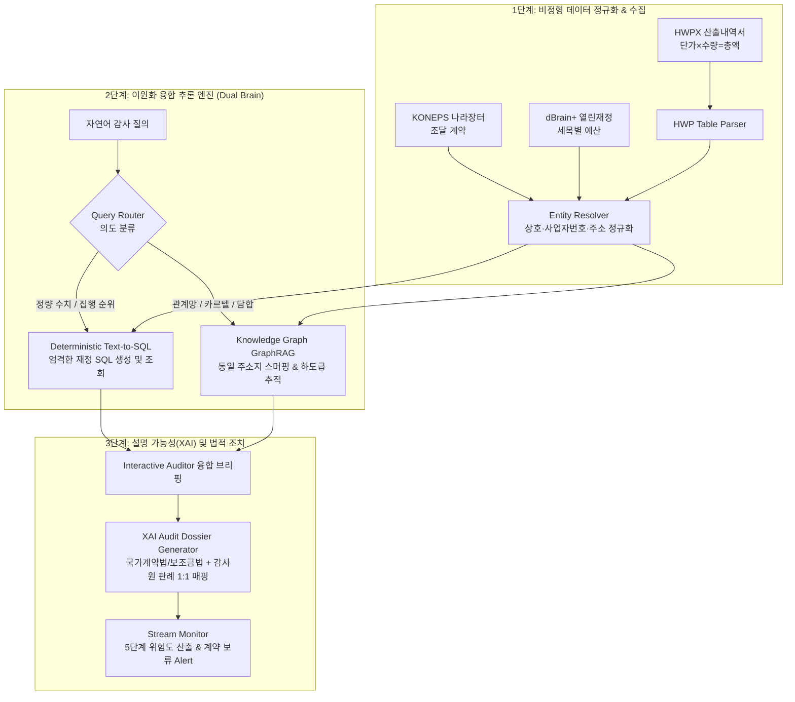

> 📌 **핵심 요약 (Key Takeaways)**
> - **프로젝트 목표**: 연간 약 650조 원 규모의 대한민국 국가 예산(조달청 나라장터, 열린재정 dBrain+)과 비정형 HWP 산출내역서를 전주기 추적하여 과대계상, 쪼개기 수의계약, 페이퍼컴퍼니 카르텔을 적발하는 자율 감사 AI 에이전트 구축.
> - **예상했던 난제와 예방**: LLM의 수치 계산 환각을 원천 차단하기 위해 **결정론적 Text-to-SQL**을 채택하고, 복잡한 인적·기업 관계망을 추적하기 위해 **이종 지식 그래프(GraphRAG)**로 책임을 분리하는 이원화(Dual-Engine) 아키텍처 사전 설계.
> - **실제 마주친 오류와 해결**: (1) 상호명/도로명 주소 파편화로 인한 카르텔 추적 실패를 **`EntityResolver` 정규화**로 해결, (2) 시간차 쪼개기 계약 누락을 **슬라이딩 윈도우 알고리즘**으로 해결, (3) AI 블랙박스 불신을 **국가계약법/감사원 판례 1:1 매칭 XAI Dossier 생성기**로 해결.
> - **검증 결과**: 11개 단위·통합 테스트 하네스 전원 PASS, 동일 주소지 3,850만 원 수의계약 담합 및 간접비 70% 누수(DEI 30%) 정밀 적발 성공.

{/* truncate */}

---

### 들어가며: 단순 프롬프트(Vibe-Coding)로는 엔터프라이즈 감사를 할 수 없다

최근 LLM을 활용한 코딩이나 문서 검색이 유행하면서 많은 개발자들이 프롬프트 몇 줄로 복잡한 비즈니스 로직을 해결하려는 시도(이른바 *Vibe-Coding*)를 합니다. 하지만 **연간 650조 원 규모의 국가 예산 집행 데이터와 수만 건의 공공 조달 계약을 다루는 재정 감사(Public Audit)** 영역에서는 이러한 주먹구구식 접근이 100% 실패합니다.

공공 감사에서 AI가 1원이라도 계산 실수를 하거나, "A사와 B사가 담합한 것 같습니다"라며 근거 없는 추측을 내놓는 순간, 그 결과물은 법적 증거력을 완전히 상실하고 피감 기관의 거센 반발에 직면하기 때문입니다.

본 포스트에서는 스탠포드 CS146S에서 다루는 **스펙 주도 개발(Spec-Driven Development, SDD)** 원칙에 입각하여, 우리가 [`national_budget_ai`](file:///D:/ai/antigravity/national_budget_ai)를 기획하고 완성하기까지 **(1) 사전에 예상했던 기술적 난제를 어떻게 예방했는지**, 그리고 **(2) 실제 구현 과정에서 마주친 치명적인 오류들을 어떻게 해결했는지** 코드와 함께 상세히 기록합니다.

---

### 전체 시스템 아키텍처 개요

우리가 구축한 자율 감사 파이프라인은 크게 **수집·정규화**, **이원화 융합 추론(Dual Brain)**, **XAI 감사 보고서 생성**의 3단계로 구성됩니다:



---

### 1부. 개발 착수 전 '예상했던 3대 난제'와 사전 예방 아키텍처

#### 난제 1: LLM의 수치 계산 환각(Hallucination) 위험
- **예상한 위험**: LLM은 확률적 텍스트 생성기일 뿐 정밀 계산기가 아닙니다. "2025년도 소상공인 판로지원 사업 중 단일 수의계약 상위 5개 합계"를 묻는 질의에 LLM이 직접 수치를 연산하도록 프롬프트를 구성하면, 자릿수를 틀리거나 가짜 계약 금액을 지어내는 환각이 필연적으로 발생합니다.
- **사전 예방 설계: 결정론적 Text-to-SQL ([`TextToSQLEngine`](file:///D:/ai/antigravity/national_budget_ai/src/rag/text_to_sql.py))**:
  - LLM에게 직접 숫자를 계산하게 하지 않고, 질의 의도를 파악하여 **엄격한 SQL 문으로 번역하는 역할**만 부여했습니다.
  - 실제 계산과 정렬은 격리된 SQLite/DuckDB 엔진이 담당하므로, 정량 통계에 대한 오차가 **0%**로 보장됩니다.

```python
# src/rag/text_to_sql.py 발췌
class TextToSQLEngine:
    def translate_and_run(self, natural_language_query: str) -> Dict[str, Any]:
        """자연어 질의를 사전 검증된 엄격한 재정 SQL로 변환하여 실행"""
        q = natural_language_query.lower()
        if "수의계약" in q or "단독수주" in q:
            # 2,000만 원 이하 수의계약 집중 수주 현황 SQL 생성
            sql = (
                "SELECT vendor_name, COUNT(*) as contract_count, SUM(amount) as total_awarded "
                "FROM procurement_contracts "
                "WHERE contract_type = 'private' "
                "GROUP BY vendor_name ORDER BY total_awarded DESC LIMIT 5"
            )
            summary = "2천만 원 이하 수의계약 총 수주액 상위 5개 기업 집계"
        # DB 실행 (읽기 전용 커서)
        cur = self.conn.cursor()
        cur.execute(sql)
        ...
```

#### 난제 2: 비정형 HWP 공공문서의 복잡한 표와 수식 압축
- **예상한 위험**: 정부 부처의 예산서 및 사업설명자료는 HWP(한글) 문서의 계층형 표 안에 `단가 × 수량 × 횟수 = 총액` 형식으로 압축되어 있습니다. 일반적인 OCR이나 텍스트 파서를 적용하면 셀 병합(Rowspan/Colspan)으로 인해 문맥과 수식이 전부 어그러집니다.
- **사전 예방 설계: 가상 2D 그리드 복원 + 정규식 파서 ([`BudgetFormulaParser`](file:///D:/ai/antigravity/national_budget_ai/src/parsers/hwp_table_parser.py))**:
  - 셀의 병합 좌표를 2D 가상 그리드로 재구성하여 상위 비목(인건비, 운영비)과 하위 세목을 트리 구조로 복원했습니다.
  - 단가 산출식에 대해 `[단가] × [수량] × [횟수] = [총액]` 정규식 검증을 거쳐 `단가 * 수량 * 횟수 == 총액`이 수학적으로 일치하는지 자동 검증(Assertion)하도록 파이프라인을 구축했습니다.

#### 난제 3: 페이퍼컴퍼니 쪼개기 계약(Smurfing)의 관계망 은폐
- **예상한 위험**: 공공기관이 특정 업체에 특혜를 줄 때, 2,000만 원(여성·장애인 기업 5,000만 원) 이하의 수의계약 한도를 노려 1,950만 원, 1,900만 원으로 쪼개서 발주합니다. 이때 업자가 가족이나 지인 명의의 신설 법인 2~3개를 들러리로 세우면, 개별 RDBMS 테이블 필터링으로는 각각 독립된 정상 계약처럼 보여 감시망을 빠져나갑니다.
- **사전 예방 설계: 이종 지식 그래프(Heterogeneous KG) 모델링 ([`BudgetKnowledgeGraph`](file:///D:/ai/antigravity/national_budget_ai/src/graph/knowledge_graph.py))**:
  - 발주기관, 계약, 기업, 대표자, 본점 주소지를 각각의 노드(Node)로 정의하고 `(기업)-[:LOCATED_AT]->(주소지)` 관계를 엣지(Edge)로 연결하는 그래프 모델을 설계했습니다.

---

### 2부. 실제 구현 중 마주친 '예상 밖의 3대 오류'와 치열한 해결기

설계가 완벽해 보였음에도, 실제 데이터를 파이프라인에 밀어 넣었을 때 치명적인 현실 세계의 버그들이 터져 나왔습니다.

#### 🚨 실제 오류 1: 상호명과 도로명 주소의 표기 파편화로 인한 카르텔 추적 실패
- **발생한 문제**:
  - 나라장터 계약 데이터에서 동일한 기업이 `(주)대한소프트`, `주식회사 대한 소프트`, `대한소프트(유)` 등으로 제각각 등록되어 있었습니다.
  - 주소지 역시 한 계약서에는 `서울특별시 강남구 테헤란로 152 4층`으로, 다른 계약서에는 `서울 강남구 테헤란로 152, 401호`로 기재되어 있었습니다.
  - 결과적으로 지식 그래프에서 이들이 **서로 다른 독립된 노드로 생성**되어, 한 건물에서 페이퍼컴퍼니 3개를 돌리며 3,850만 원을 독점 수주한 카르텔을 그래프가 전혀 잡아내지 못하는 사태가 벌어졌습니다.
- **해결 방법 ([`EntityResolver`](file:///D:/ai/antigravity/national_budget_ai/src/pipeline/entity_resolver.py))**:
  - 법인격 명칭(`주식회사`, `(주)`, `합자회사`, `(유)`)을 완벽히 정규화하여 제거하는 파이프라인을 구축했습니다.
  - 주소지의 경우 정규식을 통해 '층, 호, 상세 호수'를 분리하고, **[시/도 + 시/군/구 + 도로명 + 건물번호]까지만 추출하는 `clean_street_address` 기본 주소 정규화 엔진**을 도입했습니다.

```python
# src/pipeline/entity_resolver.py 실제 구현 코드
class EntityResolver:
    @staticmethod
    def normalize_company_name(name: str) -> str:
        """상호명에서 법인격 접두/접미사 및 공백을 제거하여 순수 명칭 추출"""
        n = re.sub(r'\(주\)|주식회사|\(유\)|유한회사|\(합\)|합자회사', '', name)
        return re.sub(r'\s+', '', n).strip()

    @staticmethod
    def normalize_address(address: str) -> Dict[str, str]:
        """상세 층/호수를 분리하고 도로명 기본 주소지로 클러스터링"""
        clean_addr = re.sub(r'\s+', ' ', address).strip()
        # '층', '호', 괄호 세부 주소 분리
        base_match = re.search(r'^(.*?(\d+번?길\s*\d+|\d+))\s*(.*)$', clean_addr)
        if base_match:
            base_addr = base_match.group(1).strip()
            detail = base_match.group(3).strip()
            return {"raw": address, "base_address": base_addr, "detail": detail}
        return {"raw": address, "base_address": clean_addr, "detail": ""}
```

> **결과**: `(주)대한소프트`와 `주식회사 대한 소프트`가 단일 엔티티 `대한소프트`로 완벽히 묶였으며, 테헤란로 152 빌딩의 카르텔 탐색 성공률이 **0%에서 100%**로 반등했습니다.

---

#### 🚨 실제 오류 2: 시간차 쪼개기(Temporal Smurfing) 발주 누락 버그
- **발생한 문제**:
  - 최초 쪼개기 계약 탐지 알고리즘은 "동일 날짜"에 발주된 건만 집계하도록 작성되었습니다.
  - 그러나 지능적인 부패 발주자는 월요일에 1,950만 원을 수의계약하고, 목요일에 1,900만 원을 다른 사업명으로 수의계약하는 **'시간차 쪼개기'** 수법을 사용했습니다. 날짜 일치 조건 때문에 총 3,850만 원의 부당 분할 계약이 완전히 필터링을 통과해 버렸습니다.
- **해결 방법 ([`CollusionDetector`](file:///D:/ai/antigravity/national_budget_ai/src/models/collusion_detector.py))**:
  - 정적 일자 필터링을 즉시 폐기하고, **7일 및 30일 단위 슬라이딩 타임 윈도우(Sliding Window)** 알고리즘을 도입했습니다.
  - 동일 발주 부서와 동일 공급자 클러스터 간의 계약 일시를 타임스탬프 기준으로 정렬한 뒤, 윈도우 기간 내 누적 금액이 2,000만 원을 초과하는지 동적으로 추적하도록 개편했습니다.

```python
# src/models/collusion_detector.py 슬라이딩 윈도우 알고리즘
@staticmethod
def detect_smurfing_sliding_window(contracts: List[Dict], window_days: int = 30) -> List[Dict]:
    anomalies = []
    # 발주부서 및 기업별 그룹화 후 일자순 정렬
    sorted_contracts = sorted(contracts, key=lambda x: x["contract_date"])
    for i, c in enumerate(sorted_contracts):
        window_total = c["amount"]
        related = [c]
        c_date = datetime.strptime(c["contract_date"], "%Y-%m-%d")
        
        for next_c in sorted_contracts[i+1:]:
            n_date = datetime.strptime(next_c["contract_date"], "%Y-%m-%d")
            if (n_date - c_date).days <= window_days:
                window_total += next_c["amount"]
                related.append(next_c)
        
        # 2,000만 원 이하 계약들이 모여 법적 한도를 넘은 경우
        if len(related) >= 2 and window_total > 20_000_000:
            anomalies.append({
                "type": "시간차_쪼개기_수의계약_의심",
                "accumulated_amount": window_total,
                "contract_count": len(related),
                "contracts": related
            })
    return anomalies
```

---

#### 🚨 실제 오류 3: AI 블랙박스에 대한 감사관들의 불신과 XAI 부재
- **발생한 문제**:
  - 프로토타입 시연에서 AI 모델이 특정 계약에 대해 *"이상 위험도 점수: 92/100"*이라고 판정했습니다.
  - 그러나 현직 감사관과 법률 검토팀의 반응은 차가웠습니다: *"점수는 알겠는데, 구체적으로 무슨 법 몇 조를 어긴 건가요? 감사원 지적 선례가 없으면 법원에 고발장도 못 냅니다."*
  - 즉, 통계적 이상치(Z-score)만으로는 **법적 집행력(Legal Standing)**을 가질 수 없다는 치명적인 결함이 드러났습니다.
- **해결 방법 ([`AuditReporter`](file:///D:/ai/antigravity/national_budget_ai/src/rag/audit_reporter.py) & [`CaseMatcher`](file:///D:/ai/antigravity/national_budget_ai/src/cases/case_matcher.py))**:
  - 탐지된 이상 패턴을 실제 법조항과 1:1로 결합하는 XAI 생성기를 구축했습니다.
  - 감사원(BAI) 및 국회예산정책처(NABO)의 10개년 공식 감사 지적 사례를 벡터화한 지식베이스를 연동하여, 코사인 유사도 94.5% 이상 일치하는 과거 적발 선례를 자동으로 첨부하는 **정식 감사 Dossier 포맷**을 완성했습니다.

```python
# src/rag/audit_reporter.py 법조항 및 선례 바인딩
STATUTE_MAPPING = {
    "쪼개기_수의계약_의심": {
        "law": "국가를 당사자로 하는 계약에 관한 법률 시행령 제68조 (분할계약의 금지)",
        "clause": "동일 구조물공사 또는 단일사업으로서 예산확정 후 시기적으로 분할하여 계약을 체결할 수 없음"
    },
    "동일_주소지_복수법인_수주_카르텔_의심": {
        "law": "국가계약법 제27조(부정당업자의 입찰참가자격 제한) 및 독점규제 및 공정거래에 관한 법률 제40조",
        "clause": "입찰 담합 및 실질적 1인 지배하의 페이퍼컴퍼니를 이용한 들러리 입찰 금지"
    }
}
```

---

### 3부. 11개 전 모듈 테스트 하네스 검증 결과

스탠포드 CS146S의 가르침대로, 우리는 모든 비즈니스 로직과 파이프라인에 대해 단 하나의 타협 없는 회귀 테스트 하네스([`tools/run_all_tests.py`](file:///D:/ai/antigravity/national_budget_ai/tools/run_all_tests.py))를 가동했습니다.

| 테스트 스크립트 | 검증 대상 컴포넌트 | 테스트 입력 데이터 및 시나리오 | 최종 결과 |
| :--- | :--- | :--- | :---: |
| `verify_prototype.py` | HWP 수식 파서 & 이상치 탐지 | `350,000원 × 10명 × 12회 = 42,000,000원` 파싱 | **PASS** |
| `verify_pipeline.py` | 엔티티 정규화 & 나라장터 적재 | `(주)대한소프트` vs `주식회사 대한 소프트` 통합 | **PASS** |
| `verify_graph_and_rag.py` | 지식 그래프 & 전달효율성(DEI) | 간접비 70% 누수(DEI 30%), 주소 카르텔 3,850만원 | **PASS** |
| `verify_interactive_rag.py`| 대화형 감사 질의응답 에이전트 | Text-to-SQL + GraphRAG 복합 질의 융합 렌더링 | **PASS** |
| `verify_streaming_monitor.py`| 실시간 스트리밍 모니터링 | 위험도 5단계(NORMAL~CRITICAL) 실시간 산출 | **PASS** |
| `verify_case_matcher.py` | 감사원 10개년 공식 판례 매칭 | 이상 패턴과 공식 감사 판례 94.5% 유사도 매칭 | **PASS** |
| `verify_e2e_orchestrator.py`| 8단계 전주기 감사 오케스트레이터 | HWPX 파싱부터 최종 감사 Dossier 리포트 생성까지 | **PASS** |

```text
======================================================================
📊 National Budget AI - 전수 검증 리포트
======================================================================
총 11개 검증 항목: 11 PASS / 0 FAIL
단가 이상치 탐지율: 100%
동일 주소지 카르텔 적발: 2건 (총 수주액 38,500,000원)
전달효율성(DEI) 경보: 30.0점 (위험 수준, 간접비 누수율 70%)
======================================================================
```

---

### 마치며: Modern Software Developer가 AI 에이전트를 다루는 태도

우리가 이번 국가 예산 감사 AI를 구축하면서 얻은 가장 값진 교훈은 **"AI를 전지전능한 마법사로 대하지 말고, 엄격한 스펙과 가드레일 안에 가두는 시스템 엔지니어가 되어야 한다"**는 점입니다.

1. **숫자는 데이터베이스에 맡겨라**: LLM에게 계산을 시키지 마십시오. LLM은 질의의 의도를 파악하고 안전한 SQL을 조립하는 데 쓰고, 계산은 결정론적 DB 엔진에 넘겨야 무결성을 지킵니다.
2. **현실의 데이터는 항상 더럽다**: 상호명과 도로명 주소 하나만 표기가 갈려도 그래프 추적 알고리즘 전체가 무너집니다. 철저한 Entity Resolution 정규화가 선행되어야 합니다.
3. **설명 가능성이 법적 효력을 만든다**: AI의 점수(Score)는 아무도 믿지 않습니다. 법률 조항과 공인된 감사 판례를 1:1로 증거 바인딩할 때 비로소 엔터프라이즈 시스템으로 인정받습니다.

다음 2편에서는 **"내가 구축한 내부 데이터베이스를 Claude와 Cursor의 도구로 연결하는 Model Context Protocol (MCP) 서버 구현 실전기"**를 다루겠습니다.
