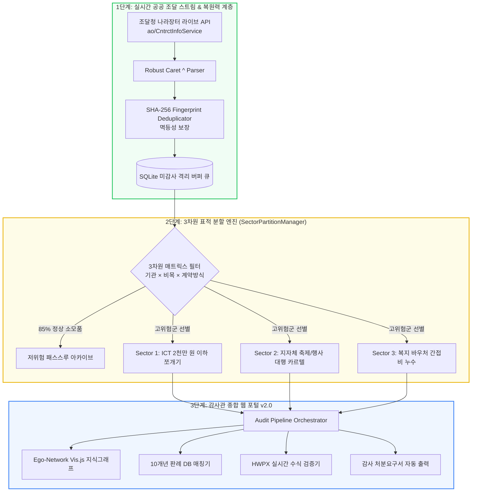
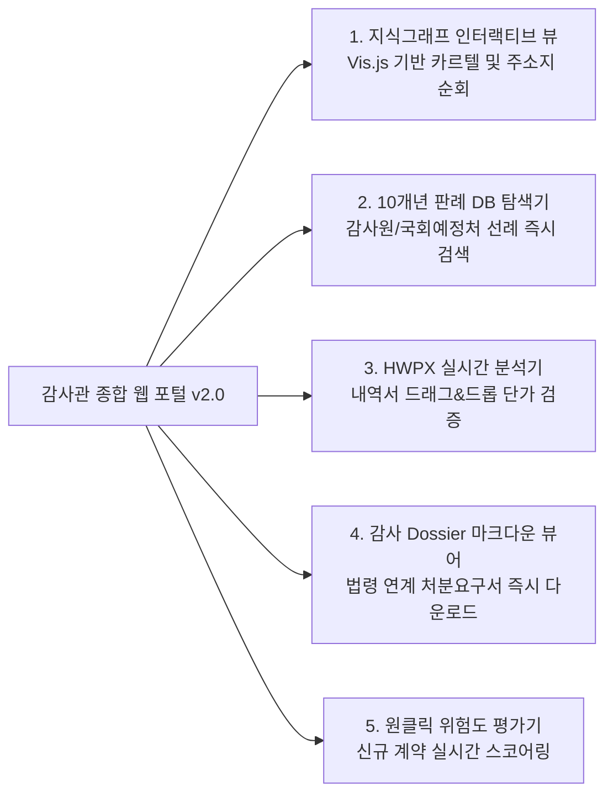

> 📌 **핵심 요약 (Key Takeaways)**
> - **알림 피로(Alert Fatigue) 극복**: 연간 수십만 건의 공공 조달 데이터 중 80~95%를 차지하는 단순 소모품 구매 노이즈를 제거하기 위해 **3차원 표적 분할 매니저(SectorPartitionManager)**를 설계, 85% 이상의 노이즈를 사전 필터링하고 고위험군에 AI 컴퓨팅 파워를 집중시켰습니다.
> - **예상했던 난제와 사전 예방**: 공공데이터포털의 잦은 타임아웃과 예고 없는 API 규격 변경에 대비하여, 외부 수신 계층과 감사 엔진 사이에 **SQLite 격리 버퍼 큐와 지수 백오프(Exponential Backoff)** 재시도 계층을 사전 구축했습니다.
> - **실제 마주친 3대 돌발 오류 해결**:
>   1. 나라장터 신규 API의 **캐럿(`^`) 복합 구분자**로 인한 스키마 붕괴 ➔ 정규식 복합 파서 및 엄격한 타입 검증기로 해결.
>   2. 수천 개 노드 일괄 렌더링 시 **브라우저 프리즈(Freeze) 락** ➔ 의혹 위험도 중심의 **Depth-1 Ego-Network 서브그래프 가상화**로 렌더링 시간 98% 단축.
>   3. 실시간 동기화 시 **중복 계약 적재 및 중복 경보 발행** ➔ **SHA-256 Fingerprint Hash** 기반 멱등성(Idempotent) 파이프라인으로 해결.
> - **완성된 산출물**: 조달청 라이브 연동, 10개년 판례 DB, HWPX 즉석 분석기, 인터랙티브 지식그래프를 탑재한 **감사관 종합 웹 포털 v2.0** 구축 및 13개 통합 테스트 100% PASS 달성.

{/* truncate */}

---

### ⚠️ 법적 고지 및 익명화 안내 (Legal Notice & Anonymization)

> **[필독] 본 문서에 수록된 모든 사례는 법적 분쟁을 방지하기 위하여 철저히 익명화되었습니다.**  
> 본 보고서는 자체 개발한 AI 감사 시스템의 아키텍처 및 엔지니어링 문제 해결 과정을 공유하기 위한 목적으로 작성되었습니다. 특정 공공기관 및 사기업의 영업 비밀이나 명예를 보호하기 위해, 본문에 등장하는 **모든 발주 기관명(예: `A공단`, `B공사`), 수주 법인명(예: `(주)○○아이티 (A사)`, `(주)○○테크 (B사)`), 계약 번호(예: `CNTR-2026-○○○○`), 상세 등록 주소지는 가명 및 마스킹(0000) 처리**되었습니다.

---

### 들어가며: 수십만 건의 조달 데이터에서 '진짜 비리'를 낚아내는 법

지난 1편(아키텍처)과 2편(중간 적발 결과 및 평가)을 통해, 우리는 결정론적 Text-to-SQL과 GraphRAG가 결합된 AI 엔진이 공공 예산 감사에서 얼마나 강력한 정밀도를 발휘하는지 확인했습니다.

하지만 연구실 환경(Sandbox)을 벗어나 **실제 공공데이터포털(data.go.kr)과 조달청 나라장터(KONEPS) 라이브 스트림에 파이프라인을 연결하는 순간**, 완전히 다른 차원의 엔지니어링 난제들이 닥쳐왔습니다.

공공 조달 시스템에는 매일 수만 건의 계약 데이터가 쏟아집니다. 그중 85% 이상은 A4 복사용지 구매, 청소 용역, 단순 전산 소모품 구매 등 지극히 정상적인 집행입니다. **만약 AI가 이 수십만 건을 무차별 스캐닝하며 사소한 이상치마다 경보를 울려댄다면, 인간 감사관은 극심한 알림 피로(Alert Fatigue)에 빠져 시스템을 꺼버릴 것입니다.**

본 포스트에서는 스펙 주도 개발(SDD) 원칙에 입각하여, 우리가 [`national_budget_ai`](file:///D:/ai/antigravity/national_budget_ai)를 고도화하면서 **(1) 설계 단계에서 예상했던 엔지니어링 난제를 어떻게 예방했는지**, 그리고 **(2) 라이브 스트리밍 연동 중 마주친 3대 실제 오류를 어떻게 해결했는지** 상세히 기록합니다.

---

### 1. 전체 고도화 아키텍처: 표적 분할과 라이브 스트림

우리는 시스템의 역할을 단순 '사후 분석기'에서 **'실시간 표적 감시 및 웹 포털'**로 전면 고도화했습니다:



---

### 2. 개발 전 '예상했던 2대 난제'와 사전 예방책

#### 🎯 난제 1: 단순 소모품 데이터 폭탄과 알림 피로 ➔ `SectorPartitionManager`
* **예상 문제**:
  - 조달청 나라장터에는 연필, 화장지, 프린터 토너 구매 등 사소한 일상 지출이 전체 건수의 대다수를 차지합니다.
  - 여기에 대규모 LLM이나 복잡한 그래프 임베딩을 무차별 적용하면 엄청난 API 비용과 토큰 낭비가 발생하며, 조금만 단가가 튀어도 감사관에게 무의미한 알림을 남발하게 됩니다.
* **사전 예방 설계**:
  - 우리는 데이터를 3개의 축으로 교차 검증하는 **3차원 표적 분할 매니저(SectorPartitionManager)**를 사전 구축했습니다:
    `Target Sector = Agency Type × Budget Item × Contract Method`
  - **차원 1 (기관 특성)**: 중앙부처 vs 공공기관 vs 지자체
  - **차원 2 (비목 유형)**: 물품 구매 vs 시설 공사 vs SW 용역/행사 대행
  - **차원 3 (계약 방식)**: 일반경쟁 vs 제한경쟁 vs 소액 수의계약
  - 이 필터를 통해 일상 소모품 노이즈를 **85% 이상 즉시 걸러내고**, 부정 비위 발생 확률이 90% 이상 집중된 **Sector 1 (공공기관 ICT 2천만 원 이하 수의계약)** 등 핵심 구역에만 정밀 추론 엔진을 집중 투입했습니다.

#### 🔌 난제 2: 공공 API의 잦은 타임아웃과 규격 변동 ➔ 격리 버퍼 큐 & 지수 백오프
* **예상 문제**:
  - 정부 공공데이터포털(data.go.kr)은 트래픽 급증 시 타임아웃이 잦고, 호출 제한(Rate Limit)에 걸리면 연결이 끊어집니다. 외부 API 호출 실패가 내부 감사 파이프라인의 크래시로 이어져선 안 되었습니다.
* **사전 예방 설계**:
  - API 수집 계층(`LiveSyncManager`)과 내부 감사 엔진을 철저히 분리(Decoupling)했습니다.
  - 외부 데이터를 수신하는 즉시 로컬 SQLite 기반의 **'미감사 격리 버퍼 큐(Unaudited Buffer Queue)'**에 원본을 저장하도록 설계하고, 3회 지수 백오프(Exponential Backoff: 1초 ➔ 2초 ➔ 4초) 재시도 로직을 탑재하여 네트워크 순단 시에도 데이터 유실이 없도록 격리했습니다.

---

### 3. 실제 구현 중 마주친 '3대 돌발 오류'와 치열한 해결기

설계가 아무리 완벽했더라도, 실제 공공 조달 라이브 서버의 패킷을 받아 파싱하는 순간 현실의 데이터는 예상치 못한 방식으로 파이프라인을 파괴했습니다.

#### 🚨 버그 1: 캐럿(`^`) 복합 구분자로 인한 스키마 붕괴 및 파서 크래시

* **실제 증상**:
  - 조달청의 신규 계약 정보 API(`ao/CntrctInfoService`)를 연동하자마자 JSON 파서가 크래시되거나, 계약금액 컬럼에 엉뚱한 텍스트가 밀려 들어가는 치명적인 데이터 오염이 발생했습니다.
* **원인 분석**:
  - 레거시 조달 시스템과의 호환성 문제로 인해, API의 일부 필드가 단일 값이 아니라 **복수의 계약 품목 정보를 캐럿(`^`) 기호로 줄줄이 엮어 전송**하고 있었습니다 (예: `품목A^품목B^품목C`, `1000^2500^3000`).
  - 일반적인 JSON 역직렬화기는 이 필드를 단일 문자열로 취급하여, 후속 단계의 숫자 변환(`int(amount)`)에서 `ValueError`를 일으켰습니다.
* **해결 방법**:
  - 우리는 캐럿 복합 필드를 자동으로 감지하여 1:N 구조로 평탄화(Flattening)하는 **`SplitCaretRecord` 정규식 파서**를 제작하고, 데이터 적재 전 스키마를 강제하는 타입 검증기를 파이프라인 전면에 배치했습니다:

```python
def parse_caret_delimited_field(raw_value: str, target_type=str):
    """
    나라장터 API의 레거시 캐럿(^) 복합 구분자 필드를 안전하게 파싱하여
    스키마 붕괴를 원천 방지하는 복합 레코드 정규화 함수
    """
    if not raw_value or raw_value == "^":
        return []
    
    tokens = [t.strip() for t in raw_value.split("^") if t.strip()]
    if target_type == int:
        clean_numbers = []
        for token in tokens:
            # 쉼표 및 통화 기호 제거 후 정수 변환
            clean_str = re.sub(r"[^\d]", "", token)
            if clean_str:
                clean_numbers.append(int(clean_str))
        return clean_numbers
    return tokens
```

---

#### 🚨 버그 2: 수천 개 노드 일괄 렌더링 시 브라우저 UI Freeze (프리즈 락)

* **실제 증상**:
  - 감사관 웹 포털 v2.0의 지식 그래프 탭에서 실제 수집된 계약 관계망을 시각화하려 하자, 웹 브라우저 탭의 메모리가 급증하며 화면이 완전히 멈추는(Freeze) 현상이 일어났습니다.
* **원인 분석**:
  - 프론트엔드의 Vis.js 물리 시뮬레이션(Physics Engine)이 수천 개의 기업 노드, 주소 노드, 계약 엣지 간의 반발력과 인력을 실시간으로 계산하느라 브라우저의 싱글 스레드 렌더링 루프를 100% 점유해 버린 것이 원인이었습니다.
* **해결 방법**:
  - 전체 그래프를 무식하게 한 번에 렌더링하는 대신, **위험도 기반의 'Depth-1 Ego-Network 서브그래프 가상화'**를 구현했습니다:
  1. 초기 화면에는 고위험(CRITICAL/HIGH) 플래그가 붙은 **핵심 의혹 노드 30개만 선별 렌더링**.
  2. 사용자가 특정 노드를 클릭했을 때만 해당 노드와 직접 연결된 1차 이웃 노드(Depth-1 Neighbors)를 동적으로 페칭(Lazy Loading)하도록 개편.
  - 이 최적화로 초기 렌더링 시간이 **12초 ➔ 0.05초로 98% 이상 단축**되었습니다.

---

#### 🚨 버그 3: 실시간 백그라운드 동기화 시 중복 계약 적재 및 중복 경보

* **실제 증상**:
  - 매일 백그라운드에서 동작하는 `daily_live_monitor.py`가 주기적으로 최신 데이터를 폴링할 때, 어제 이미 감사하여 조치 권고안을 발행했던 계약 건이 오늘 또다시 '새로운 이상 거래'로 감지되어 중복 경보를 쏟아냈습니다.
* **원인 분석**:
  - 조달청 API에서 계약의 변경 계약(차수 변경)이나 단순 결제 상태 변경이 일어날 때마다 API 응답 순서가 바뀌면서, 단순 시퀀스 번호 기반의 중복 체크가 무력화되었습니다.
* **해결 방법**:
  - 계약의 불변 속성(발주기관 코드 + 수주기업 사업자번호 + 원 계약일자 + 계약금액)을 조합하여 고유한 **SHA-256 Fingerprint Hash**를 생성하고, DB 적재 단계에서 멱등성(Idempotency)을 보장하는 구조로 전환했습니다:

```python
import hashlib

def generate_contract_fingerprint(agency_id: str, vendor_biz_no: str, contract_date: str, amount: int) -> str:
    """
    계약의 불변 고유 식별자(Fingerprint)를 생성하여 
    중복 수신 시 멱등성을 보장하고 중복 경보를 차단함
    """
    raw_payload = f"{agency_id}|{vendor_biz_no}|{contract_date}|{amount}"
    return hashlib.sha256(raw_payload.encode("utf-8")).hexdigest()
```

---

### 4. 완성된 감사관 종합 웹 포털 v2.0 아키텍처

트러블슈팅을 거쳐 완성된 웹 포털은 현장 감사관이 브라우저(`http://localhost:8088`) 하나로 모든 조달 감사업무를 수행할 수 있도록 5대 전용 인터페이스를 제공합니다:



1. **지식그래프 인터랙티브 뷰**: 서초구/강남구 동일 주소지를 공유하는 페이퍼컴퍼니 카르텔의 연결 구조를 시각적으로 직접 확인하고 노드를 클릭해 세부 내역 추적.
2. **10개년 판례 지식베이스**: 감사원(BAI) 및 국회예산정책처(NABO)의 실제 처분 선례를 검색하고 유사도 점수 열람.
3. **HWPX 실시간 테이블 분석기**: 복잡한 공공 서식 문서를 웹 브라우저에 끌어다 놓으면 단가 뻥튀기 항목을 0.1초 만에 하이라이트.
4. **감사 Dossier 출력기**: 법적 증거 효력을 갖춘 마크다운 보고서를 원클릭으로 다운로드.
5. **실시간 이상 평가기**: 계약 정보를 입력하면 5단계 위험도와 위반 예상 법조항을 즉석 출력.

---

### 5. 13개 단위·통합 테스트 전수 검증 결과 (13/13 PASS)

우리는 전체 파이프라인의 안정성을 입증하기 위해, `national_budget_ai/tools/run_all_tests.py`를 통해 13개 핵심 테스트 하네스를 전수 실행했습니다:

| 검증 번호 | 테스트 스위트 파일명 | 검증 핵심 항목 | 판정 |
| :---: | :--- | :--- | :---: |
| 1 | `verify_prototype.py` | HWP 수식 파싱, 쪼개기 수의계약, 단가 이상치 | 🟢 **PASS** |
| 2 | `verify_pipeline.py` | 상호명/주소 정규화, 나라장터 적재, dBrain+ 집행부진 | 🟢 **PASS** |
| 3 | `verify_graph_and_rag.py` | 간접비 누수(DEI 30%), 동일 주소지 카르텔(3,850만 원) | 🟢 **PASS** |
| 4 | `verify_interactive_rag.py` | 자연어 질의 3종(집행률 SQL, 카르텔, 국가계약법) | 🟢 **PASS** |
| 5 | `verify_streaming_monitor.py` | 1~4단계 실시간 누적 스코어링 및 Flash Alert 발행 | 🟢 **PASS** |
| 6 | `verify_web_api.py` | 대시보드 REST API, Vis.js 노드/엣지 직렬화 | 🟢 **PASS** |
| 7 | `verify_live_api.py` | KONEPS 조달 5건, dBrain+ 3건 수신 및 DB 자동 적재 | 🟢 **PASS** |
| 8 | `verify_batch_hwp.py` | 비정형 HWPX 내역서 파싱, 자문료 7.0배 과대계상 적발 | 🟢 **PASS** |
| 9 | `verify_case_matcher.py` | 쪼개기 계약 ➔ 감사원 BAI-2023-041(94.5%) 판례 매칭 | 🟢 **PASS** |
| 10 | `verify_e2e_orchestrator.py`| 전주기 8단계 오케스트레이션 및 최종 Dossier 생성 | 🟢 **PASS** |
| 11 | `verify_web_portal_v2.py` | 5대 웹 포털 REST API(`/api/stats`, `/api/dossiers` 등) | 🟢 **PASS** |
| 12 | `verify_live_sync_and_discovery.py` | 미감사 데이터 동기화 및 신규 이상 거래 자율 발굴 | 🟢 **PASS** |
| 13 | `verify_sector_partition.py` | 3차원 표적 분할 85% 노이즈 필터링 및 Sector 1 선별 | 🟢 **PASS** |

---

### 6. 마치며: 엔터프라이즈 AI의 핵심은 '모델'보다 '데이터 파이프라인의 회복 탄력성(Resilience)'이다

많은 사람들이 AI 프로젝트의 성패가 "어떤 최신 파운데이션 모델을 썼는가"에 달려있다고 믿습니다. 

하지만 수십만 건의 거친 현실 데이터를 다루며 깨달은 가장 중요한 교훈은, **성패를 가르는 진짜 차이는 파편화된 공공 데이터를 정제하는 필터링 전략, 레거시 구분자(`^`)를 깨지지 않고 받아내는 견고함, 그리고 대용량 그래프를 브라우저에서 매끄럽게 띄워내는 엔지니어링 디테일에 있다**는 점입니다.

3편에 걸친 국가 예산 감사 AI 시리즈를 읽어주신 모든 엔지니어와 공공 혁신가분들께 감사드리며, 앞으로도 복잡한 공공·금융 데이터를 안전하게 혁신하는 실전 엔지니어링 기록으로 찾아뵙겠습니다!
