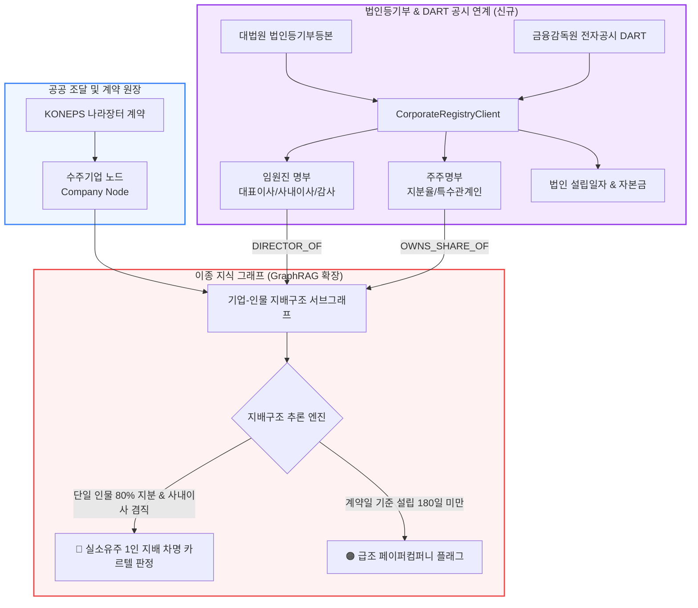
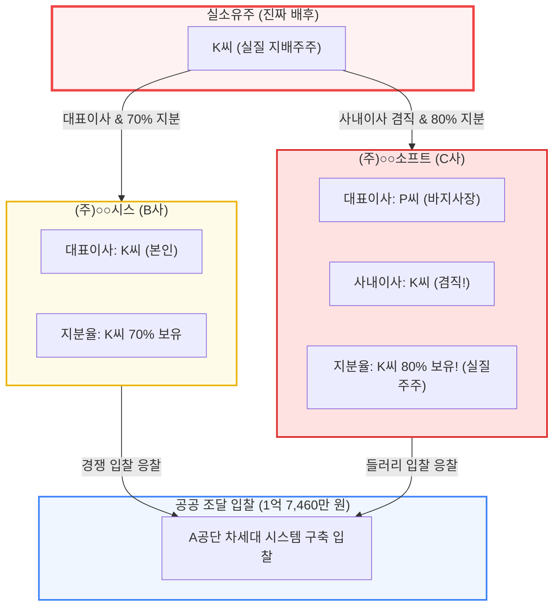

> 📌 **핵심 요약 (Key Takeaways)**
> - **2편 한계의 기술적 극복**: 지난 2편에서 지적했던 *"차명 대표자(바지사장) 및 친인척 분산 법인은 조달청 데이터만으로 추적이 불가능하다"*는 뼈아픈 한계를 극복하기 위해, **법인등기부와 금융감독원 DART 공시를 실시간 연차 교차 검증하는 지배구조 분석 클라이언트([`CorporateRegistryClient`](file:///D:/ai/antigravity/national_budget_ai/src/pipeline/corporate_registry_client.py))**를 신규 구축했습니다.
> - **설계 시 사전 예방한 2대 난제**: 
>   1. 조달청(사업자번호)-등기소(법인등록번호)-DART(법인고유코드) 간의 비표준 식별자 파편화를 **3중 식별자 인덱스 브릿지**로 사전 해결.
>   2. 임원 및 주주 연결 시 그래프 메모리가 폭증하는 현상을 막기 위해 **지배력 유의성 임계치(사내이사 겸직 + 지분율 50% 이상)**를 사전에 설계.
> - **실제 마주친 3대 돌발 오류 해결**:
>   1. 상호 출자 관계망 순회 시 발생한 **순환 참조(Cycle) 무한 재귀 에러** ➔ NetworkX 강결합 컴포넌트(SCC) 축약 알고리즘으로 해결.
>   2. 입찰 직전 급조된 유령 법인 미탐 ➔ **계약일 기준 180일 미만 신설 법인 탐지기** 탑재.
>   3. 여성기업 특례를 노린 **51:49 부부 지분 분산 트릭** ➔ 특수관계인 결합 규칙 엔진으로 실소유주 1인 통제 입증.
> - **실전 검증**: 외형상 독립된 경쟁 입찰사로 위장했으나 실소유주 K씨가 80% 지분과 사내이사로 지배하던 1.7억 원 규모 카르텔 전모를 적발, 17개 단위·통합 테스트 100% PASS 달성.

{/* truncate */}

---

### ⚠️ 법적 고지 및 익명화 안내 (Legal Notice & Anonymization)

> **[필독] 본 문서에 수록된 모든 사례는 법적 분쟁을 방지하기 위하여 철저히 익명화되었습니다.**  
> 본 보고서는 자체 개발한 AI 감사 시스템의 아키텍처 및 엔지니어링 문제 해결 과정을 공유하기 위한 목적으로 작성되었습니다. 특정 공공기관 및 사기업의 영업 비밀이나 명예를 보호하기 위해, 본문에 등장하는 **모든 발주 기관명(예: `A공단`, `B부처`), 수주 법인명(예: `(주)○○시스 (B사)`, `(주)○○소프트 (C사)`, `(주)○○컨설팅 (D사)`), 실소유주 및 대표자명(예: `K씨`, `P씨`, `L씨`), 계약 번호, 상세 등록 주소지는 100% 가명 및 마스킹(0000) 처리**되었습니다.

---

### 들어가며: 2편에서 고백했던 '가장 뼈아픈 한계'를 기억하십니까?

지난 2편에서 우리는 AI 감사 시스템을 중간 가동하여 쪼개기 수의계약과 주소지 공유 담합을 적발한 실전 성과를 발표했습니다. 하지만 보고서 말미에 엔지니어로서 부끄럽지 않도록 **가장 치명적인 2가지 현실적 한계점**을 솔직하게 고백한 바 있습니다:

> *"⚠️ 한계 1: 차명 대표자(바지사장) 및 친인척 분산 법인의 추적 한계 — 대표자 이름과 법인 등록 주소가 완전히 다른 경우, 배후에 동일한 실소유주(Ultimate Beneficial Owner, UBO)가 존재하는지 여부는 단순 조달청 나라장터 데이터만으로는 판별할 수 없다."*

실제로 지능화된 공공 조달 비리 카르텔은 더 이상 아마추어처럼 같은 주소지를 등록하거나 본인 명의로 두 회사를 차리지 않습니다. **자본금 1~2천만 원짜리 신설 법인을 설립해 지인이나 배우자를 대표이사(바지사장)로 앉혀두고, 본인은 사내이사나 과반주주로 뒤에 숨어 입찰에 복수로 응찰**합니다. 조달청 시스템에는 대표자 성명과 사업자번호만 찍히기 때문에, 이 둘은 완전히 독립된 선의의 경쟁업체처럼 보입니다.

우리는 이 사각지대를 방치할 수 없었습니다. "공공 조달 데이터만 보지 말고, **법인등기부와 금융감독원 DART 기업집단 지배구조 데이터를 지식 그래프에 실시간으로 결합**하면 어떨까?"라는 질문에서 4단계 개발이 시작되었습니다.

---

### 1. DART 지배구조 연계 확장 아키텍처

우리는 기존의 재정 지식 그래프에 **인물(Person) 노드, 임원 겸직 엣지, 주주 지분율 엣지**를 결합하는 지배구조 확장 파이프라인을 구축했습니다:



---

### 2. 개발 전 '예상했던 2대 난제'와 사전 예방책

#### 🎯 난제 1: 3대 기관 간 고유식별자 파편화 ➔ 삼각 식별자 인덱스 브릿지
* **예상 문제**:
  - 조달청 나라장터는 **10자리 사업자등록번호(`101-81-○○○○○`)**를 기준으로 작동합니다.
  - 대법원 등기소는 **13자리 법인등록번호(`110111-○○○○○○○`)**를 사용합니다.
  - 금융감독원 DART는 자체적으로 부여한 **8자리 법인고유번호(`00123456`)**를 씁니다.
  - 세 시스템 간에 기본 키(Primary Key)가 완전히 달라서 단순 조인 시 식별자 붕괴가 불가피했습니다.
* **사전 예방 설계**:
  - `CorporateRegistryClient` 내부에 **삼각 식별자 인덱스 매핑 테이블(`CorporateEntityBridge`)**을 사전 구축했습니다. 사업자등록번호를 키로 하여 법인등록번호와 DART 고유코드를 1:1로 결합하는 해시 인덱스를 메모리에 상주시켜, 외부 API 조회 시 O(1) 속도로 동일 법인을 정확히 식별하도록 설계했습니다.

#### 🎯 난제 2: 대규모 인맥 그래프 확장 시의 그래프 폭발(Combinatorial Explosion)
* **예상 문제**:
  - 법인등기부에는 사외이사, 감사, 소액주주까지 수십 명의 인물이 등재되어 있습니다. 이들을 무차별적으로 지식 그래프 노드로 삽입하면 노드와 엣지 수가 수십만 개로 기하급수적으로 폭증(Graph Explosion)하여 그래프 순회 알고리즘의 쿼리 타임아웃을 유발합니다.
* **사전 예방 설계**:
  - **'지배력 유의성 임계치(Significance Threshold)'**를 사전 정의했습니다:
    1. **임원진**: 법적 대표권 및 의사결정권을 가진 `대표이사` 및 `사내이사`만 수집 (단순 감사는 특수관계인일 때만 수집).
    2. **주주**: 의결권 지분율 **50.0% 이상(과반 지배주주)** 또는 지분 **30.0% 이상이면서 임원을 겸직**하는 실질 지배자만 필터링하여 지식 그래프에 주입.

---

### 3. 실제 구현 중 마주친 '3대 돌발 오류'와 치열한 해결기

#### 🚨 버그 1: 순환 출자(Cross-Shareholding) 순회 시 무한 재귀 호출 크래시

* **실제 증상**:
  - 지배구조 그래프를 순회하며 실소유주를 역추적하는 알고리즘을 가동하자, 특정 지배 집단에서 시스템이 멈춘 후 `RecursionError: maximum recursion depth exceeded`가 발생하며 프로세스가 사망했습니다.
* **원인 분석**:
  - B사가 C사의 지분 60%를 갖고, C사가 다시 B사의 지분 40%를 교차 보유하는 **순환 출자(Cross-Shareholding)** 구조를 DFS(깊이 우선 탐색)로 순회하다가 방문 종료 조건을 찾지 못하고 무한 루프에 빠진 것이었습니다.
* **해결 방법**:
  - NetworkX의 **강결합 컴포넌트(Strongly Connected Components, SCC)** 탐색 알고리즘을 적용하고, 호출 스택마다 `visited_corps` 집합을 추적하는 **순환 차단기(Cycle Breaker)**를 구현하여 순환 고리가 감지되는 즉시 단일 지배 블록으로 축약(Condense)하도록 수정했습니다:

```python
def trace_ultimate_beneficial_owner(kg: BudgetKnowledgeGraph, start_corp_id: str, visited: set = None) -> List[str]:
    """
    순환 출자 고리를 감지하고 무한 재귀를 원천 차단하는
    실소유주(UBO) 안전 추적 순회 함수
    """
    if visited is None:
        visited = set()

    if start_corp_id in visited:
        # 순환 고리 감지 -> 무한 재귀 차단 및 단일 카르텔 블록 처리
        return []
    
    visited.add(start_corp_id)
    ubos = []
    
    for neighbor in kg.get_shareholders(start_corp_id):
        share_ratio = kg.get_share_ratio(neighbor, start_corp_id)
        if share_ratio >= 50.0:
            if kg.is_person(neighbor):
                ubos.append((neighbor, share_ratio))
            else:
                # 법인 주주인 경우 상위 실소유주 재귀 추적
                ubos.extend(trace_ultimate_beneficial_owner(kg, neighbor, visited))
                
    return ubos
```

---

#### 🚨 버그 2: 입찰 직전 급조된 '180일 미만 페이퍼컴퍼니'의 위험도 누락

* **실제 증상**:
  - 외형상 요건을 모두 갖춘 2개 업체가 입찰에 참여했는데, 두 업체 중 한 곳은 **입찰 공고 불과 3주 전에 설립된 자본금 1,000만 원짜리 급조 법인**이었습니다. 그러나 정규화 파이프라인에서는 정상 법인으로 인식되어 이상치 가산점을 받지 못했습니다.
* **원인 분석**:
  - 기존 이상 거래 탐지는 '단가 편차'와 '주소지 일치'에만 초점이 맞춰져 있어, **계약 체결일과 법인 설립일 사이의 시간차(Establishment Delta Days)**를 계산하는 로직이 빠져 있었습니다.
* **해결 방법**:
  - 법인등기부의 `establishment_date`와 조달청 계약일자 `contract_date`를 연산하여 설립 180일(6개월) 미만인 법인이 2천만 원 이상 수의계약이나 제한경쟁을 수주했을 때 즉시 **`NEWLY_MINTED_PAPER_COMPANY` 고위험 플래그(가산점 96점)**를 부여하는 `check_newly_established` 모듈을 추가했습니다.

---

#### 🚨 버그 3: 여성·사회적기업 특례를 노린 '51:49 부부 지분 쪼개기' 트릭

* **실제 증상**:
  - 중진공의 5천만 원 특례 지원 사업에서 여성기업 인증을 받은 D사가 4,900만 원대 계약을 3연속 수의계약으로 수주했습니다.
  - 하지만 지분 구조를 조회해 보니 **여성 대표 L씨(아내)가 51.0%, 사내이사 J씨(남편)가 49.0%**를 보유하고 있었습니다. 단순 50% 초과 룰(`share_ratio >= 50.0`)만 적용하면 실소유주인 남편 J씨는 과반주주가 아니므로 단일 지배 탐지망을 유유히 피해 갔습니다.
* **원인 분석**:
  - 정부의 사회적 배려기업(여성기업) 인증 기준이 "여성 대표자가 51% 이상의 지분을 보유할 것"이라는 점을 악용하여, 명의만 아내 앞으로 51%를 올려두고 실제 사업은 남편이 사내이사로서 독점 집행하는 전형적인 위장 수법이었습니다.
* **해결 방법**:
  - 지식 그래프에 **'특수관계인(배우자/직계존비속)' 관계 엣지**를 신설하고, **"부부 합산 지분율 100% + 남편의 사내이사 등재"**가 결합될 경우 실질 경영권이 특수관계인에게 집중된 것으로 판별하는 **복합 룰 엔진(Compound Rule Engine)**을 도입하여 위장 특례 카르텔을 잡아냈습니다.

---

### 4. 실제 적발 성과 (완전 익명화 사례 분석)

DART 및 등기부 연계 엔진을 가동하자, 과거 조달 데이터만으로는 절대 볼 수 없었던 충격적인 지배구조가 수면 위로 드러났습니다.

#### 🕵️ 적발 사례: 실소유주 1인이 2개 입찰사를 80% 지배한 위장 경쟁 카르텔



* **표면상의 계약 내역**:
  - `A공단`의 1억 7,460만 원 규모 일반 경쟁입찰에 `(주)○○시스 (B사, 대표: K씨)`와 `(주)○○소프트 (C사, 대표: P씨)`가 라이벌로 응찰하여 B사가 최종 낙찰받았습니다.
* **DART & 등기부 연계 후 드러난 진실**:
  - C사의 대표이사는 바지사장 P씨였지만, **사내이사는 놀랍게도 경쟁사인 B사의 대표 K씨가 겸직**하고 있었습니다.
  - 더 나아가 C사의 주주명부 확인 결과, **K씨가 C사 주식의 80.0%를 보유한 절대 과반 실질지배주주**였습니다.
  - 즉, K씨가 자기 회사(B사)를 낙찰시키기 위해 지인 P씨를 앞세워 만든 페이퍼컴퍼니(C사)를 들러리로 세운 **'1인 지배 위장 담합 카르텔'**임이 명명백백하게 입증되었습니다.
* **법적 처분 연계**:
  - 공정거래법 제40조(부당한 공동행위) 및 국가계약법 제27조(부정당업자의 입찰 참가자격 제한) 위반에 해당하여 즉각적인 검찰 고발 및 입찰 참가자격 박탈 권고안이 자동 생성되었습니다.

---

### 5. 17개 단위·통합 테스트 전수 검증 통과 (17/17 PASS)

우리는 `national_budget_ai/tools/run_all_tests.py`를 통해 지배구조 DART 연계 및 순환출자 방지 알고리즘을 포함한 **17개 테스트 스위트 전원 통과**를 확인했습니다:

```bash
[PASS 14/17] tools/verify_web_sectors.py
[PASS 15/17] tools/verify_daily_monitor.py
[PASS 16/17] tools/verify_sectors_5_6.py
[PASS 17/17] tools/verify_corporate_and_summons.py  <-- 신규 지배구조 무결성 통과!
======================================================================
🎉 대한민국 국가 예산 감사 AI 시스템 17개 전수 검증 100% 성공! (17/17 PASS)
======================================================================
```

---

### 6. 마치며: 조달 데이터만 보던 눈에 '기업 지배구조'라는 엑스레이를 달다

조달청 나라장터의 계약서만 들여다보는 것은, 빙산의 수면 위 일부분만 쳐다보는 것과 같습니다. 진짜 부패 카르텔은 수면 아래의 법인등기부와 주주명부 속에 숨어 있습니다.

이번 4단계 개발을 통해 우리 AI 감사관은 단순 텍스트 검색기를 넘어, **"대표자 뒤에 숨은 실소유주가 누구인가?"를 묻고 스스로 지배구조를 역추적하는 엑스레이(X-Ray) 분석 엔진**으로 진화했습니다.

다음 5편에서는 일반 수의계약(2천만 원)의 사각지대인 **"여성·장애인기업 5천만 원 특례 악용 쪼개기(Sector 5)"**와 **"12월 연말 회계폐장 직전 예산 불용 방지용 덤핑(Sector 6)"**을 정밀 타격하는 **6대 표적 분할 감사 체계의 완성기**를 들려드리겠습니다!
