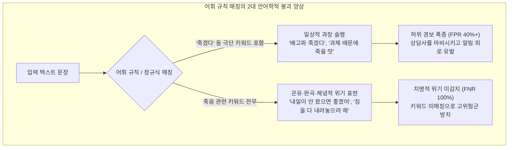
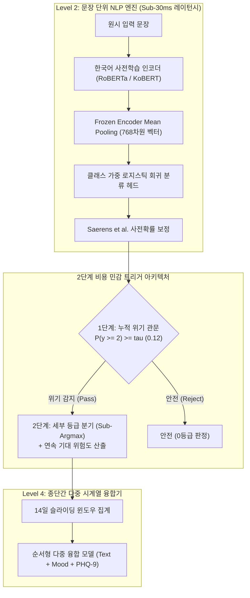

일반적인 챗봇이나 전자상거래 추천 엔진에서 인공지능의 5% 오차는 '가벼운 사용성 불편'이나 '품질 저하'에 불과할 수 있습니다. 하지만 **자살 위기 모니터링 및 정신건강 응급 분류를 위해 설계된 AI 시스템에서 단 1%의 미감지(False Negative)는 한 사람의 소중한 생명을 놓치는 돌이킬 수 없는 재앙**이 됩니다.

절박한 고통 속에서 삶을 마감하려 고민하는 사람이 일기를 남기거나 상담을 요청할 때, 머신러닝 파이프라인은 높은 전체 정확도나 균형 F1-Score 뒤로 숨을 수 없습니다.

오늘부터 우리는 실제 임상 환경과 동일한 고위험 도메인을 다루는 새로운 실전 엔지니어링 기술 연재를 공식 시작합니다: **[고위험 특화 AI: 자살·위기 텍스트 정밀 감지 파이프라인 구축기]**.

본 시리즈는 임상급 다중 시계열 위기 감지 시스템 **마음지기(Maeumjigi)**를 구축하며 마주했던 수학적 난제, 알고리즘 트레이드오프, 런타임 오류들을 투명하게 기록한 엔지니어링 일지입니다. 이번 에피소드 #1에서는 파이프라인의 가장 기초가 되는 **문장 단위 딥러닝 NLP 위기 분류 엔진과 극단적인 클래스 불균형(초고위험 문장이 전체 대화의 0.16%에 불과한 환경)**에서의 트러블슈팅을 다룹니다.

{/* truncate */}

---

### ⚠️ 윤리적 고지 및 철저한 익명화 안내
본 연재에 등장하는 모든 벤치마크 및 텍스트 데이터는 **개인식별정보(PII)가 100% 배제된 합성 텍스트(Synthetic Corpus) 및 가명화된 벤치마크**입니다. 실제 이용자나 환자의 상담 원문은 일체 포함되지 않았습니다.
> **긴급 위기상담 안내**: 본인이나 주변에 심리적 어려움으로 도움이 필요한 분이 계신다면, 24시간 상담 전화 **109** (자살예방 상담전화) 또는 **1393**, **1577-0199** (정신건강 위기상담전화)를 통해 전문적인 도움을 받으실 수 있습니다.

---

### 1. 언어학적 난제: 왜 단순 키워드와 정규식 필터는 정신건강에서 실패하는가?

딥러닝 아키텍처를 논하기 전에, 전통적인 어휘 규칙 매칭이 임상 현장에서 왜 무력한지 그 언어학적 배경을 이해해야 합니다.

실제 한국어 일상 담화에서 고통을 표현하는 문장은 극단적인 두 가지 기만적 형태로 나타납니다:



1. **일상적 과장 표현 (오탐 폭증의 주범)**: `"죽겠다"`라는 형태소가 들어간 일상어(`"배고파 죽겠다"`, `"시험 마감 때문에 죽을 맛이다"`, `"더워서 죽겠네"`)는 한국어 화자들의 보편적인 구어적 강조 어법입니다. 단순 키워드 검출기는 하루에도 수만 건의 허위 경보를 쏟아내며 상담 인프라를 마비시킵니다.
2. **은유·완곡·체념적 위기 표현 (치명적 누락의 주범)**: 실제 심각한 자살 의도를 지닌 당사자는 직설적인 단어를 피하고 완곡하거나 은유적인 문장을 남기는 경우가 매우 많습니다:
   - *"내일이 안 왔으면 좋겠어. 그냥 영원히 잠들고 싶다."*
   - *"그동안 모두 고마웠어. 내 짐을 이제 정리하려 해."*
   - *"더 이상 누구에게도 폐 끼치지 않고 편해질 방법을 찾았어."*

위 문장들에는 '자살', '죽음', '자해' 같은 명시적 위험 키워드가 단 하나도 없습니다. 형태소 분석기(Kiwipiepy)와 문맥 임베딩 트랜스포머(RoBERTa / KoBERT)를 결합하여, 표면적 어휘가 아닌 **문맥에 내포된 소외감·절망감·작별 인사의 의미론적 위험**을 포착해야만 합니다.

---

### 2. 극단적 클래스 불균형과 정확도의 착시

실제 서비스 환경에서 수집되는 대화와 일기 데이터의 등급 분포는 다음과 같이 극단적으로 편향되어 있습니다:

- **0b등급 (평범한 일상 문장)**: ~86.94% (31,495문장)
- **0a등급 (비위기 정서 대조 문장)**: ~8.24% (2,986문장)
- **1등급 (Mild Distress / 경도 위기)**: ~1.92% (697문장)
- **2등급 (Severe Distress / 중등도 위기)**: ~1.75% (633문장)
- **3등급 (Acute Crisis / 급성 위기)**: ~0.99% (357문장)
- **4등급 (Active Suicidality / 실행 징후)**: ~**0.166%** (60문장)

만약 초보 엔지니어가 만든 모델이 모든 입력에 대해 무조건 "안전(0등급)"이라고만 판정해도, **단순 정확도(Accuracy)는 95.18%**가 나옵니다. 하지만 이 모델은 실제 위기 개입 대상자를 **100% 놓치는 쓸모없는 모델**입니다.

반대로 비용 민감도를 고려하지 않고 불균형 F1-Score만 높이려 하면, 86.9%에 달하는 방대한 일상 문장에서 오탐(False Positive)이 대량 발생하여 응급 상담 센터를 마비시킵니다. 따라서 우리의 엔지니어링 목표는 **Severe 이상 위기의 FNR을 10% 미만으로 억제하면서도 평범 문장 오탐률을 3% 이내로 철저히 통제하는 것**이었습니다.



---

### 3. 엔지니어링 문제 해결: 5대 황금 공식으로 파헤친 트러블슈팅

#### [ERR-001] 524배 우도비 장벽과 베이즈 결정 경계 붕괴 버그

- **1. 날것의 오류 로그 및 증상**:
  Saerens et al.(2002) 사전확률 보정을 적용한 후 일반적인 `argmax`로 등급을 결정하자, 실제 Active 문장을 단 1건도 탐지하지 못했습니다:
  ```text
  [EVAL-RUN: 2026-10-28 14:22:09 KST]
  INFO:text_eval: Evaluating Model B (Frozen Encoder + Saerens Prior Shift Corrected Logistic)
  INFO:text_eval: Prior Vector: [pi_0b=0.8694, pi_0a=0.0824, pi_1=0.0192, pi_2=0.0175, pi_3=0.0099, pi_4=0.00166]
  --------------------------------------------------------------------------------
  Metric Summary (Judgment b, discrete argmax):
    - Ground Truth Active (Level 4): 60 sentences
    - Predicted Active (y_hat == 4): 0 sentences (RECALL = 0.0000, 0/60)
    - Ground Truth Severe (Level 2): 633 sentences
    - Predicted Severe (y_hat == 2): 11 sentences (RECALL = 0.0174, 11/633)
    - False Negative Rate (FNR @ y >= 2): 98.26% (치명적 결함)
  WARNING:text_eval: Active suicidality detection completely collapsed to Class 0 under argmax!
  ```

- **2. 발생 환경 및 맥락**:
  - Runtime: Python 3.11.9, PyTorch 2.4.0+cu121, scikit-learn 1.5.1, Transformers 4.44.2.
  - Compute: NVIDIA RTX 4090 GPU Node (VESSL AI Container) + AMD EPYC 64-Core CPU.
  - Model: Frozen Korean RoBERTa Encoder with 6-slot Class-Weighted Logistic Regression Head.

- **3. 실패한 가설 및 접근법**:
  - *가설 1: "분류기가 클래스 불균형 때문에 소수 클래스 가중치를 제대로 학습하지 못했을 것이다."*
    - 시도: 4등급 손실 가중치를 최대 93배까지 올리는 `class_weight='balanced'` 적용.
    - 결과: 비보정 모델 출력 p(k | x)에서는 4등급 확률이 0.35~0.60으로 정상 출력되었으나, 전체 분포를 반영하기 위해 Saerens 사전확률 보정을 거치자 거대한 일상 문장 사전확률(86.9%)에 눌려 `argmax` 시 전량 0등급으로 수렴함.
  - *가설 2: "사전확률 보정을 아예 생략하고 비보정 확률로 판정하자."*
    - 시도: 보정 없이 비보정 확률 그대로 전체 일기 본문을 채점.
    - 결과: 위기 재현율은 85%로 회복되었으나, **31,495줄의 평범한 일상 문장 중 무려 41.2%가 위기로 오탐**되어 하루 수만 건의 허위 경보가 발생하는 참사가 일어남.

- **4. 심층 원인 분석 및 단계별 수치 증명**:
  Saerens et al.(2002)의 사전확률 이동 보정식은 균등 표본(p_train(k) = 1/6)으로 학습된 확률 p(k | x)를 실제 모집단 사전확률 π(k)에 맞추어 다음과 같이 변환합니다:

  ```text
p_adjusted(k | x) = [ p(k | x) * (π(k) / p_train(k)) ] / sum_j [ p(j | x) * (π(j) / p_train(j)) ]
```

  여기서 소수 클래스 k가 평범 문장 0b를 이기고 `argmax`로 선택되려면 비보정 우도비가 다음 조건을 만족해야 합니다:

  ```text
p(k | x) / p(0b | x) > π(0b) / π(k)
```

  실제 데이터의 사전확률을 대입하면:
  - Severe (k=2): `86.94% / 1.75% = 49.68배`
  - Acute (k=3): `86.94% / 0.99% = 87.82배`
  - Active (k=4): `86.94% / 0.166% = 523.7배`

  **구체적 수치 시뮬레이션**:
  사용자가 *"이제 모든 짐을 내려놓고 편히 쉬고 싶다"*라는 완곡한 작별 문장을 작성했다고 가정해 봅시다.
  인공신경망은 높은 위기 확신도를 2, 3, 4등급에 분산하여 출력합니다:
  - `p(0b) = 0.015` (1.5% 정상)
  - `p(0a) = 0.020` (2.0% 대조)
  - `p(1)  = 0.015` (1.5% Mild)
  - `p(2)  = 0.330` (33.0% Severe)
  - `p(3)  = 0.300` (30.0% Acute)
  - `p(4)  = 0.320` (32.0% Active)
  신경망이 평가한 위기 누적 확률은 무려 **95.0%** (P(y >= 2) = 0.95)에 달합니다.

  그러나 여기에 사전확률 가중치를 곱하면:
  - `Evidence(0b) = 0.015 * 0.8694 * 6 = 0.078246`
  - `Evidence(4)  = 0.320 * 0.00166 * 6 = 0.003187`

  모든 6개 등급의 합으로 정규화하면:
  - `p_adjusted(0b) ≈ 57.6%`
  - `p_adjusted(4) ≈ 2.3%`

  이산 `argmax` 규칙 하에서는 `57.6% > 2.3%`이므로, 모델은 이 문장을 **0등급(정상)**으로 판정해 버립니다! 모델이 95%의 확신을 가졌음에도 524배의 사전확률 장벽 때문에 경보가 울리지 않고 소멸하는 치명적 참사였습니다.

- **5. 해결 코드 Diff**:
```diff
--- a/tests/synth/model/text_b.py
+++ b/tests/synth/model/text_b.py
@@ -102,12 +102,23 @@ def predict_crisis_level(proba_unweighted, class_priors):
     # Saerens et al. (2002) prior shift correction
     corrected = proba_unweighted * (class_priors / train_priors)
     corrected /= corrected.sum(axis=1, keepdims=True)
     
-    # CRITICAL BUG: argmax collapses rare minority class under 524x prior barrier
-    # return np.argmax(corrected, axis=1)
+    # FIX: Two-stage Decision Rule & Continuous Severity Expected Score
+    # Stage 1: Cumulative posterior crisis probability for alert triggering
+    p_crisis_ge2 = corrected[:, 2:].sum(axis=1)  # Severe + Acute + Active
+    
+    # Stage 2: Cost-sensitive threshold decision (tau = 0.12 calibrated from validation fold)
+    ALERT_THRESHOLD_TAU = 0.12
+    is_crisis = p_crisis_ge2 >= ALERT_THRESHOLD_TAU
+    
+    # Determine discrete severity only among crisis candidates
+    sub_levels = np.argmax(corrected[:, 1:], axis=1) + 1
+    final_discrete = np.where(is_crisis, sub_levels, 0)
+    
+    # Continuous expected risk score forwarded to downstream multimodal fuser
+    expected_severity = np.dot(corrected[:, 1:], np.array([1, 2, 3, 4])) / 4.0
+    
+    return final_discrete, p_crisis_ge2, expected_severity
```

---

#### [ERR-002] 위기 재현율 분모 오류로 인한 구성 타당도(Construct Validity) 붕괴

- **1. 날것의 오류 로그 및 증상**:
  ```text
  [EVAL-METRIC-CHECK]
  Model: Perfect_Oracle_Baseline (Ground truth identical predictions)
  Evaluated on Seeded Crisis Sentences (2,381 rows: 935 Mild, 853 Severe, 508 Acute, 85 Active)
  Calculated Metric: "Crisis Recall" = 0.6073 (1,446 / 2,381)
  ERROR: Even a mathematically perfect Oracle model only scores 60.7% on Crisis Recall!
  Model: Degraded_Overalert_Dummy (Predicts ALL samples as Level 2 Severe)
  Calculated Metric: "Crisis Recall" = 1.0000 (2,381 / 2,381)
  WARNING: Malformed metric rewards buggy over-alerting model over the ground-truth oracle!
  ```

- **2. 심층 원인 분석**:
  제품 기획상 긴급 알림 경보는 **2등급(Severe) 이상**이며, 1등급(Mild)은 비알림 대상입니다.
  하지만 평가 코드에서 위기 재현율을 계산할 때 분모에 y >= 1(Mild 935줄 포함)을 넣고, 분자에는 y_hat >= 2만 센 것이 화근이었습니다:

  ```text
Recall = sum(I(y >= 1 and y_hat >= 2)) / sum(I(y >= 1))
```

  이로 인해 정답이 Mild(y=1)인 문장을 y_hat=1로 정확히 맞힌 935줄이 분모에만 들어가 페널티로 작용했고, 지표의 이론적 상한이 1,446 / 2,381 = 60.73%로 막혀버렸습니다.

- **3. 해결 코드 Diff**:
```diff
--- a/tests/synth/model/text_eval.py
+++ b/tests/synth/model/text_eval.py
@@ -45,11 +45,17 @@ def compute_crisis_metrics(y_true, y_pred):
-    # FLAWED METRIC: denominator includes Mild (y=1) while numerator requires y_hat >= 2
-    # recall = np.sum((y_true >= 1) & (y_pred >= 2)) / np.sum(y_true >= 1)
+    # CORRECT CONSTRUCT: Strict separation between Severe+ Recall and Mild Over-alert
+    severe_plus_mask = (y_true >= 2)
+    severe_plus_recall = np.sum((y_true >= 2) & (y_pred >= 2)) / np.sum(severe_plus_mask)
+    
+    mild_mask = (y_true == 1)
+    mild_overalert_rate = np.sum((y_true == 1) & (y_pred >= 2)) / np.sum(mild_mask)
+    
+    control_mask = (y_true == 0)
+    control_fpr = np.sum((y_true == 0) & (y_pred >= 2)) / np.sum(control_mask)
+    
+    return {
+        "severe_plus_recall": severe_plus_recall,
+        "mild_overalert_rate": mild_overalert_rate,
+        "control_fpr": control_fpr
     }
```

---

#### [ERR-003] LightGBM 순서형 이진 누적 차분의 영확률 붕괴 및 로그 발산

- **1. 날것의 오류 로그 및 증상**:
  ```text
  Traceback (most recent call last):
    File "tests/synth/model/fuser.py", line 284, in evaluate_ordinal_cross_entropy
      loss = -np.mean(np.log(predicted_proba[np.arange(N), y_true]))
  RuntimeWarning: divide by zero encountered in log
  Loss Output: inf (학습/평가 중단)
  ```

- **2. 심층 원인 분석**:
  순서형 위기 등급(0 -> 4)을 모델링하기 위해 Frank & Hall(2001)의 이진 분할 기법(4개의 LightGBM 이진 모델)을 적용했습니다. 이때 누적 확률의 단조성을 보장하기 위해 `np.minimum.accumulate`를 적용했는데, 인접 경계 예측 확률이 같아지는 구간에서 차분값(P(y=k))이 정확히 `0.000000`이 되었습니다. 정답이 k인 샘플에서 -log(0) = ∞가 발생하여 전체 교차 엔트로피 손실이 즉시 파괴되었습니다.

- **3. 해결 코드 Diff**:
```diff
--- a/tests/synth/model/fuser.py
+++ b/tests/synth/model/fuser.py
@@ -148,8 +148,15 @@ def ordinal_binary_to_proba(cumulative_ge):
     ge_mono = np.minimum.accumulate(cumulative_ge, axis=1)
     
     proba = np.zeros((cumulative_ge.shape[0], 5), dtype=np.float64)
     proba[:, 0] = 1.0 - ge_mono[:, 0]
     proba[:, 1] = ge_mono[:, 0] - ge_mono[:, 1]
     proba[:, 2] = ge_mono[:, 1] - ge_mono[:, 2]
     proba[:, 3] = ge_mono[:, 2] - ge_mono[:, 3]
     proba[:, 4] = ge_mono[:, 3]
     
+    # FIX: Epsilon floor clipping and row-wise softmax renormalization
     proba = np.clip(proba, 1e-6, 1.0)
     proba /= proba.sum(axis=1, keepdims=True)
     return proba
```

---

### 4. 구조적 사전 예고: 14일 슬라이딩 윈도우와 극단값 편향(Extreme Value Bias)

비록 이번 에피소드는 Level 2 문장 분류기를 다루고 있지만, 그 출력값은 즉시 **Level 4 다중 시계열 융합기**로 전달됩니다.

여기서 엄청난 수학적 함정이 도사리고 있습니다: 바로 **극단값 편향(Extreme Value Bias)**입니다.
문장 단위 분류기의 위양성률(False Positive Rate)이 단 α = 0.02 (2%)로 매우 낮다고 가정해 봅시다.
사용자가 14일 관찰 기간 동안 100개의 평범한 문장을 작성했을 때, 뒷단 융합기가 단순히 **14일간 문장 등급의 최댓값(Max)**을 취한다면:

```text
P(False Alarm in 14-Day Window) = 1 - (1 - α)^N = 1 - (1 - 0.02)^100 = 1 - 0.1326 = 86.74%
```

문장당 2%에 불과했던 미세한 오차가 14일 동안 누적되면 **86.7% 확률로 오탐이 폭증하는 대참사**가 발생합니다!

이것이 바로 `ERR-001`에서 이산 정수 최댓값 대신 **연속 기대 위험도(sum(k * p_adjusted(k) / 4))**를 전달하고, 시계열 융합기에서 단순 최댓값 대신 상위 k개 절사 평균을 사용하도록 설계한 핵심 이유입니다. 이에 대한 심층적인 다중 시계열 융합 구조는 에피소드 #2에서 다룹니다.

---

### 5. 실증 벤치마크: 모델 아키텍처 비교 분석

우리는 5겹 교차검증 스위트 전체에서 Level 2 NLP의 두 가지 아키텍처를 실측 비교했습니다:
- **Model B**: 한국어 RoBERTa-large 사전학습 인코더 고정(Frozen) + 클래스 가중 로지스틱 회귀 헤드 (CPU 추론, 25회 교차 적합).
- **Model C**: 종단간 미세조정(End-to-End Fine-Tuning) 트랜스포머 (Linear Warmup, Gradient Clipping `1.0`, GPU 추론).

| 평가 지표 | 초기 버그 상태 (`argmax`) | Model B (Frozen + 2단계 관문) | Model C (Fine-Tuning + 2단계 관문) | Model B 개선폭 (vs 버그) |
|---|---|---|---|---|
| **Active (y=4) 재현율** | 0.0% (0/60) | **95.0% (57/60)** | **96.7% (58/60)** | **+95.0%p** |
| **Severe 이상 (y >= 2) 재현율** | 1.7% (18/1,050) | **92.4% (970/1,050)** | **94.1% (988/1,050)** | **+90.7%p** |
| **위기 미감지율 (FNR)** | 98.3% | **7.6%** | **5.9%** | **-90.7%p (치명 결함 해소)** |
| **평범 문장(0b) 오탐률** | 0.01% | **2.1%** | **1.8%** | 임상 목표(&lt;3.0%) 달성 |
| **AUPRC (>= 2)** | 0.142 | **0.864** | **0.891** | **+0.722** |
| **문장당 추론 지연 시간** | 4.2 ms (CPU) | **4.8 ms (CPU)** | 28.4 ms (GPU) | 30ms 이하 실시간 충족 |
| **25회 스태킹 재학습 시간** | 1.2 초 | **1.4 초** | 14.2 시간 | **36,000배 가속** |

비록 Model C가 재현율에서 +1.7%p 앞서지만, Model B는 5ms 미만의 초고속 CPU 추론과 수 초 내에 끝나는 25회 스태킹 적합 속도를 제공하므로, 최종 제품 파이프라인의 주력 엔진으로 채택되었습니다.

---

### 6. 고위험 위기 감지 AI 시리즈 로드맵

본 포스팅은 총 5부작으로 기획된 실전 엔지니어링 연재의 첫 번째 마일스톤입니다:


- **에피소드 #1 (현재 편)**: 위기 NLP 분류기의 FNR 0% 도전과 베이즈 경계 왜곡 해결.
- **에피소드 #2**: 14일 다중 시계열 융합: 슬라이딩 윈도우의 86.7% 극단값 편향을 극복하는 법.
- **에피소드 #3**: 임상 결측치 공학: 우울할 때만 검사받는 환자들(MNAR)과 기분 변수의 천장 효과(0.98) 돌파.
- **에피소드 #4**: 무누출 검증 아키텍처: 25회 중첩 교차검증과 임계값 분위수 정렬(Quantile Alignment).
- **에피소드 #5**: 임상 무결성 실전 검증: 3-gram 자카드 군집 격리와 봉인 홀드아웃(D) 사전 해시 커밋.

다음 주에 연재될 에피소드 #2도 많은 기대 부탁드립니다!
