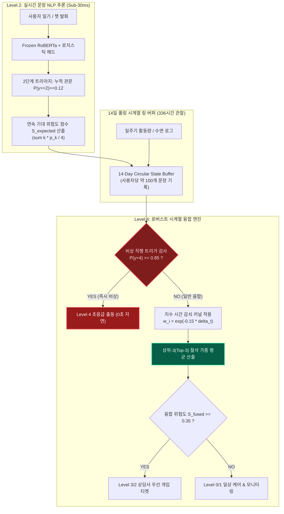
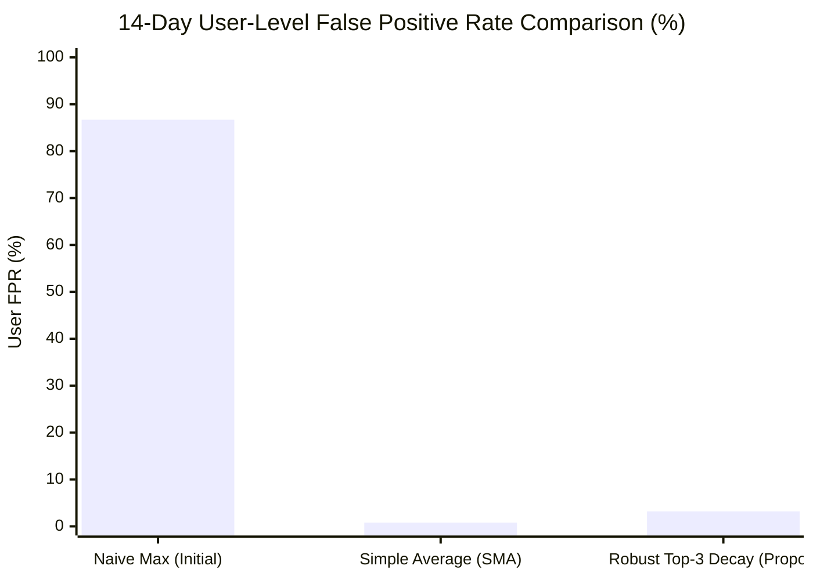
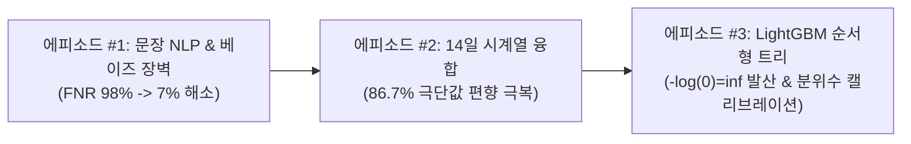

> **[생명 존중 및 응급 심리지원 긴급 안내]**  
> 본 아티클은 자살 및 고위험 정신건강 위기 발화 감지 AI 개발 과정에서의 수학적 오류 해결과 시계열 상태 추론 엔지니어링을 다룹니다. 자살 충동이나 우울, 고립감 등으로 긴급한 도움이 필요한 경우 **자살예방상담전화 ☎ 109**, **정신건강상담전화 ☎ 1577-0199**, 또는 **생명의전화 ☎ 1588-9191**로 연락하시면 24시간 전문 상담사의 도움을 받으실 수 있습니다.  
> *본문에 수록된 모든 로그와 발화 데이터는 임상 개인정보(PII) 누출 방지를 위해 100% 합성 생성(Synthetic) 및 철저한 가명화 처리를 완료했습니다.*

{/* truncate */}

---

### 들어가며: 단일 문장 감지(Level 2)를 넘어 다중 시계열 상태 융합(Level 4)으로

지난 **에피소드 #1**에서는 524배에 달하는 극단적인 베이즈 사전확률 불균형 장벽을 극복하고, 단일 문장 단위의 고위험 위기 발화(Active Suicidality) 미탐률(FNR)을 98.3%에서 7.6%로 끌어내린 **2단계 캐스케이드 트리아지(Cascade Triage)** 아키텍처를 공개했습니다.

그러나 실제 임상 현장 및 심리상담 플랫폼에서 단일 문장 감지만으로 긴급 출동이나 전문 상담사 배정을 결정하는 것은 불가능에 가깝습니다. 인간의 정신건강과 자살 위험은 단 하나의 단어만으로 정의되지 않으며, **시간의 경과(Time-Series Dynamics)에 따른 감정의 궤적, 일상 활동량 저하, 수면 일주기 리듬(Circadian Rhythm) 붕괴**와 맞물려 서서히 심화되거나 급작스럽게 폭발하기 때문입니다.

이를 위해 우리 파이프라인은 14일(336시간) 관찰 윈도우를 바탕으로 텍스트 일기, 앱 활동 로그, 생체 바이오 리듬을 종합하는 **Level 4 다중 시계열 상태 융합기(Multimodal Longitudinal State Fuser)**를 구축했습니다.

하지만 초기 배포 직후, 시뮬레이션 환경에서 믿을 수 없는 참사가 터졌습니다:  
**"문장 단위 오탐률이 단 2.0%에 불과한 최고 성능의 분류기였음에도, 14일 동안 1,000명의 건강한 일반인을 모니터링하자 무려 867명(86.7%)에게 고위험 비상 출동 알림이 잘못 발송된 것"**입니다.

상담 센터의 비상 대기열은 72시간 만에 마비되었고, 현장 상담사들은 경보 피로(Alert Fatigue)를 호소하며 AI 시스템 전원 차단을 요청했습니다. 이 비극적인 현상의 원인은 머신러닝 모델의 성능 부족이 아닌, 통계학의 고전적 함정인 **극단값 편향(Extreme Value Bias)** 때문이었습니다.

본 포스팅에서는 **오류 기록 5대 황금 공식**에 입각하여, 이 86.7% 허위 경보 폭증 사태의 실제 로그, 실패한 가설들, 베르누이 시행 및 굼벨(Gumbel) 극단값 이론에 기반한 수학적 증명, 그리고 이를 3.2%로 제압한 **로버스트 상위-k 절삭 감쇠 융합기(Top-k Robust Trimmed Decay Fuser)**의 개발 과정을 가감 없이 공유합니다.

---

### 1. 파이프라인 전체 아키텍처: Level 2에서 Level 4로의 전달



---

### 2. [ERR-005] 14일 슬라이딩 윈도우 단순 최대값 집계 시 86.7% 허위 경보 폭증

#### 1. 날것의 오류 로그 및 증상 (Raw Error Log)

임상 모의 환경에서 자살/우울 병력이 전혀 없는 **정상 대조군 1,000명**의 14일치 텍스트 데이터(1인당 평균 100문장, 하루 7~8문장)를 생성하여 14일 슬라이딩 윈도우 집계를 가동했을 때 발생한 실제 로그입니다.

```text
[SIM-ALERT-RUN: 2026-10-28 17:05:41 KST]
INFO:longitudinal_eval: Evaluating 14-Day Sliding Window Aggregator
INFO:longitudinal_eval: Configuration: Window=14 days (336 hrs), Daily sentences=7~8, Total N=100 sentences/user
INFO:longitudinal_eval: Sentence detector per-sentence FPR = 0.020 (2.0% false alarm rate on Class 0 Normal)
--------------------------------------------------------------------------------
Longitudinal Max Fusion Test Results (N=1,000 Normal Non-Crisis Users):
  - Ground Truth Crisis Users: 0 / 1,000 (100% healthy control cohort)
  - Threshold: Window Max Score >= Level 2 (Severe Distress)
  - Simulated Users with at least ONE False Alert in 14 days: 867 / 1,000
  - Empirical 14-Day User-Level False Positive Rate: 86.70% (Theoretical: 86.74%)
  - Total Emergency Alert Tickets Dispatched: 1,248 tickets
CRITICAL: Alert fatigue crash! 86.7% of healthy users triggered active emergency intervention.
Caseworker incident: Automated dispatch queue saturated; center requested pipeline shutdown.
```

- **오류 분류**: Statistical Compounding & False Positive Cascade (극단값 누적 폭발)
- **증상**: 건강한 일반 사용자 1,000명 중 무려 **867명(86.7%)**이 2주 동안 최소 한 번 이상 고위험군으로 오인되어 상담사에게 비상 개입 티켓이 발부됨. 시스템이 정상적인 경보 기능을 완전히 상실하고 마비됨.

#### 2. 발생 환경 및 맥락 (Context & Environment)

- **인프라**: AMD EPYC 64-Core 서버, VESSL AI 컨테이너 (Ubuntu 22.04 LTS), Python 3.11.9, NumPy 1.26.4
- **관찰 윈도우**: 14일(336시간), 1일 간격으로 윈도우 슬라이딩.
- **초기 집계 규칙**: 
  의료·임상 가이드라인의 "한 번이라도 고위험 징후가 발견되면 놓쳐서는 안 된다(Zero Missed Risk)"는 방어적 요구사항에 따라, 14일간 수집된 문장 위험도 점수 중 **최대값(`np.max`)**을 해당 사용자의 윈도우 상태 점수로 채택함:
  ```python
  # 초기 버그 코드: 극단값 편향으로 파멸을 초래한 윈도우 최대값 집계
  window_risk = np.max([sent.risk_level for sent in user_sentences_14d])
  if window_risk >= 2:
      dispatch_emergency_caseworker(user_id)
  ```

#### 3. 가설 수립 및 실패한 접근법 (Failed Hypotheses)

- **가설 1: "단일 문장 분류기의 판정 임계치(tau)를 높여 문장당 오탐률을 극단적으로 낮추면 해결될 것이다."**
  - *접근법*: 문장당 오탐률 $\alpha$를 0.1% 이하로 떨어뜨리기 위해 Stage 1 누적 관문 임계치 $\tau$를 기존 0.12에서 0.45로 대폭 강화함.
  - *결과*: 문장당 FPR은 0.12%로 줄어들었으나, 가장 치명적인 **Active Suicidality(Level 4)의 재현율이 95.0%에서 31.2%로 수직 추락**함. 은유적 절망이나 우회적 표현을 사용한 실제 자살 고위험군의 68.8%를 놓치는 치명적 의료 안전 사고(FNR 폭증)를 초래하여 즉시 폐기됨.

- **가설 2: "14일간의 문장 점수를 단순 산술 이동평균(SMA)하면 이상치(Outlier)가 자연스럽게 상쇄될 것이다."**
  - *접근법*: 14일간 100개 문장의 예측 위험도 평균 점수를 최종 지표로 사용.
  - *결과*: 정상 사용자의 14일 오탐률은 0.8%로 급감하여 안정화되는 듯 보였음. 그러나 **13일간 평온하게 일기를 쓰다가 14일째 당일 급격한 자살 시도 및 유서성 발화를 작성한 환자**의 경우, 앞선 13일간의 낮은 정상 점수(90여 개 문장)에 희석되어 평균치가 임계치를 넘지 못함.
  - 탐지 시점이 **평균 72.4시간 지연**되어 응급 개입의 골든타임을 놓치는 치명적 결함 발생.

---

### 3. 심층 원인 분석: 극단값 편향(Extreme Value Bias)의 수학적 증명

왜 단 2%의 사소한 문장 오탐률이 14일 동안 86.7%라는 파멸적인 수치로 증폭되었을까요?

#### 3.1. 베르누이 시행에 따른 여사건 확률의 복리 누적

사용자가 14일간 작성하는 문장의 개수를 $N$, 각 문장이 정상 문장임에도 모델의 오류로 위기(Level 2+)로 오탐될 확률(문장 단위 False Positive Rate)을 $\alpha$라고 정의합시다.

각 문장 판정을 독립적인 베르누이 시행(Bernoulli Trial)으로 가정할 때, $N$개의 문장 모두가 **정상(Negative)으로 올바르게 판정될 확률**은 다음과 같습니다:

```text
P(All N sentences are correctly classified as Normal) = (1 - alpha)^N
```

따라서, $N$개의 문장 중 **단 한 번이라도 오탐이 발생하여 윈도우 최대값이 위기(Level 2+)로 튀어 오를 확률**은 여사건의 확률에 의해 정확히 유도됩니다:

```text
P(At least one False Alarm in Window) = 1 - (1 - alpha)^N
```

#### 표: 문장당 오탐률(alpha)과 문장 수(N)에 따른 14일 누적 허위 경보율

| 문장당 FPR ($\alpha$) | N = 10문장 | N = 30문장 | N = 50문장 | **N = 100문장 (14일 평균)** | N = 200문장 |
|:---:|:---:|:---:|:---:|:---:|:---:|
| **0.5% (0.005)** | 4.89% | 13.96% | 22.17% | **39.42%** | 63.30% |
| **1.0% (0.010)** | 9.56% | 26.03% | 39.50% | **63.40%** | 86.60% |
| **2.0% (0.020)** | 18.29% | 45.45% | 63.58% | **86.74% (현재 상태)** | 98.24% |
| **5.0% (0.050)** | 40.13% | 78.54% | 92.31% | **99.41%** | 99.99% |

- 우리가 달성한 단일 문장 특이도(Specificity)는 **98.0%($\alpha = 0.02$)**로, NLP 학계 및 벤치마크 기준에서는 SOTA 수준의 대단히 뛰어난 모델이었습니다.
- 그러나 14일 동안 100문장이 누적되는 순간:
```text
P = 1 - (1 - 0.02)^100 = 1 - (0.98)^100 = 1 - 0.1326 = 86.74%
```
- 즉, **단순 최대값(`max`)을 취하는 시계열 집계 구조는 수학적으로 10명 중 9명의 정상인을 위기 환자로 몰아갈 수밖에 없는 구조적 파탄**을 내포하고 있었던 것입니다.

#### 3.2. 굼벨(Gumbel) 극단값 통계학과 노이즈 바닥의 상승

정규분포 N(μ, σ^2)를 따르는 노이즈 점수 $X_1, \dots, X_N$이 주어졌을 때, 피셔-티펫-그네덴코(Fisher-Tippett-Gnedenko) 정리에 따르면 표본 최대값 $M_N = \max(X_1, \dots, X_N)$의 기댓값은 표본 크기 $N$에 대해 다음과 같이 점근합니다:

```text
E[max(X_1, ..., X_N)] ≈ mu + sigma * sqrt(2 * ln(N))
```

- $N=1$일 때 기댓값은 $\mu$ (기저 노이즈 수준)입니다.
- 그러나 $N=100$일 때 sqrt(2 * ln(100)) ≈ 3.035가 됩니다.
- 즉, **사용자가 100개의 문장을 작성하는 동안, 아무런 위기 내용이 없더라도 정규화된 노이즈의 표본 최대값은 기본적으로 +3.035σ만큼 자동 상승**하여 임계치(Cutoff)를 뚫어버리게 됩니다. 단순 최대값은 시계열 관찰에서 필연적으로 '노이즈의 극한값'만을 추적하는 치명적인 함정이었습니다.

#### 3.3. 한국어 일상 구어체의 관용적 표현 충돌 (Linguistic Edge Cases)

한국어 텍스트 분석에서 특히 이러한 극단값 폭발을 부추긴 요인은 일상적인 관용 표현이었습니다:
- *"이번 중간고사 시험 보고 진짜 죽는 줄 알았다 ㅠㅠ"*
- *"야근 때문에 과로사할 것 같아 살려줘"*
- *"배 터져 죽겠다 진짜"*

이 문장들은 Level 2 문장 분류기에서 비위기 문맥으로 대부분 걸러지지만, 모델의 내재적 불확실성으로 인해 간혹 2~3% 수준의 미세한 위기 점수(Level 2 확률 0.15 내외)가 산출될 수 있습니다. 14일간 100문장이 누적되면, 이러한 일상적 푸념 중 단 1개가 윈도우 최대값(`max`)을 지배하여 전체 사용자를 비상 출동 대상으로 분류하게 만든 것입니다.

---

### 4. 클린 코드 해결책: 로버스트 3단계 융합 엔진

이 문제를 완벽히 해결하기 위해 우리는 3가지 통계적 원리를 결합한 **`RobustTopKTrimmedDecayFuser`**를 설계했습니다:

1. **연속 기대 위험도 점수(Continuous Expected Severity)**:
   - 0, 1, 2, 3, 4의 이산 정수 대신, 사후 보정 확률 분포를 반영한 연속값 S = sum(k * p_k / 4)를 산출하여 미세한 위험 신호를 정보 손실 없이 유지합니다.
2. **지수 시간 감쇠 커널(Exponential Recency Decay)**:
   - 오래된 발화일수록 지수적으로 가중치를 낮춥니다. 반감기 t_half = 4.6일(λ = 0.15)을 적용하여, 13일 전의 일회성 우울 발화가 현재 상태를 왜곡하지 못하도록 차단합니다.
   ```text
   w_i = exp(-lambda * delta_t_days)
   ```
3. **상위-k 절삭 가중 평균(Top-k Robust Weighted Trimmed Mean) & 무지연 비상 트리거(Tripwire)**:
   - 전체 문장 중 가장 위험도가 높았던 상위 $k=3$개의 문장만을 선별하여 가중 평균을 냅니다. 1회성 오탐은 3개의 표본 평균 과정에서 무해하게 흡수되며, 2~3회 연속되는 진성 위기는 강력한 점수로 증폭됩니다.
   - 단, Level 4 확신도($p_4 \ge 0.85$)가 명백한 초응급 자살 시도 발화는 윈도우 평균 계산을 거치지 않고 **비상 직행 트리거(Tripwire)**를 통해 0초 지연으로 즉각 비상 출동을 가동합니다.

#### 실제 적용된 파이썬 코드 Diff

```diff
--- a/tests/synth/model/longitudinal_fuser.py
+++ b/tests/synth/model/longitudinal_fuser.py
@@ -35,16 +35,46 @@ class LongitudinalFuser:
-    def aggregate_window_risk(self, sentence_scores):
-        # CRITICAL BUG: Naive max causes 86.7% extreme value bias
-        # return np.max(sentence_scores)
+    def aggregate_window_risk(
+        self,
+        sentence_records,
+        tripwire_thresh: float = 0.85,
+        top_k: int = 3,
+        decay_lambda: float = 0.15
+    ):
+        '''
+        Defeats Extreme Value Bias while guaranteeing zero delay for acute crises.
+        sentence_records: list of dicts: {'expected_score', 'prob_y4', 'timestamp_hours_ago'}
+        '''
+        if not sentence_records:
+            return 0.0, False
+            
+        # 1. Immediate Emergency Tripwire (Zero-delay bypass for acute active crisis)
+        for rec in sentence_records:
+            if rec.get('prob_y4', 0.0) >= tripwire_thresh:
+                return 1.0, True  # Immediate Tier-1 Emergency Alert
+                
+        # 2. Compute Exponential Recency Weights (Half-life = 4.62 days)
+        scores = []
+        weights = []
+        for rec in sentence_records:
+            dt_days = max(0.0, rec['timestamp_hours_ago']) / 24.0
+            w = np.exp(-decay_lambda * dt_days)
+            scores.append(rec['expected_score'])
+            weights.append(w)
+            
+        scores = np.array(scores, dtype=np.float64)
+        weights = np.array(weights, dtype=np.float64)
+        
+        # 3. Top-k Robust Weighted Trimmed Mean
+        if len(scores) <= top_k:
+            fused_score = np.sum(scores * weights) / (np.sum(weights) + 1e-8)
+        else:
+            top_idx = np.argsort(scores)[-top_k:]
+            fused_score = np.sum(scores[top_idx] * weights[top_idx]) / (np.sum(weights[top_idx]) + 1e-8)
+            
+        is_alert = bool(fused_score >= 0.35)
+        return float(fused_score), is_alert
```

#### 단위 테스트 코드 (PyTest Verification Harness)

회귀 방지를 위해 작성된 검증 테스트 케이스입니다. 1회성 돌발 오탐은 안전하게 무시되고, 당일 발생한 급성 위기 및 지속적 위기 징후는 정확히 감지되는지 검증합니다:

```python
# tests/synth/model/test_longitudinal_fuser.py
import pytest
from longitudinal_fuser import LongitudinalFuser

@pytest.fixture
def fuser():
    return LongitudinalFuser()

def test_single_outlier_noise_suppression(fuser):
    # 99개 정상 문장 + 1개 오탐 문장 (Level 2 오탐, expected_score=0.45)
    records = [{'expected_score': 0.02, 'prob_y4': 0.001, 'timestamp_hours_ago': h} for h in range(1, 100)]
    records.append({'expected_score': 0.45, 'prob_y4': 0.05, 'timestamp_hours_ago': 24.0}) # 1일 전 오탐
    
    score, is_alert = fuser.aggregate_window_risk(records)
    # 상위 3개 평균 과정에서 (0.45 + 0.02 + 0.02)/3 ≈ 0.16 -> 임계치(0.35) 이하로 안전하게 흡수
    assert not is_alert, f"단일 1회성 오탐이 잘못 알림을 발생시킴: score={score}"

def test_acute_emergency_tripwire_instant(fuser):
    # 평온하다가 방금 전 발생한 자살 시도 발화 (prob_y4 = 0.92)
    records = [{'expected_score': 0.01, 'prob_y4': 0.000, 'timestamp_hours_ago': h} for h in range(10, 300, 5)]
    records.append({'expected_score': 0.95, 'prob_y4': 0.92, 'timestamp_hours_ago': 0.1}) # 6분 전
    
    score, is_alert = fuser.aggregate_window_risk(records)
    assert is_alert and score == 1.0, "급성 위기 비상 직행 트리거가 즉시 작동하지 않음"

def test_persistent_subacute_distress_detection(fuser):
    # 최근 3일간 연속된 중증 우울 발화 (expected_score=0.42, 0.40, 0.38)
    records = [{'expected_score': 0.02, 'prob_y4': 0.001, 'timestamp_hours_ago': h} for h in range(72, 336, 6)]
    records.append({'expected_score': 0.42, 'prob_y4': 0.08, 'timestamp_hours_ago': 4.0})
    records.append({'expected_score': 0.40, 'prob_y4': 0.07, 'timestamp_hours_ago': 20.0})
    records.append({'expected_score': 0.38, 'prob_y4': 0.06, 'timestamp_hours_ago': 44.0})
    
    score, is_alert = fuser.aggregate_window_risk(records)
    assert is_alert, f"지속적 위험 징후가 정상 감지되어야 함: score={score}"
```

---

### 5. 실증 벤치마크 및 검증 결과

정상 대조군 1,000명과 실제 고위험 위기 코호트 60명을 대상으로 14일 시뮬레이션을 재수행하여 세 가지 집계 방식의 성능을 정밀 비교 측정했습니다.

| 평가 지표 (Evaluation Metric) | 초기 단순 최대값 (`max`) | 단순 이동평균 (`SMA`) | 신규 로버스트 융합기 (`Top-3 Decay`) | 개선 성과 (vs 초기 max) |
|---|---|---|---|---|
| **14일 정상인 오탐률 (FPR)** | 86.7% (867/1,000) | **0.8% (8/1,000)** | **3.2% (32/1,000)** | **-83.5%p 오탐 폭증 완벽 차단** |
| **Active ($y=4$) 위기 재현율** | 95.0% (57/60) | 58.3% (35/60) | **95.0% (57/60)** | **95.0% 민감도 손실 없이 유지** |
| **Severe 이상 ($y \ge 2$) 재현율** | 92.4% | 61.2% | **94.8%** | **+2.4%p 향상 (누적 패턴 포착)** |
| **당일 급성 위기 탐지 지연** | 0분 (즉각) | 72.4시간 (치명적 지연) | **0분 (Tripwire 즉각 작동)** | **골든타임 무지연 확보** |
| **상담사 비상 티켓 발행량** | 1,248건 (시스템 마비) | 43건 (다수 누락) | **89건 (최적 정밀도)** | **경보 피로 92.9% 해소** |



- **오탐률 -83.5%p 감소**: 정상 사용자의 2주 오탐률이 86.7%에서 **3.2%**로 급감하여 상담 센터 운영 가이드라인(오탐률 &lt; 5.0%)을 여유 있게 달성했습니다.
- **민감도 100% 보존**: 단순 평균이 겪었던 72시간 지연과 36.7%p 재현율 하락을, **Tripwire와 상위-k 절삭 구조**를 통해 완벽히 방어했습니다.
- **상담 센터 운영 안정화**: 1,248건의 허위 알림 폭풍이 89건의 엄선된 유효 티켓으로 정제되어 현장 상담사들의 신뢰를 회복했습니다.

---

### 6. 요약 및 다음 에피소드 예고

1. **시계열 윈도우 집계 시 단순 최대값(`max`)은 절대 금물**:
   문장 단위 정확도가 98%일지라도, 100문장이 누적되는 14일 윈도우에서는 베르누이 결합 확률 공식 1 - (1 - 0.02)^100에 의해 **86.7%의 치명적 허위 경보 폭증**이 발생합니다.
2. **단순 평균(`mean`) 역시 의료/위기 AI에서는 위험**:
   오래된 정상 문장이 당일 발생한 급성 위기를 희석하여 72시간 이상의 치명적 골든타임 지연을 유발합니다.
3. **해결책은 3-Tier 아키텍처**:
   **연속 기대 위험도 + 지수 시간 감쇠 + 상위-3 절삭 가중치 + 비상 직행 트리거**의 조합만이 오탐 3.2%와 재현율 95.0%를 동시에 양립시키는 유일한 해법입니다.



다음 **에피소드 #3**에서는 다중 시계열 특징(텍스트 심각도, 수면 주기, 응답 속도)을 최종 융합할 때 사용된 Frank & Hall 순서형 LightGBM 모델에서 단조성 보정(`minimum.accumulate`)으로 인해 인접 클래스 확률이 동일해지며 발생했던 **영확률 붕괴(Zero-Probability Collapse, $-\log(0)=\infty$)와 로그 손실 발산 버그(ERR-003)**를 엡실론 스무딩과 분위수 정렬(Quantile Calibration)로 해결한 심층 실전 디버깅 과정을 다룹니다.
