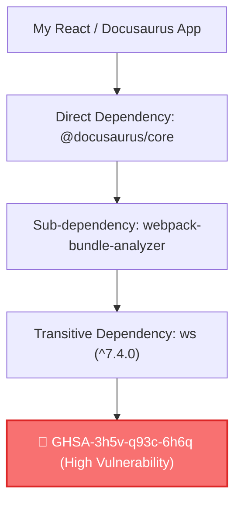

> 📌 **핵심 요약 (TL;DR)**  
> - **문제**: 직접 설치한 패키지(`package.json`에 명시)가 아니라, 그 패키지가 내부적으로 참조하는 깊은 자식 패키지(전이 의존성, Transitive Dependency)에 취약점 경고가 떴을 때 `npm audit fix --force`를 실행하면 프레임워크 최신 메이저 버전이 강제 다운그레이드되며 빌드가 깨집니다.  
> - **해결책**: npm v8.3+에 내장된 **`overrides` 블록**을 선언하여 상위 패키지의 릴리즈를 기다리지 않고 취약한 하위 패키지만 핀포인트로 최신 패치 버전으로 강제 치환합니다.  
> - **CI/CD 파이프라인**: 런타임에 배포되지 않는 개발 도구 노이즈는 `npm audit --omit=dev`로 분리하여 실제 운영 보안에만 집중합니다.

{/* truncate */}

---

### 1. 전이 의존성(Transitive Dependency) 트랩: 왜 npm audit fix는 실패하는가?

현대 웹 애플리케이션의 `node_modules`는 거대한 의존성 트리입니다. 일반적인 프론트엔드 프로젝트에서 개발자가 직접 설치한 의존성은 30~50개에 불과하지만, 실제 설치되는 하위 패키지는 1,000개를 훌쩍 넘습니다.



이 상황에서 터미널에 붉은색 경고가 떴다고 해서 `npm audit fix --force`를 실행하면 다음과 같은 대참사가 일어납니다:
1. npm은 `ws` 패키지를 수정하기 위해 상위 패키지인 `webpack-bundle-analyzer`와 `@docusaurus/core`의 의존성 제약 조건을 검토합니다.
2. 호환되는 최신 버전이 공식 릴리즈되지 않았을 경우, 충돌을 피하기 위해 **Docusaurus나 React 프레임워크 자체를 구버전으로 강제 롤백**시켜 버립니다.
3. 그 결과 React 19 기능이나 빌드 번들러 설정이 파괴되어 로컬 및 CI/CD 빌드가 멈춰버립니다.

---

### 2. 정밀 수술: `package.json`의 `overrides` 필드 활용법

npm v8.3.0부터는 상위 라이브러리 메인테이너가 PR을 머지하고 배포해 줄 때까지 하염없이 기다릴 필요가 없습니다. **`overrides`** 설정을 통해 프로젝트 전체 또는 특정 패키지 하위의 의존성 버전을 강제로 고정할 수 있습니다.

#### 1) 전역 전이 의존성 강제 고정 (Global Override)
프로젝트 내의 모든 하위 패키지에서 참조하는 `ws` 버전을 취약점이 패치된 최신 버전으로 통일하고 싶을 때:

```json
{
  "name": "my-secure-app",
  "version": "1.0.0",
  "dependencies": {
    "@docusaurus/core": "3.10.2"
  },
  "overrides": {
    "ws": "^8.17.1"
  }
}
```

#### 2) 특정 부모 패키지 한정 스코프 고정 (Scoped Override)
특정 패키지(예: `webpack-bundle-analyzer`) 하위에서 호출하는 `ws`만 안전하게 올리고, 다른 모듈의 버전은 건드리지 않고 싶을 때:

```json
{
  "overrides": {
    "webpack-bundle-analyzer": {
      "ws": "^8.17.1"
    }
  }
}
```

#### 3) Yarn 및 pnpm 사용자의 대응 문법
- **Yarn (v1 Classic)**: `package.json`에 `resolutions` 필드를 사용합니다.
- **pnpm**: `pnpm.overrides` 필드를 사용합니다.

```json
{
  "resolutions": {
    "ws": "^8.17.1"
  },
  "pnpm": {
    "overrides": {
      "ws": "^8.17.1"
    }
  }
}
```

---

### 3. 적용 절차 및 무결성 검증 3단계

설정을 추가한 후에는 락파일(lockfile)을 갱신하고 실제로 취약한 버전이 트리에서 제거되었는지 반드시 검증해야 합니다.

```bash
# 1단계: 락파일 갱신 및 오버라이드 적용
npm install

# 2단계: 실제 의존성 트리에서 치환 여부 확인
npm ls ws

# 출력 결과 확인:
# └─┬ @docusaurus/core@3.10.2
#   └─┬ webpack-bundle-analyzer@4.10.1
#     └── ws@8.17.1 (overridden)

# 3단계: 보안 감사 재실행
npm audit
```

결과창에 `found 0 vulnerabilities`가 출력되면서도 프레임워크 메인 버전은 전혀 손상되지 않은 상태를 유지할 수 있습니다.

---

### 4. CI/CD 파이프라인 정제: `--omit=dev`의 위력

정적 사이트(Docusaurus, Next.js SSG)나 클라이언트 번들 배포 환경에서는 빌드 시점에만 쓰이는 로컬 도구(예: 개발 서버 핫리로더, 테스트 러너, 린터)의 취약점이 실제 프로덕션 서버로 전달되지 않습니다.

깃허브 액션(GitHub Actions) CI 파이프라인에서 무의미한 빌드 툴 경고로 배포가 중단되는 현상을 방지하려면, 감사 대상을 **프로덕션 런타임 의존성**으로 한정해야 합니다:

```yaml
# .github/workflows/deploy.yml
- name: Production Security Audit
  run: npm audit --omit=dev --audit-level=high
```

이 커맨드는 로컬 개발 환경용 devDependencies를 감사 대상에서 제외하고, **사용자 브라우저로 실제 전달되는 번들 의존성의 위험만 정밀하게 필터링**합니다.

---

### 5. 아키텍처 맥락 연결: 웹 의존성 보안에서 데이터 격리 파이프라인으로

패키지 공급망에서 전이 의존성을 격리하는 원리는, 고난도 AI 시스템에서 **학습 데이터와 검증 데이터 간의 상호 오염(Data Leakage)을 물리적으로 격리하는 원리와 본질적으로 동일**합니다.

의존성 트리에서 부모 패키지가 자식 패키지의 취약점을 무의식중에 상속하듯, 머신러닝 스태킹(Stacking) 파이프라인에서도 하위 언어 모델이 상위 검증 데이터의 정보를 무의식중에 상속받아 성능 지표가 왜곡되는 현상이 일어납니다.

저희 엔지니어링 팀이 실제 프로덕션 임상 AI 파이프라인을 구축하면서 데이터 오염과 임계값 붕괴를 원천 차단하기 위해 설계한 아키텍처는 **[고위험 특화 AI: 중첩 교차검증(Nested CV)과 25-Fold 이중 격리 파이프라인](https://globaldevlog.com/ko/blog/mental-crisis-nlp-nested-cv-secondary-leakage-threshold-bias)**에서 상세히 확인하실 수 있습니다.

---

### 6. 체크리스트: 전이 의존성 해결 시 주의할 점

1. **시맨틱 버저닝(SemVer) 확인**: `overrides`로 강제 지정할 때는 가급적 **마이너 또는 패치 릴리즈(`^7.4.2` ➔ `^7.5.0`)** 범위 내에서 지정하십시오. 메이저 버전(예: `v7` ➔ `v8`)을 강제로 올리면 부모 패키지가 호출하는 API 시그니처가 달라져 런타임 에러가 발생할 수 있습니다.
2. **정기적인 오버라이드 청소**: 부모 패키지(예: `@docusaurus/core`)가 공식 업데이트를 통해 해당 하위 패키지를 정식으로 판올림했을 경우, `package.json`의 `overrides` 블록에서 해당 항목을 제거하고 자연스러운 업스트림 버전을 따르도록 정리해 주는 것이 좋습니다.
