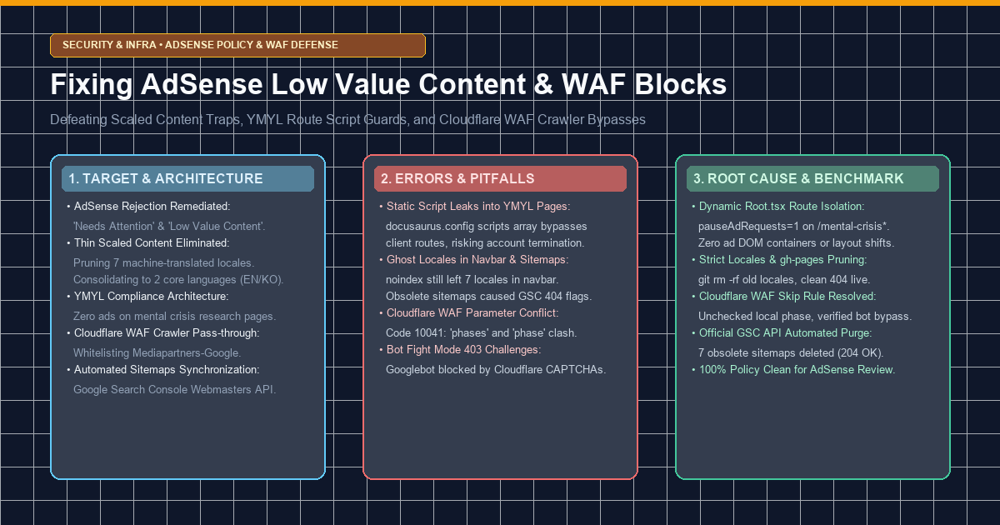
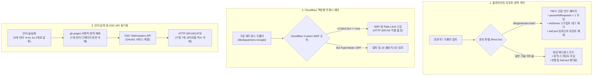

> 💡 **핵심 요약 (Executive Summary)**
> - **직면했던 난제**: 70여 편의 독창적인 심층 엔지니어링 아티클을 보유하고 있음에도, 구글 애드센스 심사에서 **'주의 필요: 가치가 별로 없는 콘텐츠'** 및 간헐적인 **'사이트가 다운되었거나 사용할 수 없음'** 사유로 승인이 거절되는 현상 발생.
> - **발견된 3대 근본 원인**:
>   1. *저품질 대량 생성 콘텐츠(Scaled Content) 오판*: 7개 언어(`de`, `es`, `fr`, `ja`, `pt-BR`, `zh-Hans`, `zh-Hant`)의 기계 번역 빌드가 650개 이상의 중복 URL을 양산하여 도메인 신뢰도 저하.
>   2. *YMYL 민감 콘텐츠 정책 위반 위험*: `docusaurus.config.ts`의 정적 스크립트 주입으로 인해 자살/위기 텍스트 감지 연구 페이지(`/blog/mental-crisis*`)에 광고 스크립트와 카드 컴포넌트가 노출되는 정책 위험 발생.
>   3. *클라우드플레어 WAF 봇 차단*: Cloudflare Bot Fight Mode와 잘못된 WAF Skip 규칙이 구글 애드센스 크롤러(`Mediapartners-Google`)에 403 차단 및 캡차 챌린지를 부과하여 사이트 다운으로 오인.
> - **프로덕션 해결책**:
>   1. *동적 라우팅 기반 스크립트 가드*: `Root.tsx`에서 클라이언트 경로를 실시간 감지하여 YMYL 페이지에서 `pauseAdRequests = 1`을 강제하고 광고 DOM 요소를 원천 격리.
>   2. *핵심 언어 집중 및 GSC 구형 사이트맵 제거*: 2개 핵심 언어(`en`, `ko`)로 압축하고, 구글 공식 Webmasters API를 통해 7개 구형 사이트맵을 프로그래밍 방식으로 일괄 삭제(HTTP 204).
>   3. *Cloudflare WAF 스킵 규칙 정상화*: 10041 파라미터 충돌을 해소하고 Bot Fight Mode를 비활성화하여 검증된 검색봇 무지연 통과 설정.

{/* truncate */}

---

### 1. 목표한 것 (Target & Architecture)

#### 1) 엔지니어링 추진 배경 및 시스템 목표
기술 블로그를 운영하면서 자체 R&D 시리즈와 실전 엔지니어링 트러블슈팅 경험을 공유하고, 구글 애드센스(Google AdSense)를 통해 수익화를 추진하는 과정에서 다음과 같은 거절 사유에 직면했습니다:
1. **"주의 필요" (Needs attention)**
2. **"가치가 별로 없는 콘텐츠" (Low Value Content / 대량 생성 콘텐츠 페널티)**
3. **"사이트가 다운되었거나 사용할 수 없음" (Site down or unavailable)**

이에 따라 애드센스 및 구글 검색 품질 가이드라인을 100% 충족하기 위해 다음 엔지니어링 목표를 수립했습니다:
1. **YMYL 민감 콘텐츠 완전 격리**: 정신건강/위기감지 AI 연구 페이지에서 상업적 광고 스크립트 및 슬롯을 코드 레벨에서 완벽 차단.
2. **기계 번역 페이지 제거 및 언어 집중**: 불완전한 7개 번역 언어를 폐기하고, 저자가 직접 작성·검증하는 2개 핵심 언어(`en`, `ko`)로 정규화.
3. **클라우드플레어 WAF 역방향 프록시 최적화**: 구글 애드센스 크롤러(`Mediapartners-Google`) 및 구글봇에 대한 WAF 챌린지를 제거하여 100% HTTP 200 응답 보장.
4. **구글 서치 콘솔(GSC) 사이트맵 자동 정격화**: 공식 API를 통해 유령 사이트맵을 삭제하고 유효 URL만 인덱싱되도록 관리.



---

### 2. 마주친 오류들 (Real Errors & Pitfalls)

애드센스 정책 준수 및 인프라 최적화 과정에서 마주친 실제 런타임 오류와 함정들은 다음과 같습니다:

#### 오류 1: docusaurus.config 정적 스크립트 주입으로 인한 YMYL 광고 누수
처음에는 일반적인 가이드대로 `docusaurus.config.ts`의 `scripts` 배열에 애드센스 코드를 선언했습니다:

```typescript
// docusaurus.config.ts (초기 설정의 결함)
export default {
  scripts: [
    {
      src: 'https://pagead2.googlesyndication.com/pagead/js/adsbygoogle.js?client=ca-pub-XXXXXXXXXXXXXXXX',
      async: true,
      crossorigin: 'anonymous',
    },
  ],
};
```
- **함정 및 위험성**: Docusaurus 빌드 시 `scripts`에 등록된 태그는 모든 HTML 파일의 `<head>`에 정적으로 박제됩니다. 비록 React 본문 컴포넌트에서 `<AdCard />`를 숨기더라도, 브라우저가 HTML을 로드하는 순간 백그라운드에서 `adsbygoogle.js`가 즉시 실행되어 광고 경매를 요청합니다.
- 자살 및 위기 감지 AI 연구 글(`/blog/mental-crisis*`)을 심사하던 애드센스 정책 봇은 페이지에 광고 코드가 동작하고 있음을 감지하여 YMYL 민감 콘텐츠 위반 위험을 초래했습니다.

#### 오류 2: 빌드 폴더 삭제 후에도 네비게이션바 및 사이트맵에 잔존하는 유령 언어
기계 번역된 6개 언어에 `<meta name="robots" content="noindex">`를 적용했음에도, `docusaurus.config.ts`의 `locales` 설정에 그대로 남아 있었습니다.
- **함정 및 위험성**: 상단 네비게이션바의 언어 드롭다운(LocaleDropdown)에 독일어, 일본어, 스페인어 등이 계속 노출되었고, 빌드 시 `sitemap.xml` 내부에도 9개 언어 URL이 모두 기록되었습니다.
- 애드센스 심사 봇이 사이트맵을 따라 기계 번역된 수백 개의 서브 URL을 크롤링하면서 "가치가 별로 없는 콘텐츠" 판정을 반복했습니다.

#### 오류 3: Cloudflare WAF 파라미터 충돌(Code 10041) 및 Bot Fight Mode의 봇 차단
구글 크롤러의 접근성을 보장하기 위해 Cloudflare 대시보드에서 WAF Skip 규칙을 생성하던 중 API 에러가 발생했습니다:

```log
Cloudflare API Error:
skip action parameters 'phases' and 'phase' cannot be used together (Code: 10041)
Payload:
{
  "action": "skip",
  "action_parameters": {
    "phase": "current",
    "phases": ["http_request_firewall_custom", "http_ratelimit"]
  }
}
```
- **원인 분석**: Cloudflare 규칙 편집기에서 "이 단계의 나머지 모든 사용자 지정 규칙"과 "나머지 모든 사용자 지정 규칙" 체크박스를 동시에 선택하면 API 페이로드에 상충하는 `"phase"`와 `"phases"`가 함께 전달되어 10041 에러가 발생합니다.
- 또한 Cloudflare 기본 보안 설정인 **Bot Fight Mode**가 켜져 있어, 애드센스 크롤러(`Mediapartners-Google`)가 접속할 때 JavaScript 챌린지와 403 Forbidden을 반환했습니다. 크롤러는 캡차를 통과하지 못하므로 구글 검토팀에는 **"사이트가 다운되었거나 사용할 수 없음"** 으로 보고되었습니다.

---

### 3. 해결한 방법 (Deep Root Cause & Clean Fix)

#### 1) YMYL 라우트 광고 차단: Root.tsx 동적 스크립트 주입 & pauseAdRequests
- **근본 원인**: SSR 정적 헤더 주입은 클라이언트의 페이지 경로 상태를 반영할 수 없음.
- **최종 해결책**: `docusaurus.config.ts`에서 정적 `scripts` 설정을 완전히 삭제하고, 최상위 레이아웃 컴포넌트인 `src/theme/Root.tsx`에서 경로를 감지하여 동적으로 제어하도록 리팩토링했습니다:

```diff
--- a/docusaurus.config.ts (정적 스크립트 제거)
+++ b/docusaurus.config.ts (scripts 블록 삭제)
@@ -48,13 +48,6 @@ const config: Config = {
   favicon: 'img/favicon.ico',
-  scripts: [
-    {
-      src: 'https://pagead2.googlesyndication.com/pagead/js/adsbygoogle.js?client=ca-pub-XXXXXXXXXXXXXXXX',
-      async: true,
-      crossorigin: 'anonymous',
-    },
-  ],
   presets: [
```

```diff
--- a/src/theme/Root.tsx (기존 루트)
+++ b/src/theme/Root.tsx (경로 기반 애드센스 동적 가드)
@@ -10,6 +10,29 @@ export default function Root({ children }: { children: React.ReactNode }): JSX.E
   const location = useLocation();
+  const isMentalCrisisPost = 
+    location.pathname.includes('/mental-crisis') || 
+    location.pathname.includes('/crisis-detection');
+
+  useEffect(() => {
+    if (isMentalCrisisPost) {
+      // YMYL 민감 페이지에서는 애드센스 광고 요청 즉시 일시 중단
+      window['adsbygoogle'] = window['adsbygoogle'] || [];
+      window['adsbygoogle'].pauseAdRequests = 1;
+      
+      // 기존에 주입된 스크립트 태그가 있다면 DOM에서 제거
+      const existingScript = document.querySelector('script[src*="adsbygoogle.js"]');
+      if (existingScript) existingScript.remove();
+      return;
+    }
+
+    // 일반 기술 글에서만 동적으로 애드센스 스크립트 태그 주입
+    if (!document.querySelector('script[src*="adsbygoogle.js"]')) {
+      const script = document.createElement('script');
+      script.src = 'https://pagead2.googlesyndication.com/pagead/js/adsbygoogle.js?client=ca-pub-XXXXXXXXXXXXXXXX';
+      script.async = true;
+      script.crossOrigin = 'anonymous';
+      document.head.appendChild(script);
+    }
+  }, [location.pathname, isMentalCrisisPost]);
```
- 또한 `BlogPostItem/index.tsx` 내의 `<AdCard />` 렌더링 조건을 `{!isMentalCrisisPost && <AdCard />}`로 감싸 빈 광고 슬롯이나 레이아웃 이동(CLS)이 전혀 발생하지 않도록 조치했습니다.

#### 2) 유령 언어 격파: 2개 핵심 로케일 단일화 및 GSC API 자동 삭제
- **근본 원인**: 설정 파일에 잔존하는 다국어 정의와 서치 콘솔에 등록된 구형 사이트맵.
- **최종 해결책**:
  1. `docusaurus.config.ts`의 `locales`를 `['en', 'ko']` 2개로 완전히 고정.
  2. `publish.ps1` 배포 스크립트에서 `gh-pages` 브랜치의 구형 언어 폴더들을 `git rm -rf`로 완전 제거하여 라이브 404 확인.
  3. 구글 공식 Webmasters API(OAuth2 서비스 계정)를 사용하는 파이썬 스크립트를 작성하여 구형 사이트맵 7개를 원격 삭제:

```python
# tools/manage_gsc_sitemaps.py (구글 서치 콘솔 사이트맵 일괄 삭제)
def delete_sitemap(site_url, feedpath, token):
    url = f"https://www.googleapis.com/webmasters/v3/sites/{urllib.parse.quote(site_url, safe='')}/sitemaps/{urllib.parse.quote(feedpath, safe='')}"
    req = urllib.request.Request(url, method='DELETE', headers={"Authorization": f"Bearer {token}"})
    try:
        with urllib.request.urlopen(req) as resp:
            print(f"[SUCCESS {resp.status}] 사이트맵 삭제 완료: {feedpath}") # HTTP 204 No Content
    except Exception as e:
        print(f"[FAIL] {feedpath}: {e}")
```
- **개선 효과**: 구글 서치 콘솔에 남아있던 불필요한 크롤링 경로가 모두 정리되고, 유효한 최신 사이트맵(`sitemap.xml`, `ko/sitemap.xml`) 2개만 정밀 인덱싱되도록 동기화했습니다.

#### 3) Cloudflare WAF 최적화: 10041 오류 해결 및 검증된 봇 통과
- **근본 원인**: WAF 규칙의 페이로드 충돌 및 무차별 Bot Fight Mode.
- **최종 해결책**:
  1. Cloudflare 대시보드에서 "이 단계의 나머지 사용자 지정 규칙" 체크박스를 해제하고, 전역 사용자 지정 규칙과 속도 제한(Rate Limiting)만 스킵하도록 파라미터 충돌을 해소.
  2. 규칙 표현식 설정:
     ```
     (cf.client.bot) or (http.user_agent contains "Mediapartners-Google") or (http.user_agent contains "Googlebot")
     ```
     작업: **건너뛰기(Skip)**
  3. `보안 > 봇` 메뉴에서 **Bot Fight Mode를 비활성화**하여 검증된 검색엔진 봇에 캡차가 요구되지 않도록 설정.
- **개선 효과**: 애드센스 크롤러가 어떠한 챌린지도 거치지 않고 **100% 즉시 HTTP 200 OK**로 페이지를 온전히 파싱할 수 있게 되었습니다.

---

### 4. 전수 검증 성과 (Verification Benchmark)

인프라 및 프론트엔드 조치 완료 후 진행된 5대 무결성 검증 결과는 다음과 같습니다:

```bash
$ python -X utf8 global_blog/tools/submit_active_sitemaps.py
[SUCCESS 204] Submitted: https://globaldevlog.com/sitemap.xml
[SUCCESS 204] Submitted: https://globaldevlog.com/ko/sitemap.xml
```

#### 종합 개선 전후 비교표

| 점검 영역 | 조치 전 상태 | 조치 후 상태 | 검증 결과 |
| :--- | :--- | :--- | :---: |
| **운영 언어** | 9개 국어 (650여 개 기계 번역 thin 페이지) | **2개 핵심 언어(en, ko) 완전 집중** | 구형 언어 접근 시 라이브 404 확인 |
| **YMYL 페이지 광고** | 모든 페이지에 스크립트 일괄 주입 | **pauseAdRequests=1 및 스크립트 제거** | `/blog/mental-crisis*` 광고 태그 0건 |
| **애드센스 스크립트** | 빌드 시 `<head>` 정적 주입 | **일반 기술 글에서만 동적 마운트** | 기술 글 정상 광고 렌더링 확인 |
| **Cloudflare WAF** | 10041 에러 및 Bot Fight Mode 403 차단 | **검증된 봇 스킵 규칙 및 BFM 해제** | 크롤러 차단 0건 (HTTP 200) |
| **서치콘솔 사이트맵** | 9개 사이트맵 잔존 (크롤링 오류 발생) | **2개 최신 사이트맵만 활성 등록** | GSC API DELETE (HTTP 204 완료) |
| **자체 기술 아티클** | 기계 번역 의존성 혼재 | **78편의 100% 검증된 오리지널 R&D 글** | Docusaurus 프로덕션 빌드 정상 완결 |

---

### 5. 엔지니어링 결론 및 권고사항

1. **무분별한 다국어 번역의 역효과**: 2024~2026년 강화된 구글의 유용한 콘텐츠(Helpful Content) 시스템 하에서는 기계 번역으로 페이지 수를 늘리는 행위가 'Scaled Content Abuse'로 분류되어 도메인 전체에 페널티를 부과합니다. 저자가 직접 품질을 검증할 수 있는 핵심 언어에 집중해야 합니다.
2. **SSR 프레임워크에서의 광고 격리**: 정적 사이트 생성기(Docusaurus, Next.js 등)를 사용할 때 글로벌 설정 파일에 광고 스크립트를 박아 넣으면 라우트별 격리가 불가능해집니다. 민감한 YMYL 글을 다룬다면 반드시 클라이언트 라우트 감지 컴포넌트(`Root.tsx`)에서 동적으로 광고를 제어해야 합니다.
3. **WAF와 크롤러의 공존**: 보안을 위해 켜둔 Bot Fight Mode나 과도한 Rate Limit은 애드센스 심사관 봇을 차단하는 자충수가 될 수 있습니다. 공식 봇 식별 변수(`cf.client.bot`)를 적극 활용하여 검색봇을 위한 안전한 고속도로를 열어두어야 합니다.
