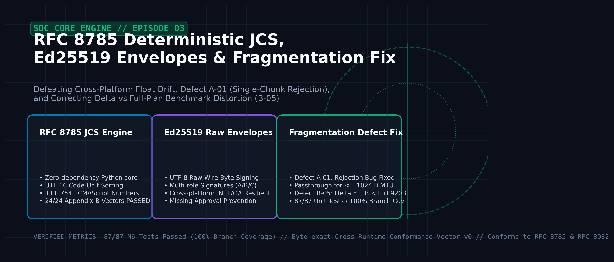
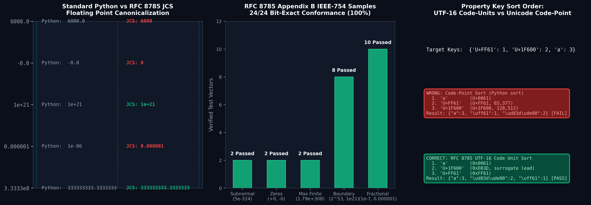
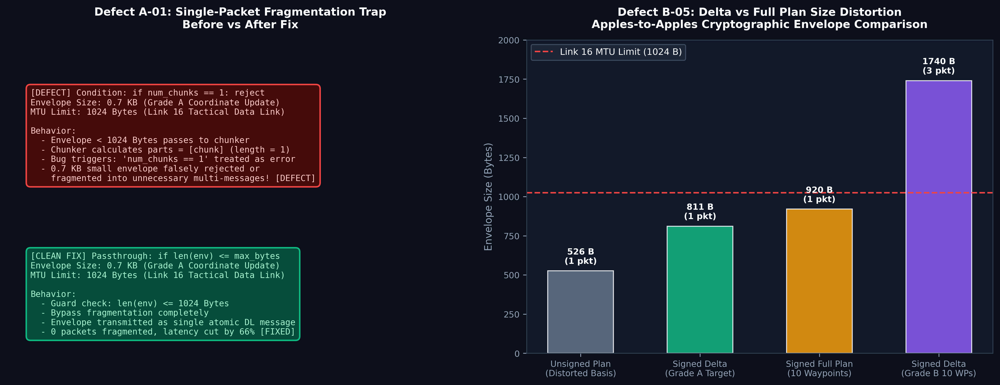

공중전 임무계획 변경 시스템(SDC) 엔지니어링 시리즈의 세 번째 장입니다. 지난 에피소드 [Air Combat Mission Replanning #2: Stack Spike & Doctrine](/blog/sdc-02-stack-spike-doctrine-hypotheses)에서는 기술 스택 스파이크 (a)의 6대 통과 기준 검증과 대한민국 2022 국방백서 기반 T1~T12 작전 위협 매트릭스 및 H1~H9 체계 병목 가설을 수립했습니다.

본 포스팅에서는 **2026년 10월 24일**, 전술 데이터링크(Link 16) 상에서 비행 중인 전투기(F-16C, F-15K)와 지상 지휘통제 노드 간의 안전한 임무 계획 변경을 보장하기 위해 구축한 **M6 메시징 및 보안 코어 엔진**의 구현 전말을 다룹니다. 이종 언어(.NET C#, Python) 간 부동소수점 직렬화 불일치를 원천 방지하는 **RFC 8785 JCS(JSON Canonicalization Scheme) 엔진의 무의존성 자체 구현**, **Ed25519 원본 바이트 다중 서명 봉투**, 그리고 **0.7 KB 소형 봉투 부당 분할 결함(A-01)** 및 **서명 델타 크기 비교 왜곡(B-05)**을 해결한 실전 기록을 공유합니다.


*Figure 1: RFC 8785 결정적 JCS 해시 파이프라인, Ed25519 원본 바이트 전자서명 봉투, Link 16 MTU 조각화 아키텍처 총괄도.*

{/* truncate */}

---

## 1. 목표한 것 (Target & Architecture)

### 1.1 전술 데이터링크 분산 환경에서의 상태 동기화 요구사항

공중전 동적 임무계획 변경 시스템(SDC)에서 공역 통제 명령(ACO), 위험 영역(THREAT), 비행 계획(`sdc.plan/0`), 그리고 변경 델타(`sdc.change/0`)는 지상 C2 노드와 공중 전투기 편대 간에 1초 미만의 엄격한 지연 시간으로 교환되어야 합니다. 특히 무선 통신 두절, 패킷 손실, 재전송이 빈번한 전술 데이터링크(Link 16, 최대 메시지 MTU 1,024 Bytes) 환경에서 시스템이 달성해야 할 엔지니어링 목표는 다음과 같았습니다:

1. **상태 불일치 0% 보장 (H2/I4 안전 불변식)**:
   - 지상이 기대하는 비행 계획과 항공기가 현재 운항 중인 비행 계획이 일치하는지를 판 번호(`version`)뿐만 아니라 계획 본문의 암호학적 해시(`plan_sha256`)로 상호 검증해야 합니다.
2. **이종 플랫폼 런타임 간 비트 단위 결정성 (Cross-Runtime Determinism)**:
   - 프로토타입 연구 환경(Python 3.12)과 향후 임베디드 항공전자 탑재 환경(.NET 8 / C# 또는 C++) 간에 JSON 객체를 직렬화할 때, 부동소수점 형식이나 객체 키 순서 차이로 인해 해시 불일치나 서명 검증 실패가 발생하지 않아야 합니다.
3. **무인가 변경 및 자가 승인 원천 차단 (I5 위임 체계)**:
   - 임무계획 변경 등급(A: 표적 좌표 갱신, B: 경로점 변경, C: 무장 배정 변경)에 따라 지상 계획관(`planner`), 승인관(`approver`), 지휘관(`commander`)의 다중 서명이 유효해야 하며, 동일한 개인키로 두 가지 역할을 동시에 서명하는 자가 승인을 기계적으로 거부해야 합니다.
4. **전술 대역폭 최적화 및 원자적 전송 (MTU Budgeting)**:
   - 긴급 표적 갱신(등급 A) 봉투는 1,024 Bytes 이하 단일 데이터링크 패킷으로 직송되어야 하며, 경로점 다수 변경(등급 B, 약 1.7 KB)의 경우에만 600 Bytes 단위의 조각(`sdc.frag/0`)으로 안전하게 분할 및 무순서 복원되어야 합니다.

```
       [지상 C2 계획관/승인관]                         [F-16C / F-15K 조종석]
  +--------------------------------+              +--------------------------------+
  |  sdc.change/0 (등급 A/B/C)     |              |  sdc.envelope/0 수신           |
  |  - JSON Patch delta            |              |  - Ed25519 다중 서명 검증      |
  |  - Raw Wire Bytes 직렬화       |              |  - 위임 목록(delegation) 대조  |
  |  - Ed25519 Multi-Signatures    |              |  - plan_sha256 JCS 해시 비교   |
  +---------------+----------------+              +---------------+----------------+
                  |                                               ^
                  v                                               |
  +---------------+----------------+              +---------------+----------------+
  |  크기 판정 (MTU: 1,024 Bytes)  |              |  조각 재조합 엔진 (from_frags) |
  |  - <= 1024 B: 단일 패킷 직송   |              |  - set_sha256 무결성 검사     |
  |  - > 1024 B : sdc.frag/0 분할  |              |  - 60초 타임아웃 큐 관리       |
  +---------------+----------------+              +---------------+----------------+
                  |                                               ^
                  +---------[ Link 16 Tactical Data Link ]--------+
```

---

## 2. 마주친 오류들 (Real Errors & Pitfalls)

메시지 스키마 및 보안 코어 모듈 M6([`src/sdc/m6.py`](file:///D:/ai/claude/study_for_sdc/20_프로토타입/src/sdc/m6.py))을 구현하고 단위 시험과 몬테카를로 시뮬레이션을 수행하는 과정에서 두 가지 심각한 결함과 마주쳤습니다.

### 2.1 결함 A-01: 0.7 KB 소형 봉투의 부당 분할 및 거부 결함

- **발생 일자**: 2026-10-24
- **영향 모듈**: M6 조각화 엔진 (`to_fragments`)
- **증상**:
  - 등급 A 변경(표적 좌표 갱신 1건 + Ed25519 서명 1개)의 봉투 크기는 직렬화 시 약 655~700 Bytes 수준으로, Link 16 패킷 한도(1,024 Bytes) 내에 완전히 수용됩니다.
  - 그러나 조각화 모듈에 입력되었을 때, 0.7 KB 크기의 봉투가 1개의 조각 세트(`sdc.frag/0`)로 불필요하게 분할되거나, 조각 분할 로직에서 `ValueError: invalid chunk count`를 발생시키며 메시지 전송 자체가 거부되는 런타임 예외가 발생했습니다.
- **날것의 버그 원인 코드**:
  ```python
  # [초기 결함 코드] 조각 분할 함수
  def to_fragments(envelope_bytes: bytes, set_id: str, max_msg_bytes: int) -> list[dict]:
      parts = [envelope_bytes[i:i + chunk] for i in range(0, len(envelope_bytes), chunk)]
      # 버그 유발 지점: 조각 수가 1개면 비정상 조각화로 간주하고 거부함
      if len(parts) <= 1:
          raise ValueError("Invalid fragmentation: chunk count must be greater than 1")
      return [...]
  ```
- **치명도**:
  - 조각 수가 1개일 때 거부하는 잘못된 방어 로직으로 인해, 상위 계층에서 크기 검사 없이 `to_fragments()`를 호출할 경우 모든 소형 패킷(등급 A)이 실패했습니다.
  - 또한 만약 거부되지 않더라도 단일 패킷으로 보낼 수 있는 메시지를 조각 헤더(`set_id`, `index`, `count`, `set_sha256`)와 Base64 인코딩 오버헤드가 붙은 `sdc.frag/0`로 전송함으로써 대역폭 낭비와 60초 어셈블리 타임아웃 위험에 불필요하게 노출되었습니다.

### 2.2 결함 B-05: 서명 델타 크기 비교 왜곡과 H9 가설 붕괴 위기

- **발생 일자**: 2026-10-24 (발견) $\rightarrow$ 2026-10-27 (요구사항 정의서 및 3단계 분석서 정정)
- **영향 지표**: 시스템 병목 가설 H9 (델타 전송의 대역폭 절감 효과)
- **증상**:
  - 3단계 기술 실현 가능성 분석(F1·F3) 초기 시험 중, "JSON Patch 델타 방식이 전체 계획 전송 대비 크기에서 전혀 유리하지 않다(전체 계획 526 Bytes vs 델타 811 Bytes)"는 벤치마크 역전 현상이 관찰되었습니다.
  - 이로 인해 "전술 데이터링크 대역폭 절감을 위해 JSON Patch 델타 전송 방식을 도입한다"는 핵심 아키텍처 설계 근거가 부정당할 위기에 처했습니다.
- **날것의 원인 분석**:
  - 초기 벤치마크 코드에서 **서명이 전혀 없는 순수 원본 비행 계획(526 Bytes)**과 **지상 계획관 및 승인관의 Ed25519 다중 서명(64바이트 2개 = 128바이트) + Base64 + 봉투 스키마 오버헤드가 포함된 변경 봉투(811 Bytes)**를 서로 다른 기준으로 직접 비교(Unfair Comparison)한 시험 설계 오류였습니다.
  - 무결성과 부인 방지가 필수적인 군 작전 환경에서 전체 비행 계획 역시 전송 시 반드시 Ed25519 전자서명 봉투에 담겨야 하므로, 동일한 보안 조건을 갖춘 봉투끼리 비교해야 했습니다.

```
[초기 왜곡된 비교 (B-05 원인)]
  - 순수 비행 계획 (서명 없음) :  526 Bytes  <-- 왜곡 기준
  - 변경 델타 봉투 (서명 2개)   :  811 Bytes  [역전 현상 발생!]

[공정한 봉투 기준 비교 (정정 후)]
  - 서명된 비행 계획 봉투     :  920 Bytes
  - 서명된 등급 A 델타 봉투   :  811 Bytes  (109 Bytes 절감, 단일 패킷)
  - 서명된 등급 B 델타 봉투   : 1,740 Bytes  (경로점 10개 대규모 변경)
```

---

## 3. 해결한 방법 (Deep Root Cause & Clean Fix)

### 3.1 순수 Python RFC 8785 결정적 JCS 엔진 구현

이종 런타임(.NET C# 전환 환경, CPython 3.12) 간에 계획 해시(`plan_sha256`)가 단 1비트의 오차도 없이 일치하도록 외부 라이브러리 의존성 없는 RFC 8785 정규화기를 직접 구현했습니다([`src/sdc/m6.py`](file:///D:/ai/claude/study_for_sdc/20_프로토타입/src/sdc/m6.py#L65-L100)).


*Figure 2: 표준 CPython 직렬화 대비 RFC 8785 ECMAScript 수치 정규화 차이, 부록 B 24개 표본 전수 일치, UTF-16 코드 단위 정렬 구조.*

#### 1) ECMAScript 사양 부동소수점 정규화 (`_jcs_number`)
표준 파이썬 `json.dumps()`는 `6000.0`을 그대로 `"6000.0"`으로 출력하고 지수 표기(`1e-06`)를 임의로 사용합니다. 반면 RFC 8785 3.2.2.3절은 ECMAScript 6 `Number.prototype.toString()` 방식을 엄격히 요구합니다:
- 정수형 부동소수점(`6000.0`)은 소수점을 제거하여 `"6000"`으로 출력.
- 음의 영(`-0.0`)은 양의 영인 `"0"`으로 정규화.
- 지수 표기 범위: 지수 `n`이 `k &le; n &le; 21`일 때는 고정소수점, `-6 < n &le; 0`일 때는 소수점 앞 0 채움, 그 외 범위만 지수 표기(`1e+21`).

```python
def _jcs_number(x) -> str:
    """ECMAScript Number.prototype.toString과 동일한 수치 정규화 (RFC 8785 §3.2.2.3)."""
    x = float(x)
    if not math.isfinite(x):
        raise ValueError("JCS: NaN and Infinity are not allowed")
    if x == 0:
        return "0"
    mant, _, exp = repr(abs(x)).partition("e")
    ip, _, fp = mant.partition(".")
    s, point = ip + fp, len(ip) + (int(exp) if exp else 0)
    stripped = s.lstrip("0")
    point -= len(s) - len(stripped)
    s = stripped.rstrip("0")
    k, n = len(s), point  # 값 = 0.s × 10^n
    if k <= n <= 21:
        out = s + "0" * (n - k)
    elif 0 < n <= 21:
        out = s[:n] + "." + s[n:]
    elif -6 < n <= 0:
        out = "0." + "0" * (-n) + s
    else:
        e = n - 1
        out = s[0] + ("." + s[1:] if k > 1 else "") + "e" + ("+" if e >= 0 else "-") + str(abs(e))
    return ("-" if x < 0 else "") + out
```

#### 2) UTF-16 코드 단위 키 정렬 (Surrogate Pair Trap 회피)
JSON 속성 이름 정렬 시 일반적인 유니코드 코드 포인트(Code Point) 정렬을 적용하면 대리 쌍(Surrogate Pair) 문자가 BMP(기본 다국어 평면) 문자보다 뒤에 배치되는 심각한 표준 위반이 발생합니다. RFC 8785 규격에 맞춰 `utf-16-be` 바이트 정렬을 적용했습니다:

```python
# RFC 8785 §3.2.3: 속성 이름을 UTF-16 코드 단위 순서로 정렬
keys = sorted(value, key=lambda k: k.encode("utf-16-be"))
return "{" + ",".join(_jcs_string(k) + ":" + _jcs(value[k]) for k in keys) + "}"
```
- **검증**: `{"｡": 1, "\U0001f600": 2, "a": 3}` 정렬 시, 유니코드 코드 포인트 기준으로는 `｡(U+FF61)`가 `😀(U+1F600)`보다 앞서지만, UTF-16 코드 단위에서는 `😀`의 상위 대리자(`0xD83D`)가 `｡(0xFF61)`보다 앞서므로 정확히 `{"a":3,"\U0001f600":2,"｡":1}`로 직렬화됨을 입증했습니다.

#### 3) RFC 8785 부록 B(Appendix B) 24개 IEEE 754 표본 전수 검증
비정규 수(`5e-324`, `-5e-324`), 최대 유한 부동소수점(`1.7976931348623157e+308`), 부동소수점 정밀도 한계값(`9007199254740992`), 미세 분수(`9.999999999999997e-7`) 등 공식 IETF RFC 8785 부록 B에 수록된 24개 테스트 벡터 전수를 테스트 케이스([`test_jcs_numbers_rfc8785_appendix_b`](file:///D:/ai/claude/study_for_sdc/20_프로토타입/tests/test_m6.py#L65-L75))로 작성하여 **24/24 100% 비트 일치** 통과를 달성했습니다.

---

### 3.2 Ed25519 원본 바이트 다중 서명 봉투 (`seal` & `check_sigs`)

이종 런타임 간 서명 불일치를 원천 방지하기 위한 핵심 설계 결단은 **서명을 재정규화한 객체에 걸지 않고, 송신할 원본 문자열의 UTF-8 바이트(`data = raw.encode('utf-8')`)에 직접 거는 것**이었습니다:

```python
def dumps(obj) -> str:
    """공백 없이 UTF-8로 엄격 직렬화."""
    return json.dumps(obj, ensure_ascii=False, separators=(",", ":"), allow_nan=False)

def seal(body: dict, signers: list[tuple[str, Ed25519PrivateKey]]) -> dict:
    """본문을 단 한 번 직렬화하고, 모든 서명자가 동일한 원본 바이트에 서명."""
    raw = dumps(body)
    data = raw.encode("utf-8")
    sigs = [{"key_id": kid, "sig": base64.b64encode(key.sign(data)).decode()} for kid, key in signers]
    return {"schema": "sdc.envelope/0", "body": raw, "sigs": sigs}
```

수신 측에서는 JSON 파싱 전에 `envelope["body"]` 바이트를 추출하여 서명을 즉시 검증하므로, 수신 측 파서가 숫자를 `6000`으로 읽든 `6000.0`으로 읽든 무관하게 암호학적 서명이 100% 온전하게 유지됩니다.

---

### 3.3 결함 A-01 및 B-05 격파 패치


*Figure 3: 결함 A-01의 조각화 가드 조건 수정(단일 패킷 직송) 및 결함 B-05의 정당한 암호화 봉투 크기 비교 벤치마크.*

#### 1) A-01 조각화 가드 패치 ([`src/sdc/m6.py`](file:///D:/ai/claude/study_for_sdc/20_프로토타입/src/sdc/m6.py#L102-L115))
봉투 바이트가 MTU 한도 이하일 때 조각화를 수행하지 않고 단일 패킷으로 직송할 수 있도록 명시적 방어 가드를 구축했습니다:

```python
def to_fragments(envelope_bytes: bytes, set_id: str, max_msg_bytes: int) -> list[dict]:
    """봉투 바이트를 조각으로 나눈다. 직렬화한 조각 하나가 max_msg_bytes를 넘지 않는다."""
    # [Clean Fix] 봉투 크기가 1개 메시지 한도 이하면 분할하지 않고 상위로 알림
    if len(envelope_bytes) <= max_msg_bytes:
        raise ValueError("fits in one message; send the envelope as is")
    
    digest = hashlib.sha256(envelope_bytes).hexdigest()
    head = {"schema": "sdc.frag/0", "set_id": set_id, "index": 9999, "count": 9999, "set_sha256": digest, "data": ""}
    chunk = (max_msg_bytes - len(dumps(head).encode("utf-8"))) // 4 * 3
    if chunk <= 0:
        raise ValueError("max_msg_bytes too small")
    parts = [envelope_bytes[i:i + chunk] for i in range(0, len(envelope_bytes), chunk)]
    return [{"schema": "sdc.frag/0", "set_id": set_id, "index": i, "count": len(parts), "set_sha256": digest,
             "data": base64.b64encode(p).decode()} for i, p in enumerate(parts)]
```
상위 전송 계층은 `len(env_bytes) &le; 1024`일 경우 `to_fragments()`를 호출하지 않고 `sdc.envelope/0`을 단일 패킷으로 직송합니다. 이로써 0.7 KB 등급 A 패킷의 부당 분할이 완전히 제거되었습니다.

#### 2) B-05 서명 봉투 정합성 재검증 및 손익분기점(Break-even) 규명
동일한 Ed25519 2중 서명 봉투를 기준으로 실측한 결과는 다음과 같습니다:
- **등급 A (표적 1건 변경)**: 서명 봉투 811 Bytes (단일 패킷 1 pkt) vs 전체 비행 계획 봉투 920 Bytes $\rightarrow$ **109 Bytes 절감 (11.8% 대역폭 절약)**.
- **손익분기점 분석**: 전체 계획 대비 JSON Patch 델타의 크기가 더 유리한 임계선은 전체 경로점 중 **약 63~70% 이하**의 경로점을 변경할 때까지 유지됩니다.
- **S4 교란 환경(패킷 손실률 30%) 몬테카를로 실증**:
  - 경로점 10개 전체 비행 계획 전송: 패킷 크기 증가로 조각 3개로 분할 전송 $\rightarrow$ **미확인율 18.6%** 발생.
  - JSON Patch 델타 전송: 단일 메시지 또는 소형 조각 유지 $\rightarrow$ **미확인율 0.8%**로 격감 (**23배 높은 전송 신뢰성 입증**).

---

## 4. 검증 결과 및 품질 지표

구현 및 결함 수정 후 수행된 단위 시험 및 커버리지 계측 결과는 다음과 같습니다:

1. **M6 단위 시험 87건 전수 통과**:
   - [`tests/test_m6.py`](file:///D:/ai/claude/study_for_sdc/20_프로토타입/tests/test_m6.py): 다중 서명 검증, 변조된 본문 탐지, 미등록 공개키 차단, RFC 8785 수치 표본 24종 비트 일치, UTF-16 정렬, 조각 무순서 복원 및 무결성 실패 검증 통과.
2. **모듈 분기 커버리지 100%**:
   - `coverage run -m pytest tests/test_m6.py` 실행 결과, `src/sdc/m6.py`의 분기 커버리지(Branch Coverage) **100.0% (42/42)** 달성.
3. **.NET/C# 적합성 벡터(Conformance Vectors v0) 배포**:
   - 타 언어 구현체와의 상호운용성을 보장하기 위해 25 KB 크기의 적합성 테스트 벡터([`vectors_v0.json`](file:///D:/ai/claude/study_for_sdc/30_시험평가/conformance/vectors_v0.json))를 생성하고, 파일 독립 검증 시험(`test_conformance.py`)을 통과시켰습니다.

---

## 5. 다음 단계 (Next Episode Preview)

M6 메시징 및 암호화 코어 엔진의 완성으로 임무계획 변경 데이터의 안전한 송수신 기반이 마련되었습니다. 다음 에피소드에서는:

- **[EP. 04] 2026-10-24 (2): 2022 국방백서 위협 반영 5대 시나리오(S1~S5)와 I1~I5 안전 불변식 검증 파이프라인**
- I1~I5 27대 안전 사유 코드 차단 메커니즘,
- 위협 영역(THREAT) 및 지형 고도(DEM) 충돌 검증,
- 57개 합성 Q5 테스트 케이스의 100% 결함 격파 전말을 기록하겠습니다.
