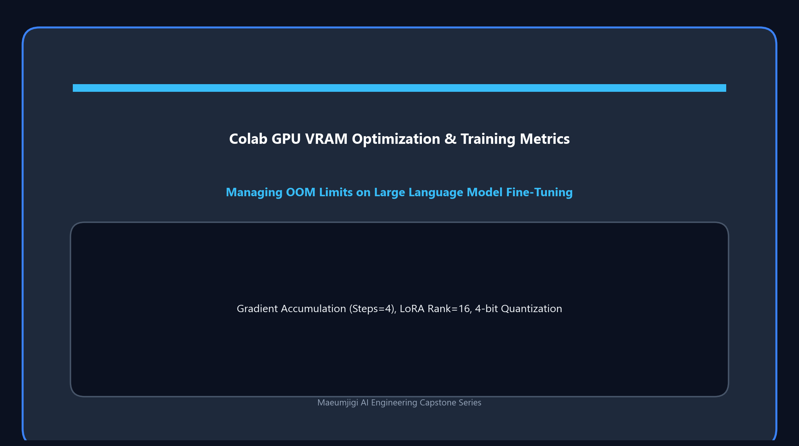

April 8th was the day we experienced the biggest crisis and a 'laugh-and-cry' happening while working on the Maeumjigi project. It was the **Claude API monthly limit exceeded & bill bomb incident**.

{/* truncate */}

### The Betrayal of the Background: "$1 for 10 records?"

- **Problem**: Relieved that we had finished optimization yesterday, we left the massive test dataset generation script running in the background unattended.
- **Process**: 
  > "Problem: Billed exceeding the monthly limit. I left it running thinking it was just working in the background, and this happened."
  > "No way, it costs $1 to generate 10 records? Does that make sense?"
- **Result**: During the process of synthesizing high-quality counseling data using an Large Language Model (LLM), the prompt's context (input tokens) accumulated, causing the cost to increase exponentially. The script halted because the monthly billing limit was exceeded. We urgently instructed the Artificial Intelligence (AI), "Immediately add a feature to print the estimated consumption, cost, and progress in real-time to the console, and prevent limit exceedance." We learned the hard way how crucial billing monitoring is when using clouds or APIs.

### Writing a Colab Notebook for Llama 3.1 Training

- **Problem**: As the data was getting ready, we now needed the code to actually fine-tune the Llama 3.1 model. Since our local PC's GPU wasn't nearly enough, we had to use the Google Colab environment.
- **Process**:
  > "Please write a python notebook to execute llama31_finetuning_experiment_plan_revised.md in Colab."
  > "Split the training data only into train/val instead of train/val/test, using a 9:1 ratio."
- **Result**: The AI independently read the training plan and wrote a perfect Jupyter Notebook code called `llama31_finetuning_colab.ipynb`. It perfectly implemented logic including setting up the latest lightweight libraries like Unsloth, and splitting the dataset into a 9:1 ratio for training and validation.

Today was a day of overcoming a realistic barrier of the project, paying a terrifying initiation fee called the API bill bomb. However, in return, we completed an excellent dataset and a Colab notebook for fine-tuning. Finally, the next step is to train the real artificial intelligence model!

---

## Summary & Key Takeaways

- **API Expenditure Shock & Diagnosis**: Encountered sudden Claude API rate and monthly billing cap limits due to accumulating context tokens during unmanned synthetic dialogue generation.
- **Cost Guardrails & Real-Time Monitoring**: Promptly integrated real-time token tracking, console expenditure estimation, and automatic kill-switches to prevent unbudgeted API runs.
- **Colab Fine-Tuning Pipeline Authoring**: Engineered `llama31_finetuning_colab.ipynb` incorporating Unsloth optimization for efficient parameter-efficient fine-tuning (PEFT).
- **Data Splitting & Preparation**: Partitioned synthesized dialogue datasets into a 9:1 train/validation split to maximize learning samples while preserving validation accuracy.

