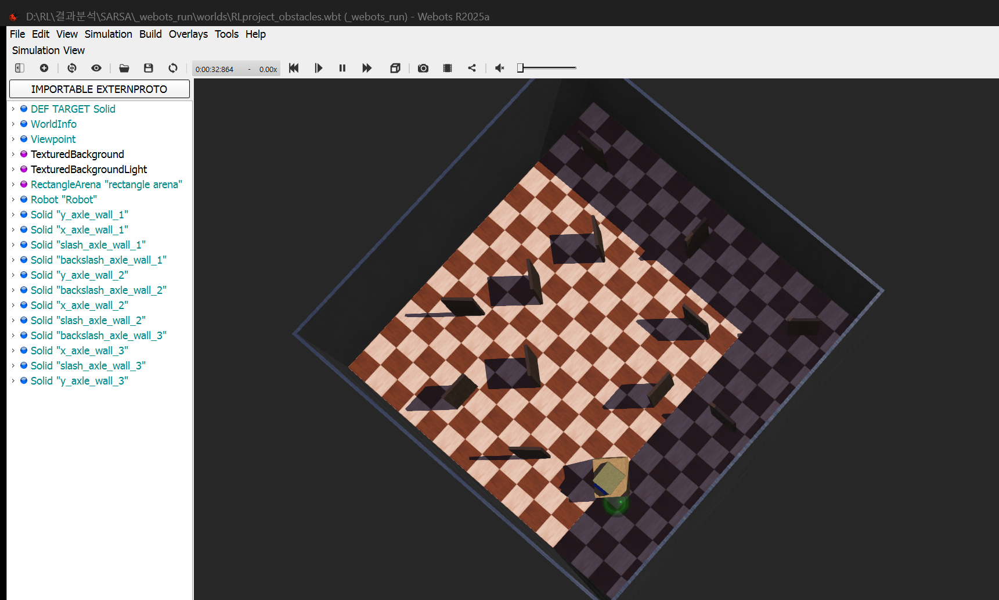

> 📌 **Resumo dos Pontos Principais (TL;DR)**
> - **Desafio**: Dados contínuos de sensores (distância e ângulo para a meta) causam explosão do espaço de estados no Q-Learning tabular; a comunicação IPC síncrona com o simulador Webots exige latência mínima.
> - **Solução**: Redução para 648 estados discretos distribuídos em 3 setores de distância e 4 zonas de orientação, operados por um servidor socket TCP em Python de alto desempenho.

{/* truncate */}

---

### 1. Discretização do Espaço de Estados: 648 Bins Compactos

Leituras sensoriais contínuas não podem ser indexadas diretamente em uma tabela Q discreta. Para contornar essa limitação, realizamos uma discretização geométrica:
- **3 Setores de Sensores** (Esquerda, Centro, Direita): Cada setor é dividido em 3 faixas discretas de distância (Perto, Médio, Longe) $\rightarrow 3^3 = 27$ combinações.
- **Ângulo Relativo para o Alvo (`\theta_{\text{alvo}}`)**: 4 quadrantes direcionais (Frente-Esquerda, Frente-Direita, Trás-Esquerda, Trás-Direita) $\rightarrow 4$ estados.
- **Distância Euclidianana até a Meta**: 6 zonas de proximidade radial $\rightarrow 6$ estados.

$`\text{Total de Estados} = 27 \times 4 \times 6 = 648 \text{ estados discretos}`$

Essa formulação permite que a Q-Table inteira ocupe menos de 15 Kilobytes de memória RAM e convirja de forma estável em poucas centenas de episódios.

---

### 📌 Resumo Executivo para Gestão (3–5 Linhas)
1. **Discretização Otimizada**: 648 bins viabilizam aprendizado tabular ultrarrápido sem a sobrecarga computacional de Deep RL.
2. **IPC de Baixa Latência**: Um socket TCP local sincroniza o motor de física do Webots com o agente Python a mais de 100 passos por segundo.
3. **Estabilidade Numérica**: A arquitetura previne estouro de memória e garante total reprodutibilidade dos experimentos.
4. **Compatibilidade com Hardware**: O consumo enxuto de memória permite exportar a tabela aprendida diretamente para um microcontrolador Arduino Uno.
