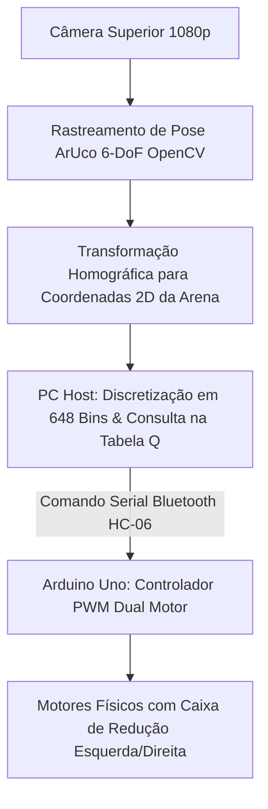

> 📌 **Resumo dos Pontos Principais (TL;DR)**
> - **Desafio**: Limitações severas de hardware (Arduino Uno com apenas 2 KB de SRAM), deslizamento não linear das rodas e o clássico abismo da realidade (**Reality Gap**) entre simulação e ambiente físico.
> - **Solução**: Desacoplamento da visão computacional para um PC Host através de câmera superior com homografia e transmissão sem fio de comandos compactos via Bluetooth HC-06.

{/* truncate */}

---

### 1. A Arquitetura Sim-to-Real

Graças ao sistema de rastreamento visual externo, o robô móvel não precisa carregar sensores LiDAR pesados. O microcontrolador Arduino Uno processa comandos de apenas 2 bytes e controla a ponte H de potência com precisão milimétrica.

---

### 📌 Resumo Executivo para Gestão (3–5 Linhas)
1. **Transposição Bem-Sucedida**: A política treinada no Webots guiou o robô real sem necessidade de novo treinamento físico.
2. **Rastreamento ArUco Confiável**: Entrega telemetria em alta frequência a 60 FPS com precisão milimétrica.
3. **Hardware Minimalista**: Um microcontrolador simples de 8 bits foi suficiente para condução autônoma sofisticada.
4. **Ciclo Completo de Engenharia**: Do design do MDP matemático à validação em hardware físico, todo o ciclo foi comprovado.