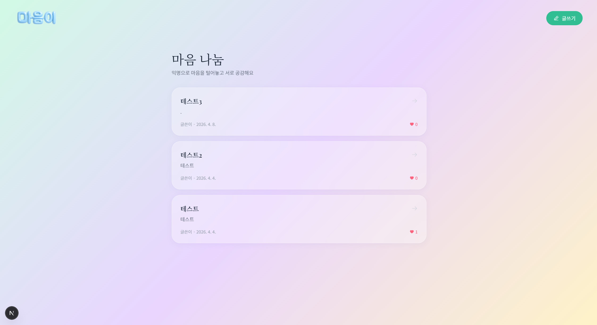

On May 21st and 22nd, the Maeumjigi Capstone team embarked on massive data generation and preparation for the **4th Fine-Tuning (fine_tuning_4)**.

{/* truncate */}

### The Tug-of-War Between Emotional and Daily Conversations

While testing the 3rd fine-tuning model, I discovered a critical issue.

> "When fine-tuning with the haiku_pred dataset, the responses seem too heavily skewed towards emotional counseling. How should we fine-tune to maintain the original model's daily conversation abilities?"

Our goal is a 'suicide prevention counselor conveying warm empathy', but the model was showing signs of **overfitting**, giving overly serious and emotional responses even to mundane questions like "How's the weather?" or "What should I eat?".

To solve this, we planned an experiment to train the model by mixing emotional data and daily chat data at appropriate ratios.

### Generating 10,000 v6 Emotion Dataset Entries via Application Programming Interface (API)

> "Unify to 512 tokens / Average 500 tokens per entry / 20 Personas / File: v6.jsonl"

To create the best dataset, I used the Anthropic API (Haiku) Batch mode to generate a staggering 10,000 entries of emotional conversation data (`Emotion_train_dataset_v6.jsonl`). Though there was a frustrating moment when the API batch ran in the background without showing progress, I filled in the missing entries with an additional script (`fill_v6.py`) to complete the 10,000 count.

### Finding the Golden Ratio (fine_tuning_4)

> "Emotion_train_dataset_v6.jsonl is complete. Now make a 7:3 ratio dataset, a 2:1 ratio, and a 5:5 ratio dataset."
> "This 4th fine-tuning will be based on the training dataset mix ratio (mixed_2_1, mixed_5_5, mixed_7_3) instead of alpha values."

The 4th fine-tuning has now become an arena to verify which data ratio perfectly harmonizes the Artificial Intelligence (AI)'s 'daily casualness' with 'professional counseling'. We generated three versions of the dataset and started injecting them into the Qwen3.5-9B model!

---

## Summary & Key Takeaways

- **Identifying Conversational Skew**: Discovered severe emotional counseling bias where the 3rd fine-tuning model gave overly solemn, therapeutic responses to mundane everyday greetings.
- **Large-Scale Synthetic Corpus Generation**: Engineered 10,000 standardized emotional dialogues (`v6.jsonl`) via Anthropic Haiku Batch API across 20 distinct personas with 500-token length constraints.
- **Multi-Ratio Experimental Matrix**: Formulated three comparative dataset mixtures (`mixed_7_3`, `mixed_2_1`, and `mixed_5_5`) blending emotional counseling with daily banter.
- **Initiating the 4th Fine-Tuning Sprint**: Commenced training on Qwen 3.5-9B to rigorously identify the golden dataset ratio that harmonizes professional counseling empathy with natural daily conversation.