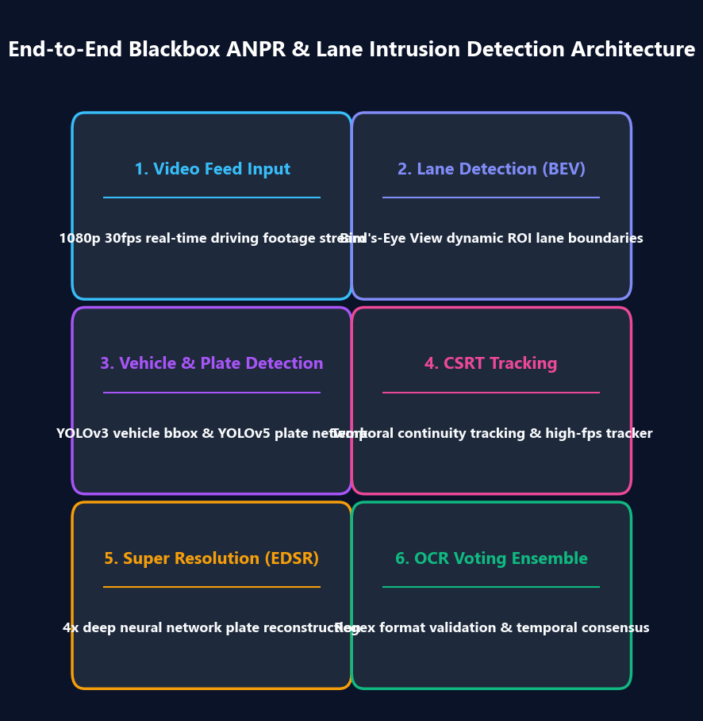
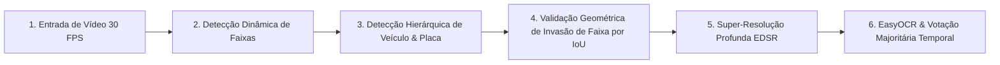

> 📌 **Resumo dos Pontos Principais (TL;DR)**
> - **Desafio**: Filmagens de dashcam em alta velocidade sofrem com vibrações mecânicas, reflexos de iluminação e desfoque por movimento. O OCR direto falha devido à baixa resolução dos recortes de placas.
> - **Solução**: Um pipeline modular em 6 estágios com restrição estrita de 30 FPS, integrando detecção de faixas, detecção hierárquica por YOLO, super-resolução EDSR e votação temporal por OCR.

{/* truncate */}

---

### 1. Visão Geral dos 6 Estágios do Pipeline

1. **Ingestão de Vídeo**: Decodificação assíncrona de streams de vídeo 1080p usando multithreading no OpenCV.
2. **Detecção de Faixas**: Filtragem de bordas Canny, máscara de região de interesse (ROI trapezoidal) e Transformada Probabilística de Hough (`HoughLinesP`).
3. **Localização Hierárquica**: Detecção preliminar de veículos com YOLOv3, seguida por segmentação refinada de placas via YOLOv5.
4. **Métrica de Invasão**: Cálculo da sobreposição de polígonos (Intersection over Union - IoU) entre a base do veículo e a faixa demarcada.
5. **Super-Resolução**: Ampliação de 4x em recortes de placas miniaturizadas (inferiores a 40x20 pixels) via modelo neural residual EDSR.
6. **OCR & Consenso**: Extração de texto com EasyOCR e suavização estatística através de janela deslizante temporal de 11 frames.

---

### 📌 Resumo Executivo para Gestão (3–5 Linhas)
1. **Arquitetura Modular**: O isolamento em 6 módulos desacoplados permite otimizar gargalos de GPU e CPU de forma independente.
2. **Processamento em Tempo Real**: O sistema garante operação sustentada a 30 FPS para telemetria confiável em veículos em movimento.
3. **Resiliência a Desfoque**: A super-resolução EDSR reconstrói placas inelegíveis onde algoritmos convencionais falham.
4. **Filtragem de Falsos Positivos**: Critérios geométricos de IoU evitam disparos indevidos em oscilações de pista.