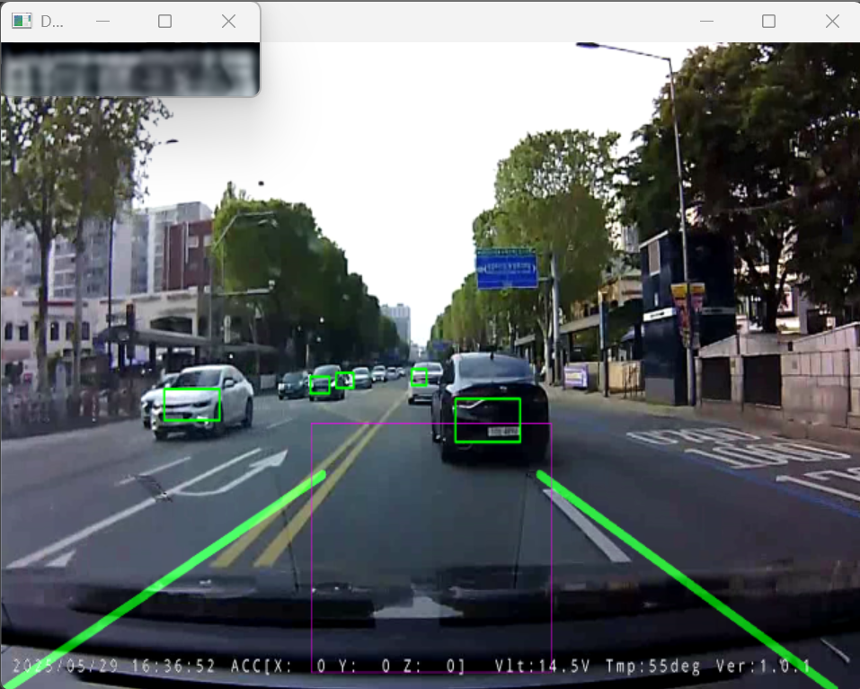

> 📌 **Resumo dos Pontos Principais (TL;DR)**
> - **Desafio**: Buscar placas minúsculas (30x15 pixels) diretamente no quadro 1080p completo causa falsos positivos em placas de trânsito e derruba a taxa de inferência para menos de 10 FPS.
> - **Solução**: Abordagem em dois estágios — primeiro localiza-se o veículo (YOLOv3), depois isola-se a placa apenas no recorte (YOLOv5), intercalando quadros intermediários com o leve e rápido rastreador CSRT.

{/* truncate */}

---

### 1. O Princípio da Detecção Hierárquica em Cascata

Em vez de processar o quadro inteiro com uma rede neural pesada, o sistema aplica um estreitamento progressivo da região de interesse:

```mermaid
flowchart TD
    Frame[Quadro Full HD 1920x1080] --> Step1["Estágio 1: YOLOv3 detecta a caixa delimitadora do veículo"]
    Step1 --> Crop[Isolamento do recorte do veículo]
    Crop --> Step2["Estágio 2: YOLOv5 busca a placa apenas na região frontal/traseira"]
    Step2 --> Plate[Recorte limpo da placa (ex: 40x20 px)]
    Plate --> Step3["Estágio 3: Rastreador CSRT assume quadros seguintes a 50+ FPS"]
```

Com o rastreamento por correlação do CSRT, a inferência neural do YOLOv5 precisa ser executada apenas a cada 5 quadros, mantendo o pipeline leve e altamente responsivo.

---

### 📌 Resumo Executivo para Gestão (3–5 Linhas)
1. **Afunilamento Hierárquico**: Elimina completamente falsos positivos em outdoors e placas de sinalização urbana.
2. **Ganho de Velocidade de 5x**: O rastreador CSRT reduz drasticamente a demanda de ciclos da GPU.
3. **Rastreamento Contínuo**: A placa permanece travada mesmo sob inclinações bruscas e frenagens.
4. **Entrega Otimizada**: O recorte de alta precisão é repassado diretamente para a etapa de super-resolução.