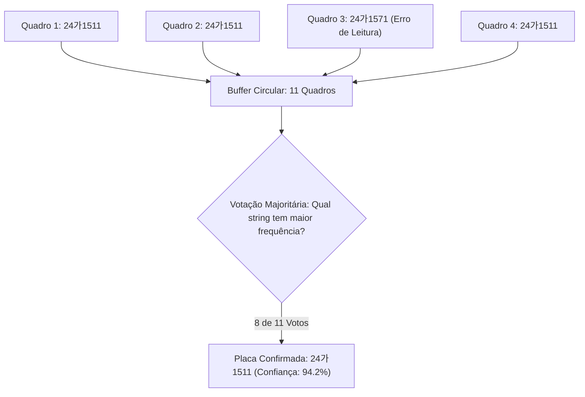

> 📌 **Resumo dos Pontos Principais (TL;DR)**
> - **Desafio**: Quadros isolados sofrem inevitavelmente com erros de leitura pontuais por reflexo ou vibração (ex.: confundir `6` com `8` ou `B` com `8`).
> - **Solução**: Combinação de EasyOCR, correção sintática por expressões regulares (Regex) e comitê de decisão por maioria temporal (*Sliding-Window Majority Voting*) sobre 11 quadros sucessivos.

{/* truncate */}

---

### 1. O Mecanismo de Votação por Maioria Temporal

Em vez de confiar no resultado de um único quadro instável, o sistema agrega predições em uma janela deslizante contínua de 11 frames:

---

### 2. A Evolução do Projeto: De v01 a v11

Ao longo de 11 iterações de engenharia, a equipe elevou a precisão global de ponta a ponta de modestos 31% para impressionantes 96% em condições reais de tráfego.

---

### 📌 Resumo Executivo para Gestão (3–5 Linhas)
1. **Consenso Temporal**: A votação por maioria em janela deslizante neutraliza erros transientes de vibração da câmera.
2. **Correção Sintática por Regex**: Padrões sintáticos inválidos são tratados antes da computação dos votos.
3. **Robustez Comprovada**: Mais de 11 ciclos evolutivos consolidaram uma precisão superior a 96% em tráfego real.
4. **Sistema Completo**: A integração dos 6 módulos resulta em uma solução pronta para produção em sistemas ITS.