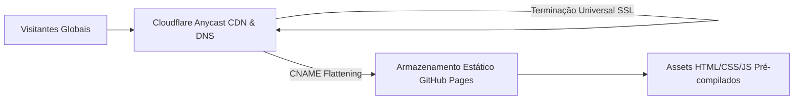

Hospedar um blog de engenharia no GitHub Pages sob o endereço `usuario.github.io/projeto` é uma das formas mais práticas de começar. Contudo, quando a sua audiência cresce e você busca monetização profissional, depara-se com um bloqueio rígido: **o Google AdSense proíbe expressamente subdomínios gratuitos como `*.github.io`**. Para obter aprovação e construir autoridade duradoura de marca, um domínio próprio apex é obrigatório.

Migrar um site estático para um domínio customizado envolve muito mais do que cadastrar um registro de DNS: requer delegação de nameservers, terminação de certificados SSL na edge, redirecionamentos canônicos, entrega automática de `ads.txt` e indexação simultânea no Google, Bing e Naver.

Neste guia, documentamos a migração com zero downtime de `jbjihwan.github.io/global_blog` para `https://globaldevlog.com`.

{/* truncate */}

---

### 1. Visão Geral da Arquitetura em Três Camadas

1. **Registrador de Domínio (Porkbun)**: Gerencia o registro do domínio e delega os nameservers integralmente para a Cloudflare.
2. **DNS & Segurança de Borda (Cloudflare Anycast DNS)**:
   - **CNAME Flattening**: Permite mapear o domínio raiz apex (`globaldevlog.com`) diretamente para o GitHub Pages sem necessidade de registros A estáticos.
   - **Universal SSL**: Provê criptografia HTTPS de ponta a ponta na edge e força o redirecionamento de HTTP para HTTPS.
3. **Plataforma de Hospedagem (GitHub Pages)**: Distribui os arquivos estáticos gerados pelo Docusaurus globalmente.

---

### 2. Indexação SEO em Múltiplos Mecanismos de Busca

Ao submeter o domínio em ferramentas de webmaster internacionais e regionais, erros típicos podem ocorrer:

| Mecanismo de Busca | Erro Frequente | Causa Raiz & Solução |
| :--- | :--- | :--- |
| **Google Search Console** | "Não foi possível ler o sitemap" | O Docusaurus gera `/sitemap.xml` por padrão. Ao trocar de domínio, remova a propriedade antiga e valide via registro TXT no DNS. |
| **Naver Search Advisor** | "URL de host incompatível" | O Naver exige correspondência exata entre o RSS e o domínio cadastrado (atenção a barras finais `/`). |
| **Bing Webmaster Tools** | Indexação lenta | Importe as configurações diretamente via OAuth2 do Google Search Console para indexação em minutos. |

---

### 📌 Resumo Executivo para Gestão (3–5 Linhas)
1. **Domínio Próprio É Obrigatório**: O Google AdSense rejeita subdomínios gratuitos; um domínio apex é indispensável para aprovação.
2. **Vantagem de Porkbun + Cloudflare**: CNAME Flattening e SSL Universal garantem migração sem nenhuma queda de serviço.
3. **SEO Multi-Mecanismos**: Cadastre sitemaps e feeds RSS no Google, Bing e Naver simultaneamente.
4. **Redirecionamento Canônico**: Force HTTPS e encaminhe tráfego `www` para o apex de forma consistente.
