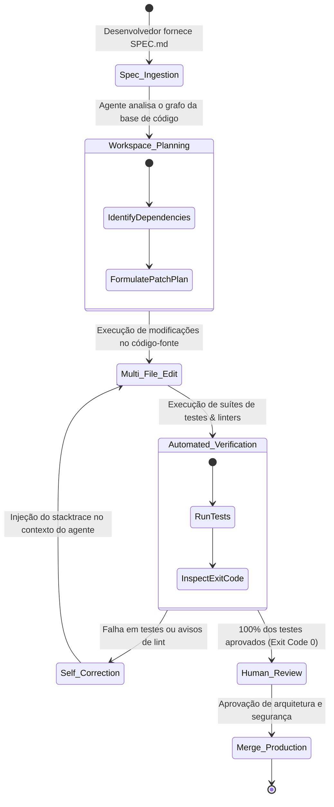
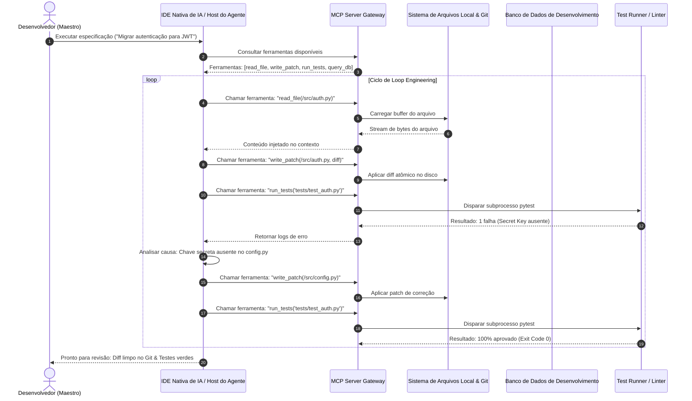

Bem-vindo à análise técnica aprofundada da série de palestras **CS146S: The Modern Software Developer da Universidade de Stanford**.

Durante as últimas cinco décadas, a educação em ciência da computação treinou desenvolvedores para serem essencialmente digitadores de sintaxe meticulosos: memorizar estruturas de linguagens, escrever algoritmos manualmente e produzir milhares de linhas de código boilerplate. Hoje, a indústria de software vivencia a transformação mais radical desde a invenção do compilador: a transição da **programação manual** para a **Engenharia Humano-Agente (Human-Agent Engineering)**.

Nesta aula inaugural, analisamos como empresas líderes em tecnologia (Google, Meta, OpenAI) redefinem a produtividade dos desenvolvedores, por que o engenheiro evolui de digitador de código para maestro de orquestra e como o **Desenvolvimento Orientado por Especificação (Spec-Driven Development - SDD)**, os **Fluxos Agênticos (Agentic Workflows)** e o **Model Context Protocol (MCP)** formam as ferramentas indispensáveis da engenharia moderna.

{/* truncate */}

---

### 1. A Mudança de Paradigma: De Digitador de Sintaxe a Maestro de Sistemas

Nos fluxos tradicionais de desenvolvimento de software, o principal gargalo sempre foi a taxa de digitação humana no teclado e a recuperação cognitiva de regras de sintaxe. Um engenheiro projeta uma arquitetura mentalmente, traduz essa lógica para tokens de linguagem específicos (Java, TypeScript, Python) e consome 70% do seu tempo de trabalho em tarefas repetitivas: declaração de interfaces, controladores REST, testes CRUD e depuração de erros sintáticos.

Com o advento dos modelos de raciocínio lógico e dos agentes de programação autônomos (Claude Code, Cursor, GitHub Copilot Workspace), o custo marginal de geração de código sintaticamente correto caiu praticamente a zero.

```mermaid
flowchart TD
    subgraph Traditional_Workflow ["Paradigma Tradicional: Desenvolvedor como Digitador"]
        A1[Ideia de Arquitetura Humana] -->|Digitação Manual 70% do Tempo| B1[Sintaxe Boilerplate & Interfaces]
        B1 -->|Escrita Manual de Testes Unitários| C1[Compilação Local & Debugging]
        C1 -->|Velocidade Linear Lenta| D1[Entrega de Recursos Isolados]
    end

    subgraph Modern_Agentic_Workflow ["Paradigma Stanford CS146S: Desenvolvedor como Maestro"]
        A2[Arquiteto Humano: Especificação & Invariantes] ==>|SPEC.md Preciso| B2[Equipe de Agentes de IA Autônomos]
        B2 -->|Edição Multi-Arquivo via MCP| C2[Loop Engineering Automatizado: Testes & Self-Heal]
        C2 -->|Feedback Contínuo| B2
        C2 ==>|Base de Código Verificada| D2[Revisão Humana de Arquitetura & Segurança]
        D2 ==>|Escala e Velocidade 10x Superior| E2[Deploy em Produção]
    end
```



Os desenvolvedores modernos não são mais avaliados pela quantidade de linhas de código (LOC - Lines of Code) geradas por dia. Em vez disso, atuam como **Líderes Técnicos (Engineering Managers) liderando uma equipe de agentes autônomos de IA**. Quando um líder técnico delega tarefas a engenheiros juniores, ele não dita cada tecla pressionada, mas elabora especificações inequívocas, delimita fronteiras de sistema e define critérios determinísticos de aceitação.

---

### 2. Desenvolvimento Orientado por Especificação (SDD): "O Que" antes de "Como"

A metodologia central promovida pelo curso Stanford CS146S é o **Spec-Driven Development (SDD)**. Em abordagens ingênuas com IA, os desenvolvedores frequentemente interagem por prompts de chat vagos como: *"Você pode criar um sistema de autenticação de usuários?"*

Essa abordagem resulta invariavelmente em desvios de arquitetura, alucinações de código e falta de tratamento para casos de borda. No SDD, a principal entrega de engenharia não é o código-fonte bruto gerado, mas um **Documento de Especificação Formal (`SPEC.md`)** interpretável por máquinas.

```markdown
# Modelo de Especificação Técnica de Engenharia (SPEC.md)

## 1. Contexto & Domínio de Negócio
- Implementar processamento idempotente de webhooks de pagamento da API Stripe v2024-06.
- Banco de Dados: PostgreSQL 16 com Row-Level Security (RLS) habilitado.

## 2. Invariantes & Restrições Inegociáveis
- Todas as mutações no banco de dados DEVEM ocorrer dentro de uma transação ACID explícita.
- A validação de assinatura de webhook (HMAC-SHA256) DEVE falhar antes de qualquer análise do payload (Fail-Closed).
- Restrição de latência: tempo de resposta no percentil P99 < 80 ms.

## 3. Interfaces & Esquemas
- Entrada: `POST /api/v1/payments/webhook` recebendo buffer de payload bruto da requisição.
- Eventos suportados: `payment_intent.succeeded`, `payment_intent.payment_failed`.

## 4. Requisitos de Verificação & Testes
- Cobertura de testes unitários > 95% para reversões de transações com IDs de evento duplicados.
- Teste de concorrência: 50 webhooks duplicados concorrentes devem gerar exatamente 1 registro no banco.
```

Ao investir esforço cognitivo profundo na elaboração da especificação, os desenvolvedores estabelecem barreiras de proteção inquebráveis. O agente de IA obtém total autonomia sobre o *"Como"* (síntese e implementação do código), enquanto o ser humano mantém controle absoluto sobre o *"O Que"* e o *"Por Quê"*.

---

### 3. Fluxos Agênticos & Engenharia de Loops Automatizados (Loop Engineering)

Outro pilar estrutural da Aula 1 é o **Loop Engineering**. Modelos fundamentais são sistemas probabilísticos; esperar que um LLM produza um sistema distribuído complexo sem nenhum erro em uma única tentativa é matematicamente irreal.

A engenharia de software moderna estrutura o trabalho do agente em um ciclo autônomo fechado de autorrecuperação:



#### As Quatro Fases do Loop Autônomo:
1. **Planejamento (Workspace Discovery)**: O agente navega pelo grafo de arquivos e analisa contratos de interface existentes.
2. **Execução (Multi-File Transformation)**: O agente aplica diffs atômicos sincronizados em arquivos de cliente, servidor e migrações de banco de dados.
3. **Verificação (Feedback Determinístico)**: O agente executa autonomamente testes (`pytest`, `vitest`, `cargo test`) e validadores de tipos.
4. **Autorrecuperação (Loop Iteration)**: Se uma asserção falhar, o agente analisa o rastreamento do erro e ajusta iterativamente o código até obter sucesso.

---

### 4. Model Context Protocol (MCP): O Protocolo Universal de Ferramentas

Como um modelo de IA sai da sandbox isolada e manipula ferramentas reais de desenvolvimento? A resposta é o **Model Context Protocol (MCP)**, o padrão aberto da indústria criado para integração segura de ferramentas.



---

### 5. Comparativo Arquitetural: Digitador vs. Maestro de IA

| Dimensão | Paradigma Tradicional (Digitador de Código) | Paradigma Stanford CS146S (Maestro de IA) |
| :--- | :--- | :--- |
| **Habilidade Primária** | Sintaxe de linguagem, velocidade de digitação | Arquitetura de sistemas, modelagem de especificações |
| **Unidade de Trabalho** | Funções, linhas de código individuais, arquivos | Especificações completas, invariantes, contratos de teste |
| **Ferramentas** | Editores de texto passivos, depuradores manuais | Agentes autônomos (Claude Code, Cursor), servidores MCP |
| **Principal Gargalo** | Fadiga cognitiva, tarefas repetitivas de boilerplate | Especificações ambíguas, suítes de testes incompletas |
| **Verificação** | Passo a passo manual no depurador, console.log | Suítes de testes determinísticas, fuzzing de invariantes |
| **Padrão de Erro** | Erros de sintaxe, ponto e vírgula ausente, off-by-one | Alucinação semântica, vulnerabilidades sutis de arquitetura |

---

### 6. Por Que os Fundamentos de Computação São Mais Cruciais do Que Nunca

Durante a aula em Stanford, os estudantes levantaram uma questão frequente:

> **Pergunta: Se os agentes de IA podem escrever 80% do nosso código em segundos, ainda precisamos estudar algoritmos, gerenciamento de memória e estruturas de dados?**

A resposta dos professores foi categórica: **Os fundamentos da ciência da computação são hoje mais vitais do que há dez anos.**

1. **O Peso da Revisão (Reviewer's Burden)**: A IA gera mil linhas de código plausível em 15 segundos. Identificar um vazamento de conexões de banco de dados, uma complexidade de tempo $O(N^2)$ oculta ou uma condição de corrida exige **compreensão profunda de sistemas**.
2. **A Responsabilidade É 100% Humana**: Um agente de IA não responde legal nem profissionalmente por falhas em produção. A responsabilidade reside inteiramente no engenheiro que aprova o Pull Request.
3. **Depuração de Casos de Borda**: Quando um agente entra em loop, somente engenheiros com conhecimento sólido de redes, sistemas operacionais e hardware conseguem diagnosticar a falha raiz.

---

### 7. Conclusão & Resumo Executivo

1. **Redefina Sua Identidade**: Posicione-se como arquiteto de sistemas, designer de especificações e líder de agentes.
2. **Domine o Spec-Driven Development**: O arquivo `SPEC.md` é o seu ativo de engenharia mais valioso.
3. **Implemente Loop Engineering**: Crie loops fechados de feedback com testes determinísticos automatizados.

Na **Aula 2**, analisaremos **Context Management & Arquitetura de Prompts**: Como estruturar janelas de contexto, utilizar mapas de repositório e prevenir degradação por sobrecarga.

---

### 📌 Resumo Executivo para Gestão (3–5 Linhas)
1. **Transição de Paradigma**: Desenvolvedores de software evoluem de digitadores manuais de sintaxe para maestros de equipes autônomas de agentes de IA.
2. **Spec-Driven Development (SDD)**: A engenharia de alto nível foca em invariantes e especificações formais legíveis por máquina (`SPEC.md`).
3. **Loop Engineering & MCP**: A autonomia produtiva da IA depende de loops iterativos de testes e da integração segura de ferramentas via Model Context Protocol.
4. **O Peso da Revisão**: Com custo marginal zero para geração de código, o domínio de fundamentos de computação torna-se o verdadeiro diferencial na auditoria de segurança.

### Referências & Materiais de Apoio
- **Playlist Oficial do Curso**: [Stanford CS146S: The Modern Software Development (YouTube Playlist)](https://www.youtube.com/playlist?list=PLxpwjSdVZQ95OWe3QvkVEcU1f1X-6NDj9)
- **Instituição**: Universidade de Stanford, Departamento de Ciência da Computação
