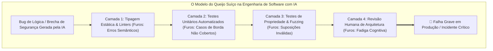

Bem-vindo de volta à análise técnica da série de palestras **CS146S: The Modern Software Developer da Universidade de Stanford**.

Na Aula 1, estabelecemos a mudança de paradigma do digitador de código para o maestro de sistemas. Na **Aula 2 (Semana 1)**, o currículo aprofunda-se no motor computacional desta revolução: **os grandes modelos de linguagem especializados em código (Coding LLMs)** e a disciplina rigorosa da **Engenharia de Prompt**.

Com base em trabalhos seminais de Andrej Karpathy (*Deep Dive into LLMs*), OpenAI (*How OpenAI Uses Codex*) e pesquisas recentes em IA agêntica, esta aula disseca como redes neurais adquirem capacidades de programação, por que continuam sendo simuladores estatísticos e como engenheiros de software devem aplicar o princípio **"Confie, mas Verifique (Trust but Verify)"** para blindar o perigoso **Modelo do Queijo Suíço** em bases de código geradas por IA.

{/* truncate */}

---

### 1. A Anatomia de um LLM: O Pipeline de Treinamento em Três Estágios

Para direcionar e depurar um assistente de IA com precisão, o engenheiro deve compreender a origem de seus pesos neurais. Conforme demonstrado por Andrej Karpathy, LLMs modernos não são bases de regras estáticas, mas o resultado de um **pipeline de treinamento em três estágios**:

```mermaid
flowchart LR
    subgraph Stage1 ["Estágio 1: Pré-treinamento (Não-Supervisionado)"]
        D1[Trilhões de Tokens da Web & GitHub] --> N1[Modelo Base Transformer<br/>Probabilidade Next-Token P(w_t | Contexto)]
    end

    subgraph Stage2 ["Estágio 2: Supervised Fine-Tuning (SFT)"]
        N1 --> D2[Pares de Instrução de Alta Qualidade<br/>Prompt & Resposta Padrão Ouro]
        D2 --> N2[Assistente Otimizado para Instruções<br/>Protocolo de Conversação]
    end

    subgraph Stage3 ["Estágio 3: RLHF & Alinhamento"]
        N2 --> D3[Ranqueamento de Preferência Humana<br/>Pontuação por Modelo de Recompensa]
        D3 --> N3[LLM de Código Pronto para Produção<br/>Seguro, Direcionado & Determinístico]
    end
```

#### Estágio 1: Pré-treinamento (Pre-training)
O modelo processa trilhões de tokens de texto e código-fonte bruto (GitHub, StackOverflow, documentações). Seu único objetivo matemático é prever o próximo token mais provável `P(w_t | w_{<t})`. O modelo aprende gramática, sintaxe de linguagens, paradigmas de programação e padrões de design, mas comporta-se como um gerador estatístico de complementação de texto.

#### Estágio 2: Ajuste Fino Supervisionado (Supervised Fine-Tuning - SFT)
Engenheiros humanos alimentam o modelo com milhares de pares estruturados de instrução e resposta ideal. O modelo aprende a persona de um assistente de programação: como explicar conceitos, estruturar blocos de código em markdown e recusar requisições malformadas.

#### Estágio 3: Aprendizado por Reforço com Feedback Humano (RLHF)
Avaliadores comparam múltiplas respostas geradas pelo modelo e as ranqueiam por utilidade, concisão e segurança. Um **Modelo de Recompensa (Reward Model)** é treinado para pontuar essas preferências, ajustando os pesos finais via otimização por política proximal (PPO).

---

### 2. O Perigo da Ilusão Antropomórfica: LLMs São Simuladores

Um erro conceitual frequente entre desenvolvedores novatos é atribuir consciência ou raciocínio humano aos modelos. LLMs não possuem um modelo mental do mundo nem memória volátil persistente durante o processamento de um token.

Eles operam como **simuladores estocásticos**: dado um prompt, o modelo simula como um desenvolvedor competente na internet responderia àquela sequência de caracteres. Se o prompt for vago, preguiçoso ou tecnicamente inconsistente, o simulador reflete exatamente esse nível de mediocridade estatística na resposta.

---

### 3. Técnicas Avançadas de Engenharia de Prompt

Para extrair desempenho de nível sênior de um modelo de linguagem, o engenheiro de software deve aplicar padrões rigorosos de injeção de contexto e raciocínio estruturado:

#### A. Chain-of-Thought (CoT) & Raciocínio Passo a Passo
Forçar o modelo a verbalizar seu raciocínio antes de gerar o código final reduz drasticamente erros de lógica. Ao emitir tokens intermediários de reflexão, o modelo utiliza o próprio histórico gerado como contexto adicional para condicionar as decisões subsequentes:

```markdown
Antes de implementar a função de ordenação concorrente:
1. Identifique as condições de corrida em potencial nas operações de escrita.
2. Defina os primitivos de sincronização (Mutex vs. Canais Atômicos).
3. Somente após detalhar os invariantes, escreva o código Go correspondente.
```

#### B. Few-Shot In-Context Learning
Fornecer 1 a 3 exemplos concisos de pares de entrada e saída esperados no mesmo formato estilístico do repositório elimina variações indesejadas de formatação e alinha o estilo do código às convenções internas da equipe.

#### C. Delimitação de Restrições Negativas
Instruções afirmativas são prioritárias, mas explicitar restrições negativas inegociáveis previne antipadrões conhecidos:
- *"NÃO utilize dependências externas além da biblioteca padrão do Python."*
- *"NÃO capture exceções genéricas (`except Exception:`); declare exceções tipadas explícitas."*

---

### 4. O Modelo do Queijo Suíço na Segurança de Código com IA

A analogia mais poderosa da Aula 2 é o **Modelo do Queijo Suíço (Swiss Cheese Model)** aplicado ao código gerado por agentes de IA.



Em qualquer sistema de engenharia complexo, cada barreira de verificação possui "furos" (imperfeições):
- O compilador não detecta vulnerabilidades de SQL injection em queries construídas dinamicamente.
- Testes unitários com mocks imperfeitos validam premissas incorretas.
- O revisor humano, sofrendo de fadiga cognitiva ao inspecionar diffs de 500 linhas, presume que o código funciona porque os testes passaram.

Quando os furos de todas as fatias de queijo se alinham simultaneamente, o bug gerado pela IA atravessa todas as defesas e atinge a produção. A solução é o princípio **"Trust but Verify"**: tratar todo código gerado por IA como o trabalho de um estagiário brilhante, porém potencialmente distraído, que necessita de barreiras determinísticas rigorosas.

---

### 5. Resumo Executivo & Conclusões

1. **Modelos São Simuladores**: A qualidade do código produzido é proporcional à precisão das restrições e dos exemplos fornecidos no prompt.
2. **Chain-of-Thought É Essencial**: Exija que a IA justifique o plano arquitetural antes de sintetizar blocos de código.
3. **Blinde o Queijo Suíço**: Sobreponha múltiplos níveis de verificação (tipagem estática, testes de propriedade, guardrails de segurança e revisão humana).

### Referências
- **Andrej Karpathy**: *Deep Dive into LLMs* (Stanford Lecture Notes)
- **OpenAI Research**: *Evaluating Large Language Models Trained on Code (Codex Paper)*
