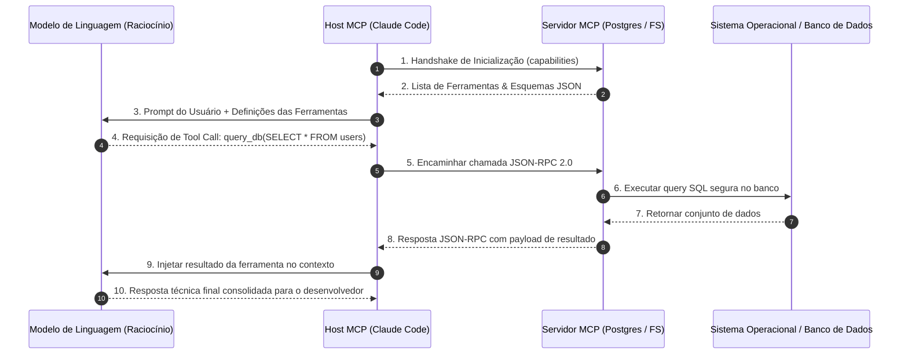

Bem-vindo à análise técnica da **Aula 3 da série CS146S: The Modern Software Developer da Universidade de Stanford**.

Nas duas primeiras aulas, cobrimos a transição de mentalidade para maestro de IA e os mecanismos computacionais internos de Coding LLMs. Na **Aula 3**, o curso foca na infraestrutura que confere aos modelos de linguagem a capacidade de agir no mundo real: **o Model Context Protocol (MCP)** e o mecanismo de **Tool Calling (Uso Autônomo de Ferramentas)**.

Sem integração com ferramentas externas, um LLM é como um cérebro brilhante preso dentro de um jarro de vidro: ele conhece algoritmos avançados, mas não consegue inspecionar o seu repositório local, ler os esquemas do PostgreSQL em produção nem rodar uma suíte de testes. O MCP, introduzido pela Anthropic e rapidamente adotado como padrão aberto pela indústria, estabelece o protocolo de comunicação universal que conecta hosts de IA a servidores locais e remotos de ferramentas.

{/* truncate */}

---

### 1. A Crise de Integração N-para-M e a Necessidade do MCP

Antes do MCP, integrar ferramentas a assistentes de IA sofria do clássico problema de fragmentação de ecossistemas:

```mermaid
flowchart TD
    subgraph Problem ["Antes do MCP: Fragmentação M x N (Spaghetti)"]
        A1[Claude Code] --> F1[Plugins Proprietários VS Code]
        A2[Cursor IDE] --> F2[Scripts Shell Ad-Hoc]
        A3[GitHub Copilot] --> F3[Extensões Fechadas de API]
        A4[Agente Customizado] --> F4[Conectores de Banco Próprios]
    end

    subgraph Solution ["Depois do MCP: Protocolo Universal Padronizado"]
        H1[Claude Desktop] --> GW[Padrão Aberto MCP (JSON-RPC 2.0)]
        H2[Cursor / Windsurf] --> GW
        H3[Claude Code CLI] --> GW
        
        GW --> S1[MCP Server: PostgreSQL]
        GW --> S2[MCP Server: Filesystem & Git]
        GW --> S3[MCP Server: GitHub API]
        GW --> S4[MCP Server: Browser Automation]
    end
```

Se existissem $N$ interfaces de IA e $M$ ferramentas de desenvolvedor, o ecossistema exigia $N 	imes M$ implementações de conectores incompatíveis entre si. O MCP resolveu esse desafio ao criar uma camada de abstração desacoplada: qualquer cliente compatível com MCP pode consumir qualquer servidor MCP universal instantaneamente.

---

### 2. A Arquitetura MCP em Três Camadas

O ecossistema MCP opera sob um modelo cliente-servidor estrito composto por três entidades:

1. **Host MCP**: A aplicação com a qual o usuário interage diretamente (ex.: Claude Code CLI, Cursor, Claude Desktop). O Host gerencia a interface, mantém a janela de contexto e coordena a orquestração do LLM.
2. **Cliente MCP (MCP Client)**: O módulo interno dentro do Host responsável por estabelecer conexões um-para-um com cada Servidor MCP, negociar capacidades de protocolo e formatar requisições.
3. **Servidor MCP (MCP Server)**: Um processo autônomo e seguro que expõe recursos específicos (leitura de arquivos, execução de testes, consultas SQL) através da interface padronizada do MCP.



---

### 3. Camadas de Transporte: Stdio vs. HTTP com Server-Sent Events (SSE)

O MCP suporta dois mecanismos de transporte fundamentais para acomodar diferentes topologias de rede e segurança:

| Mecanismo de Transporte | Casos de Uso Primários | Características de Latência & Segurança |
| :--- | :--- | :--- |
| **Stdio (Standard I/O)** | Ferramentas locais no mesmo computador (CLI, leitura de arquivos, Git) | Latência em microssegundos; processo isolado via subprocesso do SO; zero exposição de portas de rede |
| **HTTP com SSE (Server-Sent Events)** | Servidores remotos corporativos, microserviços na nuvem, gateways de APIs | Conexão autenticada via OAuth2/Bearer Tokens; streaming assíncrono de eventos e resultados longos |

---

### 4. Ciclo de Vida de Execução de Ferramentas (Tool Calling Loop)

A interação entre o modelo e as ferramentas obedece a uma máquina de estados rigorosa:

1. **Descoberta de Ferramentas (Tool Discovery)**: Durante a inicialização, o Host envia `tools/list` ao Servidor MCP, recebendo a especificação em JSON Schema de todas as ferramentas disponíveis (nome, descrição e parâmetros validados).
2. **Decisão do Modelo (Tool Use Trigger)**: Quando a requisição do usuário demanda dados externos, o modelo emite um bloco estruturado de invocação de ferramenta (`tool_use`) contendo os argumentos calculados.
3. **Execução Segura & Confirmação Humana (Human-in-the-Loop)**: O Host pode solicitar confirmação explícita do desenvolvedor para operações destrutivas (ex.: deleção de arquivos ou migrações de banco).
4. **Alimentação do Resultado (Tool Result Feedback)**: O resultado da execução é devolvido ao modelo como uma mensagem de papel `user` contendo o `tool_result`, permitindo ao modelo prosseguir com a síntese lógica.

---

### 5. Resumo Executivo & Conclusões

1. **MCP É o Padrão da Indústria**: Desacopla clientes de IA dos provedores de ferramentas, unificando a integração de desenvolvedores sob o protocolo JSON-RPC 2.0.
2. **Ambientes Seguros e Auditáveis**: O transporte Stdio garante isolamento local em subprocessos, enquanto a supervisão humana previne mutações acidentais em produção.
3. **Transformação de LLMs em Agentes**: Ao conectar o modelo ao sistema de arquivos e a ferramentas determinísticas de teste, o MCP viabiliza a execução de fluxos completos de engenharia de software autônoma.

### Referências
- **Anthropic**: *Model Context Protocol (MCP) Specification & Open Standard*
- **Stanford CS146S**: *Course Syllabus & Tool Calling Architecture*